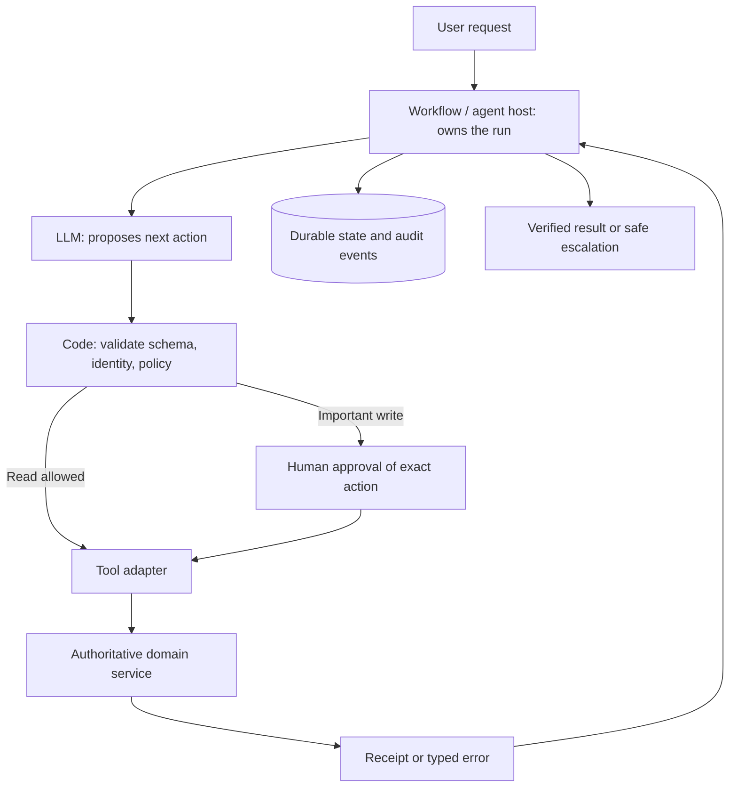
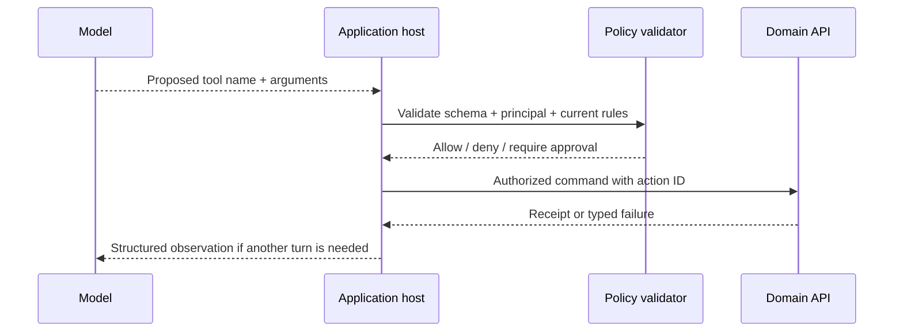
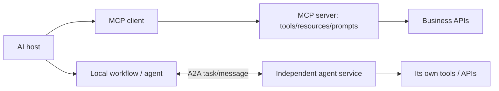

# Agentic AI & Workflow Engineering

> **Learning-first edition · Basic → Advanced → Production · 23 November 2026**  
> Source: the user's 120-question interview guide. **No RAG or vector-search topics.**  
> This edition removes repeated prompts, introduces concepts before technical detail, and keeps original Q IDs for traceability.

## Navigation

- **Start with:** [Mental model and booking walkthrough](#the-one-diagram-to-remember)
- **Fundamentals:** [01 · Agent concepts](#01--foundations-what-an-agent-really-is), [02 · Tool calling](#02--tool-calling-from-proposed-function-to-trusted-action), [03 · Agent patterns](#03--execution-patterns-loops-planning-and-orchestration)
- **Systems:** [04 · State](#04--state-memory-and-durable-progress), [05 · Framework choices](#05--frameworks-and-durable-engines), [06 · MCP & A2A](#06--mcp--a2a-integration-boundaries-not-magic)
- **Production:** [07 · Collaboration and approval](#07--multi-agent-collaboration-and-human-approval), [08 · Reliability](#08--reliability-and-observability-in-production), [09 · Design cases](#09--five-complete-system-design-walkthroughs), [10 · Fast reference](#10--fast-reference-choose-the-simplest-architecture)

## How to study without getting lost

Start here even if you already build distributed systems: the confusing part is **who makes decisions** and **who has permission to perform real effects**. Learn one concept, follow the example, then explain the answer in your own words.

| Pass | What to do | Outcome |
|---|---|---|
| **1 · Understand** | Read the visual model and worked scheduling example | Explain *model vs host vs workflow vs tool* |
| **2 · Build** | Read chapters 01–04 and sketch a bounded tool loop | Explain state, failures and action approval |
| **3 · Integrate** | Read chapters 05–07 | Choose frameworks; explain MCP, A2A, multi-agent |
| **4 · Produce** | Read chapter 08 and solve the five design cases | Defend crash recovery, correctness and rollout |

### The one diagram to remember



**One-sentence rule:** *The LLM can propose. The host controls execution. The domain system confirms what actually happened.*

### Six terms that people often mix up

| Term | Plain explanation | Example |
|---|---|---|
| **LLM** | Produces text or a structured action proposal | "Check calendar first" |
| **Agent** | Uses feedback to choose some next actions | Checks slots, then asks for a preference |
| **Workflow** | Owns stages, deadlines, rules and transitions | `PROPOSED → APPROVED → COMMITTED` |
| **Tool** | A named way to invoke a capability | `listSlots`, `createEvent` |
| **MCP** | Standard interface between an AI host and capability servers | Host ↔ calendar MCP server |
| **A2A** | Standard interface between independently operated agent services | Scheduling agent ↔ external travel agent |

### Worked example: "Book a meeting tomorrow afternoon"

1. **User intent:** "Tomorrow afternoon" is ambiguous until timezone, attendees and availability are known.
2. **LLM proposes:** `getFreeBusy(attendees, dateRange)` with structured arguments.
3. **Host validates:** authenticated identity, permitted calendars, schema, tool budget.
4. **Domain API reads:** calendars return candidate slots. The model may summarize them, but code checks overlaps and policy.
5. **Human confirms:** the **exact** date, time, attendees and meeting purpose.
6. **Host commits:** create event with a stable logical command ID, if provider semantics support safe deduplication.
7. **If timeout:** mark outcome **unknown**; check the external calendar before retrying.
8. **Finish only after evidence:** show the actual event ID or explain that confirmation remains unresolved.

The important distinction: understanding natural language benefits from an LLM; **access control, approval, conflict rules, state recovery and the final write do not belong to free-form model judgment**.

### What makes a good interview answer?

Use a compact pattern: **definition → real example → why it matters in production → limitation**. You should be able to answer a basic question in 20–30 seconds and expand it into a trade-off discussion when asked.

---


# 01 · Foundations: what an agent really is

**After this chapter:** Can explain the difference between one LLM call, a fixed workflow, and a bounded decision loop.

**Mental model:** No action loop is required for a normal LLM response. A workflow has a coded path; an agent can choose a next action within host-defined limits.


### 01. What is an AI agent, technically, and why isn't any LLM chatbot an agent?  
*From original Q001*

**Core idea:** An **agent** is a software system that can choose its next action using feedback, not just produce a single text answer.


**How it works:** For LLM agents, the **model proposes** the next step and the **host executes permitted steps**. Definitions vary: a one-step tool-using assistant may also be called an agent; state your definition.


**Practical notes:**

- **Mechanics:** objective → observation → policy/model choice → action → new observation → terminal condition.
- **Trade-off:** the more actions and autonomy permitted, the more explicit controls and tests are needed.
- **Mistake:** calling every prompt chain a fully autonomous agent.


### 02. LLM application versus deterministic workflow versus agent: where is the boundary?  
*From original Q002*

**Core idea:** In a **fixed workflow**, application code decides the next step.


**How it works:** In an **agentic loop**, a model can choose among permitted next actions. A **hybrid** uses an LLM only where flexibility is needed and deterministic code for business decisions. Pick the simplest system that solves the task.


**Practical notes:**

- **Key test:** who chooses the next transition—source code or a model?
- **Mistake:** confusing probabilistic content generation with nondeterministic orchestration.


### 03. What are autonomy levels and how do you choose one?  
*From original Q003*

**Core idea:** Autonomy means **how much of the task the model can decide and act on**.


**How it works:** It is not a standardized level scale. Start with suggestions or read-only actions; add write permissions only when evidence, guardrails and impact justify them. Enforce budgets and privileges in code, not prompts.


**Practical notes:**

- **Production rule:** promote autonomy only after task-specific evidence and auditing; do not grant a tool solely because the model is 'smart enough.'
- **Trade-off:** lower autonomy increases human effort but limits surprise effects.


### 04. What is decision-making in an agent, and what is still deterministic?  
*From original Q004*

**Core idea:** Decision-making means the model selects among *authorized choices*: call `checkAvailability`, ask for missing timezone, or produce a summary.


**How it works:** Deterministic code defines the **action catalog**, checks preconditions, validates arguments, enforces budgets, persists transitions, and invokes the actual API. Even when the model returns syntactically valid JSON, domain rules remain application-owned.


**Practical notes:**

- **Example:** the model may select `bookSlot`; code rejects a slot outside clinic opening hours or a booking with an obsolete quote.
- **Mistake:** writing 'the agent checks permissions' in a prompt and omitting checks in the execution boundary.


### 05. What is planning, and should an agent always construct a plan first?  
*From original Q005*

**Core idea:** Planning decomposes an objective into potential steps with dependencies and success criteria.


**How it works:** It can be **implicit** (next tool call), **explicit** (task list or DAG), or **periodically revised**. A short deterministic process rarely needs an LLM-generated plan. A changing software-maintenance objective may benefit from an explicit plan with bounded milestones and verification. A plan is **advisory state**, not authority: each step is validated against current conditions.


**Practical notes:**

- **Failure mode:** a generated plan becomes stale after a tool result; therefore plans require revision points and a hard stop.
- **Trade-off:** planning adds tokens and latency but may reduce wandering on complex tasks.


### 06. What capabilities are necessary to claim an agent can complete tasks?  
*From original Q006*

**Core idea:** Define a task contract: valid inputs, accessible tools, accepted actions, terminal outcomes, and escalation rules.


**How it works:** Completion requires more than a fluent final answer: the requested effect must be verifiably achieved or explicitly declined. For a schedule-change task, success is a confirmed updated event ID, not the phrase 'Your event was moved.'


**Practical notes:**

- **Production controls:** idempotency, structured observations, outcome verification, and an authoritative system of record.
- **Mistake:** measuring completion by the model's self-report alone.


### 07. What are the main limitations of LLM-controlled agents?  
*From original Q007*

**Core idea:** They can select wrong tools, hallucinate arguments, lose track of prior constraints, repeat actions, misinterpret tool errors, and prematurely announce success.


**How it works:** More context or longer thought does not guarantee correctness. The runtime must defend against malformed requests, conflicting instructions, non-repeatable actions, tool latency, and budget exhaustion.


**Practical notes:**

- **Alternative:** use a classifier or deterministic decision table for a narrow task with stable rules.
- **Mistake:** assuming a second model call will always correct the first.


### 08. Is 'reasoning' in model output the same as reliable logical execution?  
*From original Q009*

**Core idea:** A convincing model explanation is **not** a proof of what occurred.


**How it works:** Keep the real evidence in application logs: tool selected, validated arguments, approval, downstream response, state change and receipt. Provider-private reasoning is not an audit log.


**Practical notes:**

- **Mistake:** treating a convincing chain-of-thought-like explanation as proof of business correctness.


### 09. How do you decide whether to ask the user a question or invoke a tool?  
*From original Q010*

**Core idea:** Identify required data and whether the tool can safely derive it.


**How it works:** If a user says 'move tomorrow's visit' but has multiple matching visits, ask which one before writing. If a deterministic tool can list candidate visits, invoke read-only lookup first. Preserve known context and ask only for the unresolved independent field.


**Practical notes:**

- **Pattern:** precondition validator outputs `READY`, `NEEDS_INPUT`, `NEEDS_APPROVAL`, or `REJECTED`. The model may draft the question, but code classifies sensitive or required preconditions.
- **Mistake:** letting the agent fill missing values by guessing.


### 10. What is the difference between observation, tool result, and authoritative state?  
*From original Q011*

**Core idea:** An **observation** is what the agent sees after an action: an API response, error, or external event.


**How it works:** A **tool result** is the structured output returned by an adapter and may be stale, partial, or misleading. **Authoritative state** is the source-of-truth domain record or verified external commit. Example: a payment API timeout is not proof that a payment failed; the agent needs an idempotency key and status reconciliation.


**Practical notes:**

- **Mistake:** equating 'no successful response' with 'no external side effect.'


**Checkpoint for yourself:** Explain this chapter using one concrete business example without relying on agent-framework names.

---


# 02 · Tool calling: from proposed function to trusted action

**After this chapter:** Can describe model ↔ host ↔ validated tool, including schema limits, access control, parallel calls and errors.

**Mental model:** A proposed tool call is *data*. A tool execution is an *authorized application operation*. Never confuse them.





### 11. What happens during function/tool calling end to end?  
*From original Q013*

**Core idea:** For an **application-defined function tool**, the model returns a proposed function name and arguments.


**How it works:** The **host** validates and executes it; the model itself does not run that application function. Distinguish this from some **provider-hosted built-in tools**, which the provider operates under its own product/API contract.


**Practical notes:**

- **Boundary:** schema-conformant output is not an authenticated domain command.
- **Mistake:** assuming the inference provider executed your local function merely because the output mentions it. [DOC: OpenAI function calling](https://developers.openai.com/api/docs/guides/function-calling)


### 12. Why distinguish tool-call schema from tool-result schema?  
*From original Q014*

**Core idea:** The **input schema** constrains the arguments the model proposes.


**How it works:** A **result schema** establishes the adapter's observable contract: `status`, `entityId`, `version`, `errorCode`, and whether an external effect was committed. Without a typed result, an agent must parse human prose such as 'probably created,' which breaks recovery logic. Model-compatible tool output may be summarized, but the canonical structured result should remain available to the runtime.


**Practical notes:**

- **Mistake:** returning an entire HTTP response body as free-form text and expecting the model to infer commit status.


### 13. What does JSON Schema guarantee, and what does it not guarantee?  
*From original Q015*

**Core idea:** JSON Schema checks **shape**, not **truth or permission**.


**How it works:** Even strict structured-output modes follow provider-specific supported subsets and error/refusal behavior. Code still verifies that IDs exist, belong to the user and may be changed.


**Practical notes:**

- **Important detail:** strict modes and defaults vary by API; do not generalize one provider's behavior. [DOC: structured outputs](https://developers.openai.com/api/docs/guides/structured-outputs)


### 14. How should a tool registry be designed?  
*From original Q016*

**Core idea:** Store an immutable, versioned registry of `name`, description, input/output contracts, handler, risk category, required permission, timeout, and idempotency behavior.


**How it works:** Publish only tools allowed for the current principal and run stage. Dispatch **by exact allowlisted name**; never turn model output into arbitrary module imports, shell commands, or reflection-based method invocation.


**Practical notes:**

- **Alternative:** a simple map of typed functions is enough for a small service; a separate registry service is justified only when many integrations and tenants need governance.
- **Mistake:** treating a tool description as an enforcement mechanism.


### 15. How do you validate model-generated tool arguments safely?  
*From original Q017*

**Core idea:** Apply a validation pipeline: parse JSON → validate schema → normalize only documented fields → verify principal/tenant ownership → check current business preconditions → classify risk → call the handler.


**How it works:** Reject unknown or forged fields where possible. A model-selected `userId` must not override the authenticated principal. Check values against fresh domain state immediately before commit.


**Practical notes:**

- **Example:** `appointmentId` must belong to the requester and still be cancellable.
- **Mistake:** using Zod/Pydantic alone as if input typing were authorization.


### 16. How should tool descriptions be written for correct selection?  
*From original Q019*

**Core idea:** Describe **when to use**, **when not to use**, argument semantics, effects, prerequisite states, and expected errors.


**How it works:** Prefer narrowly scoped names such as `getAvailableSlots` and `reserveSlot` over a generic `manageScheduling`. Describe differences between superficially similar tools. A description improves model selection but is **not** a trust boundary.


**Practical notes:**

- **Mistake:** putting hidden business policy in natural language instead of implementing it in the handler.


### 17. What is the difference between read-only and side-effecting tools?  
*From original Q020*

**Core idea:** A read-only tool should not change business state (although reads may still incur cost).


**How it works:** A write tool changes external state and may be irreversible. Label tools by **effect class**: pure calculation, read, reversible draft, committed write, or high-impact write. Use a stricter approval and retry policy as effect risk increases. For writes, attach an idempotency key and preserve the canonical commit receipt.


**Practical notes:**

- **Mistake:** assuming HTTP `GET` means a tool is truly side-effect-free, or that a 'draft' operation cannot trigger notifications.


### 18. When should tools execute in parallel?  
*From original Q021*

**Core idea:** Parallelize when calls are independent, operate on disjoint state, and can tolerate non-deterministic completion order.


**How it works:** Example: checking calendars for three participants is safe to fan out; reserving a shared slot should be coordinated and serialized or transactionally guarded. Cap fan-out and model/tool concurrency.


**Practical notes:**

- **Mechanics:** spawn tasks with correlation IDs, collect typed results, apply a deterministic join/reducer, then proceed.
- **Mistake:** parallelizing dependent writes or assuming that faster execution preserves semantics.


### 19. How do you keep tool errors useful without leaking internal details?  
*From original Q022*

**Core idea:** Separate internal diagnostics from the observation supplied to the model.


**How it works:** Return a stable error code, safe explanation, retryability classification, and optionally user-action requirement. Keep stack traces, credentials, and sensitive records in restricted telemetry—not in the prompt. Example: `SLOT_CONFLICT` with a current-slot reference is more useful than a raw database exception.


**Practical notes:**

- **Mistake:** return a long exception message and ask the model to deduce retry semantics.


### 20. What should happen when a model asks for an unavailable tool?  
*From original Q023*

**Core idea:** Reject dispatch, log `UNKNOWN_TOOL` with registry version, and optionally let the model retry **within a bounded repair budget** using the allowed catalog.


**How it works:** If the operation cannot be completed, return a clear limitation or human escalation. Do **not** silently map to a 'similar' privileged tool.


**Practical notes:**

- **Trade-off:** a one-time repair attempt can recover format mistakes; repeated repair loops waste cost and may conceal product gaps.


### 21. How do TypeScript and Python compare for typed tool execution?  
*From original Q024*

**Core idea:** TypeScript with **Zod** is convenient when the host is Node.js and shares schemas with existing services; Python with **Pydantic** gives a similar runtime validation boundary alongside Python-oriented agent tooling.


**How it works:** Neither language makes an LLM deterministic or prevents duplicate effects. Both need explicit authorization, stable tool IDs, idempotency, and structured results. For an existing service-oriented TypeScript organization, favor language consistency unless a Python-only framework or compute dependency changes the economics.


**Practical notes:**

- **Mistake:** comparing frameworks without considering the runtime contract and deployment ownership.


**Checkpoint for yourself:** Explain this chapter using one concrete business example without relying on agent-framework names.

---


# 03 · Execution patterns: loops, planning and orchestration

**After this chapter:** Can choose a small, testable pattern instead of automatically creating a multi-agent system.

**Mental model:** Flexibility belongs where information is ambiguous. Known transitions, policy and final actions belong in code.


### 22. Describe the minimal reasoning–action–observation loop.  
*From original Q025*

**Core idea:** A host prepares the goal and permitted tools, calls the model, inspects whether the response is final or proposes actions, validates any proposed actions, executes them, appends **structured observations**, and repeats until a terminal condition. **Do not confuse** model-generated reasoning text with the host's control loop. Loop invariants should include authenticated principal, bounded step counters, preserved call IDs, and immutable commit receipts. The stop decision should be partly code-owned (limits, approval, policy), even if the model chooses to answer.


**Practical notes:**

- **Failure mode:** appending unbounded raw results increases cost, latency, and confusion. [PATTERN]


### 23. What is ReAct, and is it a required protocol?  
*From original Q026*

**Core idea:** **ReAct** names a reasoning–action–observation research pattern.


**How it works:** It does not require displaying private chain-of-thought, nor is it a network protocol. Structured tool calls can implement the action/observation loop without exposing hidden reasoning.


**Practical notes:**

- **When useful:** tasks whose next step depends on a tool observation.
- **When unnecessary:** a fixed three-stage pipeline.
- **Mistake:** claiming an explicit 'Thought:' field is required for every agent. [PATTERN; source: ReAct paper](https://arxiv.org/abs/2210.03629)


### 24. How are a single-step agent, iterative agent, and planner–executor different?  
*From original Q027*

**Core idea:** A **single-step agent** makes one bounded choice.


**How it works:** An **iterative agent** repeatedly selects the next action based on fresh observations. A **planner–executor** first records a plan, then executes and revises it on triggers. Choose by dependency complexity and uncertainty. Example: route a support issue (single-step); check and clarify appointment details (iterative); coordinate a software change with tests and review (planner–executor).


**Practical notes:**

- **Trade-off:** every extra model-decided transition adds latency, cost, and possible error; explicit plans can also become stale. [PATTERN]


### 25. What exactly should make an agent stop?  
*From original Q028*

**Core idea:** Use **terminal result verified**, **user input required**, **human approval pending**, **declined/forbidden**, **unrecoverable tool error**, **deadline**, **maximum steps/calls/tokens/cost**, and **cancellation** as distinct terminal or suspended states. Do not simply inspect whether the response 'sounds finished.' A booking agent ends successfully only when it has a confirmed booking reference; a draft suggestion may end as `PROPOSED`, not `COMPLETED`.


**Practical notes:**

- **Important:** suspension is nonterminal and requires durable state. [RECOMMENDATION]


### 26. How do you budget steps, tokens, cost and elapsed time?  
*From original Q029*

**Core idea:** Maintain a durable budget record for each run: `remainingModelCalls`, `remainingToolCalls`, `deadline`, and provider-specific usage totals.


**How it works:** Enforce hard caps **before** dispatch and at resume; propagate a remaining deadline to downstream calls. Optionally differentiate read-only and write tools. A rough token estimate is an advisory guard, since final metered usage comes from the provider response. **Do not double-spend budgets** when multiple workers resume the same run: use a versioned state update or lease/fencing.


**Practical notes:**

- **Mistake:** putting '$1 max' in the prompt without application-level metering. [PATTERN]


### 27. What is reflection or self-critique in agents?  
*From original Q030*

**Core idea:** Reflection is a deliberate extra pass where the model critiques or revises a candidate answer or plan, often after a concrete signal that quality is insufficient.


**How it works:** It is **optional and experimental in value**, not an automatic correctness guarantee. Make the critique target a specific contract: missing user fields, invalid function arguments, or failing tests. A code validator or domain verifier is more trustworthy when one exists.


**Practical notes:**

- **Trade-off:** self-critique adds tokens and may repeat the same mistake.
- **Mistake:** recursively adding 'think again' until the budget runs out. [PATTERN]


### 28. How should an agent recover from a failed action without looping forever?  
*From original Q031*

**Core idea:** Classify failures: **invalid arguments** → one schema correction; **business conflict** → reacquire current state/ask user; **transient transport** → application retry with backoff; **unknown write outcome** → reconcile using idempotency key; **permission denied** → stop. Maintain attempt counts **per action and error class**, not just per conversation. Escalate when no new information is available.


**Practical notes:**

- **Mistake:** sending the same exception back to the model repeatedly while allowing it to retry the same write. [RECOMMENDATION]


### 29. How do you test an agent loop without depending on a live model?  
*From original Q032*

**Core idea:** Use a scripted fake model that emits a fixed sequence: tool call, bad arguments, corrected call, final answer.


**How it works:** Fake tool adapters return controlled success, timeout, conflict, and ambiguous-commit outcomes. Assert **state transitions, total calls, authorization checks, exact dispatch, and idempotency keys**. Complement with limited end-to-end model tests, but keep orchestration tests deterministic.


**Practical notes:**

- **Example:** after three repeated invalid arguments, the run must enter `FAILED` or `NEEDS_USER`, not call the model indefinitely. [RECOMMENDATION]


### 30. What is prompt chaining, and when is it preferable to an agent?  
*From original Q033*

**Core idea:** Prompt chaining is a fixed sequence of model or code steps—e.g., classify request → extract fields → generate reply—where **code chooses the order**.


**How it works:** It is preferable when the path is stable and each stage has independently checkable outputs. A chain allows simpler debugging and selective retries.


**Practical notes:**

- **Trade-off:** it cannot flexibly discover new paths, but often does not need to.
- **Mistake:** replacing deterministic stage transitions with a model that chooses the same known stages every time. [PATTERN]


### 31. How does routing differ from a supervisor agent?  
*From original Q034*

**Core idea:** **Routing** chooses a destination based on input, often once: billing versus scheduling versus technical support.


**How it works:** It can be implemented as rules, a classifier, or an LLM. A **supervisor** remains active throughout a multi-step task, deciding which worker to invoke next and how to combine their results. Use a cheap deterministic router when classes are well-defined; reserve a supervisor for genuinely interdependent decisions.


**Practical notes:**

- **Mistake:** deploying a conversational supervisor just to select one queue label. [PATTERN]


### 32. Describe parallelization versus orchestrator–worker.  
*From original Q035*

**Core idea:** **Parallelization** fans out independent known steps and combines results using a predictable reducer.


**How it works:** **Orchestrator–worker** lets an orchestrator decide or generate subtasks, assign them, and synthesize outputs. The first has fixed topology; the second can adapt task count and shape. Example: run lint, typecheck and unit tests in parallel (deterministic); split an unfamiliar migration into bounded modules and delegate reviews (orchestrator). **Risk:** synthesis conflicts, duplicated work, and unbounded fan-out. [PATTERN]


### 33. What is evaluator–optimizer and when can it be harmful?  
*From original Q036*

**Core idea:** An evaluator examines a candidate against a rubric or test; an optimizer revises it.


**How it works:** The loop stops when requirements pass or a strict budget is reached. Use it when feedback is meaningful and actionable, such as compiler failures or schema checks. It is weaker when the evaluator is another uncalibrated model with the same blind spots.


**Practical notes:**

- **Production design:** prefer executable tests where possible; do not let evaluation overwrite the final verified state. For judge calibration and bias, refer to the separate evaluation guide. [PATTERN]


### 34. What is a hybrid architecture, and why is it often the practical default?  
*From original Q038*

**Core idea:** A hybrid architecture embeds probabilistic steps inside deterministic orchestration.


**Practical notes:**

- **Example:** an agent interprets a reschedule request, code validates the account and current booking, the model proposes a preference ranking, code selects a valid slot and seeks user consent, then a transactional handler commits. The model supplies flexible language understanding but **never owns the commit or the workflow invariants**. Compared with a wholly autonomous agent, the hybrid is easier to recover and explain.
- **Mistake:** calling all branches 'agent decisions' even when the business logic is fully deterministic. [RECOMMENDATION]


### 35. What is the difference between control plane and execution plane in agent systems?  
*From original Q040*

**Core idea:** The **control plane** defines tool catalogs, agent versions, workflow definitions, policies, budgets, and rollout settings.


**How it works:** The **execution plane** runs model steps, tools, checkpoints, and approvals for specific jobs. Separating them helps immutable run configurations and controlled deployments.


**Practical notes:**

- **Example:** a new prompt/tool schema affects new runs, while an in-flight run resumes using an explicitly compatible version.
- **Trade-off:** separate deployables are not mandatory—logical separation in one service is enough initially. [PATTERN]


**Checkpoint for yourself:** Explain this chapter using one concrete business example without relying on agent-framework names.

---


# 04 · State, memory and durable progress

**After this chapter:** Can distinguish prompt history, structured state, snapshots, concurrency and persisted business effects.

**Mental model:** Chat history helps the model converse; structured state helps the system be correct; authoritative domain state proves business effects.


### 36. Distinguish conversation history, working memory, and long-term memory.  
*From original Q041*

**Core idea:** **Conversation history** is a sequence of messages and tool exchanges.


**How it works:** **Working memory** is structured, run-scoped context—objective, collected fields, plan, step counters, current candidate, receipts. **Long-term memory** is selected information intentionally preserved across runs, subject to ownership, provenance, expiration, and deletion. A checkpoint may contain working memory but is not equivalent to a semantic or personalized memory system.


**Practical notes:**

- **Mistake:** saving the entire transcript as permanent user memory without a retention policy. [PATTERN]


### 37. What belongs in structured workflow state instead of the prompt?  
*From original Q042*

**Core idea:** Put **run status, actor identity, permissions reference, budgets, action IDs, confirmation status, authoritative entity IDs and versions, error codes, and idempotency keys** in typed state.


**How it works:** The model sees the subset needed for its next decision. This prevents loss of invariants when conversation history is trimmed.


**Practical notes:**

- **Example:** approval flag should be persisted with `approvalId` and action fingerprint, not remembered as 'the user agreed earlier' in a chat paragraph. [RECOMMENDATION]


### 38. What does checkpointing actually persist?  
*From original Q043*

**Core idea:** A **checkpoint** records enough workflow state to resume at a defined boundary; it does not roll back an already executed external API call. Some runtimes replay nodes or code when recovering, so every business write must tolerate retries or be reconciled.


### 39. How is a checkpoint different from an event log?  
*From original Q044*

**Core idea:** A **checkpoint/snapshot** answers 'what is the current execution state?' An **event log** answers 'what happened and in what order?' Systems often combine them: replay a small number of events after the latest snapshot. For forensic debugging, record model-step metadata, tool invocation ID, approval decision, external receipt, and outcome.


**Practical notes:**

- **Trade-off:** richer logs increase storage and privacy obligations; snapshots accelerate recovery but can hide history if retained alone. [PATTERN]


### 40. How should concurrent updates to agent state be handled?  
*From original Q045*

**Core idea:** Identify which worker owns a run and use versioned compare-and-swap, optimistic concurrency, or a durable workflow engine.


**How it works:** Example: `UPDATE runs SET state=?, version=version+1 WHERE id=? AND version=?` must affect one row; otherwise re-read and reconcile. Do not let parallel agent branches silently overwrite the same JSON blob. For fan-in, define a deterministic reducer and ownership of each state field.


**Practical notes:**

- **Mistake:** relying on JavaScript's single event loop or Python's GIL to prevent cross-process races. [RECOMMENDATION]


### 41. How do you manage long conversations without losing key constraints?  
*From original Q046*

**Core idea:** Store important constraints as **typed run facts** with provenance; keep only recent relevant messages plus an explicitly labeled summary for model context.


**How it works:** A summarizer can omit details, so do not trust it as the only copy of legal limits, consent, or commit receipts. Preserve immutable audit events separately. When a new statement conflicts with earlier constraints, request clarification or update a versioned fact through code.


**Practical notes:**

- **Mistake:** using larger context windows as a substitute for structured state. [PATTERN]


### 42. What should the lifecycle of long-term agent memory look like?  
*From original Q047*

**Core idea:** Define **candidate → validated → stored → used → corrected → expired/deleted**.


**How it works:** Store only information with a legitimate future purpose; attach owner, source, timestamp, confidence or verification status, TTL, and correction/deletion behavior. Distinguish user-provided facts from model-inferred guesses. Important business values should be refreshed from the system of record rather than blindly recalled.


**Practical notes:**

- **Trade-off:** richer memory may improve continuity but makes staleness and data governance harder. [RECOMMENDATION]


### 43. How do you prevent an agent from confusing one user's state with another's?  
*From original Q048*

**Core idea:** Derive the tenant and principal from authenticated runtime context, not from conversation text.


**How it works:** Partition state by tenant, user, and run; enforce row-level or service-level authorization on every read/write. Before storing cross-run memory, choose explicit scope such as user-private, team-shared, or system-global.


**Practical notes:**

- **Failure mode:** a shared cache keyed only by `threadId` collides across tenants.
- **Mistake:** assuming prompts such as 'never reveal other users' replace database access controls. [RECOMMENDATION]


### 44. When would you use PostgreSQL, Redis, or framework-managed stores for agent state?  
*From original Q050*

**Core idea:** Use a durable transactional store such as PostgreSQL for **run state, approvals, unique idempotency constraints, and external receipts**; use Redis as a cache or queue coordination component when its durability model meets the requirement; consider framework-managed checkpointers/stores when they match required restart, concurrency, and retention semantics. Test failover, migrations, and partial writes rather than assuming 'supports persistence' means complete crash safety.


**Practical notes:**

- **Alternative:** managed durable-execution engines can own workflow history and retries while a separate DB holds domain state. [RECOMMENDATION]


**Checkpoint for yourself:** Explain this chapter using one concrete business example without relying on agent-framework names.

---


# 05 · Frameworks and durable engines

**After this chapter:** Can evaluate framework claims by actual persistence, recovery and side-effect semantics.

**Mental model:** Framework feature names are not execution guarantees. Ask what happens on a crash in the worst possible millisecond.


### 45. What criteria should determine the agent framework choice?  
*From original Q051*

**Core idea:** Start with the required execution model: **single agent/tool loop**, **explicit graph**, **durable long-running workflow**, **multi-agent handoffs**, or **embedded LLM steps in ordinary code**.


**How it works:** Then test state persistence, interrupts, tool lifecycle, typed contracts, model-provider support, observability export, deployment topology, license, and team-language fit. Different versions and optional services change capabilities.


**Practical notes:**

- **Senior-level answer:** build a small failure-injection proof of concept rather than ranking by popularity.
- **Mistake:** selecting a framework because its homepage says 'production-ready' without verifying crash recovery and duplicate-write semantics. [RECOMMENDATION]


### 46. What is LangGraph's primary architectural abstraction?  
*From original Q052*

**Core idea:** **LangGraph** uses shared state, nodes and edges; conditional transitions are explicit.


**How it works:** Checkpointers support persistence and interrupt/resume. A checkpoint still does **not** make arbitrary API writes exactly once. Test crash recovery with your specific storage adapter and graph design.


**Practical notes:**

- **Constraint:** checkpointing is not a transaction spanning arbitrary side effects, and resume behavior depends on node boundaries and replay semantics.
- **Trade-off:** more graph modeling work than a small agent loop. [DOC: LangGraph Python persistence](https://docs.langchain.com/oss/python/langgraph/persistence) · [TypeScript interrupts](https://docs.langchain.com/oss/javascript/langgraph/interrupts)


### 47. How does LangGraph distinguish short-term from long-term persistence?  
*From original Q053*

**Core idea:** Documented LangGraph **checkpointers** preserve thread-specific graph state (conversation continuity, interruptions, recovery), while **stores** hold application-defined cross-thread information.


**How it works:** A thread ID is not the same as a user ID. Persist only canonical business identifiers and approved memory facts; keep secrets and authorization in application context.


**Practical notes:**

- **Constraint:** cross-thread storage requires explicit scoping and your own retention/access policy.
- **Mistake:** assuming a graph automatically shares all state safely across users. [DOC: LangGraph persistence](https://docs.langchain.com/oss/javascript/langgraph/persistence)


### 48. When would Mastra be a good fit, and what must you still validate?  
*From original Q054*

**Core idea:** **Mastra** offers TypeScript agents and workflows, storage and suspend/resume mechanisms. Its **durable agents** documentation currently marks that feature **beta** (introduced in `@mastra/core@1.45.0`), so verify release compatibility, behavior on restart and migration before adopting it for critical workflows.


**Practical notes:**

- **Validate:** the precise storage adapter, workflow snapshot durability, behavior after process termination, concurrent-resume fencing, abort semantics, and version upgrade strategy. Its documentation distinguishes simple suspend/resume from durable-agent recovery, so don't treat every pause as a crash-proof background job. [DOC: workflows](https://mastra.ai/docs/workflows/overview) · [storage](https://mastra.ai/docs/storage) · [durable agents](https://mastra.ai/docs/harness/durable-agents)


**Source:** [Mastra durable agents documentation](https://mastra.ai/docs/harness/durable-agents) — marked beta.


### 49. What does the OpenAI Agents SDK provide, and what doesn't it replace?  
*From original Q055*

**Core idea:** The **OpenAI Agents SDK** helps build agent loops, typed tools, handoffs, sessions, guardrails, HITL and traces. That does **not automatically replace** a durable transaction coordinator for a long-running workflow spanning multiple external services.


### 50. How do CrewAI Crews and Flows differ?  
*From original Q056*

**Core idea:** **Crews** organize role/task-oriented agent collaboration.


**How it works:** **Flows** provide structured, event-driven application control with state, branching, and integration of crew executions. Current CrewAI documentation includes flow persistence and checkpointing features, so 'CrewAI cannot persist' is inaccurate.


**Practical notes:**

- **Constraint:** confirm persistence scope, resumption granularity, and side-effect handling for the exact library release; a collaboration abstraction does not automatically guarantee safe external writes.
- **When suitable:** teams comfortable with Python and explicit role collaboration.
- **Mistake:** creating multiple agents for every step when a Flow plus deterministic functions is simpler. [DOC: Flows v1.15.44](https://docs.crewai.com/v1.15.44/en/concepts/flows) · [checkpointing](https://docs.crewai.com/v1.15.44/en/concepts/checkpointing)


### 51. What other ecosystems matter in 2026, and why?  
*From original Q057*

**Core idea:** **Pydantic AI** emphasizes Python typing, dependency injection, tools, model abstraction and documented durable-execution integrations; **Google ADK** documents agent teams and sequential/parallel/loop workflow abstractions with multiple language SDKs; **Microsoft Agent Framework** is Microsoft's successor direction for AutoGen and Semantic Kernel patterns, with workflows and tool support. **Selection:** choose based on runtime and failure semantics, not a presumed feature hierarchy.


**Practical notes:**

- **Caution:** supported languages, connectors, and maturity differ by release; for Microsoft Agent Framework, the official docs explicitly distinguish preview/missing features in some languages. [DOC: Pydantic AI](https://pydantic.dev/docs/ai/overview/) · [ADK](https://adk.dev/agents/workflow-agents/) · [Microsoft](https://learn.microsoft.com/en-us/agent-framework/overview/)


### 52. Is AutoGen still a meaningful choice relative to Microsoft Agent Framework?  
*From original Q058*

**Core idea:** AutoGen offers documented multi-agent teams and termination conditions, but Microsoft's current AutoGen documentation directs existing users toward **Microsoft Agent Framework** and provides a migration guide.


**How it works:** A new enterprise adoption should compare the migration target first, particularly support roadmap, language bindings, and required middleware. Do not claim AutoGen is unusable or that migration is automatic.


**Practical notes:**

- **Trade-off:** preserving a working AutoGen solution may be lower risk than rewriting immediately, but new projects should evaluate the successor's contracts. [DOC: AutoGen](https://microsoft.github.io/autogen/stable/index.html) · [migration](https://learn.microsoft.com/en-us/agent-framework/migration-guide/from-autogen/)


### 53. How is an agent framework different from Temporal or another durable workflow engine?  
*From original Q059*

**Core idea:** **Temporal** is a durable workflow runtime, **not** a model reasoning framework.


**How it works:** It records execution history and replays deterministic workflow logic; model calls and other nondeterministic I/O go into Activities. Activities can be retried, so external writes still need idempotency or reconciliation.


**Practical notes:**

- **Trade-off:** adopting a durable engine adds operational complexity but strengthens long-running process semantics. [DOC: Temporal](https://docs.temporal.io/durable-execution) · [workflow determinism](https://docs.temporal.io/workflow-definition)


### 54. What questions should a framework proof of concept answer before production adoption?  
*From original Q060*

**Core idea:** Verify empirically: (1) kill worker after model decision but before tool call; (2) kill it after a successful external write but before recording receipt; (3) duplicate an approval callback; (4) race two resumptions; (5) cancel while a tool is running; (6) change workflow definition and resume an older run; (7) inspect trace and state after failure; (8) check TypeScript/Python interoperability requirements. A framework can claim 'durable' yet require a particular storage adapter and explicit recovery setup. **Success criterion:** evidence of correct terminal state and **no duplicate business effect**, not merely successful process restart. [RECOMMENDATION]

### Capability comparison — not a benchmark or universal ranking

| Ecosystem | Primary fit | Documented primitives checked | Important limitation / verification task |
|---|---|---|---|
| **LangGraph** (Python, TS) | Explicit graph and stateful agents | Checkpointers, stores, interrupts, conditional edges | Side effects still need idempotency; validate replay and node boundaries |
| **Mastra** (TS) | TS agents and typed workflows | Workflow graphs, storage, suspend/resume, durable-agent options | Configure and test durable storage and recovery; distinguish pause from restart resilience |
| **OpenAI Agents SDK** (TS, Python) | Agent runner and handoffs | Tools, sessions, guardrails, HITL, tracing | Not a general-purpose transaction coordinator by itself |
| **CrewAI** (Python) | Role/task crews plus structured flows | Crews, Flows, state, checkpointing, tracing | Validate exact flow persistence and production topology |
| **Pydantic AI** (Python) | Typed model/tool interfaces | Dependency injection, output validation, durable-execution integrations | Test chosen persistence/orchestrator integration |
| **Google ADK** (multiple SDKs) | Agent/workflow abstractions | Sequential, parallel, loop patterns, agent teams | Verify parity by language/release and deployment environment |
| **Microsoft Agent Framework** (primarily Python/.NET; others vary) | Microsoft ecosystem and workflows | Agents, graph/functional workflows, sessions, tools | Some language features may be preview or unavailable |
| **Temporal** (TS, Python and others) | Durable business processes | Event history, replay, activities, signals | Not a model-agent framework; activities need external idempotency |


**Checkpoint for yourself:** Explain this chapter using one concrete business example without relying on agent-framework names.

---


# 06 · MCP & A2A: integration boundaries, not magic

**After this chapter:** Can draw host/client/server and agent-to-agent boundaries, with precise versioning caveats.

**Mental model:** MCP is not A2A; neither is a replacement for your durable workflow or domain authorization.




**Version check:** MCP modern baseline `2026-07-28` removes the old mandatory handshake. This edition uses A2A `1.0.1` as the dated specification baseline; check advertised capabilities and protocol bindings for your actual deployment. **A2A task state names in prose are shorthand**, not always literal wire enum values.


### 55. What exactly is MCP, and what problem does it standardize?  
*From original Q061*

**Core idea:** **MCP** connects an AI host to external **tools, resources and prompts** through a common protocol.


**How it works:** It is a capability interface, not a task scheduler, an AI model or an authorization engine. For a single internal application, direct typed adapters may be simpler.


### 56. Distinguish MCP host, client, and server with an enterprise example.  
*From original Q062*

**Core idea:** The **host** is the application that owns the user interaction and orchestrates model context/tools.


**How it works:** An MCP **client** is a connector inside that host that speaks MCP to one server. An MCP **server** implements capabilities—e.g., `getAppointment`, `listSlots`, `createDraft`. A single host can create separate clients for a CRM server and calendar server. The host decides which tools are exposed to the model and enforces its local execution policy; the server must independently authorize its operations.


**Practical notes:**

- **Mistake:** equating 'MCP server' with 'agent' or treating a server-side tool as implicitly user-authorized. [SPEC](https://modelcontextprotocol.io/specification/2026-07-28)


### 57. How do MCP tools, resources, and prompts differ?  
*From original Q063*

**Core idea:** **Tools** are named invocable functions with argument schemas, often model-selected by the host.


**How it works:** **Resources** are URI-identified contextual objects that a host can select and present. **Prompts** are reusable prompt templates/structured messages, typically user-invoked. These are **protocol-defined categories**, not three interchangeable names for tool calls. Example: `createEvent` is a tool; `calendar://policy` might be an application-specific resource; `draft-invite` is a prompt template. The server declares only categories it supports.


**Practical notes:**

- **Mistake:** assuming a prompt template executes a business action. [SPEC: tools](https://modelcontextprotocol.io/specification/2026-07-28/server/tools) · [resources](https://modelcontextprotocol.io/specification/2026-07-28/server/resources) · [prompts](https://modelcontextprotocol.io/specification/2026-07-28/server/prompts)


### 58. How did the MCP lifecycle change in 2026?  
*From original Q064*

**Core idea:** **MCP `2026-07-28`** introduced a stateless, per-request protocol core.


**How it works:** Unlike pre-2026 handshake-era revisions, the modern revision does **not** require `initialize`; it has optional `server/discover` and carries version/capability metadata per request. A modern SDK may support both eras; negotiate rather than assume.


**Source:** [MCP 2026-07-28 official release](https://blog.modelcontextprotocol.io/posts/2026-07-28/) and [SDK version negotiation](https://ts.sdk.modelcontextprotocol.io/v2/protocol-versions).


### 59. Which MCP transports are standard, and what do they guarantee?  
*From original Q065*

**Core idea:** The current specification defines **stdio** (messages over a subprocess's standard streams) and **Streamable HTTP** (POST to an MCP endpoint; JSON or request-scoped SSE responses), while allowing custom transports.


**How it works:** These bindings carry the same MCP semantics. A transport is not a guarantee of durable delivery, committed side effects, or authenticated end-user authority. In the modern protocol, cancellation signaling differs by transport (stdio cancellation notification versus closing an HTTP response stream).


**Practical notes:**

- **Mistake:** assuming SSE streaming is always available or equivalent to an event queue. [SPEC: transports](https://modelcontextprotocol.io/specification/2026-07-28/basic/transports)


### 60. How does MCP authorization work in the current specification?  
*From original Q066*

**Core idea:** MCP HTTP authorization is **optional** at the protocol level; when used, the spec describes an OAuth-based framework.


**How it works:** A protected MCP server acts as a **resource server**, an MCP client as an OAuth client, and a separate authorization server issues access tokens. The spec defines transport-level flows, not a replacement for per-tool domain authorization. For stdio, the HTTP authorization flow is not the expected mechanism; credentials commonly come from the execution environment.


**Practical notes:**

- **Critical:** a token authorizing a server does not authorize every tenant/entity mutation. [SPEC: authorization](https://modelcontextprotocol.io/specification/2026-07-28/basic/authorization)


### 61. How should an MCP host make tool access safe?  
*From original Q067*

**Core idea:** Filter the tool catalog by authenticated role, tenant, workflow phase, and tool effect class.


**How it works:** Treat descriptions, tool arguments, and outputs as untrusted integration data. Require explicit approval for impactful operations, attach idempotency keys, and perform domain checks again at the server. The versioned MCP tool spec recommends user visibility/control over tool use but does **not** guarantee the host has implemented approval UI.


**Practical notes:**

- **Alternative:** connect the host directly to internal typed APIs when standard multi-host integration provides little value. [SPEC: tools](https://modelcontextprotocol.io/specification/2026-07-28/server/tools)


### 62. Does MCP guarantee tool execution, retry safety, or durable tasks?  
*From original Q068*

**Core idea:** **MCP does not guarantee exactly-once side effects.** Optional extensions such as Tasks can provide additional long-running-operation semantics when both sides support them, but plain `tools/call` does not itself make a domain write idempotent or transactional.


**Practical notes:**

- **Example:** a scheduling tool must use a domain idempotency key, even if the MCP transport succeeds. [SPEC overview](https://modelcontextprotocol.io/specification/2026-07-28)


### 63. What MCP interoperability and versioning issues should a senior engineer anticipate?  
*From original Q069*

**Core idea:** A host may connect to **legacy handshake-era** and **modern stateless** servers, with different lifecycle and capability expectations.


**How it works:** Pin/test supported protocol versions and SDK lines; specifically, the MCP TypeScript SDK's **v2 stable line** documents support for the `2026-07-28` revision, whereas v1 documentation is for earlier semantics. Check advertised capabilities, absent features, list caching, errors, and transport security.


**Practical notes:**

- **Mistake:** hardcoding the latest `initialize` example from an old blog post into a 2026 client. [DOC: TS SDK v2](https://ts.sdk.modelcontextprotocol.io/v2/) · [versions](https://ts.sdk.modelcontextprotocol.io/v2/protocol-versions)


### 64. When should an organization implement an MCP server rather than a direct tool adapter?  
*From original Q070*

**Core idea:** Build an MCP server when the same capability must be reused across multiple hosts, IDEs, products, or agent frameworks and can be exposed behind a stable contract.


**How it works:** Use a **direct adapter** when there is only one application, the latency/operational budget is tight, and existing domain APIs already fit. For both approaches, write side-effect-safe domain services beneath the interface. MCP standardizes access to capabilities; it should not become a second domain model with duplicated business rules.


**Practical notes:**

- **Trade-off:** interoperability versus protocol/identity/compatibility overhead. [RECOMMENDATION]


### 65. What does A2A standardize, and how is it different from MCP?  
*From original Q071*

**Core idea:** **MCP = AI application ↔ capability server**.


**How it works:** **A2A = agent service ↔ independently operated agent service**. A2A represents messages, tasks, statuses and artifacts; it is unnecessary for helper functions or agents within one process. This chapter uses the official **A2A `1.0.1`** specification as its versioned reference.


**Source:** [A2A 1.0.1 specification](https://a2a-protocol.org/v1.0.1/specification/).


### 66. What is an Agent Card, and is agent discovery automatic?  
*From original Q072*

**Core idea:** An **Agent Card** describes an agent's identity, endpoint/interfaces, supported capabilities, skills, and security requirements; A2A defines mechanisms including a **well-known Agent Card URL**.


**How it works:** Finding and trusting cards is a deployment/discovery problem: private directories, configured endpoints, and verification policies may be necessary. A card is metadata, **not proof** that the agent can perform a task safely or that it is authorized for this request.


**Practical notes:**

- **Production rule:** maintain an allowlist or trusted directory and verify capabilities before delegation. [SPEC: Agent Card](https://a2a-protocol.org/v1.0.1/specification/)


### 67. Describe the A2A task lifecycle.  
*From original Q073*

**Core idea:** An **A2A task** may be submitted, working, awaiting input/authorization, completed, failed, canceled or rejected.


**How it works:** These are human-readable names; protocol enums use version-defined wire representations (for example the `TASK_STATE_...` form in protobuf). Do not equate `INPUT_REQUIRED` with success.


**Practical notes:**

- **Design implication:** awaiting user input or authorization is not success; completion should be distinguished from artifacts still being generated.


**Source:** [A2A 1.0.1 specification](https://a2a-protocol.org/v1.0.1/specification/).


### 68. What is the relationship among A2A messages, tasks, parts, and artifacts?  
*From original Q074*

**Core idea:** A **Message** conveys conversational input/output, typically assembled from **Parts** that can represent different content forms.


**How it works:** A **Task** tracks an ongoing or long-running unit of work, while **Artifacts** represent task-produced deliverables. A simple exchange need not always become a complex long-running task, depending on response semantics.


**Practical notes:**

- **Example:** a deployment-analysis agent returns progress messages and a final structured report artifact.
- **Mistake:** treating an artifact as proof that downstream external actions were committed. [SPEC: data model](https://a2a-protocol.org/v1.0.1/specification/)


### 69. What transports and interaction modes does A2A 1.0.x support?  
*From original Q075*

**Core idea:** A2A 1.0.x defines protocol bindings including **HTTP+JSON/REST, JSON-RPC and gRPC**, while streaming and push notification support depends on the agent's advertised capabilities. Check the specific Agent Card and chosen binding.


**Source:** [A2A 1.0.1 specification](https://a2a-protocol.org/v1.0.1/specification/).


### 70. How do A2A streaming, polling, and push notifications differ?  
*From original Q076*

**Core idea:** **Streaming** sends progress over an active connection when capability is advertised; **Get Task/polling** asks for state on demand; **push notifications** deliver updates to registered webhooks if supported.


**How it works:** A disconnected client needs task IDs and reconciliation, not reliance on an open SSE stream. Push-notification delivery is not by itself exactly-once or trusted without authentication/verification.


**Practical notes:**

- **Trade-off:** streaming suits interactive UIs; polling is straightforward; push suits server-to-server long-running jobs but adds callback security and lifecycle complexity. [SPEC](https://a2a-protocol.org/v1.0.1/specification/)


### 71. Does A2A guarantee idempotent Send Message behavior?  
*From original Q077*

**Core idea:** Do **not** assume duplicate A2A Send Message requests are deduplicated: the protocol leaves that behavior conditional on implementation. Use stable application request IDs and reconcile downstream business effects when retries are possible.


**Practical notes:**

- **Example:** two retries of 'create purchase order' must not create two orders just because one A2A response was lost.
- **Mistake:** conflating a message ID with a guaranteed exactly-once transaction. [SPEC: operation semantics](https://a2a-protocol.org/v1.0.1/specification/#331-idempotency)


**Source:** [A2A 1.0.1 specification](https://a2a-protocol.org/v1.0.1/specification/).


### 72. How should identity, authorization, and delegation work between A2A agents?  
*From original Q078*

**Core idea:** Each peer authenticates the communicating party and applies a **task-specific authorization policy**.


**How it works:** Agent Card security schemes advertise options, but a card is not itself an access grant. Delegate only the minimum scope, avoid forwarding privileged tokens indiscriminately, and keep an audit chain from initiating user to delegated task and committed action. A2A 1.0.x also models `AUTH_REQUIRED` for in-task authorization needs; the meaning/validity/revocation of a granted downstream credential remains application-specific.


**Practical notes:**

- **Mistake:** granting a remote agent the supervisor's entire service account. [SPEC: security and authorization](https://a2a-protocol.org/v1.0.1/specification/)


### 73. When is A2A justified instead of internal agent calls?  
*From original Q079*

**Core idea:** Use A2A when **independent teams, vendors, trust domains, technology stacks, or deployment ownership** need a standardized task protocol and capability discovery. Within a single backend, a typed method call or queue command is usually simpler and more observable.


**Practical notes:**

- **Example:** a procurement agent managed by one organization asks a separate vendor's fulfillment agent for a quote and tracks its Task.
- **Trade-off:** A2A adds task protocol, version compatibility, distributed failure, and authorization overhead without magically improving reasoning quality. [RECOMMENDATION]


### 74. How would you integrate MCP and A2A without coupling every component?  
*From original Q080*

**Core idea:** Keep **A2A at the agent-service boundary** and **MCP at the tool-integration boundary** when both interoperability needs exist.


**How it works:** For example, a business-process coordinator delegates an independent legal-review task to an A2A peer; the peer uses internal application APIs or MCP tools. Domain business services remain authoritative and reusable. The coordinator tracks the external A2A task ID and maps it to its own run state; it must reconcile callback duplicates and timeouts.


**Practical notes:**

- **Mistake:** forcing a local helper function to become an A2A agent and every REST API to become an MCP server. [PATTERN]


**Checkpoint for yourself:** Explain this chapter using one concrete business example without relying on agent-framework names.

---


# 07 · Multi-agent collaboration and human approval

### Visual: approval and resume are state transitions

```mermaid
stateDiagram-v2
  [*] --> Proposed
  Proposed --> Validated: code checks target/policy
  Validated --> AwaitingApproval: high-impact action
  AwaitingApproval --> Ready: authenticated approval of exact proposal
  AwaitingApproval --> Denied: rejected or expired
  Ready --> Revalidate: check current domain version
  Revalidate --> Committed: still allowed; domain executes once logically
  Revalidate --> Proposed: proposal changed or stale
  Committed --> [*]
  Denied --> [*]
```



An approval must identify **what** was approved and must be checked again at commit. This is more reliable than keeping "user said yes" in chat text.


**After this chapter:** Can define coordinator ownership, collaboration contracts, approval fingerprints, and safe resume.

**Mental model:** Adding agents increases coordination edges. Approval is a persisted, specific authorization event—not a vague **yes** in the prompt.


### 75. What defines a multi-agent system versus one agent with many tools?  
*From original Q081*

**Core idea:** A multi-agent system has multiple **independently executing or independently modeled decision-making units**, each with its own responsibilities and interaction contract.


**How it works:** One agent calling billing and scheduling APIs is **not** automatically multi-agent. The split is useful only when roles, context boundaries, ownership, or parallel work justify coordination overhead.


**Practical notes:**

- **Example:** a planning agent delegates test generation and code review to separately bounded agents; a single agent checking a price and calendar remains a single agent.
- **Mistake:** counting tools as agents. [PATTERN]


### 76. What are supervisor, hierarchical, and peer-to-peer coordination models?  
*From original Q082*

**Core idea:** A **supervisor** chooses specialist workers and integrates outputs.


**How it works:** A **hierarchy** allows bounded delegation through levels, often with one owner per subtask. In a **peer** model, agents exchange requests directly and coordinate through shared protocols or state. Supervisors simplify control and budgets but can become bottlenecks; peer collaboration can scale organizational independence but complicates ownership and loop prevention.


**Practical notes:**

- **Recommendation:** begin with a single coordinator and explicit worker contracts; adopt peer topology when operational ownership demands it. [PATTERN]


### 77. How do handoffs differ from agents-as-tools?  
*From original Q083*

**Core idea:** With **agents-as-tools**, a manager invokes a specialist as a bounded function and retains responsibility for the final user answer.


**How it works:** With a **handoff**, control of the active interaction transfers to another agent or specialized handler under the framework's rules. This distinction is explicitly documented in OpenAI Agents SDK orchestration.


**Practical notes:**

- **Choice:** use a tool-like specialist when one coordinator must enforce a single workflow; use handoff when the recipient should own follow-up user interaction.
- **Mistake:** assuming handoff means permissions and prior state automatically transfer safely. [DOC: OpenAI orchestration](https://openai.github.io/openai-agents-js/guides/multi-agent/)


### 78. How do you prevent infinite delegation between agents?  
*From original Q084*

**Core idea:** Give each task a **root run ID**, parent-child lineage, delegation depth, allowed recipient set, and total budget.


**How it works:** Track recent route history to detect A→B→A cycles; enforce max child count and no recursive self-delegation unless explicitly supported. Every child returns a typed terminal status; unresolved work returns to its parent, not to an arbitrary peer.


**Practical notes:**

- **Mistake:** relying on prompts saying 'do not recurse' while allowing every agent to call every other agent. [RECOMMENDATION]


### 79. What is the best way to share state across workers?  
*From original Q085*

**Core idea:** Share **minimum typed task context**, not an unrestricted transcript or a mutable global memory blob.


**How it works:** Give each worker its input, permitted tools, deadline, and expected output schema. The coordinator owns the canonical run state and merges child outputs via explicit versioned reducers. If workers act on shared domain resources, rely on domain transactions or concurrency control, not on their conversational agreement.


**Practical notes:**

- **Trade-off:** narrower contexts reduce coupling and leakage but require explicit serialization and task contracts. [RECOMMENDATION]


### 80. How do you aggregate conflicting answers from multiple agents?  
*From original Q086*

**Core idea:** First distinguish **factual conflict** from **presentation differences**.


**How it works:** Compare structured claims against authoritative state, testable invariants, or domain constraints. An LLM may reconcile prose, but it must not silently choose between incompatible booking IDs or payment totals. Use a deterministic priority order, request another authoritative observation, or escalate.


**Practical notes:**

- **Mistake:** asking a third ungrounded agent to vote and treating majority agreement as correctness. For rigorous judge methodology, refer to the separate evaluation guide. [RECOMMENDATION]


### 81. When is parallel multi-agent work slower or worse than one agent?  
*From original Q087*

**Core idea:** Parallel work helps only when subtasks are substantially independent and the benefit exceeds orchestration, repeated context, extra model calls, and merge effort.


**How it works:** Many tasks are constrained by **serial dependencies**, shared files, or final integration. Example: three code-writing agents modifying the same module may create conflicts and rework; parallel lint/test/review is often safer. **Evaluate:** task completion and end-to-end latency, not number of agents or tokens per worker.


**Practical notes:**

- **Mistake:** assuming agent count implies linear throughput. [RECOMMENDATION]


### 82. How should a multi-agent system assign ownership of final actions?  
*From original Q088*

**Core idea:** Exactly one **application-level coordinator** should be accountable for the final commitment of each business effect—even if it uses many worker agents.


**How it works:** Record who proposed the action, who validated it, who approved it, and which service executed it. Workers may generate plans, tests, or recommendations, but all high-impact writes pass through a guarded domain command.


**Practical notes:**

- **Trade-off:** central commit ownership simplifies traceability; a distributed ownership model requires stronger contracts and explicit conflict resolution. [PATTERN]


### 83. When should an agent stop for human approval?  
*From original Q089*

**Core idea:** A **human approval** is a gate before an important action, not a general statement that the agent is trusted. Approval should identify the specific actor, target and proposed change; require a new approval when material details change.


**Practical notes:**

- **Critical:** approval attaches to a concrete proposed action, not to generic trust in the agent.
- **Mistake:** having the model infer consent from a previous conversation. [RECOMMENDATION]


### 84. What information must an approval request contain?  
*From original Q090*

**Core idea:** Bind approval to the **exact proposed action**: actor, target IDs, normalized arguments, policy version, expiration and proposal fingerprint.


**How it works:** Authenticate the approving user, enforce approver permissions, recheck business preconditions and reject replayed/changed proposals. A cryptographic signature is one possible implementation, not always necessary.


**Practical notes:**

- **Example:** approval for 'send message to customer X' does not authorize a different recipient or rewritten content. [RECOMMENDATION]


### 85. How do interrupts and resume tokens work safely?  
*From original Q091*

**Core idea:** On interruption, durably persist run ID, pending step, action fingerprint, expiry and approval status.


**How it works:** The UI receives an **opaque reference**, not a trusted serialized command. On callback, authenticate the actor; enforce one-time or idempotent decision updates; check run version and current domain state; then transition back to a ready queue. Never reconstruct permissions from client-supplied fields. **Framework nuance:** LangGraph, Mastra, and OpenAI Agents SDK document different interruption/resumption APIs; test the exact semantics before adoption. [DOC: LangGraph](https://docs.langchain.com/oss/javascript/langgraph/interrupts) · [Mastra](https://mastra.ai/docs/agents/human-in-the-loop) · [OpenAI](https://openai.github.io/openai-agents-js/guides/human-in-the-loop/)


### 86. How do you design timeout and escalation for a pending human decision?  
*From original Q092*

**Core idea:** Set a deadline and explicit state: `AWAITING_APPROVAL`.


**How it works:** A durable timer or scanner triggers `EXPIRED` or escalates to an authorized reviewer; approval does **not** default to yes on timeout. Invalidate outdated pending actions and notify the initiating user.


**Practical notes:**

- **Example:** a booking offer expires, so an approval arriving later must result in re-checking availability and possibly a new offer.
- **Mistake:** a suspended agent wakes up days later and executes an old authorization against changed circumstances. [RECOMMENDATION]


### 87. How do you combine user corrections and agent continuation?  
*From original Q093*

**Core idea:** Treat a correction as a **new input event** that changes the versioned intent or action proposal.


**How it works:** Cancel or supersede the old pending approval and recompute any affected steps. Preserve the history that an earlier proposal was rejected rather than overwriting it. The new action must undergo the same schema, policy, and approval checks.


**Practical notes:**

- **Example:** changing the attendee list after approving an invite creates a new action fingerprint.
- **Mistake:** letting the model edit already-approved arguments in place. [RECOMMENDATION]


**Checkpoint for yourself:** Explain this chapter using one concrete business example without relying on agent-framework names.

---


# 08 · Reliability and observability in production

**After this chapter:** Can defend retry safety, unknown outcome reconciliation, fencing, cancellation and tracing.

**Mental model:** Remote side effects cannot be rolled back by restoring an agent checkpoint. Recover from evidence and protect repeated requests.


### Visual: crash-recovery of a write

```mermaid
sequenceDiagram
  participant Host as Workflow host
  participant DB as Durable state
  participant API as External domain API
  Host->>DB: Save command intent + stable action ID
  Host->>API: Execute command with action ID
  API-->>Host: Response may be lost after commit
  Host->>DB: Outcome UNKNOWN if no receipt
  Host->>API: Reconcile by action ID if supported
  alt Existing committed effect found
    API-->>Host: Original receipt
    Host->>DB: Save receipt; mark completed
  else Confirmed absent and safe to retry
    Host->>API: Retry same logical command ID
  else Cannot prove status or safe dedupe
    Host->>DB: Escalate; do not assert success/failure
  end
```

**Crash window to memorize:** `remote write commits → worker crashes → receipt not stored`. You cannot conclude either "failed" or "safe to retry" without the downstream idempotency/reconciliation contract.


### 88. Why is idempotency non-negotiable for agent-initiated writes?  
*From original Q094*

**Core idea:** Idempotency means a **retry of the same logical command** does not produce a duplicate business effect.


**How it works:** Use a stable action ID, enforce a dedupe/uniqueness contract in the domain service where supported and keep the original receipt. If the external API offers no dedupe or query, you may **not** be able to guarantee exactly-once effects.


**Practical notes:**

- **Mistake:** assuming a durable workflow engine or transport alone provides exactly-once external effects. [RECOMMENDATION]


### 89. Explain at-least-once execution versus exactly-once business effects.  
*From original Q095*

**Core idea:** A queue or activity can attempt delivery **more than once**. Exactly-once **business effects** are an *application property*, not an automatic transport property: they depend on how the authoritative service handles the same logical command, especially if the response is lost after commit.


**Practical notes:**

- **Example:** two `reserveSlot` attempts with the same operation key map to one reservation record.
- **Mistake:** treating 'the activity is not replayed after recorded success' as proof it could not run twice before recording success. [DOC: Temporal](https://docs.temporal.io/activities)


### 90. What is the correct recovery flow after a tool timeout with unknown outcome?  
*From original Q096*

**Core idea:** A **timeout is an unknown outcome**, not proof of failure.


**How it works:** Reconcile by stable action key or external operation ID. Only retry the same logical action when its adapter/domain contract makes repetition safe; otherwise escalate rather than create a new request ID.


**Practical notes:**

- **Example:** `createTicket` returns HTTP timeout, but a ticket may already exist.
- **Mistake:** immediately issuing the same write with a new key, or falsely reporting failure to the user without reconciliation. [RECOMMENDATION]


### 91. How should retries differ for model steps and tool actions?  
*From original Q097*

**Core idea:** Model requests without writes can often be retried for rate limits or transient availability, bounded by deadline and cost.


**How it works:** Read-only tools generally permit backoff retries. Write tools need **idempotent command semantics and/or status reconciliation** before retry. Business conflicts are not transport failures: refresh state or ask for a new decision.


**Practical notes:**

- **Control:** classify errors and define retry policy by action type; do not use one universal retry decorator for everything. [RECOMMENDATION]


### 92. What do leases and fencing tokens solve in agent workers?  
*From original Q098*

**Core idea:** A lease allows one worker to claim a job temporarily; an expired lease permits takeover after a crash.


**How it works:** But the original worker may still be alive. A **monotonically increasing fencing token** lets the state store reject stale writes from older lease holders. For external services that cannot enforce fencing, use command-level idempotency and state reconciliation.


**Practical notes:**

- **Mistake:** assuming a distributed lock's TTL prevents a paused worker from acting after takeover. [PATTERN]


### 93. Why is a recovery scanner useful even when using a queue?  
*From original Q099*

**Core idea:** A queue is usually a **notification channel**, not the only source of truth.


**How it works:** A durable database may contain work that never reached the queue or whose lease expired. A periodic scanner can find such runs and re-enqueue safely. A managed workflow engine may already own this recovery behavior.


**Practical notes:**

- **Alternative:** a durable workflow platform may implement much of this internally; verify its guarantees rather than duplicating machinery.
- **Mistake:** assuming an empty queue proves no unfinished work exists. [RECOMMENDATION]


### 94. What does a durable execution boundary look like around an agent step?  
*From original Q100*

**Core idea:** Before an external write, persist the intended action and stable key.


**How it works:** Execute through an idempotent domain adapter, then persist a receipt. If the worker crashes after the commit, reconcile the unknown result before any retry. A workflow checkpoint alone cannot atomically commit across your DB and a remote API.


**Practical notes:**

- **Mistake:** embedding a direct payment API call inside replayable workflow code. [PATTERN]


### 95. How should cancellation propagate through an agent workflow?  
*From original Q101*

**Core idea:** Record a durable cancel request, stop scheduling new model/tool steps, signal active work where possible, and mark pending approvals invalid.


**How it works:** Cancellation is **cooperative**: an in-flight external call might already have committed, so reconcile actual effects. For a parent-child hierarchy, propagate to children with independent status tracking; do not claim cancellation succeeded merely because an HTTP stream closed.


**Practical notes:**

- **Trade-off:** some operations are non-cancellable and require compensation or a truthful partial-completion report. [RECOMMENDATION]


### 96. What is compensation, and when is it appropriate?  
*From original Q102*

**Core idea:** Compensation is a **new business action** that counteracts an earlier committed action when atomic rollback is unavailable.


**How it works:** Examples: cancel an accidental hold or issue a correcting notification. It is not always possible or semantically equivalent to rollback; money movement, emails, and external effects may be irreversible. Model-generated compensation proposals need the same policy/approval checks as ordinary writes.


**Practical notes:**

- **Mistake:** representing a distributed saga as an ACID transaction across services. [PATTERN]


### 97. How would you prove a resumed run won't silently repeat a write?  
*From original Q103*

**Core idea:** Prove retry safety by **failure injection**: crash before sending, after remote commit, before saving receipt, during duplicate approval and after lease takeover. Compare persisted receipts and the authoritative system, not only the workflow's final answer.


**Practical notes:**

- **Mistake:** testing only happy-path resume after a clean pause. [RECOMMENDATION]


### 98. What events and identifiers are essential in an agent trace?  
*From original Q104*

**Core idea:** Trace an agent as an **execution graph**, not just a chat transcript: `runId`, `stepId`, `toolCallId`, `actionId`, workflow version, retries, approvals, errors and downstream receipts. Redact sensitive data and make retention explicit.


**Practical notes:**

- **Trade-off:** full prompts/results may carry confidential material, so collect them only under an approved privacy policy. [PATTERN; SDK tracing examples: TypeScript](https://openai.github.io/openai-agents-js/guides/tracing/) · [Python](https://openai.github.io/openai-agents-python/tracing/)


### 99. Which operational signals tell you an agent is unreliable?  
*From original Q105*

**Core idea:** Monitor **task completion confirmed by domain evidence**, unresolved/unknown writes, repeat tool calls, invalid-argument rate, authorization denials, approval abandonment, step-budget exhaustion, tool latency/errors, replays, cancellation convergence, and spend per successful task. Aggregate by workflow version and tool rather than one global 'accuracy' score. A fluent reply with no confirmed effect is a failure for transactional tasks.


**Practical notes:**

- **Scope:** scoring methodology, sample design, LLM judges, and formal evaluation statistics belong in the separate evaluation guide. [RECOMMENDATION]


### 100. How do you debug a production run that claims success but created no record?  
*From original Q106*

**Core idea:** Trace backward from the final answer to the **verified outcome flag** and domain receipt.


**How it works:** Check whether the model only *proposed* the tool, whether validation rejected it, whether approval was pending, and whether the adapter returned an error or a fake success string. Verify idempotency lookup and authoritative domain state. Fix the execution contract so `COMPLETED` requires a confirmed commit receipt, rather than changing the prompt to say 'be careful.'


**Practical notes:**

- **Mistake:** debugging only the final natural-language response. [RECOMMENDATION]

### Two-language implementation sketch: same guarded action contract

The following examples are **[ILLUSTRATIVE]** application code; they deliberately avoid binding to a fast-changing provider SDK. They demonstrate the trustworthy part of the architecture, not the model API integration. In both cases, the authenticated principal and idempotency key come from the host, **not** model-generated arguments.

**TypeScript / Zod (conceptual adapter):**


**Checkpoint for yourself:** Explain this chapter using one concrete business example without relying on agent-framework names.

---


# 09 · Five complete system-design walkthroughs

Here the goal changes from recalling terms to defending **one complete flow**. Each example is a design pattern, not a claim about a provider's exact implementation.

| Scenario | Model's useful job | Code's non-negotiable job | Hardest failure |
|---|---|---|---|
| Customer support | Understand issue, draft reply | Account auth, ticket write, escalation | Ticket committed after timeout |
| Meeting scheduler | Interpret informal time preferences | Slot constraints, approval, calendar write | Check-to-book race |
| Purchase approval | Extract unstructured request | Budget rules, approvals, final purchase | Stale approval / partial effects |
| Software engineering | Propose plan, code, review hints | CI, branch isolation, code-owner gate | Incomplete AI review / stale commit |
| Operations copilot | Summarize incident evidence | Read-only scope, change approval, audit | Partially committed remediation |


## Design case 1 — Design a customer-support agent that resolves simple tickets and escalates complex ones.

**Requirements:** classify intent, check order/account state, suggest resolutions, create a support ticket or route a case, and never promise changes that were not committed.  keep authentication, routing policy, and ticket writes in deterministic services; use one bounded LLM agent to interpret free-form descriptions and draft explanations. A workflow records `INTAKE → CLASSIFIED → VERIFIED → RESOLUTION_PROPOSED → ACTION/ESCALATION → CLOSED`.

**Data:** run ID, user ID, ticket ID, action key, cited domain response IDs, and approval status.

**Trade-off:** adding separate billing, shipping, and technical agents helps only if their policies and interactions genuinely differ.

**Failure:** after a ticket-creation timeout, check by idempotency key before retrying.

**Mistake:** treating a friendly response as resolution without ticket or account evidence.

**Stress-test questions (not repeat definitions):**

- **Original Q108 — How would the support agent handle an uncertain user identity or account match?** do not let the model infer ownership from names or conversation context. The host derives the authenticated user and limits account queries to that scope. If the message refers to multiple orders, run read-only selection and ask for a choice. The user sees a minimal disambiguation prompt; internal IDs remain in structured state. If identity validation fails, allow only safe general guidance or an authorized handoff. **Trade-off:** this may require one more question, but avoids cross-account mistakes. **Failure mode:** a hallucinated account ID is treated as a tool argument and must be rejected by domain authorization. [RECOMMENDATION]

- **Original Q109 — When should the support agent use a human escalation rather than another model call?** escalate for policy exceptions, unsupported operations, repeated failures, unknown payment/ticket outcomes, harmful or high-impact uncertainty, or user request. Include **structured handoff context**: issue summary, verified facts, attempted actions, error codes, pending approvals, and external receipts—without raw secrets. A human can continue from the persisted run rather than rereading unbounded transcript. **Trade-off:** escalation costs human capacity; endless model retries often cost more and mislead the user. **Mistake:** presenting escalation as a model failure rather than a designed workflow outcome. [RECOMMENDATION]

- **Original Q110 — What are the support agent's essential correctness tests?** test duplicate ticket creation, user-ID spoofing, missing order selection, stale order state, denied approval, tool timeout after successful commit, repeated invalid arguments, and operator handoff. Assert **one ticket per logical command**, no unauthorized access, and a truthful terminal status. Model-facing tests should verify intent/explanation quality, while deterministic tests verify lifecycle and effects. Track task completion from domain receipts, not chat sentiment. **Trade-off:** transactional tests are stable and cheap; end-to-end model tests catch integration behavior but are less deterministic. [RECOMMENDATION]


## Design case 2 — Design a scheduling agent that finds and books a meeting across calendars.

**Requirements:** understand natural-language time preferences, respect timezones, check participant calendars, seek consent, and commit exactly one event.  let the model parse vague preferences, then pass a typed date-range to a **deterministic scheduling workflow**. Parallelize free/busy **reads**, select only valid candidate slots using coded constraints, show the proposed participants/time, require confirmation, and make an idempotent create-event command. Record event ID and provider response. **Do not** allow the model to assume free/busy results still hold at commit; revalidate or use provider conflict controls.

**Trade-off:** language parsing benefits from an LLM; overlap calculations and policy constraints do not. [RECOMMENDATION]

**Stress-test questions (not repeat definitions):**

- **Original Q112 — What race conditions arise between checking availability and booking?** Another participant can book during the approval interval, the calendar's timezone rules can shift, or the original event can change. This is a classic **time-of-check/time-of-use** gap. Mitigate using conditional provider APIs if available, a final availability check, stable proposal versions, and a clearly defined conflict policy. If a collision occurs, return a refreshed alternative; do not silently book another time. **Critical:** the last check cannot guarantee atomicity unless the calendar provider supports the necessary condition or transactional semantics. [RECOMMENDATION]

- **Original Q113 — What should happen when a booking request times out after the user approved it?** Keep the run in `COMMIT_UNKNOWN`, retain the approved action fingerprint and idempotency key, and query the calendar provider by operation reference/event correlation where supported. If a matching event exists, store its ID and finish. If not, retry safely with the same logical key only when the adapter can guarantee deduplication; otherwise escalate or ask the user before a risky second write. **Mistake:** tell the user 'booking failed, please try again' while a real event may already exist. [RECOMMENDATION]


## Design case 3 — Design an agent-assisted purchase-request approval workflow.

**Requirements:** extract natural-language intent, verify allowed items and budgets, collect manager approval, create an order, and notify stakeholders.  model converts free text to a typed draft; **deterministic business rules** validate cost center, item catalog, and approval thresholds. A durable workflow waits for authorized review, persists decision and fingerprint, then executes an idempotent purchase-order command. Notifications occur after a confirmed commit, ideally through a domain outbox/event.

**Why not autonomous?** finance limits and delegation authority are policy rules; model-selected decisions are inappropriate commit authority.

**Trade-off:** a rule-based approval tree may look verbose, but its auditability is essential. [RECOMMENDATION]

**Stress-test questions (not repeat definitions):**

- **Original Q115 — Where does an agent add value in an otherwise deterministic business workflow?** At **unstructured boundaries**: turning a messy request into a draft, spotting missing information, explaining a policy decision in plain language, and producing a human-readable status update. The workflow still owns the fixed approval graph, deadline, and commit. If input formats are already structured and the decision tree is known, an LLM may provide no advantage. **Mistake:** using an agent to 'decide approval' when policy dictates the answer and a normal rules engine could enforce it. [RECOMMENDATION]

- **Original Q116 — How would you version and migrate a long-running approval workflow?** Persist a **workflow definition version**, state schema version, policy version, and exact pending action fingerprint. New deploys may start new versions while old runs remain compatible or pass through explicit migration code. Test an in-flight approval paused under v1 then resumed after v2 deployment: do not change semantics silently. Some durable engines provide worker/versioning mechanisms; their detailed behavior is implementation-specific. **Trade-off:** keeping multiple workflow versions costs maintenance but avoids corrupting old approvals. [RECOMMENDATION]


## Design case 4 — Design a bounded multi-agent software-engineering workflow.

**Requirements:** turn an issue into a change, run tests, prepare a pull/merge request, and require a human code owner to merge.  the deterministic coordinator creates a branch/worktree and assigns bounded phases: **planner → implementer → test worker → reviewer**. Tests and linting run as code/CI jobs, not model opinions. A reviewer agent may propose fixes, but CI and the code owner remain acceptance gates. Use unique workspaces, branch ownership, and clear merge/conflict handling; bound generated code execution to a sandbox.

**Trade-off:** multiple agent roles can help with independent verification, but serial phases and shared-file conflicts may dominate.

**Mistake:** using an LLM review summary as the sole quality gate. [RECOMMENDATION]

**Stress-test questions (not repeat definitions):**

- **Original Q118 — How do you enforce a dependable review before a merge request without trusting vendor screenshots?** Treat reviews as **repository-side enforced checks**. A CI job or protected merge-request pipeline invokes the approved review service, stores a machine-readable result linked to **commit SHA and policy version**, and reports a required check status. Branch protection and code-owner approval block merge if mandatory checks fail. Engineers may use any editor or model for development; their local screenshots are nonauthoritative. **Important:** automated AI review supplements, not replaces, deterministic static analysis, tests, and human ownership. **Failure:** if the diff changes, the previous review result is invalidated. [RECOMMENDATION]


## Design case 5 — Design an enterprise operations agent that investigates an incident but cannot change production without approval.

**Requirements:** collect system-health observations, reason about a likely cause, propose safe remediation, request SRE approval, and create an auditable change.  expose **read-only health/incident tools** first; a bounded agent gathers evidence and drafts a diagnosis. A deterministic policy gate classifies suggested commands. A high-impact change becomes an explicit **proposed change object** with target, command, rollback/compensation plan where possible, and expiry. The SRE approves the exact fingerprint; an authorized **execution service** performs the change and stores a receipt. **Default alternative:** a read-only copilot is often more appropriate than autonomous remediation. [RECOMMENDATION]

**Stress-test questions (not repeat definitions):**

- **Original Q120 — How would you handle a partially failed enterprise-operations workflow across services?** Maintain a **per-step effect ledger**: proposed action, approved fingerprint, execution key, downstream receipt, verification result, and compensation status. On interruption, stop future changes, reconcile completed actions from authoritative systems, and surface **partial completion** rather than a false green status. If one step succeeded and the next failed, use a domain-specific compensating action only when safe and authorized; otherwise escalate to an operator. Preserve causality across steps with trace/run/action IDs. **Mistake:** treating a model-generated rollback script as an automatic universal undo. [RECOMMENDATION]


---

# 10 · Fast reference: choose the simplest architecture

| Situation | Default choice | Upgrade when | What this does **not** guarantee |
|---|---|---|---|
| One language transformation | One model call + validation | Dependencies require additional stages | Factual correctness |
| Fixed, typed multi-step process | Deterministic workflow | Model must choose next action | Model reasoning |
| Uncertain investigation with safe reads | Bounded agent tool loop | Need long-running recovery | Business-effect guarantees |
| Multiple dependent business writes | Durable workflow + idempotent domain commands | Complexity justifies separate engine | Cross-service ACID transaction |
| One app calling internal services | Typed direct adapters | Many hosts require portability → MCP | Authorization without enforcement |
| One agent service delegating to another org | A2A | Shared task protocol/discovery justified | Exactly-once delivery or success |
| Code review gate | CI + designated code owner | Add advisory model review | AI review as substitute for CI |

## The recovery decision table

| Condition | Host response | Why |
|---|---|---|
| Schema-invalid proposal | Reject or bounded repair | Syntax is not trusted input |
| Permission denied | Stop / escalate | Model cannot grant itself access |
| Read-only transient failure | Bounded retry/backoff | Safe when no domain side effects |
| Write timeout with ambiguous outcome | Reconcile by logical command ID | Remote system may have committed |
| Approval expired or action changed | Request fresh approval | Old consent is tied to old proposal |
| Worker lease expires | Check fencing/version and ownership | Old worker may still be active |
| Cancellation during write | Stop new work, reconcile old work | Cancellation is not rollback |

## Short production readiness checklist

- [ ] Success defined by verified domain state or output contract (not the model claiming success).
- [ ] Authenticated principal comes from trusted host context, never model-generated user IDs.
- [ ] Tool input/output schemas, effects and version are documented.
- [ ] Every model decision loop has hard step, time and cost ceilings.
- [ ] Important writes require appropriately scoped approval and revalidation.
- [ ] Write adapters enforce idempotency where possible; ambiguous commits have reconciliation paths.
- [ ] Run state, pending approvals, action IDs and receipts survive worker restart.
- [ ] Concurrent-resume collisions are handled (CAS/version/lease/fencing as appropriate).
- [ ] MCP/A2A compatibility and feature support are pinned/tested by version.
- [ ] Traces correlate run, step, action and domain receipts with sensitive values minimized.
- [ ] Failure-injection tests cover duplicate callbacks, post-commit crash, and stale approvals.
- [ ] An operator can see partial completion and intervene safely.

## 15-minute architecture interview template

1. **Requirements (2 min):** success criteria, allowed tools, duration, effect/approval risk.
2. **Architecture (3 min):** show code-owned workflow, bounded model calls, tools, domain systems.
3. **Contracts and state (3 min):** inputs/outputs, identities, statuses, receipts, versions.
4. **Failures (4 min):** ambiguous write, retries, approval race, crash, cancellation.
5. **Alternatives and rollout (3 min):** start simple, measure verified outcomes, expand autonomy only after evidence.

## Accuracy, limitations and provenance

This revision is grounded in the uploaded 120-question guide. It does **not** claim that all framework features have equivalent durability or that an HTTP/API integration can guarantee business-effect uniqueness without cooperating downstream systems.

- **Protocol specification (normative only for its version):** [MCP `2026-07-28`](https://modelcontextprotocol.io/specification/2026-07-28); [A2A `1.0.1`](https://a2a-protocol.org/v1.0.1/specification/).
- **SDK compatibility:** [MCP TypeScript v2](https://ts.sdk.modelcontextprotocol.io/v2/); [MCP protocol eras](https://ts.sdk.modelcontextprotocol.io/v2/protocol-versions).
- **Framework docs (feature claims; deployment needs testing):** [LangGraph](https://docs.langchain.com/oss/javascript/langgraph/persistence); [Mastra durable agents — beta](https://mastra.ai/docs/harness/durable-agents); [OpenAI Agents SDK](https://openai.github.io/openai-agents-js/guides/human-in-the-loop/); [CrewAI checkpointing](https://docs.crewai.com/v1.15.44/en/concepts/checkpointing); [Temporal](https://docs.temporal.io/durable-execution).
- **Design recommendations (not standards):** approval fingerprints, stable action IDs, recovery scans, deterministic commit ownership and fail-safe behavior.

> Final mental model: **Agent = bounded decision-maker; workflow = execution owner; tool = guarded capability; MCP = host-to-capability protocol; A2A = independent agent protocol; checkpoint = resumable progress; idempotency + reconciliation = repeated-write safety.**


---

# Appendix · Minimal guarded tool handlers

The examples below illustrate the **host/domain boundary**, not a complete SDK integration. The domain API must enforce authorization and a uniqueness/idempotency contract; the approval must be verified against a stored, exact action proposal before execution.

### TypeScript — Zod

```ts
import { z } from "zod";

const ReserveSlot = z.object({ slotId: z.string().min(1) }).strict();
type Principal = { tenantId: string; userId: string };
type Receipt = { reservationId: string; status: "committed" };

interface BookingDomain {
  reserveOnce(command: {
    principal: Principal;
    slotId: string;
    idempotencyKey: string;
  }): Promise<Receipt>;
}

async function executeModelProposal(
  proposedArguments: unknown,
  ctx: { principal: Principal; actionId: string; exactActionApproved: boolean },
  domain: BookingDomain,
): Promise<Receipt> {
  const args = ReserveSlot.parse(proposedArguments); // Syntax, not authorization
  if (!ctx.exactActionApproved) throw new Error("APPROVAL_REQUIRED");
  return domain.reserveOnce({
    principal: ctx.principal, // Trusted identity; never model supplied
    slotId: args.slotId,
    idempotencyKey: ctx.actionId, // Stable for retries of one logical command
  });
}
```

### Python — Pydantic 2

```python
from dataclasses import dataclass
from typing import Protocol
from pydantic import BaseModel, ConfigDict, Field

class ReserveSlot(BaseModel):
    model_config = ConfigDict(extra="forbid")
    slot_id: str = Field(min_length=1)

@dataclass(frozen=True)
class Principal:
    tenant_id: str
    user_id: str

class BookingDomain(Protocol):
    def reserve_once(self, *, principal: Principal,
                     slot_id: str, idempotency_key: str) -> dict: ...

def execute_model_proposal(proposed: object, *, principal: Principal,
                           action_id: str, exact_action_approved: bool,
                           domain: BookingDomain) -> dict:
    args = ReserveSlot.model_validate(proposed)
    if not exact_action_approved:
        raise PermissionError("APPROVAL_REQUIRED")
    return domain.reserve_once(principal=principal,
                               slot_id=args.slot_id,
                               idempotency_key=action_id)
```

**Not implemented above:** lookup of a persisted proposal fingerprint; transactional domain deduplication; concurrency controls; logging/redaction; ambiguous-write reconciliation. Treat these as required integration work rather than assuming a schema validator supplies them.
