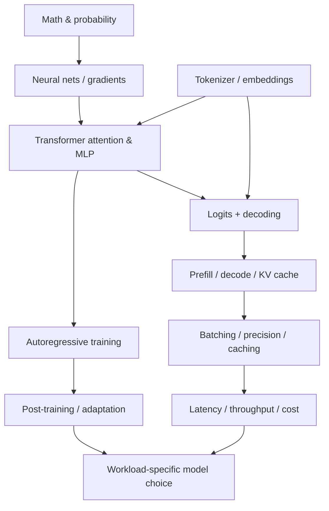

# LLM Foundations — Learn, Explain, Apply

**Basic → Advanced → Production | Senior / Principal AI Engineer interviews**  
**Proofread and structured: 23 November 2026 | Single-file edition**

> **One guiding question:** How does a model go from text input to predicted tokens, and what does that mean for accuracy, GPU memory, latency, and cost?
>
> **How to use this guide:** Learn the explanation first, use the short answer for interviews, and use the limits/engineering examples to defend real-world decisions.

**Scope:** AI/ML foundations, linear algebra for language models, neural nets, Transformers, tokenization, training and post-training, decoding, model families, low-level inference engineering, and basic performance/economics. **Intentionally out of scope:** RAG/retrieval systems, agent orchestration, enterprise AI governance, dedicated evaluation-tool frameworks, and full distributed-platform design (covered in separate guides).

## Start here: a simple learning map

This guide contains **97 core concept questions, 3 worked examples, and 11 practical cases**. The 116 original question IDs remain traceable in [Appendix D](#appendix-d--original-question--new-location); seven overlapping pairs have been merged rather than repeated.

| Learning pass | Read | What you should be able to explain |
|---|---|---|
| **Basic — build intuition** | Chapters 1–3 | Training vs inference; vectors, gradients, tokens, logits and probabilities |
| **Advanced — understand mechanisms** | Chapters 4–7 | Attention, Transformers, pretraining, adaptation, decoding and model families |
| **Production — make decisions** | Chapters 8–10 | Prefill/decode, KV memory, batching, latency, cost, sizing and trade-offs |

**First pass — understand:** read each chapter introduction and its **Plain English** notes; skip difficult derivations.

**Second pass — connect:** work through formulas, tensor shapes, and examples.

**Interview pass — apply:** hide each 30-second answer, then explain the mechanism, constraints, trade-offs, and measurements.

### How each question is written

- **30-second answer** — the concise response you can say in an interview.
- **Plain English / mini-example** — intuition that makes the concept memorable (included where most useful).
- **Mechanism and boundaries** — what is technically happening, when the explanation applies, and when it does not.

**Evidence labels:** Mathematical statements are definitions or identities. Numerical examples are illustrative, not benchmark results. Statements about a specific tokenizer, runtime or provider require checking that exact implementation; empirical research results are not universal guarantees.

### Interview answer framework

**Mechanism → Assumption → Constraint → Trade-off → Measurement → Fallback.** Do not memorize a technical word without being able to explain what improves, what gets worse, and how you would test it.

### The story of one generated response


**Train vs serve:** during training the model adjusts weights using a loss and backpropagation; at ordinary inference time the weights remain fixed while the runtime generates tokens and maintains sequence state.

### Notation used throughout

`B` = batch size; `T` = sequence length; `V` = vocabulary size; `d` = model hidden width; `dh` = dimension per attention head; `Hq` = number of query heads; `Hkv` = number of key/value heads; `L` = layer count; `P` = parameter count; `N` = sample/token count as defined locally; `s` = bytes per stored element; `τ` = sampling temperature; `η` = learning rate. Numerical examples are illustrative, **not** production benchmarks or defaults.

### Fast track: 12 must-know concepts

If the complete guide feels overwhelming, study these **in order**. Each link points to the *new* question number after consolidation.

1. [Q004 — Self-supervised learning](#q004--what-is-self-supervised-learning-and-why-is-it-central-to-llms) → how the training target comes from text.
2. [Q020 — Forward pass and backpropagation](#q020--what-are-forward-pass-and-backpropagation) → how neural networks learn.
3. [Q027 — Logits](#q027--what-are-logits) and [Q028 — Softmax](#q028--what-is-softmax) → what the model predicts.
4. [Q034 — Transformer architecture](#q034--what-is-the-end-to-end-structure-of-a-decoder-only-transformer) → the big-picture computation.
5. [Q036 — Attention mathematics](#q036--explain-scaled-dot-product-attention-mathematically) → how context is mixed.
6. [Q038 — Causal mask](#q038--why-does-a-causal-mask-matter) → why future tokens are hidden.
7. [Q029 — Causal pretraining](#q029--how-is-causal-next-token-pretraining-formulated) → how the loss is defined.
8. [Q060 — Decoding approaches](#q060--what-are-greedy-decoding-and-stochastic-sampling) → how predictions become text.
9. [Q076 — Prefill](#q076--what-happens-during-prefill-vs-decode) and [Q077 — KV caching](#q077--what-is-a-kv-cache) → how inference executes.
10. [Q078 — KV memory](#q078--how-do-you-estimate-kv-cache-memory) → why context and concurrency compete.
11. [Q088 — Latency and throughput](#q088--which-inference-metrics-matter-ttft-tpot-latency-or-throughput) → how to measure performance.
12. [Q090 — Hosted-model cost](#q090--how-do-you-estimate-hosted-model-inference-costs) → how to connect token usage to business cost.

These question numbers are the revised learning order; the full mapping from the original guide is in [Appendix D](#appendix-d--original-question--new-location).

### Jump to a chapter

- [Chapter 1: Build the mental model](#chapter-1--build-the-mental-model) — 8 concept cards
- [Chapter 2: Understand the mathematics of learning](#chapter-2--understand-the-mathematics-of-learning) — 12 concept cards
- [Chapter 3: From text to tokens to predicted probabilities](#chapter-3--from-text-to-tokens-to-predicted-probabilities) — 12 concept cards
- [Chapter 4: Look inside a Transformer](#chapter-4--look-inside-a-transformer) — 15 concept cards
- [Chapter 5: Training, post-training and adaptation](#chapter-5--training-post-training-and-adaptation) — 12 concept cards
- [Chapter 6: Generation, decoding and output reliability](#chapter-6--generation-decoding-and-output-reliability) — 11 concept cards
- [Chapter 7: Model families, multimodality and context](#chapter-7--model-families-multimodality-and-context) — 5 concept cards
- [Chapter 8: How inference engines make LLMs efficient](#chapter-8--how-inference-engines-make-llms-efficient) — 12 concept cards
- [Chapter 9: Performance, economics and engineering choices](#chapter-9--performance-economics-and-engineering-choices) — 10 concept cards
- [Chapter 10: Apply concepts to engineering decisions](#chapter-10--apply-concepts-to-engineering-decisions) — 3 worked examples and 11 practice cases
- [Appendix A: Full inference walkthrough](#appendix-a--a-complete-request-step-by-step)
- [Appendix B: Formula cheat sheet](#appendix-b--formula-sheet-with-assumptions)
- [Appendix C: Concept map](#appendix-c--concept-map)
- [Appendix D: Original-to-new question crosswalk](#appendix-d--original-question--new-location)
- [Appendix E: Source bibliography](#appendix-e--sources-and-verification-boundaries)
- [Appendix F: Editorial and accuracy audit](#appendix-f--editorial-and-accuracy-audit)

---

## Chapter 1 — Build the mental model

**Start with a distinction:** an LLM is not just a chatbot API. It is a trained model that assigns probabilities to token sequences, plus a runtime that turns those probabilities into generated output. Training learns parameters; inference uses them.

```text
AI (broad field)
├── Rule-based systems (AI without learned weights)
└── Machine Learning (learn from data)
    ├── Traditional ML (e.g., linear regression)
    └── Deep Learning (multi-layer neural networks)
        ├── Transformer language models
        └── Other families (e.g., diffusion models)

Generative AI overlaps these branches: it describes producing new content,
not a mandatory additional layer of the hierarchy.
```

**Running example:** Suppose a model sees “The sky is”. During training it learns how probable different next tokens are, based on examples. At inference, it produces logits for candidates such as “blue” and “clear”, converts scores to a selection distribution, and chooses a token. Its behavior depends on learned weights, context, and decoding.

**Remember:** Good token prediction is a *training objective*, not a guarantee of factual correctness.

**Study check:** Can you explain the chapter’s diagram or comparison without definitions in front of you? Then practice the 8 questions below.

### Q001 — How do AI, machine learning, deep learning, and generative AI relate?

**30-second answer.** AI is the broad goal of building systems that perform tasks associated with intelligence. ML learns statistical behavior from data; deep learning is ML using multi-layer neural networks. Generative AI learns to produce content such as text, images, or audio.

**Mechanism and boundaries.** A rule-based expert system can be AI without ML. Linear regression is ML without deep learning. A Transformer language model is deep learning and generative AI. The categories overlap rather than forming four incompatible technologies. **[Established taxonomy]**

### Q002 — What separates discriminative from generative models?

**30-second answer.** A discriminative model predicts a target conditioned on input, commonly `p(y|x)`; a generative model learns a distribution that supports generating data, such as `p(x)` or `p(x|condition)`.

**Plain English.** A classifier answers “Is this spam?” A generative model can produce the email text itself. A language model can also be used for classification through prompting, so model *use* and training *objective* are different questions.

**Mechanism and boundaries.** A spam classifier chooses spam/not-spam; an autoregressive language model assigns probabilities to sequences and samples the next token. Some model families can serve both roles; the distinction describes objectives and behavior, not exclusive product categories. **[Math]**

### Q003 — What is supervised learning?

**30-second answer.** Learning a mapping from inputs to labeled targets by minimizing prediction error on examples.

**Mechanism and boundaries.** Given `(apartment size, price)`, a regression model fits parameters to predict price. Labels can be categories, numbers, or desired sequences. Training examples constrain the model, while held-out examples test generalization. Label quality and representativeness matter as much as model capacity.

### Q004 — What is self-supervised learning, and why is it central to LLMs?

**30-second answer.** Self-supervised learning constructs targets from the data itself—for example, using earlier tokens to predict the next token—rather than requiring humans to label every token.

**Plain English.** The sentence already contains its own teaching signal. From “the sky is blue”, the prefix “the sky is” becomes the input and “blue” becomes a target. No person needs to label that position manually.

**Mechanism and boundaries.** In `The sky is blue`, the target after `The sky is` can be `blue`. Autoregressive models learn conditional next-token probabilities across many sequences. Other objectives, such as masked-token or span corruption, also exist; **not all language models train only with causal next-token prediction**. [S02](https://arxiv.org/abs/1810.04805) [S03](https://arxiv.org/abs/1910.10683) [S04](https://arxiv.org/abs/1910.13461)

### Q005 — What is generalization?

**30-second answer.** Generalization means performing well on examples or distributions not memorized from training, rather than only reproducing the training set.

**Mechanism and boundaries.** A model that learns a meaningful relationship can handle a new apartment size. Good training loss is insufficient: separate training, validation, and test data, assess distribution shifts, and watch for leakage. Future user traffic may differ substantially from the test distribution.

### Q006 — What are underfitting and overfitting?

**30-second answer.** Underfitting fails to capture useful patterns; overfitting captures noise or idiosyncrasies that do not transfer.

**Mechanism and boundaries.** High training and validation error suggest underfitting. Very low training error but materially worse validation error suggests overfitting, although distribution shift can also cause the gap. Solutions include better data, regularization, model-capacity adjustment, early stopping, and domain-matched testing—not blindly adding parameters.

### Q007 — What are parameters, hyperparameters, and activations?

**30-second answer.** Parameters are learned quantities (weights/biases); hyperparameters configure training or inference (learning rate, layer count, decoding temperature); activations are intermediate outputs computed for a particular input.

**Plain English.** Weights are what the model **learns**; the learning rate is something the engineer **chooses**; activations are intermediate numbers created when one particular input passes through the network.

**Mechanism and boundaries.** A linear layer computes `y = Wx + b`: `W` and `b` are parameters, while `y` changes with the input. A `7B` parameter label tells little by itself about context length, active experts, training data quality, or deployment memory. **[Model-dependent]**

### Q008 — What is the difference between training and inference?

**30-second answer.** Training changes model parameters using a loss and optimizer; inference uses already-trained parameters to compute predictions and optionally generate tokens.

**Plain English.** Training is writing and revising the model’s internal weights; inference is reading those weights to make a prediction. A chat message normally does not retrain the model.

**Mechanism and boundaries.** Training usually needs parameter/gradient/optimizer memory and activation storage for backward passes. Inference often prioritizes low latency, KV caches, batching, and memory-efficient weight formats. Fine-tuning is another training stage, not simply a special decoding parameter.

---

## Chapter 2 — Understand the mathematics of learning

A neural network is many small numerical transformations connected together. It needs **representations** (vectors), a **prediction** (forward pass), a **score for errors** (loss), and a **way to change the parameters** (gradients, optimizer).

```text
Input vector x ──> weighted layers ──> prediction ŷ
                                          │
Correct target y ──────────────────────────┤
                                          ▼
                                        Loss L
                                          │
                            backpropagation / chain rule
                                          ▼
                                parameter gradients
                                          │
                                 optimizer update
```

**Mini example:** Predict `y=6` from `x=2` using `ŷ=wx`. Start at `w=2` → prediction `4`, squared loss `4`. The gradient is `−8`, so one plain-gradient-descent update with `η=0.01` gives `w=2.08`. This reduces the error for *that illustrative point*; it does not establish success on unseen data.

**Avoid memorizing formulas in isolation:** state what each quantity *measures* and how the measurement guides a decision.

**Study check:** Can you explain the chapter’s diagram or comparison without definitions in front of you? Then practice the 12 questions below.

### Q009 — Why do we represent data as vectors?

**30-second answer.** A vector packages numeric features or hidden states so the model can apply linear algebra efficiently.

**Mechanism and boundaries.** An illustrative 2D feature vector `[area, distance] = [80, 5]` requires scaling before some distance-based methods because units differ. In neural networks, vectors are learned hidden representations, not human-labeled dimensions; a single coordinate usually lacks a stable plain-English meaning.

### Q010 — What is a dot product?

**30-second answer.** It combines corresponding vector components into a scalar and often measures alignment; attention uses dot products between query and key vectors.

**Plain English.** Think of two lists of corresponding features. Multiply matching entries, then add the products. Attention turns this operation into a learned match score between Q and K.

**Mechanism and boundaries.** **[Math; illustrative]** `[1,2] · [3,4] = 1×3 + 2×4 = 11`. In general, `a·b = Σ_i a_i b_i`. For nonzero vectors, `a·b = ||a|| ||b|| cos θ`: magnitude affects raw dot-product scores, so a raw dot product is **not automatically cosine similarity**.

### Q011 — What is matrix multiplication, and why do tensor shapes matter?

**30-second answer.** Matrix multiplication applies many weighted combinations in parallel; compatible inner dimensions are mandatory.

**Plain English.** Shape tracking is the tensor equivalent of checking function signatures: `[2,4,512] @ [512,128]` works and gives `[2,4,128]` because the last dimension matches the matrix input.

**Mechanism and boundaries.** **[Math]** `(m×n) @ (n×p) → (m×p)`. **[Illustrative]** Token states `X` with shape `[B,T,512]` multiplied by projection `W` `[512,128]` produce `[B,T,128]`. Most Transformer shape errors come from confusing batch, position, head, and channel dimensions.

### Q012 — What is a derivative?

**30-second answer.** A derivative is the local rate of change of a scalar function, showing how sensitive the output is to a small input change.

**Mechanism and boundaries.** **[Math; illustrative]** If `f(x)=x²`, then `f'(x)=2x`; at `x=3`, slope is `6`. The derivative is local: it does not say the function changes by exactly six for arbitrary large steps.

### Q013 — What is a gradient?

**30-second answer.** A gradient is the vector of partial derivatives of a scalar loss with respect to many parameters, pointing in the local direction of steepest increase under Euclidean geometry.

**Plain English.** The derivative tells how one input changes the loss; a **gradient** collects that information for many weights at once. To lower the loss, basic gradient descent walks against the gradient.

**Mechanism and boundaries.** **[Math]** For `L(w,b)`, `∇L=[∂L/∂w, ∂L/∂b]`. To reduce loss, basic gradient descent steps approximately opposite to that direction. A gradient is computed from the current batch; it is not a proof that the next large step improves the entire population loss.

### Q014 — What is a loss function, and how do MSE and cross-entropy differ?

**30-second answer.** A loss assigns a numerical penalty to predictions; training optimizes expected or empirical loss, not an abstract concept of intelligence.

**Plain English.** For predicting a price, ask “how far away was my number?” (MSE). For choosing a token, ask “how much probability did I give the correct choice?” (cross-entropy).

**Mechanism and boundaries.** Squared error emphasizes larger numeric deviations; cross-entropy penalizes low probability assigned to the correct class/token. A low next-token loss does not guarantee truthfulness, task success, or safe behavior because the optimized objective is only a proxy. **[Math + interpretation]**

**Distinguish the examples.** Mean squared error fits numeric targets; cross-entropy fits probabilistic choices, including next-token classification.

**[Math]** `MSE=(1/N)Σ_i (ŷ_i−y_i)²`. For a single correct-class probability `p`, cross-entropy is `−ln(p)`. **[Illustrative]** `p=0.25` gives loss `1.3863`; `p=0.8` gives `0.2231`. `N` is the number of examples, `ŷ` prediction, `y` true target, and `ln` natural logarithm.

### Q015 — How does gradient descent actually update a weight?

**30-second answer.** Compute a gradient of loss, then move parameters a small amount in the negative-gradient direction.

**Plain English.** If a weight is too small, the slope may tell us to increase it. The learning rate controls how far we move after computing that slope.

**Mechanism and boundaries.** **[Math; illustrative]** For `ŷ=wx`, `L=(wx−y)²`, with `w=2`, `x=2`, `y=6`, loss is `4` and `∂L/∂w=2(wx−y)x=−8`. With learning rate `η=0.01`, `w_new=w−η∂L/∂w=2.08`. `η` controls step size; larger is not always faster or stable.

### Q016 — What is a learning rate, and why can too-high or too-low rates fail?

**30-second answer.** Learning rate controls optimizer step magnitude. Too high can overshoot or diverge; too low can make convergence unacceptably slow.

**Mechanism and boundaries.** In nonconvex deep networks, gradient sizes, optimizer moments, schedules, effective batch size, and numerical precision interact. Learning-rate warmup and decay are design choices, not universal requirements. Monitor loss curves and stability instead of copying an unrelated model's hyperparameters.

### Q017 — What do full-batch, stochastic, and mini-batch training mean?

**30-second answer.** Full-batch uses the entire dataset per update; stochastic gradient descent in the narrow sense uses one example; mini-batch training updates from a subset.

**Mechanism and boundaries.** Mini-batches enable accelerator efficiency while approximating the population gradient with noise. Distributed training may accumulate gradients from several microbatches to simulate a larger *effective* batch. Batch size changes memory use, throughput, and optimization dynamics.

### Q018 — What is an artificial neuron?

**30-second answer.** A simple artificial neuron computes a weighted sum plus bias, then passes it through an activation function.

**Mechanism and boundaries.** **[Math]** `a=φ(w·x+b)` where `x` input vector, `w` weights, `b` bias, `φ` nonlinear activation. Without nonlinearities between layers, a stack of linear maps collapses into one linear map. The biological-neuron analogy is only an intuition, not a faithful biological simulation.

### Q019 — Why do neural networks need nonlinear activation functions?

**30-second answer.** Nonlinear activations allow multi-layer networks to represent relationships more complex than a single linear transformation.

**Plain English.** Without a nonlinear activation, several linear layers could be collapsed into one matrix multiplication. Nonlinearities allow a network to learn curved or conditional relationships.

**Mechanism and boundaries.** ReLU is `max(0,x)`; GELU and gated activations (e.g., SwiGLU) are used in different Transformer variants. There is no single activation shared by all modern LLMs. Activation choice changes expressivity, gradient behavior, and implementation efficiency. [S01](https://arxiv.org/abs/1706.03762)

### Q020 — What are forward pass and backpropagation?

**30-second answer.** The forward pass computes outputs and loss; backpropagation efficiently computes parameter gradients by applying the chain rule backward through the computation graph.

**Plain English.** The **forward pass** computes an answer and error. **Backpropagation** tells each weight how it contributed to that error. The optimizer then updates those weights.

**Mechanism and boundaries.** For `x → linear → activation → loss`, backprop propagates how changing later quantities changes the loss and then composes those derivatives backward. It does not imply that token generation itself 'backpropagates'; normal inference uses a forward computation without training gradients. **[Math]**

---

## Chapter 3 — From text to tokens to predicted probabilities

A language model does not ingest a string directly as a sequence of “words.” The client serializes the conversation, the tokenizer maps text to **integer IDs**, and an embedding table turns IDs into **learned vectors**. The model outputs **logits**, which can become token probabilities via softmax.

```text
Messages
   ↓ chat template + tokenizer
Token IDs
   ↓ embedding lookup + Transformer
Logits (one score per vocabulary token)
   ↓ decoding rules + token selection
Next token → append to context → repeat
```

**Three different objects:** token text (`"blue"`), token ID (`391`, fictional), and token embedding (`[0.12, −0.41, …]`, fictional) are not interchangeable.

**One training-vs-inference subtlety:** During causal pretraining, the model gets the *real prefix* to predict each next token (teacher forcing). During free-running generation, it gets its own prior generated tokens. This explains both parallelizable training positions and potential generation drift.

**Study check:** Can you explain the chapter’s diagram or comparison without definitions in front of you? Then practice the 12 questions below.

### Q021 — What is tokenization, and why is a token not the same as a word?

**30-second answer.** Tokenization turns input content into discrete units mapped to integer IDs; the model processes those IDs rather than raw character strings.

**Plain English.** A tokenizer turns text into a series of integer labels. A “word” may be one, many, or part of a token. Model bills and context budgets depend on tokens, not displayed words.

**Mechanism and boundaries.** Tokens may be words, subwords, characters, bytes, or modality-specific units. Text length in characters is not token length. Tokenizer behavior is **model-specific**, including normalization, whitespace, Unicode, and special-token rules. [S14](https://huggingface.co/docs/transformers/main/tokenizer_summary) [S15](https://developers.openai.com/api/docs/guides/token-counting)

**Important distinction.** Tokenization optimizes a representation scheme, not linguistic word boundaries; one word may be many tokens, and spaces/punctuation may join adjacent tokens.

Multilingual text, emoji, code, and unusual symbols may tokenize very differently. For production, measure tokens using the **model's** tokenizer or provider accounting endpoint; English characters-per-token heuristics are unreliable for correctness or billing. [S14](https://huggingface.co/docs/transformers/main/tokenizer_summary) [S16](https://huggingface.co/docs/transformers/main/chat_templating)

### Q022 — How do BPE, WordPiece, and Unigram differ?

**30-second answer.** They are subword tokenization families: BPE learns frequent merges; WordPiece uses a different vocabulary-selection criterion and longest-match tokenization; Unigram chooses segmentations from a probabilistic candidate vocabulary.

**Mechanism and boundaries.** Subwords balance vocabulary size against fragmenting uncommon words. **[Illustrative; not actual IDs]** `unhappiness` could become `un + happi + ness` or a different partition depending on tokenizer. Byte-level approaches can represent arbitrary text through bytes; SentencePiece is a framework supporting multiple algorithms, not a fourth mutually exclusive segmentation objective. [S14](https://huggingface.co/docs/transformers/main/tokenizer_summary)

### Q023 — What are vocabulary size and token IDs?

**30-second answer.** Vocabulary size `V` is the count of token entries for a tokenizer; token IDs are integer indices into that vocabulary.

**Plain English.** The token ID is like a row number in an embedding table; the table row contains a learned vector. Token ID `391` does not mean “391 units of meaning.”

**Mechanism and boundaries.** Tokens map to learned input vectors, typically through a lookup table `[V,d]`. IDs are arbitrary labels, not semantic ranks. Increasing `V` can shorten sequences for some content while enlarging token-related parameter tables. Tokenizer and checkpoint must match; reusing arbitrary IDs from another tokenizer breaks semantics. [S14](https://huggingface.co/docs/transformers/main/tokenizer_summary)

### Q024 — What are special tokens and chat templates?

**30-second answer.** Special tokens mark structural roles or boundaries—such as begin/end of sequence, end of turn, role separators, or other model-specific controls. A chat template serializes structured messages into the model's expected token pattern.

**Plain English.** A chat template is the actual serialized format the model learned to read. A program’s `{role, content}` messages are not necessarily the exact token stream presented to the model.

**Mechanism and boundaries.** A chat API's `{role,content}` objects are not guaranteed to map one-to-one to visible text; providers may add internal markers or hidden overhead. Wrong templates can degrade instruction following or termination. End-of-message and end-of-generation need not be the same token. [S15](https://developers.openai.com/api/docs/guides/token-counting) [S16](https://huggingface.co/docs/transformers/main/chat_templating)

### Q025 — What counts toward input and output tokens?

**30-second answer.** Account for serialized instructions, message metadata/formatting, user content, and any modality tokens according to the provider; output usage may include visible text plus model-specific nonvisible output/reasoning tokens.

**Mechanism and boundaries.** Providers may expose cached input separately while still including it within input usage. Raw tokenizer counts can differ from billed or metered API usage because templates and internal accounting differ. Prefer authoritative usage fields and model-specific counting tools; never add cached tokens again if they are already a subset. [S15](https://developers.openai.com/api/docs/guides/token-counting) [S16](https://huggingface.co/docs/transformers/main/chat_templating)

### Q026 — How do probability and conditional probability enter an LLM?

**30-second answer.** The model produces conditional probabilities for candidate next tokens given preceding context.

**Plain English.** Autoregressive text probability is a chain of small questions: “What is the first token?”, then “What follows it?”, then “What follows both?”. Multiply the conditional probabilities to score the sequence.

**Mechanism and boundaries.** **[Math]** `P(x₁,…,x_T)=∏_{t=1}^{T}P(x_t|x_<t)` is the probability chain rule; `x_t` is token at position `t`, and `x_<t` denotes preceding tokens. An autoregressive model parameterizes these factors. Sampling from a distribution differs from asserting that its most probable continuation is factual.

### Q027 — What are logits?

**30-second answer.** Logits are unnormalized scores for vocabulary candidates, typically output by the model's last projection before turning scores into probabilities.

**Plain English.** Logits are scores **before** conversion to probabilities. A score of 2 is not “2% confident”; softmax compares it with the scores of *all* other candidates.

**Mechanism and boundaries.** For vocabulary size `V`, output logits have shape `[B,T,V]` during full-sequence computation; generation usually uses the last relevant position. Logit differences, not absolute offsets, determine softmax probabilities. A logit is **not** itself a confidence percentage.

### Q028 — What is softmax?

**30-second answer.** Softmax converts a vector of logits into nonnegative probabilities that sum to one.

**Plain English.** For logits `[2,1,0]`, softmax gives roughly 66.5%, 24.5%, and 9.0%. Shifting every logit by the same amount does not change those percentages.

**Mechanism and boundaries.** **[Math]** `p_i=exp(z_i)/Σ_j exp(z_j)`, where `z_i` is the logit of option `i`. **[Illustrative]** logits `[2,1,0]` yield approximately `[0.665,0.245,0.090]`. Subtract the maximum logit before exponentiation for numerical stability; this does not change the result.

### Q029 — How is causal next-token pretraining formulated?

**30-second answer.** Given a sequence, learn to maximize probability of its observed next tokens under the preceding context.

**Plain English.** For “A B C D”, one training pass can score “B after A”, “C after A B”, and “D after A B C” together, while the causal mask prevents each prediction from seeing its target in the future.

**Mechanism and boundaries.** **[Math]** `L(θ)=−Σ_{t=1}^{T}log p_θ(x_t|x_<t)` (possibly averaged/masked); `θ` denotes trainable parameters. The loss scores observed next tokens for many positions at once under a causal mask. Teacher forcing supplies the observed prefix; [Q030](#q030--why-does-teacher-forcing-create-a-traininginference-mismatch) separately explains why conditioning on generated prefixes at inference creates a mismatch. [S05](https://arxiv.org/abs/2005.14165)

### Q030 — Why does teacher forcing create a training/inference mismatch?

**30-second answer.** In conventional autoregressive training, the model predicts the next token from the **correct previous tokens**. During generation, it must continue from **its own previous outputs**, including any mistakes. That difference is a form of exposure mismatch.

**Plain English.** Training resembles finishing sentences when someone always supplies the correct first half. Generation resembles continuing a story using whatever you wrote a moment ago; one bad continuation changes the next starting point.

**Mechanism and boundaries.** Teacher forcing makes it possible to score many positions in parallel under causal masking. An erroneous generated token changes the subsequent conditioning context; the model does not automatically reset to the training example. The mismatch helps explain error propagation, but not every generation error comes from exposure mismatch. See the [causal objective in Q029](#q029--how-is-causal-next-token-pretraining-formulated). [S05](https://arxiv.org/abs/2005.14165)

### Q031 — What is perplexity?

**30-second answer.** Perplexity is the exponential of average token negative log likelihood; it summarizes how surprised a model is by target tokens under a specified tokenization and dataset.

**Plain English.** Perplexity `4` can be thought of loosely as the uncertainty of choosing among four equally likely options, but that analogy does not describe the actual rank or accuracy on real tasks.

**Mechanism and boundaries.** **[Math]** `PPL=exp(−(1/N)Σ_{i=1}^N log p_i)` where `p_i` is predicted probability for the correct token, `N` scored tokens. **[Illustrative]** If average loss is `ln 4`, perplexity is `4`. Comparing perplexity across different tokenizers, corpora, or scoring conventions is misleading without normalization. Lower PPL does not directly prove better business-task performance.

### Q032 — Where does pretraining data quality matter?

**30-second answer.** Data coverage, duplication, contamination, language balance, formatting, and noise shape both model capability and limitations.

**Mechanism and boundaries.** Duplicates can increase memorization; low-quality text teaches undesirable patterns; missing domain/language coverage reduces reliability on that distribution. Filtering has trade-offs: aggressive filtering can remove useful minority-language or domain material. Published datasets and recipes vary; avoid assuming every commercial model used the same mix. [S05](https://arxiv.org/abs/2005.14165) [S06](https://arxiv.org/abs/2203.15556)

---

## Chapter 4 — Look inside a Transformer

The Transformer is the computational core. In a conventional decoder block, **attention** exchanges information across allowed token positions and the **MLP** transforms each position's features. Residual connections and normalization support deep training.

```text
x (hidden states)
│
├──────────────────────┐
│                      ▼
│              Norm → causal attention
│                      │
└────────── (+) ◄──────┘   = h
            │
            ├──────────────┐
            │              ▼
            │          Norm → MLP
            │              │
            └─── (+) ◄──────┘   = next block's hidden states
```

Each `(+)` is a **residual addition**. The attention sublayer mixes information across permitted positions; the MLP transforms the features of each position. This is one **pre-norm** decoder layout, not a universal Transformer implementation.

**Attention by analogy:** a query asks which earlier positions are relevant; keys give match scores; values supply the information mixed into the output. It is *learned vector arithmetic*, not literal string search.

**Tiny example:** If a query's scaled scores against two allowed keys are `[0, ln 3]`, softmax assigns weights `[0.25, 0.75]`. The attention result is `0.25v₁ + 0.75v₂`. This is the clearest route from Q/K/V terminology to the attention equation.

**Important scope:** The diagram illustrates a pre-norm causal decoder; encoder–decoder models, GQA, alternative normalization, positional methods, and newer attention variants differ.

**Study check:** Can you explain the chapter’s diagram or comparison without definitions in front of you? Then practice the 15 questions below.

### Q033 — Why did Transformers change sequence modeling?

**30-second answer.** Self-attention lets every allowed position exchange information through learned, content-dependent weights, while training processes many positions in parallel.

**Mechanism and boundaries.** The original 2017 Transformer was an encoder–decoder architecture, not today's generic synonym for an autoregressive chatbot. Compared with recurrent computation, attention shortens many dependency paths but conventional full attention has quadratic sequence-length interaction cost. Practical efficiency depends on sequence length, hardware, kernels, and architecture. [S01](https://arxiv.org/abs/1706.03762)

### Q034 — What is the end-to-end structure of a decoder-only Transformer?

**30-second answer.** Convert token IDs to vectors, inject position information, repeat causal attention and feed-forward blocks, normalize/project hidden states to vocabulary logits, and decode next tokens.

**Plain English.** The big picture is: token IDs → learned vectors → repeated attention/MLP blocks → one score per vocabulary token → choose a next token. At inference, repeat the last part one token at a time.

**Mechanism and boundaries.** The diagram below uses a **pre-normalization illustrative design**. Alternative block order, normalization, attention, MLP, and output-head designs exist.

```text
Text → tokenizer → token IDs [B,T]
  → token lookup [B,T,d] + positional mechanism
  → ┌──── repeated L times ───────────────────────────────┐
    │ Norm → causal self-attention → residual addition    │
    │ Norm → position-wise FFN/MLP → residual addition    │
    └─────────────────────────────────────────────────────┘
  → final norm (if configured)
  → vocabulary projection [B,T,V]
  → select next-position logits → decoding → next token
```
**Key insight:** Training can score all next positions in one masked forward pass; generation of a standard autoregressive decoder is sequential across newly generated positions. [S01](https://arxiv.org/abs/1706.03762) [S05](https://arxiv.org/abs/2005.14165)

### Q035 — What do Query, Key, and Value actually mean?

**30-second answer.** Query represents what the current token seeks; Key represents how other positions can be matched; Value contains information passed forward when a match receives weight.

**Plain English.** Q asks “What information should this position look for?” K describes what other positions match. V is the vector that gets mixed into the result. The model learns all three—not hard-coded keywords.

**Mechanism and boundaries.** These are learned projections of hidden states, not a literal database lookup. For hidden states `X`, calculate `Q=XW_Q`, `K=XW_K`, `V=XW_V`. Scores use `QKᵀ`; a weighted sum of `V` creates context-dependent outputs. Same input can yield different attention patterns across heads and layers. [S01](https://arxiv.org/abs/1706.03762)

### Q036 — Explain scaled dot-product attention mathematically.

**30-second answer.** Attention scores query–key similarity, scales it, masks forbidden positions, uses softmax as weights, and mixes value vectors.

**Plain English.** Imagine two past positions with scores `0` and `ln(3)`. Softmax assigns 25% and 75%; the result mixes their value vectors in exactly those proportions. This is *not* selecting a single earlier word.

**Mechanism and boundaries.** **[Math]**

`Attention(Q,K,V) = softmax(QKᵀ/√dh + M) V`

`dh` is key-head dimension; `M` adds `−∞` to forbidden positions (conceptually); `softmax` acts row-wise. Scaling mitigates increasing dot-product variance as `dh` grows under common initialization assumptions. With one query, two keys scored `[0, ln 3]` (illustrative after scaling/masking), weights are `[0.25,0.75]`; the output is `0.25v₁+0.75v₂`. [S01](https://arxiv.org/abs/1706.03762)

### Q037 — Why is it called self-attention?

**30-second answer.** The queries, keys, and values come from different learned projections of the **same sequence's** states.

**Mechanism and boundaries.** In cross-attention, queries come from one sequence/state while keys and values come from another—for example, a decoder attending to an encoder. Decoder-only causal self-attention does not require an encoder. Some multimodal systems use cross-attention; others combine modalities in a shared token stream. [S01](https://arxiv.org/abs/1706.03762) [S04](https://arxiv.org/abs/1910.13461)

### Q038 — Why does a causal mask matter?

**30-second answer.** It prevents a next-token predictor at position `t` from seeing future target positions `t+1...`, preserving the autoregressive objective.

**Plain English.** When training a model to predict token 4, it must not peek at words 5 and 6. A triangular attention mask makes that rule executable even when many training positions run in parallel.

**Mechanism and boundaries.** For `T=4`, allowed attention positions (✓) can be pictured as:

```text
             key positions →  1  2  3  4
query pos 1                   ✓  ·  ·  ·
query pos 2                   ✓  ✓  ·  ·
query pos 3                   ✓  ✓  ✓  ·
query pos 4                   ✓  ✓  ✓  ✓
```
The mask applies to attention scores, not the label-generation process itself. **[Math for this architecture]** If future tokens are visible during causal training, information leakage makes the task invalid. Other model objectives intentionally use different masks. [S01](https://arxiv.org/abs/1706.03762)

### Q039 — What is multi-head attention and why use multiple heads?

**30-second answer.** Multiple learned query/key/value projections allow several attention patterns and information subspaces to be modeled in parallel, then mixed together.

**Mechanism and boundaries.** Each head computes attention with its own projections. Concatenate head outputs and use an output projection. More heads do **not** guarantee disjoint human-interpretable functions, and increasing head count alone does not monotonically improve quality. [S01](https://arxiv.org/abs/1706.03762)

### Q040 — Walk through concrete attention tensor shapes.

**30-second answer.** Track the batch, sequence, head, and per-head dimensions; the attention score matrix is over pairs of token positions.

**Plain English.** The attention score tensor is `[batch, heads, query positions, key positions]`. During full prefill it is conceptually `[B,H,T,T]`, whereas one-token decoding computes a much thinner `[B,H,1,T]` step.

**Mechanism and boundaries.** **[Illustrative full MHA]** `B=2`, `T=4`, `d=512`, `Hq=Hkv=8`, `dh=64`:

```text
X                           [2,4,512]
Q,K,V after reshape         [2,8,4,64]
Q @ transpose(K)            [2,8,4,4]
softmax + mask              [2,8,4,4]
attention weights @ V       [2,8,4,64]
concat heads                [2,4,512]
output projection           [2,4,512]
```
In grouped-query attention, `Hq` and `Hkv` differ; K/V heads are shared among groups of query heads, so don't blindly reuse the MHA memory formula. [S01](https://arxiv.org/abs/1706.03762) [S11](https://arxiv.org/abs/2305.13245)

### Q041 — Why does attention have a quadratic component in sequence length?

**30-second answer.** Full attention compares each of `T` query positions with `T` key positions, producing `T²` pairwise scores per head.

**Plain English.** If prompt length doubles, the pairwise comparisons in conventional full attention grow about fourfold. Better kernels may reduce memory traffic without changing that basic pair count.

**Mechanism and boundaries.** Score computation scales roughly `O(T²dh)` per head; projection and MLP costs may also dominate at some dimensions and sequence lengths. Optimized attention kernels can avoid materializing the full `T×T` matrix in high-bandwidth memory without making full attention's arithmetic complexity universally linear. [S01](https://arxiv.org/abs/1706.03762) [S12](https://arxiv.org/abs/2205.14135)

### Q042 — What does the feed-forward network do in a Transformer block?

**30-second answer.** After attention exchanges information across positions, a position-wise feed-forward network transforms features **within each token position**.

**Plain English.** Attention moves information **between positions**. The FFN/MLP transforms the feature vector **within each position**. Both mechanisms are needed inside a standard block.

**Mechanism and boundaries.** A typical two-layer MLP is `FFN(x)=W₂ φ(W₁x+b₁)+b₂`, often with an intermediate width greater than `d`; gated variants use a different formula. The same weights operate at each position, but inputs differ because prior attention mixed context. In many architectures the FFN contributes a large share of parameters/compute. [S01](https://arxiv.org/abs/1706.03762)

### Q043 — What are residual connections and why do they help?

**30-second answer.** Residual connections add a layer's transformation to its input: `y=x+F(x)`, preserving an identity path for information and gradients.

**Mechanism and boundaries.** Backpropagation through `y` includes an identity contribution, which helps train deep networks. Residuals are not a guarantee against exploding/vanishing gradients. Shapes on both sides of the sum must be compatible (or explicitly projected). The Transformer uses residual pathways around sublayers. [S01](https://arxiv.org/abs/1706.03762)

### Q044 — What is LayerNorm vs RMSNorm?

**30-second answer.** LayerNorm centers and rescales a feature vector using its mean and variance; RMSNorm rescales using root-mean-square magnitude without subtracting the mean.

**Plain English.** LayerNorm subtracts the mean and rescales; RMSNorm rescales without first subtracting the mean. This is a numerical/architectural distinction—not a choice between “good” and “bad” normalization.

**Mechanism and boundaries.** **[Math; simplified]** `LN(x)=(x−μ)/√(σ²+ε) ·γ+β`; `RMSNorm(x)=x/√(mean(x²)+ε)·γ`. `μ`, `σ²` are within-normalized-dimension statistics; `γ`, `β` are learned scale/shift (when provided); `ε` stabilizes division. Architecture and norm placement vary. [S01](https://arxiv.org/abs/1706.03762) [S13](https://arxiv.org/abs/1910.07467)

### Q045 — What is pre-norm vs post-norm?

**30-second answer.** In pre-norm blocks the normalization precedes attention/MLP (`x+F(Norm(x))`); in post-norm blocks it follows the residual sum (`Norm(x+F(x))`).

**Mechanism and boundaries.** The original Transformer employed post-norm-style residual blocks, while many later decoder stacks use pre-norm variants for optimization behavior. Changing norm placement alters gradient propagation, training dynamics, and sometimes inference numerics. Never assume 'the Transformer block' has one universal order. [S01](https://arxiv.org/abs/1706.03762)

### Q046 — If attention understands content, why add positional information?

**30-second answer.** Attention needs information about sequence position. Content-only self-attention without positional mechanisms is permutation-equivariant; causal masks provide directional structure, but positional methods explicitly encode richer order or offsets.

**Mechanism and boundaries.** A content-only attention operation can be permutation-equivariant if it has no positional information or order-dependent mask. **Causal masking itself is order dependent**, so avoid saying every form of attention is completely order-blind. Learned positions, sinusoidal encodings, RoPE, and relative biases provide different kinds of position signals; they are not plug-and-play replacements. [S01](https://arxiv.org/abs/1706.03762) [S10](https://arxiv.org/abs/2104.09864)

### Q047 — What is RoPE, intuitively?

**30-second answer.** RoPE encodes position by rotating pairs of query/key features through position-dependent angles, allowing attention scores to reflect relative offsets.

**Plain English.** RoPE rotates query/key feature pairs by position-dependent angles. The difference between two positions influences their match score, instead of simply attaching a visible position number to the token.

**Mechanism and boundaries.** **[Intuitive, illustrative]** A vector `(a,b)` is rotated by `θ_t` at position `t`: `(a cosθ_t−b sinθ_t, a sinθ_t+b cosθ_t)`. For compatible rotation schedules, dot products between rotated Q and K depend on relative positional relationships. Extending a model beyond its trained positional regime may need special adaptation and verification. [S10](https://arxiv.org/abs/2104.09864)

---

## Chapter 5 — Training, post-training and adaptation

Separate **what is learned**, **what data teaches it**, and **which parameters change**:

| Stage | Data / signal | What changes | Primary goal |
|---|---|---|---|
| Pretraining | Large text/token sequences | Base weights | General language modeling capability |
| Supervised fine-tuning (SFT) | Input → desired response examples | All or some trainable weights | Improve instruction/task behavior |
| Preference optimization (RLHF/DPO families) | Preferences/rewards | Policy weights/adapters | Favor selected response qualities |
| LoRA / QLoRA | Task data | Small adapters; frozen base in the original methods | Adapt with lower training memory |
| Distillation | Teacher-generated guidance | Student weights | Transfer selected behavior into another model |

**Key principle:** Optimizing one loss does *not* directly guarantee truthfulness, reliability, or generalization. Use separate held-out tasks to decide whether an adaptation helped; training loss alone is not a product success metric.

**Study check:** Can you explain the chapter’s diagram or comparison without definitions in front of you? Then practice the 12 questions below.

### Q048 — What are scaling laws—and what do they *not* guarantee?

**30-second answer.** Empirical scaling laws fit relationships between model size, data, compute, and predictive loss within studied regimes; they guide research and capacity decisions but are not physics laws.

**Mechanism and boundaries.** Chinchilla-style work showed important parameter/data trade-offs for a training compute budget. The optimal balance also depends on data reuse/quality, architecture, target workload, and inference economics. No fixed 'tokens per parameter' ratio universally predicts the best production model in 2026. **[Evidence, not universal theorem]** [S06](https://arxiv.org/abs/2203.15556)

### Q049 — What are common limitations of the pretraining objective?

**30-second answer.** Predicting probable text does not independently enforce truth, up-to-date knowledge, task alignment, calibration, or correct reasoning.

**Mechanism and boundaries.** A continuation can be statistically plausible but false. Training examples may contain contradictions; knowledge is compressed into parameters, not maintained as a transactional record. Post-training and application-level checks can improve behavior but cannot turn a probabilistic model into an intrinsically authoritative source. [S05](https://arxiv.org/abs/2005.14165) [S07](https://arxiv.org/abs/2203.02155)

### Q050 — What is the difference between optimization progress and genuine capability gain?

**30-second answer.** Lower training loss indicates a better fit to the training objective; useful capability requires independent evidence on target tasks and conditions.

**Mechanism and boundaries.** Improvements may arise from memorization, benchmark overlap, data selection, or changed tokenization rather than transferable skill. Check held-out behavior, out-of-distribution cases, error modes, and operational constraints. In interviews, distinguish measured findings from mechanistic explanations and plausible hypotheses.

### Q051 — How does supervised fine-tuning differ from pretraining?

**30-second answer.** SFT updates pretrained parameters or adapters on examples of desired input–response behavior, using a supervised objective.

**Plain English.** Pretraining builds broad predictive ability from large text corpora. SFT shows examples of the *kind of answer* the assistant should give for a specific request.

**Mechanism and boundaries.** Instruction tuning is SFT targeting instruction following. An example might pair a user instruction with a model answer in a defined chat template; the training loss often focuses on assistant tokens, with implementation-specific masking. SFT can change style, format, and task behavior, but it is not guaranteed to teach missing factual knowledge or erase prior capabilities. [S07](https://arxiv.org/abs/2203.02155)

**Important distinction.** Pretraining learns broad statistical language behavior from large-scale data; instruction tuning teaches the model how to respond to requests and conversational roles.

Next-token training on raw text can model many genres without prioritizing user helpfulness. Instruction tuning concentrates probability mass on preferred response formats and task-following patterns. They may use similar token prediction losses but different data, masks, and objectives. Modern training recipes can involve several stages rather than one fixed pipeline. [S05](https://arxiv.org/abs/2005.14165) [S07](https://arxiv.org/abs/2203.02155)

### Q052 — What is RLHF, and what does preference optimization actually optimize?

**30-second answer.** Reinforcement learning from human feedback uses human preference information to improve a model's response policy; a classic pipeline learns a reward model from rankings and optimizes the policy against it.

**Plain English.** Classic RLHF can train a reward model from comparisons such as “answer A is better than B”, then optimize an LLM to receive higher reward. It optimizes that learned preference signal, not truth itself.

**Mechanism and boundaries.** **[One established recipe, not a mandatory universal stack]** Demonstrations → SFT → pairwise human preferences → reward model → RL optimization with an explicit reference-model regularization term. PPO was used in the InstructGPT work, but other RL methods exist. Reward models imperfectly approximate preferences and may be exploited by optimization. [S07](https://arxiv.org/abs/2203.02155)

**Important distinction.** It increases relative likelihood of preferred outputs over less-preferred outputs under a specified objective, not objective 'truth' or guaranteed human values.

Preference labels may encode style, task success, safety boundaries, or annotator bias. A model can optimize apparent helpfulness while remaining confidently wrong. Keep 'preference alignment' separate from factual grounding and explicit application correctness constraints. [S07](https://arxiv.org/abs/2203.02155) [S08](https://arxiv.org/abs/2305.18290)

### Q053 — What is DPO, and how does it differ from classic RLHF?

**30-second answer.** Direct Preference Optimization learns from chosen/rejected responses without fitting a separate explicit reward model and running an online RL loop in the original DPO formulation.

**Plain English.** DPO directly learns from chosen vs rejected answers using a preference objective. In its original form, it skips training a separate explicit reward model and the associated online RL optimization loop.

**Mechanism and boundaries.** DPO uses preference pairs with a reference policy and an analytically derived classification-style objective. It is simpler operationally for many training setups, but depends on preference-data quality, objective assumptions, and chosen reference behavior; it is not a blanket guarantee of safer or better models than RLHF. [S08](https://arxiv.org/abs/2305.18290)

### Q054 — How does safety training affect model behavior?

**30-second answer.** Safety training and policy-specific post-training shift response probabilities toward permitted, useful responses and away from disallowed behaviors; implementations vary by model family and provider.

**Mechanism and boundaries.** Safety tuning may use curated demonstrations, preference data, classifiers, or other post-training methods. Such training is not a hard guarantee; a deployed application still needs its own controls appropriate to the task. Here the focus is the *learning mechanism*, not organizational security policy. **[Model-dependent]**

### Q055 — When should you use full fine-tuning?

**30-second answer.** Full fine-tuning updates all or most base-model parameters, appropriate when substantial model behavior adaptation justifies higher training, checkpoint, and regression cost.

**Mechanism and boundaries.** It requires careful data separation, training capacity, and checking for regressions in general abilities. It can work when adapters are insufficient, but 'more parameters updated' is not automatically better. For applied systems, benchmark prompt/configuration changes and less invasive adaptation first. **[Decision heuristic]**

### Q056 — What is LoRA, mathematically?

**30-second answer.** Low-Rank Adaptation freezes a pretrained weight matrix and learns a low-rank update instead of directly updating the entire matrix.

**Plain English.** Instead of rewriting millions of values in a weight matrix, LoRA learns two much smaller matrices whose product is added to the unchanged base matrix.

**Mechanism and boundaries.** **[Math]** `W' = W₀ + (α/r)BA`, where `W₀ ∈ R^{out×in}` is frozen, `A ∈ R^{r×in}`, `B ∈ R^{out×r}`, `r` is adapter rank and `α` scaling. **[Illustrative]** For a `4096×4096` matrix and `r=8`, full matrix has `16,777,216` elements, while `A+B` has `65,536` trainable elements (not counting other adapted layers). Smaller trainable footprint does not guarantee identical quality. [S09](https://arxiv.org/abs/2106.09685)

### Q057 — What is QLoRA, and what stays quantized?

**30-second answer.** In the original QLoRA approach, the pretrained base weights are loaded in low-bit quantized form and kept frozen while trainable LoRA adapters receive gradients.

**Plain English.** QLoRA keeps the large base model frozen in a memory-saving quantized form while training small adapters. It is primarily a training-memory strategy, not a claim that all arithmetic happens in INT4.

**Mechanism and boundaries.** This reduces base-weight memory during adapter training; computations still use supported higher-precision arithmetic and dequantization pathways. The original paper introduced 4-bit NF4, double quantization, and paged optimizers. 'QLoRA' does not mean training every base weight directly as a four-bit integer, and final inference quantization is a separate decision. [S20](https://arxiv.org/abs/2305.14314) [S30](https://huggingface.co/docs/transformers/quantization/finetune)

### Q058 — What is knowledge distillation?

**30-second answer.** Distillation trains a student model to approximate selected behavior of a stronger teacher, often using teacher-produced probabilities, outputs, or features.

**Mechanism and boundaries.** **[Illustrative objective]** `L=λ L_hard+(1−λ)L_teacher`, where `λ` weights ground-truth supervision against a teacher-matching term; the exact form varies. Students may achieve lower cost/latency at a performance trade-off. Teacher errors and narrow training examples can be transferred or amplified. [S31](https://arxiv.org/abs/1503.02531)

### Q059 — How do you decide whether adaptation is justified?

**30-second answer.** Adapt only after demonstrating a persistent, measurable gap not adequately fixed by instruction design, application constraints, or choosing an existing model.

**Mechanism and boundaries.** SFT/LoRA may suit stable domain-specific formatting, style, or task patterns; distillation may suit high-volume narrow tasks. Require enough high-quality examples, a held-out comparison, latency and operating-cost estimates, rollback plans, and ownership of the adapted checkpoint. Don't fine-tune merely because a model answered one prompt badly.

---

## Chapter 6 — Generation, decoding and output reliability

A model's raw output is **logits**, not a sentence. Generation makes repeated choices: adjust the scores, optionally restrict allowed tokens, select a token, append it to the context, and repeat until a stop condition.

```text
logits → (temperature / penalties / constraints)
       → optional top-k / top-p filtering
       → token selection → append token → repeat
```

**Don't mix these concepts:** temperature changes a *sampling distribution*; calibration measures whether probabilities align with observed correctness; schema-constrained decoding can enforce supported formats but not the truth of a business fact.

**A useful default habit:** when outputs fail, identify whether the problem is **model knowledge**, **decoding behavior**, **output format**, or **domain validity**. Those require different remedies.

**Study check:** Can you explain the chapter’s diagram or comparison without definitions in front of you? Then practice the 11 questions below.

### Q060 — What are greedy decoding and stochastic sampling?

**30-second answer.** Greedy decoding picks the highest-scoring available token at each step; sampling draws a token according to a modified probability distribution.

**Plain English.** Greedy always takes the current top-ranked token. Sampling can pick a less likely token according to its probability, allowing different continuations from the same prompt.

**Mechanism and boundaries.** Greedy is locally optimal, not necessarily globally optimal for an entire sequence. Sampling can increase diversity but also error variability. Some APIs expose a sampling mode; others abstract the underlying decoder and may not offer temperature/top-p for certain models. [S17](https://huggingface.co/docs/transformers/main_classes/text_generation)

### Q061 — What does decoding temperature change mathematically?

**30-second answer.** For positive temperature τ, divide logits by τ before softmax. Larger τ generally flattens the distribution; smaller positive τ sharpens it. An API setting of zero follows provider/runtime-specific handling.

**Plain English.** Temperature changes how much the candidate probabilities spread out. Low positive temperature concentrates on the top candidates; high temperature spreads probability more evenly.

**Mechanism and boundaries.** **[Math]** `p_i(τ)=exp(z_i/τ)/Σ_j exp(z_j/τ)` for `τ>0`; `z_i` is logit `i`. **[Illustrative]** `[2,1,0]` produces roughly `[0.665,0.245,0.090]` at `τ=1`, and `[0.506,0.307,0.186]` at `τ=2`. Temperature is not the sequence-length variable `T`. As `τ→0+`, probability concentrates on maximum-scoring tokens. Provider settings labeled `0` should be treated as implementation-specific, not literal division by zero. [S17](https://huggingface.co/docs/transformers/main_classes/text_generation)

### Q062 — How do top-k and top-p sampling work?

**30-second answer.** Top-k retains at most `k` highest-ranked tokens; top-p (nucleus sampling) retains the smallest high-probability set with cumulative probability at least `p`, then renormalizes.

**Plain English.** Top-k keeps a fixed number of candidates. Top-p keeps as many high-probability candidates as needed to reach a chosen cumulative mass; the set size changes with each step.

**Mechanism and boundaries.** **[Illustrative]** For `[0.50,0.25,0.15,0.10]`, `top_k=2` keeps the first two; `top_p=0.70` also keeps the first two, but with a different distribution it might keep three or four. Order of filters and special handling are implementation-specific. `top_p=0.9` is not a universal best practice; tune by task and provider. [S17](https://huggingface.co/docs/transformers/main_classes/text_generation)

### Q063 — Why isn't temperature a calibration knob?

**30-second answer.** Generation temperature controls the diversity of sampled token choices; it does not by itself guarantee that a response's expressed confidence matches its probability of correctness.

**Plain English.** Temperature used for *generating* text is not a correctness guarantee. “Model says 90% confident” requires separate evidence to establish whether it is correct about 90% of the time.

**Mechanism and boundaries.** Temperature scaling is also used as a *separate statistical calibration method* fitted on labeled data. These uses share a mathematical operation but serve distinct purposes. Token probabilities, answer-level confidence, and real-world correctness differ. [S29](https://arxiv.org/abs/1706.04599)

### Q064 — What are repetition penalties, frequency penalties, and presence penalties?

**30-second answer.** They modify token selection to discourage repeated text or already-seen tokens; exact scoring rules and availability differ by implementation.

**Mechanism and boundaries.** Some systems adjust logits for token occurrence counts; others rescale logits or use n-gram blocking. Excessive penalties can break code, names, lists, or structured outputs where repetition is correct. Prefer diagnosing a repetitive loop rather than applying undocumented 'magic' defaults. [S17](https://huggingface.co/docs/transformers/main_classes/text_generation)

### Q065 — What makes generation stop?

**30-second answer.** Stopping can occur at a learned end-of-generation token, configured stop sequence, output-token limit, or a provider/runtime-specific terminal condition.

**Mechanism and boundaries.** Stopping due to a length cap may leave incomplete JSON or unfinished prose; check a provider's finish reason. End-of-turn markers may be different from end-of-sequence markers. A stop string can be removed from returned text even if it influenced generated content. [S16](https://huggingface.co/docs/transformers/main/chat_templating) [S17](https://huggingface.co/docs/transformers/main_classes/text_generation)

### Q066 — What is beam search, and why is it not always suitable for chat?

**30-second answer.** Beam search keeps several high-scoring candidate sequences to approximate high-probability sequence search instead of choosing one token at a time greedily.

**Mechanism and boundaries.** It can help constrained sequence tasks but often produces generic or repetitive text for open-ended conversational tasks and costs extra computation. Length penalties and ranking matter. Do not claim beam search always outperforms sampling or greedy decoding; objectives differ. [S17](https://huggingface.co/docs/transformers/main_classes/text_generation)

### Q067 — Why is text generation often nondeterministic?

**30-second answer.** Sampling adds randomness; even at nominally deterministic decoding, distributed kernels, precision, backend changes, and provider model updates can change outputs.

**Mechanism and boundaries.** Seeds improve reproducibility only within documented assumptions and do not guarantee cross-GPU, cross-version, or cross-service bitwise identity. Treat fixed models and decoder configuration as part of a reproducibility contract; log relevant metadata while controlling privacy exposure. **[Model-dependent]**

### Q068 — What is hallucination, and why does it happen?

**30-second answer.** Hallucination is generated content that is ungrounded, incorrect, or fabricated relative to the task's truth requirements. A plausible continuation is not the same as verified fact.

**Plain English.** The model may generate text that *sounds* right but is factually wrong. The next-token objective rewards likely continuations, not guaranteed verification against the outside world.

**Mechanism and boundaries.** Contributing factors include imperfect data, mismatched objectives, uncertainty, and generation dynamics. Even a model with low token loss can produce wrong factual answers. Better prompts and lower sampling diversity can help some workloads but cannot provide a universal correctness guarantee. **[Empirical; task-dependent]**

### Q069 — What does it mean for an LLM to 'reason'?

**30-second answer.** Operationally, reasoning refers to successfully transforming information through multi-step inference or problem solving; the underlying cognitive interpretation remains debated.

**Mechanism and boundaries.** Measured performance can improve with suitable prompting, additional inference computation, training, or verification, but coherent explanations can still hide invalid steps. Do not equate generated reasoning text with a faithful record of internal computation. **[Observed capabilities; interpretation open]**

### Q070 — What is structured output, and how is it enforced?

**30-second answer.** Structured output means requesting a format/schema. Supported constrained decoders can restrict next tokens to enforce schema-compatible syntax, but do not guarantee correct meaning, successful completion, or that every response is schema-shaped (e.g., refusal cases).

**Plain English.** JSON mode may help emit JSON. Strict schema-supported decoding can restrict syntax and fields. Neither proves that an amount, date, or diagnosis is correct for the application.

**Mechanism and boundaries.** A supported strict schema can constrain output grammar/fields within documented limitations. It does **not** validate domain-level semantics, guarantee task success, or exclude a refusal or interrupted response. Inspect finish status, refusal indicators, and schema support; then validate domain rules in application code. JSON mode alone is not strict schema adherence. [S24](https://developers.openai.com/api/docs/guides/structured-outputs)

---

## Chapter 7 — Model families, multimodality and context

“Transformer” is not one universal layout. Models vary in how they represent inputs, which directions they attend, and which parts are active per token.

| Family | Main idea | Common strength |
|---|---|---|
| Encoder-only | Contextualize input, commonly bidirectionally | Classification/representation tasks |
| Decoder-only | Predict the next token from a causal prefix | Autoregressive generation |
| Encoder–decoder | Encode an input, then generate conditioned output | Conditional sequence transformation |
| Sparse MoE | Route selected token states to some expert submodules | Increase capacity without activating all experts every token |
| Multimodal | Convert images/audio/other signals to model-consumable representations | Combine non-text and text tasks |

**Context-window trap:** being allowed to submit 100K tokens says only that the API accepts them under its limits; it does **not** prove all positions are recalled or reasoned over equally well.

**Study check:** Can you explain the chapter’s diagram or comparison without definitions in front of you? Then practice the 5 questions below.

### Q071 — How do encoder-only, decoder-only, and encoder–decoder architectures differ?

**30-second answer.** Encoder-only models build context-aware representations, often with bidirectional attention; decoder-only autoregressive models generate tokens from a causal prefix; encoder–decoder models encode an input then generate an output conditioned on that encoding.

**Mechanism and boundaries.** BERT is a canonical encoder-only example, GPT-style models illustrate decoder-only generation, and T5 illustrates encoder–decoder text-to-text learning. These are families, not exhaustive descriptions of every model, especially multimodal and hybrid architectures. [S02](https://arxiv.org/abs/1810.04805) [S03](https://arxiv.org/abs/1910.10683) [S05](https://arxiv.org/abs/2005.14165)

### Q072 — How does sparse mixture-of-experts (MoE) routing work?

**30-second answer.** A dense model applies its relevant dense sublayers to each token; a sparse MoE model routes token states to a subset of expert networks for some layers.

**Plain English.** A sparse MoE is not eight independent chatbots voting. A learned router dispatches *token representations* to selected neural submodules at particular layers.

**Mechanism and boundaries.** Routing can increase total parameter capacity without activating every expert for each token. But all or many expert weights still must be stored/distributed, communication and load balance matter, and activated compute is not determined solely by total parameter count. Experts are usually learned neural submodules, not individually named human specialist agents. [S21](https://huggingface.co/docs/transformers/model_doc/mixtral)

**Routing detail.** A router scores expert choices for a token state and sends that state to selected experts, often the top few under a specified gating rule.

**[Illustrative]** With 8 experts and top-2 routing, two experts contribute per token at the routed layer; this does **not** mean only 25% of every parameter in the whole model is active. Shared layers remain active, and selected expert compute/communication varies. Training may use balancing losses to avoid overloaded experts. [S21](https://huggingface.co/docs/transformers/model_doc/mixtral)

### Q073 — How do multimodal LLMs ingest images or audio?

**30-second answer.** They convert non-text signals to model-consumable representations using modality-specific encoders, tokenization, or projection paths, then integrate them with language processing.

**Mechanism and boundaries.** Designs include projected vision tokens inserted into an autoregressive stream, cross-attention between modalities, and specialized audio streams. Image/audio costs and token accounting may not match plain-text BPE counts; sequence length, resolution, and compression strategies change behavior. There is no universal multimodal input pipeline. **[Architecture-dependent]**

### Q074 — What is a context window, exactly?

**30-second answer.** It is the bounded input/state span a model or service can condition on, subject to model and API constraints; a request may also have separate output limits.

**Plain English.** A 100K-token accepted prompt is like a book that fits on your desk. Fitting does not prove the model will consistently find and use every relevant sentence.

**Mechanism and boundaries.** A provider may limit total input+output, input alone, or separate sublimits, and multimodal inputs may consume variable budget. Distinguish *advertised acceptance limit*, *effective useful recall/use*, and *computational/memory cost*. Long context is not synonymous with reliable reasoning over all earlier material. [S15](https://developers.openai.com/api/docs/guides/token-counting) [S23](https://arxiv.org/abs/2307.03172)

### Q075 — Why is long-context performance uneven?

**30-second answer.** Position, distractors, length, objective, and training regime can affect how reliably a model uses information within its nominal context.

**Mechanism and boundaries.** 'Lost in the Middle' found substantial positional effects in studied models/tasks, but this is an empirical observation—not a fixed law for every modern model. Evaluate the *actual* target workload and attention implementation; never assume that fitting a prompt within a context limit guarantees all facts are used correctly. [S23](https://arxiv.org/abs/2307.03172)

---

## Chapter 8 — How inference engines make LLMs efficient

Serving is not merely “run the model.” The engine must schedule work and manage memory across many requests.

```text
request → tokenize → queue/admission → PREFILL (prompt positions)
                                       │
                                       ▼
                                  KV/state cache
                                       │
                                       ▼
                        DECODE → token → cache update → repeat
                                       │
                                       ▼
                                stream / complete
```

**The core trade-off:** KV caches reduce repeated attention-state computation but consume memory that would otherwise be available for more concurrent requests. Continuous batching, PagedAttention, GQA/MQA, FlashAttention, prefix reuse, and speculative decoding solve **different** performance bottlenecks.

| Technique | Primary bottleneck addressed | What it does **not** guarantee |
|---|---|---|
| KV cache | Recompute of prior attention K/V | Free memory or free attention over past tokens |
| GQA / MQA | K/V cache size and bandwidth | Identical quality to every MHA model |
| FlashAttention | Attention memory traffic / IO | Linear arithmetic complexity for full attention |
| PagedAttention | Fragmentation and allocation of KV blocks | A different attention learning objective |
| Continuous batching | GPU utilization across variable request lengths | Better tail latency under every load |
| Prefix caching | Repeated prefill over identical compatible prefixes | Reuse of generated answer or universal cost discount |
| Speculative decoding | Sequential decode latency | Faster decoding when draft acceptance is poor |


**Back-of-the-envelope KV example:** For a conventional full-history cache, `2 × 32 layers × 1 sequence × 4096 tokens × 8 KV heads × 128 dimensions × 2 bytes = 512 MiB` for the K **and** V tensor payload combined. Add weights and all runtime overhead before deciding whether the GPU fits.

**Study check:** Can you explain the chapter’s diagram or comparison without definitions in front of you? Then practice the 12 questions below.

### Q076 — What happens during prefill vs decode?

**30-second answer.** Prefill processes the existing prompt/context and builds the required model states/cache; decode autoregressively produces subsequent tokens, usually one logical generation step at a time.

**Plain English.** Prefill reads the prompt and prepares attention state. Decode creates future tokens one after another. They have different workloads and often different bottlenecks.

**Mechanism and boundaries.** Prefill often uses large matrix operations across many prompt positions and can be compute-heavy. Decode repeatedly reads model weights and growing cache/state with relatively less parallel work per sequence, often becoming memory-bandwidth sensitive. Scheduling and hardware can change which phase dominates. [S18](https://huggingface.co/docs/transformers/main/kv_cache) [S27](https://docs.vllm.ai/en/stable/benchmarking/cli/)

### Q077 — What is a KV cache?

**30-second answer.** A key–value cache stores attention K/V states for earlier positions so later autoregressive decoding need not recompute them at every step.

**Plain English.** Without a KV cache, each new token can require redoing much of the earlier attention-state work. With a cache, earlier keys and values can be reused; the growing cache still costs memory.

**Mechanism and boundaries.** During decode, the new query attends to cached keys and uses cached values, and the new token's K/V are appended (for models/attention types supporting that representation). KV caching primarily reduces repeated computation; it trades GPU memory for speed and usually does not remove the cost of attending over past context. [S18](https://huggingface.co/docs/transformers/main/kv_cache)

### Q078 — How do you estimate KV-cache memory?

**30-second answer.** For a conventional full-history KV-cache layout, memory scales with layers, concurrent sequences, stored length, KV heads, head dimension, and bytes per element.

**Plain English.** The factor `2` is for keys **and** values. Multiply by layers, live sequences, stored tokens, KV heads, dimensions and bytes. The result estimates cache payload, **not total GPU memory**.

**Mechanism and boundaries.** **[Approximation]** `M_KV ≈ 2 × L × B × T × Hkv × dh × s` bytes, where `2` counts K and V, `s` bytes/element. **[Illustrative]** `L=32`, `B=1`, `T=4096`, `Hkv=8`, `dh=128`, `s=2` gives `536,870,912 bytes = 512 MiB`. This excludes allocator fragmentation, blocks, metadata, alternative attention states, and other runtime buffers. GQA reduces `Hkv` compared with standard MHA of the same query-head count. [S11](https://arxiv.org/abs/2305.13245) [S18](https://huggingface.co/docs/transformers/main/kv_cache)

### Q079 — What are MHA, MQA, and GQA in serving terms?

**30-second answer.** Multi-head attention gives separate K/V heads for query heads; multi-query attention shares one KV head across queries; grouped-query attention uses fewer KV heads than query heads, shared within groups.

**Plain English.** MHA stores a K/V head per query head, MQA shares one K/V head across queries, and GQA groups queries around fewer K/V heads. Fewer K/V heads generally mean a smaller cache.

**Mechanism and boundaries.** Lower KV-head count reduces KV-cache footprint and cache bandwidth, potentially improving decode throughput. Quality/latency trade-offs depend on model training, head grouping, hardware, and kernels. Retrofitting an existing checkpoint is nontrivial; the GQA paper investigates uptraining. [S11](https://arxiv.org/abs/2305.13245)

### Q080 — What is FlashAttention—and what is it not?

**30-second answer.** FlashAttention is an IO-aware, tiled algorithm for computing attention efficiently by reducing memory traffic between GPU memory levels; it is not a different language-model objective.

**Plain English.** FlashAttention changes *how* attention is computed and stored on GPU to avoid wasteful memory reads/writes. It does not turn unrestricted full attention into a linear-time algorithm.

**Mechanism and boundaries.** The original algorithm computes exact attention up to ordinary floating-point differences without materializing the full attention-probability matrix in external GPU memory. It improves memory efficiency and often speed, but doesn't magically eliminate all quadratic full-attention arithmetic. Hardware support, mask/layout, and implementation determine gains. [S12](https://arxiv.org/abs/2205.14135)

### Q081 — What is quantization, and how do common numeric formats differ?

**30-second answer.** Quantization represents weights and/or activations with reduced numerical precision to reduce memory, bandwidth, and sometimes computation costs.

**Plain English.** An 8B model at 4 bits per parameter has `8 × 10⁹ × 4 / 8 = 4 × 10⁹` bytes (about **3.73 GiB**) of packed weight payload. It still needs cache, temporary memory, quantization metadata and supported kernels.

**Mechanism and boundaries.** Weight-only INT4 quantization differs from W8A8 or FP8 schemes. Size reduction is not a universal speedup: dequantization overhead, available kernels, outliers, calibration data, and hardware determine whether throughput and quality improve. Validate critical task behavior after changing numeric formats. [S26](https://huggingface.co/docs/transformers/quantization/overview)

**Format comparison.** These formats trade precision, dynamic range, memory footprint, and supported hardware operations; choose based on both numerical stability and serving kernels.

FP32 uses 32 bits, FP16/BF16 16, FP8 8, INT8 8, INT4 4 *per element before metadata/packing*. BF16 has a wider exponent range but less fraction precision than IEEE FP16. FP8 comes in different formats, and INT4 may involve per-group scales/zeros. An “8B × 4 bits = 4 GB” estimate ignores metadata, nonquantized tensors, KV cache, and runtime overhead. [S26](https://huggingface.co/docs/transformers/quantization/overview)

### Q082 — What is continuous batching?

**30-second answer.** Continuous/in-flight batching admits and retires requests as decoding advances instead of waiting for an entire fixed batch to complete.

**Plain English.** Instead of waiting for the slowest response to finish before changing the batch, an inference engine can insert new requests as others complete.

**Mechanism and boundaries.** Requests have varying prompt and completion lengths; waiting for the slowest request wastes capacity. Dynamic scheduling can improve throughput and utilization while introducing fairness, admission, and latency trade-offs. How prefill and decode are mixed is engine-specific; benchmarks must include concurrency distributions. [S19](https://arxiv.org/abs/2309.06180)

### Q083 — What is PagedAttention?

**30-second answer.** PagedAttention organizes KV-cache storage using block-based memory management, reducing wasted space and enabling flexible sharing in the vLLM design.

**Plain English.** PagedAttention is conceptually like paging memory: the logical token history need not occupy one giant contiguous KV allocation. It helps allocate and share cache blocks efficiently.

**Mechanism and boundaries.** It separates logical sequence blocks from physical KV blocks, reminiscent of virtual memory paging. The main benefit is better cache-memory utilization for variable-length sequences, not the elimination of attention compute. Other serving stacks may use different cache allocators. [S19](https://arxiv.org/abs/2309.06180)

### Q084 — What is prefix caching, and how is it different from a per-request KV cache?

**30-second answer.** A per-request KV cache reuses earlier states *within* an ongoing generation. Prefix caching can reuse compatible prompt-prefix states *across* requests under engine-specific matching rules.

**Plain English.** KV cache is reuse **within** one generation; prefix cache is reuse **between** compatible requests that start with the same tokens. A prefix-cache hit reduces prompt computation, not the need to generate the answer.

**Mechanism and boundaries.** Repeated system instructions or shared unchanged prefixes may reduce prefill work. A cache hit requires compatible token sequences and model/cache settings; a few changed early tokens can invalidate much reuse. Prefix caching does not bypass output decode cost, and cost/accounting may be provider-specific. [S25](https://docs.vllm.ai/en/stable/features/automatic_prefix_caching/) [S32](https://developers.openai.com/api/docs/guides/prompt-caching)

### Q085 — What is speculative decoding?

**30-second answer.** A faster draft process proposes candidate tokens; a stronger target model verifies/accepts them in larger chunks, potentially reducing sequential target-model work.

**Plain English.** A small draft model guesses several possible next tokens; the target model checks them. If enough guesses are accepted, fewer serial target steps are needed.

**Mechanism and boundaries.** Specific acceptance rules can preserve the target sampling distribution in the original algorithm; simplified implementations may not. Speed depends on draft speed, acceptance rate, overhead, and model/hardware pairing. It helps only when accepted-token work outweighs verification cost. [S22](https://proceedings.mlr.press/v202/leviathan23a.html)

### Q086 — How do context length and concurrency interact with GPU memory?

**30-second answer.** Long active sequences increase KV-cache/state footprint, reducing how many concurrent sequences fit and potentially forcing queueing or eviction.

**Plain English.** As users hold longer contexts, each active request occupies more attention-state memory. The same GPU may then admit fewer simultaneous requests even if its weights do not change.

**Mechanism and boundaries.** The memory budget includes model weights, KV cache, temporary activations, allocator overhead, and runtime buffers. Worst-case planning at advertised maximum context for every user is often infeasible; estimate real input/output length distributions and enforce explicit limits. GQA, quantization, and cache layouts can shift the constraint. [S18](https://huggingface.co/docs/transformers/main/kv_cache) [S19](https://arxiv.org/abs/2309.06180)

### Q087 — How should prompt/context budgets be allocated?

**30-second answer.** Reserve space for required instructions, user input, formatting overhead, expected generation, and a safety margin compatible with the specific API and model.

**Mechanism and boundaries.** **[Illustrative]** If a service enforces a `16,000`-token combined budget and expects up to `2,000` output tokens, the *theoretical* maximum serialized input is `14,000` before any separate sublimits or provider overhead. No vendor-independent formula dictates the actual safe input size. Explicitly handle truncation policy and refusal/length finish statuses. [S15](https://developers.openai.com/api/docs/guides/token-counting)

---

## Chapter 9 — Performance, economics and engineering choices

A strong Principal-level discussion always connects the mechanism to an operational outcome. “The model is fast” is meaningless without prompt length, output length, concurrency, percentile and quality requirements.

| Symptom | Measure first | Possible causes |
|---|---|---|
| High TTFT | Queue wait, prompt tokens, prefill time | Burst, long prompts, cache misses |
| High time per output token | Decode speed, cache footprint, batch mix | Memory bandwidth, overloaded decode |
| Good throughput, poor p95 | Per-request latency, scheduling, long jobs | Head-of-line blocking / batching trade-off |
| Unexpected spend | Input, output, cached reads **and any separately billed writes** | Traffic mix, long outputs, cache policy |
| Model changes regress quality | Accepted-task rate with fixed test cases | Model/config changes, changed tokenization |

**Decision template:** mechanism → constraint → trade-off → metric → fallback. Cost means **cost per successful, accepted task**, not merely token unit price.

**Study check:** Can you explain the chapter’s diagram or comparison without definitions in front of you? Then practice the 10 questions below.

### Q088 — Which inference metrics matter: TTFT, TPOT, latency or throughput?

**30-second answer.** TTFT measures time until the first streamed token; TPOT/ITL measure subsequent emission pace under a chosen measurement definition; E2E covers the completed response. Throughput (tokens/s) is a different, aggregate metric and can improve even while p95 user latency worsens.

**Plain English.** TTFT is “when did the user see the first token?” TPOT is “how quickly did later tokens appear?” Throughput asks how much total work the server completed. These are different objectives.

**Mechanism and boundaries.** For a single streamed response with `G>1` visible output-token events, one common rough convention is `TPOT≈(E2E−TTFT)/(G−1)` using consistent timestamps. Tools may define aggregated ITL/TPOT differently, and token bundling, hidden/reasoning tokens, networking, and buffering complicate comparisons. Measure TTFT and TPOT percentiles **plus** successful request rate, queue wait, and aggregate throughput at representative concurrency. [S27](https://docs.vllm.ai/en/stable/benchmarking/cli/)

**Throughput vs latency.** Aggregate tokens/sec can increase while individual users wait longer; measure both service throughput and user-perceived latency under representative load.

Important metrics include requests/sec, output tokens/sec, TTFT p50/p95/p99, TPOT, success/timeout rate, GPU utilization, and queue depth. A throughput benchmark with tiny prompts cannot predict latency for a real workload with long prompts and variable generation lengths. [S27](https://docs.vllm.ai/en/stable/benchmarking/cli/)

### Q089 — What is head-of-line blocking during LLM serving?

**30-second answer.** A long or computationally expensive request can delay short requests if scheduling or shared resources are poorly isolated.

**Mechanism and boundaries.** Large prefill jobs may monopolize GPU compute or KV memory. Chunked prefill, request-class scheduling, separate model pools, admission control, and concurrency limits can help; each creates fairness/throughput/complexity trade-offs. Don't promise strict latency isolation from batching alone. **[Systems reasoning]**

### Q090 — How do you estimate hosted-model inference costs?

**30-second answer.** Estimate actual charges from the provider's *current* usage categories and rates. Distinguish uncached reads, cached reads, any separately billed cache writes/retention, output tokens, and non-token charges rather than assuming one universal three-term formula.

**Plain English.** Start with actual *billable* categories, not an estimated word count. Cached tokens may already be included in total input, so subtract or partition correctly instead of double counting.

**Mechanism and boundaries.** **[Illustrative baseline]** Where a provider charges only for uncached input (`U`), cached-input reads (`C`), and generated output (`O`), with rates per million tokens, `Cost=(U r_u + C r_c + O r_o)/10⁶ + other fees`. **But this is not universal.** Some APIs may separately meter cache creation/retention (`W` with its own rate) or subdivide writes by TTL; then include such categories **exactly once** following billing documentation. `input_tokens` can already include `cached_tokens` and, in some APIs, reported write subsets; **partition the provider’s categories correctly and do not double-count any token**. Newer OpenAI caching options distinguish cache read/write and lifetime categories; use the current pricing and usage schema for your model. Use provider usage/accounting fields rather than a guess. [S15](https://developers.openai.com/api/docs/guides/token-counting) [S32](https://developers.openai.com/api/docs/guides/prompt-caching)

### Q091 — How do you reason about self-hosted inference economics?

**30-second answer.** Compare fully loaded infrastructure and operations cost against effective successfully served workload, not just raw GPU rental divided by theoretical peak tokens/sec.

**Mechanism and boundaries.** Include accelerator reservation/utilization, replicas, failover spare capacity, idle time, scaling granularity, deployment engineering, monitoring, storage/network, licensing, and model updates. Model-weight memory plus KV/cache capacity often determine GPU count. The break-even point is workload-specific and can change with provider pricing and demand. **[Systems reasoning]**

### Q092 — Hosted API or open-weight self-hosted model?

**30-second answer.** Use a hosted API when managed quality, fast iteration, and minimal serving burden outweigh control constraints; consider open weights when custom deployment, inspectability, predictable volume, or model adaptation justifies operating the stack.

**Plain English.** A hosted API trades model-serving control for simplicity and provider responsibility. Self-hosted open weights offer more deployment control but require serious attention to GPU memory, runtime and operations.

**Mechanism and boundaries.** Separate 'open weights' from 'open-source model'—licenses, training data disclosures, and permitted uses differ. Compare achievable task quality, token economics, latency, region availability, operational support, upgrade cadence, and reversibility. Do not make the choice based only on parameter count. **[Decision heuristic]**

### Q093 — How do you benchmark models fairly for a workload?

**30-second answer.** Compare models on the same task examples, prompts, output constraints, acceptance criteria, and realistic request mix, then measure both quality and serving behavior.

**Mechanism and boundaries.** Preserve dataset version and avoid accidental overlap/contamination when possible. Track model/version, tokenizer/chat template, runtime, quantization, decoding settings, hardware, concurrency, and sample sizes. A leaderboard score alone may not predict code output accuracy, domain behavior, or latency. This is model selection—not a survey of separate evaluation frameworks.

### Q094 — What does streaming improve—and what doesn't it improve?

**30-second answer.** Streaming exposes partial output sooner and often lowers perceived latency; it does not inherently reduce total model compute, billed tokens, or completion latency.

**Plain English.** Streaming makes the answer *appear sooner*. It may leave total compute and the final response completion time almost unchanged.

**Mechanism and boundaries.** Users see TTFT rather than waiting for all tokens. Streaming needs cancellation, partial-output handling, backpressure, and careful handling of structured data until the output is complete. An early token stream is not proof the final generation will be valid. **[Systems reasoning]**

### Q095 — What do timeout, retry, and rate-limit policies need to consider?

**30-second answer.** LLM requests are expensive and can be long-running, so retries need bounded budgets, backoff, and application-level idempotency semantics.

**Mechanism and boundaries.** A timed-out call may have completed or incurred token charges even if the client never received the answer. Retrying an output generation may produce different text; it is not a guaranteed replay. Apply per-tenant quotas and concurrency admission at the application boundary, with clear errors and circuit-breaker behavior as appropriate. **[Systems reasoning]**

### Q096 — What is model routing and why can it help?

**30-second answer.** Model routing chooses among available models based on workload difficulty, cost, latency, quality requirements, and runtime availability.

**Plain English.** Routing is a cost–quality decision: let an inexpensive model handle genuinely easy tasks and use a stronger one where the measured quality gap justifies it.

**Mechanism and boundaries.** A narrow formatting task may fit a small model; complex multi-step reasoning may require a stronger model. Routing classifiers can be wrong, and fallback must preserve task semantics. Measure end-to-end *accepted* task cost, not just token price. Avoid unvalidated substitution of a differently tuned model under the same interface. **[Model-dependent]**

### Q097 — What would you monitor in an LLM inference service?

**30-second answer.** Observe user-facing SLOs, token and cache accounting, runtime utilization, model errors, and cost per useful request.

**Mechanism and boundaries.** Track TTFT/TPOT percentiles, E2E latency, timeouts, rate limits, queue wait, batch utilization, prompt/output lengths, KV memory pressure, cache hit rate, model/runtime versions, and spend. Keep sensitive input/output out of broad telemetry by default. Correlate regressions with deployments, decoding/config changes, input mix, and provider behavior without overcollecting content. **[Systems reasoning]**

---

## Chapter 10 — Apply concepts to engineering decisions

Start with the **three worked examples** to connect theory to calculations, then practice the **11 engineering cases**. The cases reuse concepts from earlier chapters instead of repeating their definitions.

### Worked examples — connect the pieces

The numerical examples below are **illustrative**, not measured behavior of any specific LLM.

#### Worked example 1 — A gradient update (connect Q014–Q020)

- Prediction: `ŷ = w × x`, with `x = 2`, target `y = 6`, starting weight `w = 2`.
- Forward pass: `ŷ = 4`; squared error `L = (4 − 6)² = 4`.
- Gradient: `dL/dw = 2(wx − y)x = −8`.
- Update with learning rate `η = 0.01`: `w_new = 2 − 0.01 × (−8) = 2.08`.
- New prediction: `4.16`; new loss: `(4.16 − 6)² = 3.3856`.

**Meaning:** one weight update improved the training loss for this one example; it is not a claim that the model generalizes. This is the small-scale version of how training changes neural weights.

#### Worked example 2 — From logits to a token (connect Q021, Q027–Q029 and Q060–Q062)

Suppose a model predicts three candidate tokens with **fictional** logits `[2, 1, 0]`. Softmax at `τ = 1` gives probabilities approximately `[0.665, 0.245, 0.090]`. Greedy chooses the first candidate. Sampling can choose the second or third; at `τ = 2`, the probabilities become approximately `[0.506, 0.307, 0.186]`. These are **token probabilities**, not probabilities that a whole answer is factually correct.

#### Worked example 3 — KV-cache memory and concurrency (connect Q076–Q086)

Assume a conventional full-history decoder cache with `L=32` layers, `Hkv=8` K/V heads, `dh=128`, `s=2` bytes/element, and `T=4096` stored tokens.

`M_KV ≈ 2 × 32 × 1 × 4096 × 8 × 128 × 2 = 536,870,912 bytes = 512 MiB` **per sequence**.

For 8 such sequences, the theoretical cache payload alone is `8 × 512 MiB = 4 GiB`. This is **not** an estimate of total VRAM: weights, allocators, activations and other runtime buffers are extra. For sliding-window attention, quantized KV caches or unusual model layouts, use the appropriate alternative calculation.

### Engineering practice cases

For each scenario, answer in this order: **(1) state assumptions → (2) identify the mechanism → (3) choose a measurement or experiment → (4) explain the trade-off and fallback**.

#### Case Q098 — Design a low-latency LLM API for a customer-facing product.

**Revisit first:** [Q088](#q088--which-inference-metrics-matter-ttft-tpot-latency-or-throughput), [Q089](#q089--what-is-head-of-line-blocking-during-llm-serving), [Q086](#q086--how-do-context-length-and-concurrency-interact-with-gpu-memory), [Q092](#q092--hosted-api-or-open-weight-self-hosted-model), [Q095](#q095--what-do-timeout-retry-and-rate-limit-policies-need-to-consider)

**Recommended answer.** Start with workload and SLOs, then choose a model and serving mode that meet *quality and p95 latency* at target concurrency, not just at single-request speed.

**How to verify / trade-offs.** Gather request length distributions, output length, expected peak QPS, latency expectations, streaming needs, model capability requirements, and spend cap. Use bounded input/output tokens, admission control, request metrics, timeout/cancellation handling, and realistic load tests. If hosted, instrument provider request latency and usage. If self-hosted, also inspect scheduler, GPU memory, batch composition, and KV cache. Roll out by traffic cohort; compare accepted task outcomes, not only latency.

#### Case Q099 — You must serve an open-weight model on a constrained GPU. How do you size it?

**Revisit first:** [Q078](#q078--how-do-you-estimate-kv-cache-memory), [Q081](#q081--what-is-quantization-and-how-do-common-numeric-formats-differ), [Q086](#q086--how-do-context-length-and-concurrency-interact-with-gpu-memory), [Q091](#q091--how-do-you-reason-about-self-hosted-inference-economics)

**Recommended answer.** Budget for quantized/unquantized weights **plus** KV cache, runtime buffers, and headroom, then benchmark feasible context lengths and concurrency.

**How to verify / trade-offs.** **[Illustrative]** An 8-billion-parameter model stored at exactly 4 bits per weight has a theoretical raw weight payload of `4,000,000,000 bytes ≈3.73 GiB`; that is **not** the memory required to run it. Extra scales, nonquantized components, KV cache, fragmentation, and framework overhead raise the total. Validate kernel/hardware support and compare quality against a higher-precision reference. No universal GPU-size conclusion follows from parameter count alone.

#### Case Q100 — An API accepts a long prompt but answers incorrectly about early context. Why?

**Revisit first:** [Q074](#q074--what-is-a-context-window-exactly), [Q075](#q075--why-is-long-context-performance-uneven), [Q087](#q087--how-should-promptcontext-budgets-be-allocated)

**Recommended answer.** Acceptance within the nominal context window does not guarantee reliable use of all positions; investigate prompt layout, distractors, task difficulty, truncation, and the specific model's long-context behavior.

**How to verify / trade-offs.** First verify the full serialized prompt actually reached the model and wasn't silently truncated. Construct controlled experiments that move the same key fact between beginning, middle, and end while holding content constant. Consider a different model or shorter task-focused context if failure is repeatable. Do not declare attention 'broken' just because a long-input error occurred. [S23](https://arxiv.org/abs/2307.03172)

#### Case Q101 — A model returns malformed JSON despite a strong prompt. What is the fix?

**Revisit first:** [Q070](#q070--what-is-structured-output-and-how-is-it-enforced), [Q065](#q065--what-makes-generation-stop)

**Recommended answer.** Prefer provider-supported schema-constrained output, validate the completed response and its finish reason, and handle refusals or truncation explicitly.

**How to verify / trade-offs.** A JSON-looking example in a prompt is not a parser guarantee. Enforce supported JSON Schema constraints where available, but separately enforce domain semantics and numeric ranges. Test maximum-length truncation and streaming partial objects. If strict decoding is unavailable, use bounded repair/retry after deterministic validation; never assume invalid payloads are safe to cast. [S24](https://developers.openai.com/api/docs/guides/structured-outputs)

#### Case Q102 — How do you diagnose a sudden TTFT regression?

**Revisit first:** [Q088](#q088--which-inference-metrics-matter-ttft-tpot-latency-or-throughput), [Q089](#q089--what-is-head-of-line-blocking-during-llm-serving), [Q084](#q084--what-is-prefix-caching-and-how-is-it-different-from-a-per-request-kv-cache), [Q076](#q076--what-happens-during-prefill-vs-decode)

**Recommended answer.** Split latency into network/queue, prefill, and first decode emission; correlate with traffic mix, context length, cache hits, model version, and capacity changes.

**How to verify / trade-offs.** A prompt-size shift may increase prefill; a cache miss may remove reuse; a burst may raise queue time; a provider upgrade may change behavior. Record p50/p95 TTFT by prompt bucket and model version. For self-hosting, check GPU saturation, batching/scheduler, and cache utilization. Avoid immediately lowering output-token limits, which mainly constrain subsequent generation rather than prefill.

#### Case Q103 — How would you justify LoRA versus prompt-only adaptation?

**Revisit first:** [Q051](#q051--how-does-supervised-fine-tuning-differ-from-pretraining), [Q056](#q056--what-is-lora-mathematically), [Q059](#q059--how-do-you-decide-whether-adaptation-is-justified)

**Recommended answer.** Require evidence of stable repeated errors, sufficient high-quality training examples, and a deployment benefit that compensates for maintaining an adapter.

**How to verify / trade-offs.** Compare fixed prompts/model configurations to adapter training on held-out business cases. Check adverse changes on general skills and unusual inputs. Estimate adapter memory, serving compatibility, update cadence, model-version coupling, and rollback. If simple schema enforcement fixes the task, SFT may be unnecessary. [S09](https://arxiv.org/abs/2106.09685) [S28](https://huggingface.co/docs/transformers/peft)

#### Case Q104 — Your product supports Vietnamese, English, and code. What must you verify?

**Revisit first:** [Q021](#q021--what-is-tokenization-and-why-is-a-token-not-the-same-as-a-word), [Q022](#q022--how-do-bpe-wordpiece-and-unigram-differ), [Q025](#q025--what-counts-toward-input-and-output-tokens), [Q093](#q093--how-do-you-benchmark-models-fairly-for-a-workload)

**Recommended answer.** Test task quality and cost independently for each language and mixed-language workload, because tokenization efficiency and training coverage can differ.

**How to verify / trade-offs.** Measure token counts on actual Unicode inputs, code snippets, accents, and chat formatting; do not use English token heuristics. Check instructions, code fences, JSON escaping, Unicode normalization, and error behavior. A larger multilingual vocabulary does not by itself prove stronger Vietnamese capability. [S14](https://huggingface.co/docs/transformers/main/tokenizer_summary)

#### Case Q105 — How would you choose between a dense model and MoE for production?

**Revisit first:** [Q072](#q072--how-does-sparse-mixture-of-experts-moe-routing-work), [Q091](#q091--how-do-you-reason-about-self-hosted-inference-economics), [Q093](#q093--how-do-you-benchmark-models-fairly-for-a-workload)

**Recommended answer.** Compare accepted-task quality, live token latency, memory footprint, active compute, routing/communication overhead, concurrency, and operational complexity.

**How to verify / trade-offs.** An MoE may have fewer active parameters per token relative to its total parameters, but storing expert weights across devices and coordinating routing can offset computational advantages. Dense models can be simpler for deployment and memory placement. Test the exact engine and precision format; 'more total parameters' is not an apples-to-apples capability or cost metric. [S21](https://huggingface.co/docs/transformers/model_doc/mixtral)

#### Case Q106 — An inference service has high throughput but poor p95 latency. What do you change?

**Revisit first:** [Q082](#q082--what-is-continuous-batching), [Q088](#q088--which-inference-metrics-matter-ttft-tpot-latency-or-throughput), [Q089](#q089--what-is-head-of-line-blocking-during-llm-serving)

**Recommended answer.** Inspect batching, long-request interference, queue policy, prefill/decode balance, and concurrency before increasing hardware or changing models.

**How to verify / trade-offs.** Per-request latency can worsen when larger batches maximize total tokens/sec. Segment metrics by prompt/output length and request priority. Options include admission caps, scheduling weights, chunked prefill (if supported), separate latency-sensitive pools, or scaling replicas. Evaluate improvements against both p95 and throughput; every scheduling change has trade-offs.

#### Case Q107 — When is prompt-prefix reuse beneficial, and when might it hurt?

**Revisit first:** [Q084](#q084--what-is-prefix-caching-and-how-is-it-different-from-a-per-request-kv-cache), [Q086](#q086--how-do-context-length-and-concurrency-interact-with-gpu-memory)

**Recommended answer.** Prefix caching helps when long **identical token prefixes** are repeated frequently enough to offset cache memory and management overhead.

**How to verify / trade-offs.** Keep stable instructions before changing content where the provider/engine supports prefix reuse; model, serialization, routing and cache TTL matter. High churn, early changes to prefixes, incompatible cache state, or evictions reduce hits. Do not treat cache reuse as a correctness mechanism or universal billing discount. [S25](https://docs.vllm.ai/en/stable/features/automatic_prefix_caching/) [S32](https://developers.openai.com/api/docs/guides/prompt-caching)

#### Case Q108 — What if the best-quality hosted model is too expensive at scale?

**Revisit first:** [Q090](#q090--how-do-you-estimate-hosted-model-inference-costs), [Q096](#q096--what-is-model-routing-and-why-can-it-help), [Q058](#q058--what-is-knowledge-distillation)

**Recommended answer.** Decompose cost by task and token category, then assess lower-cost model options, input reduction, output length control, caching, routing, and possibly distillation.

**How to verify / trade-offs.** Build a representative cost distribution, not just the average. **[Illustrative]** A task with 20,000 input tokens and 200 output tokens responds differently to input-price reductions than one with 200 input and 4,000 output tokens. Changing models can reduce price while increasing retries/errors; optimize cost per accepted outcome. Distillation is justified only if repeat volume covers training/maintenance. [S31](https://arxiv.org/abs/1503.02531) [S32](https://developers.openai.com/api/docs/guides/prompt-caching)


### Principal-level answer pattern

**Mechanism → Assumption → Constraint → Trade-off → Measurement → Fallback.**

For example, instead of “4-bit quantization makes LLMs faster,” say: “It can reduce weight memory and bandwidth, but speed depends on supported kernels, the fraction of runtime dominated by weight fetches, and dequantization overhead. I would compare accepted-task quality, p95 TTFT/TPOT, peak KV-memory headroom and GPU cost at the target workload, with a higher-precision fallback.”

This captures original Q116 without duplicating earlier theory.

---

## Appendix A — A complete request, step by step

This walkthrough illustrates a **standard causal decoder with attention KV caching**, **not** every model architecture or API. All tensor sizes and token IDs are **illustrative**.

**Example configuration:** batch `B=1`; prompt length `T=4`; hidden width `d=512`; layers `L=32`; query heads `Hq=8`; KV heads `Hkv=8`; per-head dimension `dh=64`; vocabulary `V=10,000`. Token IDs below are fictional and are **not** claims about any production tokenizer.

```text
Client request: "Explain gradient descent"
        │
        ▼
[1] Serialize chat template / roles / system instructions
        │
        ▼
[2] Tokenize (fictional IDs: [17, 391, 82, 75])     shape [1,4]
        │
        ▼
[3] Token lookup + position handling                 shape [1,4,512]
        │
        ▼
[4] PREFILL: 32 causal Transformer blocks
    layer Q: [1,8,4,64], K/V: [1,8,4,64]
    causal attention scores per layer/head: [1,8,4,4]
    cached K,V across prompt positions
        │
        ▼
[5] Final hidden state of last prompt position       shape [1,512]
        │
        ▼
[6] Vocabulary projection: logits                    shape [1,10000]
        │
        ▼
[7] Decode one token (temperature/filter/grammar as configured)
        │
        ▼
[8] Feed emitted token through model → predict subsequent token
    new Q: [1,8,1,64]
    cached K/V positions available: 5 when processing that first generated token
    attention score extent: [1,8,1,5]
        │
        ├── repeat until stop token / stop rule / output cap
        ▼
[9] Detokenize / stream text; return finish reason and usage
```

### Interpret the timeline (and common pitfalls)

1. **Serialization precedes token counting.** Role delimiters, instructions, and modal inputs can affect the true token budget. Count through the correct model/provider path, not raw character length. [S15](https://developers.openai.com/api/docs/guides/token-counting) [S16](https://huggingface.co/docs/transformers/main/chat_templating)
2. **Token IDs are integer keys, not vectors.** A learned lookup transforms `[1,4]` IDs into `[1,4,512]` hidden states. Positional treatment is model-specific.
3. **Prefill computes all prompt positions together.** Causal masking prevents future leakage even though the GPU performs many positions in parallel. The engine stores eligible K/V states for later use (if the cache implementation supports this path).
4. **The last prompt position predicts the first new token.** During prefill, there are logits at multiple positions; conventional generation chooses the final relevant position.
5. **Logits do not equal probabilities.** Apply any configured restrictions, scaling, filtering, and normalized token selection as the runtime defines. If strict structured decoding is used, the allowed set can change per step.
6. **Decode reuses cache and adds one position's state.** With 8 query and 8 KV heads here, the shape is MHA. A GQA model changes KV head shapes; sliding-window or alternative architectures change what state is stored.
7. **Stop and account.** Inspect output-length termination and provider usage; nonvisible generated/reasoning tokens may be billed by some services. A truncated or refused generation is not necessarily a complete application result.
8. **No training occurs in ordinary inference.** Weights remain fixed; generating more tokens does not update learned parameters. In-context behavior is not an optimizer update.

### Training vs inference: quick comparison

| Dimension | Pretraining / fine-tuning | Standard inference |
|---|---|---|
| Inputs | Data batches, targets/masks | Prompt tokens and configuration |
| Output | Loss + parameter gradients | Logits, sampled tokens, usage |
| Weights | Updated by optimizer | Normally frozen |
| Backward pass | Yes | No |
| Teacher forcing | Common in autoregressive training | Generally no (conditions on generated prefix) |
| Memory drivers | Weights + gradients + optimizer + saved activations | Weights + KV/state + temporary buffers |
| Main engineering goal | Stable convergence and learning efficiency | Quality, latency, capacity, reliability, cost |

---

## Appendix B — Formula sheet (with assumptions)

Symbols are defined locally; **assumptions matter**. No numbers below are model benchmarks.

| Concept | Formula | Interpretation / boundary |
|---|---|---|
| Dot product | `a·b = Σ_i a_i b_i` | Sum of paired feature products; not automatically cosine similarity |
| Matrix multiply | `(m×n) @ (n×p) → (m×p)` | Inner dimensions match |
| Gradient descent | `θ_next = θ − η∇_θ L` | `θ` parameters, `η` step size, `L` loss; plain GD, not exact AdamW formula |
| MSE | `(1/N)Σ_i (ŷ_i−y_i)²` | `N` count; `y` target; `ŷ` prediction |
| Cross-entropy for target | `−ln p(target)` | Lower when correct token probability is higher |
| Chain-rule factorization | `P(x₁…x_T)=∏_t P(x_t|x_<t)` | Identity; chosen model approximates the conditionals |
| Autoregressive loss | `−(1/N)Σ_t ln p_θ(x_t|x_<t)` | Mask/averaging and dataset sampling are implementation-specific |
| Perplexity | `exp(mean negative log likelihood)` | Must use comparable tokenization/scoring to compare |
| Softmax | `p_i=e^{z_i}/Σ_j e^{z_j}` | Converts logits `z` to probabilities |
| Decoding temperature | `p_i(τ)=e^{z_i/τ}/Σ_j e^{z_j/τ}` | Defined for `τ>0`; a provider setting `temperature=0` has implementation-specific semantics |
| Attention | `softmax(QKᵀ/√dh + M)V` | `M` attention mask, `dh` head dimension; per head |
| Residual | `y=x+F(x)` | Identity path; shapes must match |
| LoRA | `W'=W₀+(α/r)BA` | Frozen `W₀`; trained rank-`r` update; scale `α` |
| KV cache bytes | `≈2LBTHkv dh s` | Standard full-history cache; `s` bytes/element; excludes overhead |
| Hosted token cost | `(U r_u + C r_c + O r_o)/10⁶ + other charges` | A three-category special case; actual cache-write/retention fees and other usage types may add terms |
| Token decode latency | `TPOT≈(E2E−TTFT)/(G−1)` | For `G>1`, compatible timestamps, and a particular streaming convention |
| Raw weight payload | `P × bits_per_weight / 8` bytes | Theoretical packed bits only; not total GPU VRAM |

**Three easy-to-confuse distinctions:** (1) next-token *probability* vs factual confidence; (2) acceptance into a *context window* vs reliable use of all context; (3) reducing *memory capacity* vs improving *compute latency*. Those pairs are related, not equivalent.

---

## Appendix C — Concept map



**The interview-quality narrative:** gradient → attention → causal training objective → logits → decoding → KV cache → TTFT/TPOT → workload economics. Explain why each arrow exists.

---

## Appendix D — Original question → new location

This is an **ID lookup**, not another set of questions. All **116 original IDs** are accounted for. “Merged” means that overlapping original questions now have one primary answer. Original Q116 is the interview answer framework.

| Original | Current location | Original | Current location |
|---|---|---|---|
| Q01 | [Q001](#q001--how-do-ai-machine-learning-deep-learning-and-generative-ai-relate) | Q59 | [Q060](#q060--what-are-greedy-decoding-and-stochastic-sampling) |
| Q02 | [Q002](#q002--what-separates-discriminative-from-generative-models) | Q60 | [Q061](#q061--what-does-decoding-temperature-change-mathematically) |
| Q03 | [Q003](#q003--what-is-supervised-learning) | Q61 | [Q062](#q062--how-do-top-k-and-top-p-sampling-work) |
| Q04 | [Q004](#q004--what-is-self-supervised-learning-and-why-is-it-central-to-llms) | Q62 | [Q063](#q063--why-isnt-temperature-a-calibration-knob) |
| Q05 | [Q005](#q005--what-is-generalization) | Q63 | [Q064](#q064--what-are-repetition-penalties-frequency-penalties-and-presence-penalties) |
| Q06 | [Q006](#q006--what-are-underfitting-and-overfitting) | Q64 | [Q065](#q065--what-makes-generation-stop) |
| Q07 | [Q007](#q007--what-are-parameters-hyperparameters-and-activations) | Q65 | [Q066](#q066--what-is-beam-search-and-why-is-it-not-always-suitable-for-chat) |
| Q08 | [Q009](#q009--why-do-we-represent-data-as-vectors) | Q66 | [Q067](#q067--why-is-text-generation-often-nondeterministic) |
| Q09 | [Q010](#q010--what-is-a-dot-product) | Q67 | [Q071](#q071--how-do-encoder-only-decoder-only-and-encoderdecoder-architectures-differ) |
| Q10 | [Q011](#q011--what-is-matrix-multiplication-and-why-do-tensor-shapes-matter) | Q68 | [Q072](#q072--how-does-sparse-mixture-of-experts-moe-routing-work) |
| Q11 | [Q012](#q012--what-is-a-derivative) | Q69 | [Q072](#q072--how-does-sparse-mixture-of-experts-moe-routing-work) *(merged)* |
| Q12 | [Q013](#q013--what-is-a-gradient) | Q70 | [Q073](#q073--how-do-multimodal-llms-ingest-images-or-audio) |
| Q13 | [Q014](#q014--what-is-a-loss-function-and-how-do-mse-and-cross-entropy-differ) | Q71 | [Q074](#q074--what-is-a-context-window-exactly) |
| Q14 | [Q014](#q014--what-is-a-loss-function-and-how-do-mse-and-cross-entropy-differ) *(merged)* | Q72 | [Q075](#q075--why-is-long-context-performance-uneven) |
| Q15 | [Q015](#q015--how-does-gradient-descent-actually-update-a-weight) | Q73 | [Q068](#q068--what-is-hallucination-and-why-does-it-happen) |
| Q16 | [Q016](#q016--what-is-a-learning-rate-and-why-can-too-high-or-too-low-rates-fail) | Q74 | [Q069](#q069--what-does-it-mean-for-an-llm-to-reason) |
| Q17 | [Q017](#q017--what-do-full-batch-stochastic-and-mini-batch-training-mean) | Q75 | [Q070](#q070--what-is-structured-output-and-how-is-it-enforced) |
| Q18 | [Q026](#q026--how-do-probability-and-conditional-probability-enter-an-llm) | Q76 | [Q055](#q055--when-should-you-use-full-fine-tuning) |
| Q19 | [Q027](#q027--what-are-logits) | Q77 | [Q056](#q056--what-is-lora-mathematically) |
| Q20 | [Q028](#q028--what-is-softmax) | Q78 | [Q057](#q057--what-is-qlora-and-what-stays-quantized) |
| Q21 | [Q018](#q018--what-is-an-artificial-neuron) | Q79 | [Q058](#q058--what-is-knowledge-distillation) |
| Q22 | [Q019](#q019--why-do-neural-networks-need-nonlinear-activation-functions) | Q80 | [Q059](#q059--how-do-you-decide-whether-adaptation-is-justified) |
| Q23 | [Q020](#q020--what-are-forward-pass-and-backpropagation) | Q81 | [Q076](#q076--what-happens-during-prefill-vs-decode) |
| Q24 | [Q008](#q008--what-is-the-difference-between-training-and-inference) | Q82 | [Q077](#q077--what-is-a-kv-cache) |
| Q25 | [Q033](#q033--why-did-transformers-change-sequence-modeling) | Q83 | [Q078](#q078--how-do-you-estimate-kv-cache-memory) |
| Q26 | [Q034](#q034--what-is-the-end-to-end-structure-of-a-decoder-only-transformer) | Q84 | [Q079](#q079--what-are-mha-mqa-and-gqa-in-serving-terms) |
| Q27 | [Q035](#q035--what-do-query-key-and-value-actually-mean) | Q85 | [Q080](#q080--what-is-flashattentionand-what-is-it-not) |
| Q28 | [Q036](#q036--explain-scaled-dot-product-attention-mathematically) | Q86 | [Q081](#q081--what-is-quantization-and-how-do-common-numeric-formats-differ) |
| Q29 | [Q037](#q037--why-is-it-called-self-attention) | Q87 | [Q081](#q081--what-is-quantization-and-how-do-common-numeric-formats-differ) *(merged)* |
| Q30 | [Q038](#q038--why-does-a-causal-mask-matter) | Q88 | [Q082](#q082--what-is-continuous-batching) |
| Q31 | [Q039](#q039--what-is-multi-head-attention-and-why-use-multiple-heads) | Q89 | [Q083](#q083--what-is-pagedattention) |
| Q32 | [Q040](#q040--walk-through-concrete-attention-tensor-shapes) | Q90 | [Q084](#q084--what-is-prefix-caching-and-how-is-it-different-from-a-per-request-kv-cache) |
| Q33 | [Q041](#q041--why-does-attention-have-a-quadratic-component-in-sequence-length) | Q91 | [Q085](#q085--what-is-speculative-decoding) |
| Q34 | [Q042](#q042--what-does-the-feed-forward-network-do-in-a-transformer-block) | Q92 | [Q088](#q088--which-inference-metrics-matter-ttft-tpot-latency-or-throughput) |
| Q35 | [Q043](#q043--what-are-residual-connections-and-why-do-they-help) | Q93 | [Q088](#q088--which-inference-metrics-matter-ttft-tpot-latency-or-throughput) *(merged)* |
| Q36 | [Q044](#q044--what-is-layernorm-vs-rmsnorm) | Q94 | [Q089](#q089--what-is-head-of-line-blocking-during-llm-serving) |
| Q37 | [Q045](#q045--what-is-pre-norm-vs-post-norm) | Q95 | [Q086](#q086--how-do-context-length-and-concurrency-interact-with-gpu-memory) |
| Q38 | [Q046](#q046--if-attention-understands-content-why-add-positional-information) | Q96 | [Q090](#q090--how-do-you-estimate-hosted-model-inference-costs) |
| Q39 | [Q047](#q047--what-is-rope-intuitively) | Q97 | [Q091](#q091--how-do-you-reason-about-self-hosted-inference-economics) |
| Q40 | [Q021](#q021--what-is-tokenization-and-why-is-a-token-not-the-same-as-a-word) | Q98 | [Q092](#q092--hosted-api-or-open-weight-self-hosted-model) |
| Q41 | [Q022](#q022--how-do-bpe-wordpiece-and-unigram-differ) | Q99 | [Q093](#q093--how-do-you-benchmark-models-fairly-for-a-workload) |
| Q42 | [Q023](#q023--what-are-vocabulary-size-and-token-ids) | Q100 | [Q087](#q087--how-should-promptcontext-budgets-be-allocated) |
| Q43 | [Q024](#q024--what-are-special-tokens-and-chat-templates) | Q101 | [Q094](#q094--what-does-streaming-improveand-what-doesnt-it-improve) |
| Q44 | [Q021](#q021--what-is-tokenization-and-why-is-a-token-not-the-same-as-a-word) *(merged)* | Q102 | [Q095](#q095--what-do-timeout-retry-and-rate-limit-policies-need-to-consider) |
| Q45 | [Q025](#q025--what-counts-toward-input-and-output-tokens) | Q103 | [Q096](#q096--what-is-model-routing-and-why-can-it-help) |
| Q46 | [Q029](#q029--how-is-causal-next-token-pretraining-formulated) | Q104 | [Q097](#q097--what-would-you-monitor-in-an-llm-inference-service) |
| Q47 | [Q030](#q030--why-does-teacher-forcing-create-a-traininginference-mismatch) | Q105 | [Q098](#case-q098--design-a-low-latency-llm-api-for-a-customer-facing-product) |
| Q48 | [Q031](#q031--what-is-perplexity) | Q106 | [Q099](#case-q099--you-must-serve-an-open-weight-model-on-a-constrained-gpu-how-do-you-size-it) |
| Q49 | [Q032](#q032--where-does-pretraining-data-quality-matter) | Q107 | [Q100](#case-q100--an-api-accepts-a-long-prompt-but-answers-incorrectly-about-early-context-why) |
| Q50 | [Q048](#q048--what-are-scaling-lawsand-what-do-they-not-guarantee) | Q108 | [Q101](#case-q101--a-model-returns-malformed-json-despite-a-strong-prompt-what-is-the-fix) |
| Q51 | [Q049](#q049--what-are-common-limitations-of-the-pretraining-objective) | Q109 | [Q102](#case-q102--how-do-you-diagnose-a-sudden-ttft-regression) |
| Q52 | [Q050](#q050--what-is-the-difference-between-optimization-progress-and-genuine-capability-gain) | Q110 | [Q103](#case-q103--how-would-you-justify-lora-versus-prompt-only-adaptation) |
| Q53 | [Q051](#q051--how-does-supervised-fine-tuning-differ-from-pretraining) | Q111 | [Q104](#case-q104--your-product-supports-vietnamese-english-and-code-what-must-you-verify) |
| Q54 | [Q051](#q051--how-does-supervised-fine-tuning-differ-from-pretraining) *(merged)* | Q112 | [Q105](#case-q105--how-would-you-choose-between-a-dense-model-and-moe-for-production) |
| Q55 | [Q052](#q052--what-is-rlhf-and-what-does-preference-optimization-actually-optimize) | Q113 | [Q106](#case-q106--an-inference-service-has-high-throughput-but-poor-p95-latency-what-do-you-change) |
| Q56 | [Q053](#q053--what-is-dpo-and-how-does-it-differ-from-classic-rlhf) | Q114 | [Q107](#case-q107--when-is-prompt-prefix-reuse-beneficial-and-when-might-it-hurt) |
| Q57 | [Q052](#q052--what-is-rlhf-and-what-does-preference-optimization-actually-optimize) *(merged)* | Q115 | [Q108](#case-q108--what-if-the-best-quality-hosted-model-is-too-expensive-at-scale) |
| Q58 | [Q054](#q054--how-does-safety-training-affect-model-behavior) | Q116 | [Answer pattern](#principal-level-answer-pattern) |

---

## Appendix E — Sources and verification boundaries

**How to read:** Foundational papers establish a specific research result under the experiments described; official documentation establishes an implementation/API description at the time checked. Neither proves every provider/model uses that design. Links below are primary papers, conference publications, or official project/provider documentation. The bibliography includes foundational references and official documentation. A focused check of selected live provider and inference claims was performed on **23 November 2026**; not every link or detail was re-audited end-to-end. Check the exact provider/model/runtime version before deployment.

### Mathematical foundations, original architectures, and training

- **[S01]** Vaswani et al. (2017), *Attention Is All You Need*. Transformer, attention equation, multi-head attention, residual blocks and original positional encoding. https://arxiv.org/abs/1706.03762
- **[S02]** Devlin et al. (2018), *BERT: Pre-training of Deep Bidirectional Transformers for Language Understanding*. Encoder-only and masked-language modeling. https://arxiv.org/abs/1810.04805
- **[S03]** Raffel et al. (2019/2020), *Exploring the Limits of Transfer Learning with a Unified Text-to-Text Transformer (T5)*. Encoder–decoder and span-corruption objectives. https://arxiv.org/abs/1910.10683
- **[S04]** Lewis et al. (2019/2020), *BART: Denoising Sequence-to-Sequence Pre-training*. Alternative denoising pretraining, encoder–decoder architecture. https://arxiv.org/abs/1910.13461
- **[S05]** Brown et al. (2020), *Language Models are Few-Shot Learners (GPT-3)*. Autoregressive pretraining, language model capabilities and limitations. https://arxiv.org/abs/2005.14165
- **[S06]** Hoffmann et al. (2022), *Training Compute-Optimal Large Language Models (Chinchilla)*. Empirical compute/data/parameter scaling trade-offs. https://arxiv.org/abs/2203.15556
- **[S07]** Ouyang et al. (2022), *Training language models to follow instructions with human feedback (InstructGPT)*. SFT, preference modeling, RLHF. https://arxiv.org/abs/2203.02155
- **[S08]** Rafailov et al. (2023), *Direct Preference Optimization: Your Language Model is Secretly a Reward Model*. DPO objective and comparison with classic RLHF pipelines. https://arxiv.org/abs/2305.18290

### Architecture details, efficient training, and inference papers

- **[S09]** Hu et al. (2021/2022), *LoRA: Low-Rank Adaptation of Large Language Models*. Low-rank weight updates. https://arxiv.org/abs/2106.09685
- **[S10]** Su et al. (2021), *RoFormer: Enhanced Transformer with Rotary Position Embedding*. RoPE mechanism. https://arxiv.org/abs/2104.09864
- **[S11]** Ainslie et al. (2023), *GQA: Training Generalized Multi-Query Transformer Models from Multi-Head Checkpoints*. KV head sharing trade-offs. https://arxiv.org/abs/2305.13245
- **[S12]** Dao et al. (2022), *FlashAttention: Fast and Memory-Efficient Exact Attention with IO-Awareness*. Memory traffic and tiling. https://arxiv.org/abs/2205.14135
- **[S13]** Zhang & Sennrich (2019), *Root Mean Square Layer Normalization*. RMSNorm vs re-centering normalization. https://arxiv.org/abs/1910.07467
- **[S19]** Kwon et al. (2023), *Efficient Memory Management for Large Language Model Serving with PagedAttention*. KV paging and vLLM. https://arxiv.org/abs/2309.06180
- **[S20]** Dettmers et al. (2023), *QLoRA: Efficient Finetuning of Quantized LLMs*. 4-bit frozen base and adapter training. https://arxiv.org/abs/2305.14314
- **[S21]** Hugging Face Transformers, *Mixtral architecture/model documentation*. Specific sparse-MoE implementation; not universal MoE behavior. https://huggingface.co/docs/transformers/model_doc/mixtral
- **[S22]** Leviathan et al. (2023), *Fast Inference from Transformers via Speculative Decoding*. Distribution-preserving speculative method under specified conditions. https://proceedings.mlr.press/v202/leviathan23a.html
- **[S23]** Liu et al. (2023/2024), *Lost in the Middle: How Language Models Use Long Contexts*. Empirical positional behavior on tested tasks/models. https://arxiv.org/abs/2307.03172
- **[S29]** Guo et al. (2017), *On Calibration of Modern Neural Networks*. Predictive calibration and temperature scaling as a fitted method. https://arxiv.org/abs/1706.04599
- **[S31]** Hinton, Vinyals & Dean (2015), *Distilling the Knowledge in a Neural Network*. Teacher/student distillation. https://arxiv.org/abs/1503.02531

### Official implementation and provider documentation

- **[S14]** Hugging Face Transformers, *Tokenization algorithms*. BPE, WordPiece, Unigram, SentencePiece distinctions. https://huggingface.co/docs/transformers/main/tokenizer_summary
- **[S15]** OpenAI API, *Counting tokens*. Model-aware accounting, including API serialization considerations. https://developers.openai.com/api/docs/guides/token-counting
- **[S16]** Hugging Face Transformers, *Chat templates*. Model-specific roles and serialization. https://huggingface.co/docs/transformers/main/chat_templating
- **[S17]** Hugging Face Transformers, *Generation configuration*. Decoding parameters and their implementation semantics. https://huggingface.co/docs/transformers/main_classes/text_generation
- **[S18]** Hugging Face Transformers, *Cache strategies*. Decoder KV-cache variants and trade-offs. https://huggingface.co/docs/transformers/main/kv_cache
- **[S24]** OpenAI API, *Structured model outputs*. Strict schema constraints, supported schema features, and refusal behavior. https://developers.openai.com/api/docs/guides/structured-outputs
- **[S25]** vLLM documentation, *Automatic Prefix Caching*. KV reuse across matching prefixes. https://docs.vllm.ai/en/stable/features/automatic_prefix_caching/
- **[S26]** Hugging Face Transformers, *Quantization overview*. Low-bit deployment techniques and trade-offs. https://huggingface.co/docs/transformers/quantization/overview
- **[S27]** vLLM, *Benchmark CLI*. Defines TPOT for a single response as `(E2E − TTFT)/(output tokens − 1)` when there are at least two output tokens; also documents TTFT, ITL, and benchmarking limitations. https://docs.vllm.ai/en/stable/benchmarking/cli/
- **[S28]** Hugging Face Transformers, *Parameter-efficient fine-tuning*. Adapter integration and supported methods. https://huggingface.co/docs/transformers/peft
- **[S30]** Hugging Face Transformers, *Fine-tune a quantized model*. QLoRA training mechanics and limitations. https://huggingface.co/docs/transformers/quantization/finetune
- **[S32]** OpenAI API, *Prompt caching*. Model-specific prefix reuse and evolving read/write/retention usage-accounting categories. https://developers.openai.com/api/docs/guides/prompt-caching

### Verification notes and boundaries

- **Mathematical identities** (softmax, chain rule, matrix dimensions, loss definitions) are proven by their definitions; cited papers illustrate their deployment in model families rather than being the sole authority for arithmetic.
- **Empirical claims** (long-context performance, scaling-law fits, efficiency speedups, model-quality trends) are conditional on the experiments and should not be presented as constants or guarantees for future systems.
- **Model-specific behavior** (special tokens, KV-cache variants, decoding controls, stop reasons, multimodal accounting, pricing, schema guarantees) must be verified on the exact model and API revision in use.
- **Not included by design:** model training at frontier scale, research-only optimization minutiae, dedicated agent design, policy/compliance treatment, and retrieval-related system design.

---

## Appendix F — Editorial and accuracy audit

The source guide already had **116 traceable original IDs**, mapped into **97 concept questions plus 11 applied cases**. The final validation confirms 108 unique question anchors and no broken internal links. It preserved the seven existing merges, rather than pretending they were newly discovered. The final pass improves wording, heading hierarchy, diagrams, and navigation while retaining implementation-specific qualifications.

**Findings and actions:**

| Finding | Action taken | Why it matters |
|---|---|---|
| Dense, compressed technical paragraphs | Added Plain English explanations for foundational and hard concepts | Easier learning without removing technical nuance |
| Repetitive “Original Q…” labels on every card | Removed labels; retained a complete compact ID crosswalk | Less visual noise and full traceability |
| Q029/Q030 repeated the teacher-forcing definition | Q029 now owns causal loss; Q030 explains train/inference exposure mismatch | Distinct interview questions rather than duplicated answers |
| Inference optimizations easy to conflate | Added a bottleneck-by-technique comparison table | Avoids confusing FlashAttention, GQA, cache paging and batching |
| Equations were scattered across cards | Grouped three connected, checked worked examples under Chapter 10 | More intuitive path from math to serving decisions |
| Crosswalk difficult on narrow screens | Kept a compact four-column lookup with valid question links | Easier navigation in Markdown renderers |
| Provider token accounting rapidly changes | Clarified cache read/write partitions and model-specific pricing | Avoids double counting of cached/write tokens |
| KV memory example incorrectly said “values alone” | Changed to **K and V tensor payload** | The formula includes both keys and values |
| Worked examples and appendix sections had inconsistent hierarchy | Grouped examples under Chapter 10; nested appendix sections and ordered A–F | Clear, predictable navigation |

**Earlier merges and precision improvements carried forward from the source:**

| Original section(s) | Editorial decision | Accuracy / learning benefit |
|---|---|---|
| Q13 + Q14 | Merged | A loss function is the concept; MSE and cross-entropy are examples. |
| Q40 + Q44 | Merged | A token need not be a word; explain together. |
| Q53 + Q54 | Merged | Contrast pretraining and instruction tuning in one account. |
| Q55 + Q57 | Merged | RLHF and the *actual preference objective* belong together; DPO remains a separate method. |
| Q68 + Q69 | Merged | Explain sparse MoE and routing as one mechanism. |
| Q86 + Q87 | Merged | Quantization fundamentals and format comparison are one coherent topic. |
| Q92 + Q93 | Merged | Compare latency and throughput in one measurement model. |
| Q38 | Clarified | A causal mask itself contains order structure; avoid absolute claims that all attention lacks positional cues. |
| Q60 | Clarified notation | Use `τ` for decoding temperature, preserving `T` for sequence length. |
| Q75 | Sharpened | Strict schema constraints ≠ semantic correctness, guaranteed success, or complete outputs. |
| Q83 | Verified assumption | KV-cache formula describes a conventional full-history K/V layout; not every architecture. |
| Q85 | Verified distinction | FlashAttention optimizes IO/memory traffic, not the quadratic arithmetic term of full attention. |
| Q90 and Q96 | Updated qualification | Prefix cache eligibility and token accounting vary across runtimes; newer providers can distinguish cache reads, writes and TTL. |
| Q105–Q115 | Reframed as practice cases | Apply prior mechanisms without treating the same definitions as new material. |
| Q116 | Moved to framework | The Principal-level answer pattern now appears at the start and end of the guide. |

**Verification status:** the worked arithmetic and question/link mappings have been checked. Selected implementation-sensitive claims were checked against the official OpenAI token counting, structured output and prompt caching guides, Hugging Face KV cache documentation, and vLLM’s TTFT/TPOT definitions on **23 November 2026**. Foundational architecture claims retain their original paper citations. This is an editorial/technical audit, **not a formal correctness proof of every sentence**, and it does not predict future provider behavior.

---

**End of the final single-file guide.** Original Q01–Q116 map to 97 core questions, 11 practice cases, and the Principal-level interview framework.
