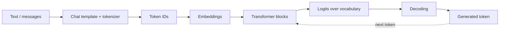
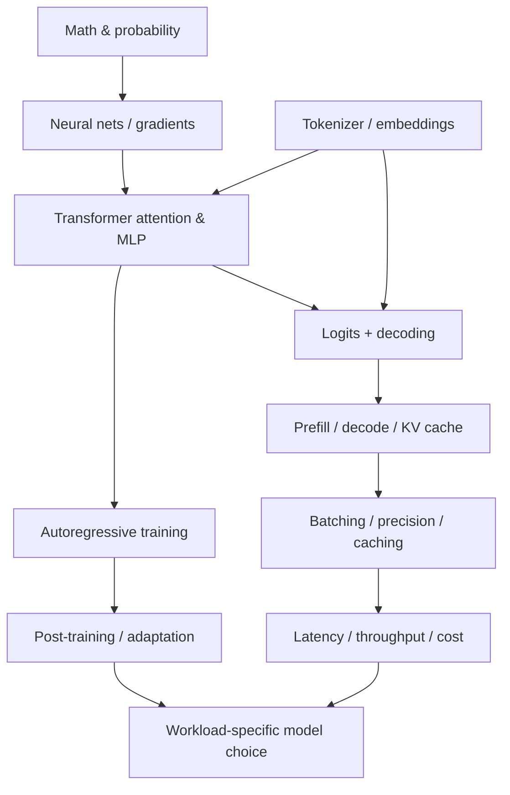

# LLM Foundations — A Learning-First Master Guide

**From first principles to Principal-level interviews**  
**Revised 23 November 2026 · Single-file edition**

> **Goal:** Understand what happens from a string entering an LLM to trained probabilities, generated tokens, GPU memory usage, inference latency and engineering decisions. This version is a coherent learning guide *and* a searchable interview reference.

**Scope:** AI/ML foundations, linear algebra for language models, neural nets, Transformers, tokenization, training and post-training, decoding, model families, low-level inference engineering, and basic performance/economics. **Intentionally out of scope:** RAG/retrieval systems, agent orchestration, enterprise AI governance, dedicated evaluation-tool frameworks, and full distributed-platform design (covered in separate guides).

## How this edition is different

- **Learn the concept before the Q&A.** Each chapter begins with an intuition, a diagram/example, and a practical distinction.
- **One primary home per concept.** Closely overlapping questions are merged, with the previous 116 IDs mapped in the crosswalk appendix.
- **Answers stay interview-ready.** Each card has a concise answer followed by mechanism, nuance and evidence.
- **Applied scenarios are exercises, not another theory chapter.** Use the cross-referenced concepts to form a decision.
- **No false universals.** Mathematical identities, illustrative calculations, implementation-specific details and empirical findings are distinguished.

## Quick-start: read in three passes

1. **Understanding (first pass):** read the chapter introduction, then explain the diagram using your own words. Skip difficult formula derivations on the first read.
2. **Mechanics (second pass):** follow the worked examples and the **How it works** explanations. Track variable definitions and tensor shapes.
3. **Interview mastery (third pass):** hide the 30-second answer, respond aloud, then defend assumptions and trade-offs using the applied cases.

### The story of one generated response



**Train vs serve:** during training the model adjusts weights using a loss and backpropagation; at ordinary inference time the weights remain fixed while the runtime generates tokens and maintains sequence state.

### Notation used throughout

`B` = batch size; `T` = sequence length; `V` = vocabulary size; `d` = model hidden width; `dh` = dimension per attention head; `Hq` = number of query heads; `Hkv` = number of key/value heads; `L` = layer count; `P` = parameter count; `N` = sample/token count as defined locally; `s` = bytes per stored element; `τ` = sampling temperature; `η` = learning rate. Numerical examples are illustrative, **not** production benchmarks or defaults.

### Fast track: the 12 concepts to master first

If the complete guide feels overwhelming, study these **in order**. Each link points to the *new* question number after consolidation.

1. [Q004 — Self-supervised learning](#q004) → how the training target comes from text.
2. [Q020 — Forward pass and backpropagation](#q020) → how neural networks learn.
3. [Q027 — Logits](#q027) and [Q028 — Softmax](#q028) → what the model predicts.
4. [Q034 — Transformer architecture](#q034) → the big-picture computation.
5. [Q036 — Attention mathematics](#q036) → how context is mixed.
6. [Q038 — Causal mask](#q038) → why future tokens are hidden.
7. [Q029 — Causal pretraining](#q029) → how the loss is defined.
8. [Q060 — Decoding approaches](#q060) → how predictions become text.
9. [Q076 — Prefill](#q076) and [Q077 — KV caching](#q077) → how inference executes.
10. [Q078 — KV memory](#q078) → why context and concurrency compete.
11. [Q088 — Latency and throughput](#q088) → how to measure performance.
12. [Q090 — Hosted-model cost](#q090) → how to connect token usage to business cost.

These anchor numbers are the revised learning order; the full mapping from the original guide is in [Appendix D](#question-crosswalk).

## Navigation

- [Chapter 1: Build the mental model](#chapter-1) — 8 concept cards
- [Chapter 2: Understand the mathematics of learning](#chapter-2) — 12 concept cards
- [Chapter 3: From text to tokens to predicted probabilities](#chapter-3) — 12 concept cards
- [Chapter 4: Look inside a Transformer](#chapter-4) — 15 concept cards
- [Chapter 5: Training, post-training and adaptation](#chapter-5) — 12 concept cards
- [Chapter 6: Generation behavior and output correctness](#chapter-6) — 11 concept cards
- [Chapter 7: Model families, multimodality and context](#chapter-7) — 5 concept cards
- [Chapter 8: How inference engines make LLMs efficient](#chapter-8) — 12 concept cards
- [Chapter 9: Performance, economics and engineering choices](#chapter-9) — 10 concept cards
- [Chapter 10: Applied engineering cases](#chapter-10) — 11 practice cases
- [Full inference walkthrough](#full-inference-walkthrough)
- [Formula cheat sheet](#formula-cheat-sheet)
- [Concept map](#appendix-c--concept-map)
- [Original-to-new question crosswalk](#question-crosswalk)
- [Editorial and accuracy review](#editorial-review)
- [Source bibliography](#source-bibliography)

---

<a id="chapter-1"></a>

## Chapter 1 — Build the mental model

**Start with a distinction:** an LLM is not just a chatbot API. It is a trained model that assigns probabilities to token sequences, plus a runtime that turns those probabilities into generated output. Training learns parameters; inference uses them.

```text
AI (broad field)
├── Rule-based systems (AI without learned weights)
└── Machine Learning (learn from data)
    ├── Traditional ML (e.g., linear regression)
    └── Deep Learning (multi-layer neural networks)
        ├── Transformer language models
        └── Other families (e.g., diffusion models)

Generative AI overlaps these branches: it describes producing new content,
not a mandatory additional layer of the hierarchy.
```

**Running example:** Suppose a model sees “The sky is”. During training it learns how probable different next tokens are, based on examples. At inference, it produces logits for candidates such as “blue” and “clear”, converts scores to a selection distribution, and chooses a token. Its behavior depends on learned weights, context, and decoding.

**Remember:** Good token prediction is a *training objective*, not a guarantee of factual correctness.

**Study check:** Can you explain the chapter’s diagram or comparison without definitions in front of you? Then practice the 8 questions below.

<a id="q001"></a>

### 001. How do AI, machine learning, deep learning, and generative AI relate?

**30-second answer:** AI is the broad goal of building systems that perform tasks associated with intelligence. ML learns statistical behavior from data; deep learning is ML using multi-layer neural networks. Generative AI learns to produce content such as text, images, or audio.

**How it works / where it breaks:** A rule-based expert system can be AI without ML. Linear regression is ML without deep learning. A Transformer language model is deep learning and generative AI. The categories overlap rather than forming four incompatible technologies. **[Established taxonomy]**

<small>Original Q01</small>

<a id="q002"></a>

### 002. What separates discriminative from generative models?

**30-second answer:** A discriminative model predicts a target conditioned on input, commonly `p(y|x)`; a generative model learns a distribution that supports generating data, such as `p(x)` or `p(x|condition)`.

**How it works / where it breaks:** A spam classifier chooses spam/not-spam; an autoregressive language model assigns probabilities to sequences and samples the next token. Some model families can serve both roles; the distinction describes objectives and behavior, not exclusive product categories. **[Math]**

<small>Original Q02</small>

<a id="q003"></a>

### 003. What is supervised learning?

**30-second answer:** Learning a mapping from inputs to labeled targets by minimizing prediction error on examples.

**How it works / where it breaks:** Given `(apartment size, price)`, a regression model fits parameters to predict price. Labels can be categories, numbers, or desired sequences. Training examples constrain the model, while held-out examples test generalization. Label quality and representativeness matter as much as model capacity.

<small>Original Q03</small>

<a id="q004"></a>

### 004. What is self-supervised learning, and why is it central to LLMs?

**30-second answer:** Self-supervised learning constructs targets from the data itself—for example, using earlier tokens to predict the next token—rather than requiring humans to label every token.

**How it works / where it breaks:** In `The sky is blue`, the target after `The sky is` can be `blue`. Autoregressive models learn conditional next-token probabilities across many sequences. Other objectives, such as masked-token or span corruption, also exist; **not all language models train only with causal next-token prediction**. [S02](#source-s02), [S03](#source-s03), [S04](#source-s04)

<small>Original Q04</small>

<a id="q005"></a>

### 005. What is generalization?

**30-second answer:** Generalization means performing well on examples or distributions not memorized from training, rather than only reproducing the training set.

**How it works / where it breaks:** A model that learns a meaningful relationship can handle a new apartment size. Good training loss is insufficient: separate training, validation, and test data, assess distribution shifts, and watch for leakage. Future user traffic may differ substantially from the test distribution.

<small>Original Q05</small>

<a id="q006"></a>

### 006. What are underfitting and overfitting?

**30-second answer:** Underfitting fails to capture useful patterns; overfitting captures noise or idiosyncrasies that do not transfer.

**How it works / where it breaks:** High training and validation error suggest underfitting. Very low training error but materially worse validation error suggests overfitting, although distribution shift can also cause the gap. Solutions include better data, regularization, model-capacity adjustment, early stopping, and domain-matched testing—not blindly adding parameters.

<small>Original Q06</small>

<a id="q007"></a>

### 007. What are parameters, hyperparameters, and activations?

**30-second answer:** Parameters are learned quantities (weights/biases); hyperparameters configure training or inference (learning rate, layer count, decoding temperature); activations are intermediate outputs computed for a particular input.

**How it works / where it breaks:** A linear layer computes `y = Wx + b`: `W` and `b` are parameters, while `y` changes with the input. A `7B` parameter label tells little by itself about context length, active experts, training data quality, or deployment memory. **[Model-dependent]**

<small>Original Q07</small>

<a id="q008"></a>

### 008. What is the difference between training and inference?

**30-second answer:** Training changes model parameters using a loss and optimizer; inference uses already-trained parameters to compute predictions and optionally generate tokens.

**How it works / where it breaks:** Training usually needs parameter/gradient/optimizer memory and activation storage for backward passes. Inference often prioritizes low latency, KV caches, batching, and memory-efficient weight formats. Fine-tuning is another training stage, not simply a special decoding parameter.

<small>Original Q24</small>

---

<a id="chapter-2"></a>

## Chapter 2 — Understand the mathematics of learning

A neural network is many small numerical transformations connected together. It needs **representations** (vectors), a **prediction** (forward pass), a **score for errors** (loss), and a **way to change the parameters** (gradients, optimizer).

```text
Input vector x ──> weighted layers ──> prediction ŷ
                                          │
Correct target y ──────────────────────────┤
                                          ▼
                                        Loss L
                                          │
                            backpropagation / chain rule
                                          ▼
                                parameter gradients
                                          │
                                 optimizer update
```

**Mini example:** Predict `y=6` from `x=2` using `ŷ=wx`. Start at `w=2` → prediction `4`, squared loss `4`. The gradient is `−8`, so one plain-gradient-descent update with `η=0.01` gives `w=2.08`. This reduces the error for *that illustrative point*; it does not establish success on unseen data.

**Avoid memorizing formulas in isolation:** state what each quantity *measures* and how the measurement guides a decision.

**Study check:** Can you explain the chapter’s diagram or comparison without definitions in front of you? Then practice the 12 questions below.

<a id="q009"></a>

### 009. Why do we represent data as vectors?

**30-second answer:** A vector packages numeric features or hidden states so the model can apply linear algebra efficiently.

**How it works / where it breaks:** An illustrative 2D feature vector `[area, distance] = [80, 5]` requires scaling before some distance-based methods because units differ. In neural networks, vectors are learned hidden representations, not human-labeled dimensions; a single coordinate usually lacks a stable plain-English meaning.

<small>Original Q08</small>

<a id="q010"></a>

### 010. What is a dot product?

**30-second answer:** It combines corresponding vector components into a scalar and often measures alignment; attention uses dot products between query and key vectors.

**How it works / where it breaks:** **[Math; illustrative]** `[1,2] · [3,4] = 1×3 + 2×4 = 11`. In general, `a·b = Σ_i a_i b_i`. For nonzero vectors, `a·b = ||a|| ||b|| cos θ`: magnitude affects raw dot-product scores, so a raw dot product is **not automatically cosine similarity**.

<small>Original Q09</small>

<a id="q011"></a>

### 011. What is matrix multiplication, and why do tensor shapes matter?

**30-second answer:** Matrix multiplication applies many weighted combinations in parallel; compatible inner dimensions are mandatory.

**How it works / where it breaks:** **[Math]** `(m×n) @ (n×p) → (m×p)`. **[Illustrative]** Token states `X` with shape `[B,T,512]` multiplied by projection `W` `[512,128]` produce `[B,T,128]`. Most Transformer shape errors come from confusing batch, position, head, and channel dimensions.

<small>Original Q10</small>

<a id="q012"></a>

### 012. What is a derivative?

**30-second answer:** A derivative is the local rate of change of a scalar function, showing how sensitive the output is to a small input change.

**How it works / where it breaks:** **[Math; illustrative]** If `f(x)=x²`, then `f'(x)=2x`; at `x=3`, slope is `6`. The derivative is local: it does not say the function changes by exactly six for arbitrary large steps.

<small>Original Q11</small>

<a id="q013"></a>

### 013. What is a gradient?

**30-second answer:** A gradient is the vector of partial derivatives of a scalar loss with respect to many parameters, pointing in the local direction of steepest increase under Euclidean geometry.

**How it works / where it breaks:** **[Math]** For `L(w,b)`, `∇L=[∂L/∂w, ∂L/∂b]`. To reduce loss, basic gradient descent steps approximately opposite to that direction. A gradient is computed from the current batch; it is not a proof that the next large step improves the entire population loss.

<small>Original Q12</small>

<a id="q014"></a>

### 014. What is a loss function, and how do MSE and cross-entropy differ?

**30-second answer:** A loss assigns a numerical penalty to predictions; training optimizes expected or empirical loss, not an abstract concept of intelligence.

**How it works / where it breaks:** Squared error emphasizes larger numeric deviations; cross-entropy penalizes low probability assigned to the correct class/token. A low next-token loss does not guarantee truthfulness, task success, or safe behavior because the optimized objective is only a proxy. **[Math + interpretation]**

**Related distinction (original Q14):** Mean squared error fits numeric targets; cross-entropy fits probabilistic choices, including next-token classification.

**[Math]** `MSE=(1/N)Σ_i (ŷ_i−y_i)²`. For a single correct-class probability `p`, cross-entropy is `−ln(p)`. **[Illustrative]** `p=0.25` gives loss `1.3863`; `p=0.8` gives `0.2231`. `N` is the number of examples, `ŷ` prediction, `y` true target, and `ln` natural logarithm.

<small>Original Q13 + Q14</small>

<a id="q015"></a>

### 015. How does gradient descent actually update a weight?

**30-second answer:** Compute a gradient of loss, then move parameters a small amount in the negative-gradient direction.

**How it works / where it breaks:** **[Math; illustrative]** For `ŷ=wx`, `L=(wx−y)²`, with `w=2`, `x=2`, `y=6`, loss is `4` and `∂L/∂w=2(wx−y)x=−8`. With learning rate `η=0.01`, `w_new=w−η∂L/∂w=2.08`. `η` controls step size; larger is not always faster or stable.

<small>Original Q15</small>

<a id="q016"></a>

### 016. What is a learning rate, and why can too-high or too-low rates fail?

**30-second answer:** Learning rate controls optimizer step magnitude. Too high can overshoot or diverge; too low can make convergence unacceptably slow.

**How it works / where it breaks:** In nonconvex deep networks, gradient sizes, optimizer moments, schedules, effective batch size, and numerical precision interact. Learning-rate warmup and decay are design choices, not universal requirements. Monitor loss curves and stability instead of copying an unrelated model's hyperparameters.

<small>Original Q16</small>

<a id="q017"></a>

### 017. What do full-batch, stochastic, and mini-batch training mean?

**30-second answer:** Full-batch uses the entire dataset per update; stochastic gradient descent in the narrow sense uses one example; mini-batch training updates from a subset.

**How it works / where it breaks:** Mini-batches enable accelerator efficiency while approximating the population gradient with noise. Distributed training may accumulate gradients from several microbatches to simulate a larger *effective* batch. Batch size changes memory use, throughput, and optimization dynamics.

<small>Original Q17</small>

<a id="q018"></a>

### 018. What is an artificial neuron?

**30-second answer:** A simple artificial neuron computes a weighted sum plus bias, then passes it through an activation function.

**How it works / where it breaks:** **[Math]** `a=φ(w·x+b)` where `x` input vector, `w` weights, `b` bias, `φ` nonlinear activation. Without nonlinearities between layers, a stack of linear maps collapses into one linear map. The biological-neuron analogy is only an intuition, not a faithful biological simulation.

<small>Original Q21</small>

<a id="q019"></a>

### 019. Why do neural networks need nonlinear activation functions?

**30-second answer:** Nonlinear activations allow multi-layer networks to represent relationships more complex than a single linear transformation.

**How it works / where it breaks:** ReLU is `max(0,x)`; GELU and gated activations (e.g., SwiGLU) are used in different Transformer variants. There is no single activation shared by all modern LLMs. Activation choice changes expressivity, gradient behavior, and implementation efficiency. [S01](#source-s01)

<small>Original Q22</small>

<a id="q020"></a>

### 020. What are forward pass and backpropagation?

**30-second answer:** The forward pass computes outputs and loss; backpropagation efficiently computes parameter gradients by applying the chain rule backward through the computation graph.

**How it works / where it breaks:** For `x → linear → activation → loss`, backprop propagates how changing later quantities changes the loss and then composes those derivatives backward. It does not imply that token generation itself 'backpropagates'; normal inference uses a forward computation without training gradients. **[Math]**

<small>Original Q23</small>

---

<a id="chapter-3"></a>

## Chapter 3 — From text to tokens to predicted probabilities

A language model does not ingest a string directly as a sequence of “words.” The client serializes the conversation, the tokenizer maps text to **integer IDs**, and an embedding table turns IDs into **learned vectors**. The model outputs **logits**, which can become token probabilities via softmax.

```text
Messages → chat template → text/token stream → token IDs
                                                │
                                        embeddings / model
                                                │
                                       logits [vocabulary]
                                                │
                                     decoding → next token
```

**Three different objects:** token text (`"blue"`), token ID (`391`, fictional), and token embedding (`[0.12, −0.41, …]`, fictional) are not interchangeable.

**One training-vs-inference subtlety:** During causal pretraining, the model gets the *real prefix* to predict each next token (teacher forcing). During free-running generation, it gets its own prior generated tokens. This explains both parallelizable training positions and potential generation drift.

**Study check:** Can you explain the chapter’s diagram or comparison without definitions in front of you? Then practice the 12 questions below.

<a id="q021"></a>

### 021. What is tokenization, and why is a token not the same as a word?

**30-second answer:** Tokenization turns input content into discrete units mapped to integer IDs; the model processes those IDs rather than raw character strings.

**How it works / where it breaks:** Tokens may be words, subwords, characters, bytes, or modality-specific units. Text length in characters is not token length. Tokenizer behavior is **model-specific**, including normalization, whitespace, Unicode, and special-token rules. [S14](#source-s14), [S15](#source-s15)

**Related distinction (original Q44):** Tokenization optimizes a representation scheme, not linguistic word boundaries; one word may be many tokens, and spaces/punctuation may join adjacent tokens.

Multilingual text, emoji, code, and unusual symbols may tokenize very differently. For production, measure tokens using the **model's** tokenizer or provider accounting endpoint; English characters-per-token heuristics are unreliable for correctness or billing. [S14](#source-s14), [S16](#source-s16)

<small>Original Q40 + Q44</small>

<a id="q022"></a>

### 022. How do BPE, WordPiece, and Unigram differ?

**30-second answer:** They are subword tokenization families: BPE learns frequent merges; WordPiece uses a different vocabulary-selection criterion and longest-match tokenization; Unigram chooses segmentations from a probabilistic candidate vocabulary.

**How it works / where it breaks:** Subwords balance vocabulary size against fragmenting uncommon words. **[Illustrative; not actual IDs]** `unhappiness` could become `un + happi + ness` or a different partition depending on tokenizer. Byte-level approaches can represent arbitrary text through bytes; SentencePiece is a framework supporting multiple algorithms, not a fourth mutually exclusive segmentation objective. [S14](#source-s14)

<small>Original Q41</small>

<a id="q023"></a>

### 023. What are vocabulary size and token IDs?

**30-second answer:** Vocabulary size `V` is the count of token entries for a tokenizer; token IDs are integer indices into that vocabulary.

**How it works / where it breaks:** Tokens map to learned input vectors, typically through a lookup table `[V,d]`. IDs are arbitrary labels, not semantic ranks. Increasing `V` can shorten sequences for some content while enlarging token-related parameter tables. Tokenizer and checkpoint must match; reusing arbitrary IDs from another tokenizer breaks semantics. [S14](#source-s14)

<small>Original Q42</small>

<a id="q024"></a>

### 024. What are special tokens and chat templates?

**30-second answer:** Special tokens mark structural roles or boundaries—such as begin/end of sequence, end of turn, role separators, or other model-specific controls. A chat template serializes structured messages into the model's expected token pattern.

**How it works / where it breaks:** A chat API's `{role,content}` objects are not guaranteed to map one-to-one to visible text; providers may add internal markers or hidden overhead. Wrong templates can degrade instruction following or termination. End-of-message and end-of-generation need not be the same token. [S15](#source-s15), [S16](#source-s16)

<small>Original Q43</small>

<a id="q025"></a>

### 025. What counts toward input and output tokens?

**30-second answer:** Account for serialized instructions, message metadata/formatting, user content, and any modality tokens according to the provider; output usage may include visible text plus model-specific nonvisible output/reasoning tokens.

**How it works / where it breaks:** Providers may expose cached input separately while still including it within input usage. Raw tokenizer counts can differ from billed or metered API usage because templates and internal accounting differ. Prefer authoritative usage fields and model-specific counting tools; never add cached tokens again if they are already a subset. [S15](#source-s15), [S16](#source-s16)

<small>Original Q45</small>

<a id="q026"></a>

### 026. How do probability and conditional probability enter an LLM?

**30-second answer:** The model produces conditional probabilities for candidate next tokens given preceding context.

**How it works / where it breaks:** **[Math]** `P(x₁,…,x_T)=∏_{t=1}^{T}P(x_t|x_<t)` is the probability chain rule; `x_t` is token at position `t`, and `x_<t` denotes preceding tokens. An autoregressive model parameterizes these factors. Sampling from a distribution differs from asserting that its most probable continuation is factual.

<small>Original Q18</small>

<a id="q027"></a>

### 027. What are logits?

**30-second answer:** Logits are unnormalized scores for vocabulary candidates, typically output by the model's last projection before turning scores into probabilities.

**How it works / where it breaks:** For vocabulary size `V`, output logits have shape `[B,T,V]` during full-sequence computation; generation usually uses the last relevant position. Logit differences, not absolute offsets, determine softmax probabilities. A logit is **not** itself a confidence percentage.

<small>Original Q19</small>

<a id="q028"></a>

### 028. What is softmax?

**30-second answer:** Softmax converts a vector of logits into nonnegative probabilities that sum to one.

**How it works / where it breaks:** **[Math]** `p_i=exp(z_i)/Σ_j exp(z_j)`, where `z_i` is the logit of option `i`. **[Illustrative]** logits `[2,1,0]` yield approximately `[0.665,0.245,0.090]`. Subtract the maximum logit before exponentiation for numerical stability; this does not change the result.

<small>Original Q20</small>

<a id="q029"></a>

### 029. How is causal next-token pretraining formulated?

**30-second answer:** Given a sequence, learn to maximize probability of its observed next tokens under the preceding context.

**How it works / where it breaks:** **[Math]** `L(θ)=−Σ_{t=1}^{T}log p_θ(x_t|x_<t)` (possibly averaged/masked); `θ` denotes trainable parameters. Teacher forcing supplies the actual previous tokens during training, enabling parallel loss computation. At inference, the model conditions on its own generated history, creating exposure to its mistakes. [S05](#source-s05)

<small>Original Q46</small>

<a id="q030"></a>

### 030. What is teacher forcing?

**30-second answer:** Teacher forcing feeds observed target-prefix tokens during sequence-model training rather than feeding the model's own previous predictions.

**How it works / where it breaks:** It makes standard autoregressive training efficient and creates well-defined supervised positions. During free-running generation the model may drift after an error because it is no longer conditioning on the same prefixes seen in the training examples. This train/inference mismatch is one reason decoding behavior matters. [S05](#source-s05)

<small>Original Q47</small>

<a id="q031"></a>

### 031. What is perplexity?

**30-second answer:** Perplexity is the exponential of average token negative log likelihood; it summarizes how surprised a model is by target tokens under a specified tokenization and dataset.

**How it works / where it breaks:** **[Math]** `PPL=exp(−(1/N)Σ_{i=1}^N log p_i)` where `p_i` is predicted probability for the correct token, `N` scored tokens. **[Illustrative]** If average loss is `ln 4`, perplexity is `4`. Comparing perplexity across different tokenizers, corpora, or scoring conventions is misleading without normalization. Lower PPL does not directly prove better business-task performance.

<small>Original Q48</small>

<a id="q032"></a>

### 032. Where does pretraining data quality matter?

**30-second answer:** Data coverage, duplication, contamination, language balance, formatting, and noise shape both model capability and limitations.

**How it works / where it breaks:** Duplicates can increase memorization; low-quality text teaches undesirable patterns; missing domain/language coverage reduces reliability on that distribution. Filtering has trade-offs: aggressive filtering can remove useful minority-language or domain material. Published datasets and recipes vary; avoid assuming every commercial model used the same mix. [S05](#source-s05), [S06](#source-s06)

<small>Original Q49</small>

---

<a id="chapter-4"></a>

## Chapter 4 — Look inside a Transformer

The Transformer is the computational core. In a conventional decoder block, **attention** exchanges information across allowed token positions and the **MLP** transforms each position's features. Residual connections and normalization support deep training.

```text
Hidden states ───┬───────────────────────────┐
                 ▼                           │
            Norm → Q/K/V → causal attention ──+→ updated states
                                              │
                 ┌────────────────────────────┘
                 ▼
            Norm → token-wise MLP → residual → next block
```

**Attention by analogy:** a query asks which earlier positions are relevant; keys give match scores; values supply the information mixed into the output. It is *learned vector arithmetic*, not literal string search.

**Tiny example:** If a query's scaled scores against two allowed keys are `[0, ln 3]`, softmax assigns weights `[0.25, 0.75]`. The attention result is `0.25v₁ + 0.75v₂`. This is the clearest route from Q/K/V terminology to the attention equation.

**Important scope:** The diagram illustrates a pre-norm causal decoder; encoder–decoder models, GQA, alternative normalization, positional methods, and newer attention variants differ.

**Study check:** Can you explain the chapter’s diagram or comparison without definitions in front of you? Then practice the 15 questions below.

<a id="q033"></a>

### 033. Why did Transformers change sequence modeling?

**30-second answer:** Self-attention lets every allowed position exchange information through learned, content-dependent weights, while training processes many positions in parallel.

**How it works / where it breaks:** The original 2017 Transformer was an encoder–decoder architecture, not today's generic synonym for an autoregressive chatbot. Compared with recurrent computation, attention shortens many dependency paths but conventional full attention has quadratic sequence-length interaction cost. Practical efficiency depends on sequence length, hardware, kernels, and architecture. [S01](#source-s01)

<small>Original Q25</small>

<a id="q034"></a>

### 034. What is the end-to-end structure of a decoder-only Transformer?

**30-second answer:** Convert token IDs to vectors, inject position information, repeat causal attention and feed-forward blocks, normalize/project hidden states to vocabulary logits, and decode next tokens.

**How it works / where it breaks:** The diagram below uses a **pre-normalization illustrative design**. Alternative block order, normalization, attention, MLP, and output-head designs exist.

```text
Text → tokenizer → token IDs [B,T]
  → token lookup [B,T,d] + positional mechanism
  → ┌──── repeated L times ───────────────────────────────┐
    │ Norm → causal self-attention → residual addition    │
    │ Norm → position-wise FFN/MLP → residual addition    │
    └─────────────────────────────────────────────────────┘
  → final norm (if configured)
  → vocabulary projection [B,T,V]
  → select next-position logits → decoding → next token
```

**Key insight:** Training can score all next positions in one masked forward pass; generation of a standard autoregressive decoder is sequential across newly generated positions. [S01](#source-s01), [S05](#source-s05)

<small>Original Q26</small>

<a id="q035"></a>

### 035. What do Query, Key, and Value actually mean?

**30-second answer:** Query represents what the current token seeks; Key represents how other positions can be matched; Value contains information passed forward when a match receives weight.

**How it works / where it breaks:** These are learned projections of hidden states, not a literal database lookup. For hidden states `X`, calculate `Q=XW_Q`, `K=XW_K`, `V=XW_V`. Scores use `QKᵀ`; a weighted sum of `V` creates context-dependent outputs. Same input can yield different attention patterns across heads and layers. [S01](#source-s01)

<small>Original Q27</small>

<a id="q036"></a>

### 036. Explain scaled dot-product attention mathematically

**30-second answer:** Attention scores query–key similarity, scales it, masks forbidden positions, uses softmax as weights, and mixes value vectors.

**How it works / where it breaks:** **[Math]**

`Attention(Q,K,V) = softmax(QKᵀ/√dh + M) V`

`dh` is key-head dimension; `M` adds `−∞` to forbidden positions (conceptually); `softmax` acts row-wise. Scaling mitigates increasing dot-product variance as `dh` grows under common initialization assumptions. With one query, two keys scored `[0, ln 3]` (illustrative after scaling/masking), weights are `[0.25,0.75]`; the output is `0.25v₁+0.75v₂`. [S01](#source-s01)

<small>Original Q28</small>

<a id="q037"></a>

### 037. What makes self-attention 'self' attention?

**30-second answer:** The queries, keys, and values come from different learned projections of the **same sequence's** states.

**How it works / where it breaks:** In cross-attention, queries come from one sequence/state while keys and values come from another—for example, a decoder attending to an encoder. Decoder-only causal self-attention does not require an encoder. Some multimodal systems use cross-attention; others combine modalities in a shared token stream. [S01](#source-s01), [S04](#source-s04)

<small>Original Q29</small>

<a id="q038"></a>

### 038. Why does a causal mask matter?

**30-second answer:** It prevents a next-token predictor at position `t` from seeing future target positions `t+1...`, preserving the autoregressive objective.

**How it works / where it breaks:** For `T=4`, allowed attention positions (✓) can be pictured as:

```text
             key positions →  1  2  3  4
query pos 1                   ✓  ·  ·  ·
query pos 2                   ✓  ✓  ·  ·
query pos 3                   ✓  ✓  ✓  ·
query pos 4                   ✓  ✓  ✓  ✓
```

The mask applies to attention scores, not the label-generation process itself. **[Math for this architecture]** If future tokens are visible during causal training, information leakage makes the task invalid. Other model objectives intentionally use different masks. [S01](#source-s01)

<small>Original Q30</small>

<a id="q039"></a>

### 039. What is multi-head attention and why use multiple heads?

**30-second answer:** Multiple learned query/key/value projections allow several attention patterns and information subspaces to be modeled in parallel, then mixed together.

**How it works / where it breaks:** Each head computes attention with its own projections. Concatenate head outputs and use an output projection. More heads do **not** guarantee disjoint human-interpretable functions, and increasing head count alone does not monotonically improve quality. [S01](#source-s01)

<small>Original Q31</small>

<a id="q040"></a>

### 040. Walk through concrete attention tensor shapes

**30-second answer:** Track the batch, sequence, head, and per-head dimensions; the attention score matrix is over pairs of token positions.

**How it works / where it breaks:** **[Illustrative full MHA]** `B=2`, `T=4`, `d=512`, `Hq=Hkv=8`, `dh=64`:

```text
X                           [2,4,512]
Q,K,V after reshape         [2,8,4,64]
Q @ transpose(K)            [2,8,4,4]
softmax + mask              [2,8,4,4]
attention weights @ V       [2,8,4,64]
concat heads                [2,4,512]
output projection           [2,4,512]
```

In grouped-query attention, `Hq` and `Hkv` differ; K/V heads are shared among groups of query heads, so don't blindly reuse the MHA memory formula. [S01](#source-s01), [S11](#source-s11)

<small>Original Q32</small>

<a id="q041"></a>

### 041. Why does attention have a quadratic component in sequence length?

**30-second answer:** Full attention compares each of `T` query positions with `T` key positions, producing `T²` pairwise scores per head.

**How it works / where it breaks:** Score computation scales roughly `O(T²dh)` per head; projection and MLP costs may also dominate at some dimensions and sequence lengths. Optimized attention kernels can avoid materializing the full `T×T` matrix in high-bandwidth memory without making full attention's arithmetic complexity universally linear. [S01](#source-s01), [S12](#source-s12)

<small>Original Q33</small>

<a id="q042"></a>

### 042. What does the feed-forward network do in a Transformer block?

**30-second answer:** After attention exchanges information across positions, a position-wise feed-forward network transforms features **within each token position**.

**How it works / where it breaks:** A typical two-layer MLP is `FFN(x)=W₂ φ(W₁x+b₁)+b₂`, often with an intermediate width greater than `d`; gated variants use a different formula. The same weights operate at each position, but inputs differ because prior attention mixed context. In many architectures the FFN contributes a large share of parameters/compute. [S01](#source-s01)

<small>Original Q34</small>

<a id="q043"></a>

### 043. What are residual connections and why do they help?

**30-second answer:** Residual connections add a layer's transformation to its input: `y=x+F(x)`, preserving an identity path for information and gradients.

**How it works / where it breaks:** Backpropagation through `y` includes an identity contribution, which helps train deep networks. Residuals are not a guarantee against exploding/vanishing gradients. Shapes on both sides of the sum must be compatible (or explicitly projected). The Transformer uses residual pathways around sublayers. [S01](#source-s01)

<small>Original Q35</small>

<a id="q044"></a>

### 044. What is LayerNorm vs RMSNorm?

**30-second answer:** LayerNorm centers and rescales a feature vector using its mean and variance; RMSNorm rescales using root-mean-square magnitude without subtracting the mean.

**How it works / where it breaks:** **[Math; simplified]** `LN(x)=(x−μ)/√(σ²+ε) ·γ+β`; `RMSNorm(x)=x/√(mean(x²)+ε)·γ`. `μ`, `σ²` are within-normalized-dimension statistics; `γ`, `β` are learned scale/shift (when provided); `ε` stabilizes division. Architecture and norm placement vary. [S01](#source-s01), [S13](#source-s13)

<small>Original Q36</small>

<a id="q045"></a>

### 045. What is pre-norm vs post-norm?

**30-second answer:** In pre-norm blocks the normalization precedes attention/MLP (`x+F(Norm(x))`); in post-norm blocks it follows the residual sum (`Norm(x+F(x))`).

**How it works / where it breaks:** The original Transformer employed post-norm-style residual blocks, while many later decoder stacks use pre-norm variants for optimization behavior. Changing norm placement alters gradient propagation, training dynamics, and sometimes inference numerics. Never assume 'the Transformer block' has one universal order. [S01](#source-s01)

<small>Original Q37</small>

<a id="q046"></a>

### 046. If attention understands content, why add positional information?

**30-second answer:** Attention needs information about sequence position. Content-only self-attention without positional mechanisms is permutation-equivariant; causal masks provide directional structure, but positional methods explicitly encode richer order or offsets.

**How it works / where it breaks:** A content-only attention operation can be permutation-equivariant if it has no positional information or order-dependent mask. **Causal masking itself is order dependent**, so avoid saying every form of attention is completely order-blind. Learned positions, sinusoidal encodings, RoPE, and relative biases provide different kinds of position signals; they are not plug-and-play replacements. [S01](#source-s01), [S10](#source-s10)

<small>Original Q38</small>

<a id="q047"></a>

### 047. What is RoPE, intuitively?

**30-second answer:** RoPE encodes position by rotating pairs of query/key features through position-dependent angles, allowing attention scores to reflect relative offsets.

**How it works / where it breaks:** **[Intuitive, illustrative]** A vector `(a,b)` is rotated by `θ_t` at position `t`: `(a cosθ_t−b sinθ_t, a sinθ_t+b cosθ_t)`. For compatible rotation schedules, dot products between rotated Q and K depend on relative positional relationships. Extending a model beyond its trained positional regime may need special adaptation and verification. [S10](#source-s10)

<small>Original Q39</small>

---

<a id="chapter-5"></a>

## Chapter 5 — Training, post-training and adaptation

Separate **what is learned**, **what data teaches it**, and **which parameters change**:

| Stage | Data / signal | What changes | Primary goal |
|---|---|---|---|
| Pretraining | Large text/token sequences | Base weights | General language modeling capability |
| Supervised fine-tuning (SFT) | Input → desired response examples | All or some trainable weights | Improve instruction/task behavior |
| Preference optimization (RLHF/DPO families) | Preferences/rewards | Policy weights/adapters | Favor selected response qualities |
| LoRA / QLoRA | Task data | Small adapters; frozen base in the original methods | Adapt with lower training memory |
| Distillation | Teacher-generated guidance | Student weights | Transfer selected behavior into another model |

**Key principle:** Optimizing one loss does *not* directly guarantee truthfulness, reliability, or generalization. Use separate held-out tasks to decide whether an adaptation helped; training loss alone is not a product success metric.

**Study check:** Can you explain the chapter’s diagram or comparison without definitions in front of you? Then practice the 12 questions below.

<a id="q048"></a>

### 048. What are scaling laws—and what do they *not* guarantee?

**30-second answer:** Empirical scaling laws fit relationships between model size, data, compute, and predictive loss within studied regimes; they guide research and capacity decisions but are not physics laws.

**How it works / where it breaks:** Chinchilla-style work showed important parameter/data trade-offs for a training compute budget. The optimal balance also depends on data reuse/quality, architecture, target workload, and inference economics. No fixed 'tokens per parameter' ratio universally predicts the best production model in 2026. **[Evidence, not universal theorem]** [S06](#source-s06)

<small>Original Q50</small>

<a id="q049"></a>

### 049. What are common limitations of the pretraining objective?

**30-second answer:** Predicting probable text does not independently enforce truth, up-to-date knowledge, task alignment, calibration, or correct reasoning.

**How it works / where it breaks:** A continuation can be statistically plausible but false. Training examples may contain contradictions; knowledge is compressed into parameters, not maintained as a transactional record. Post-training and application-level checks can improve behavior but cannot turn a probabilistic model into an intrinsically authoritative source. [S05](#source-s05), [S07](#source-s07)

<small>Original Q51</small>

<a id="q050"></a>

### 050. What is the difference between optimization progress and genuine capability gain?

**30-second answer:** Lower training loss indicates a better fit to the training objective; useful capability requires independent evidence on target tasks and conditions.

**How it works / where it breaks:** Improvements may arise from memorization, benchmark overlap, data selection, or changed tokenization rather than transferable skill. Check held-out behavior, out-of-distribution cases, error modes, and operational constraints. In interviews, distinguish measured findings from mechanistic explanations and plausible hypotheses.

<small>Original Q52</small>

<a id="q051"></a>

### 051. How does supervised fine-tuning differ from pretraining?

**30-second answer:** SFT updates pretrained parameters or adapters on examples of desired input–response behavior, using a supervised objective.

**How it works / where it breaks:** Instruction tuning is SFT targeting instruction following. An example might pair a user instruction with a model answer in a defined chat template; the training loss often focuses on assistant tokens, with implementation-specific masking. SFT can change style, format, and task behavior, but it is not guaranteed to teach missing factual knowledge or erase prior capabilities. [S07](#source-s07)

**Related distinction (original Q54):** Pretraining learns broad statistical language behavior from large-scale data; instruction tuning teaches the model how to respond to requests and conversational roles.

Next-token training on raw text can model many genres without prioritizing user helpfulness. Instruction tuning concentrates probability mass on preferred response formats and task-following patterns. They may use similar token prediction losses but different data, masks, and objectives. Modern training recipes can involve several stages rather than one fixed pipeline. [S05](#source-s05), [S07](#source-s07)

<small>Original Q53 + Q54</small>

<a id="q052"></a>

### 052. What is RLHF, and what does preference optimization actually optimize?

**30-second answer:** Reinforcement learning from human feedback uses human preference information to improve a model's response policy; a classic pipeline learns a reward model from rankings and optimizes the policy against it.

**How it works / where it breaks:** **[One established recipe, not a mandatory universal stack]** Demonstrations → SFT → pairwise human preferences → reward model → RL optimization with an explicit reference-model regularization term. PPO was used in the InstructGPT work, but other RL methods exist. Reward models imperfectly approximate preferences and may be exploited by optimization. [S07](#source-s07)

**Related distinction (original Q57):** It increases relative likelihood of preferred outputs over less-preferred outputs under a specified objective, not objective 'truth' or guaranteed human values.

Preference labels may encode style, task success, safety boundaries, or annotator bias. A model can optimize apparent helpfulness while remaining confidently wrong. Keep 'preference alignment' separate from factual grounding and explicit application correctness constraints. [S07](#source-s07), [S08](#source-s08)

<small>Original Q55 + Q57</small>

<a id="q053"></a>

### 053. What is DPO, and how does it differ from classic RLHF?

**30-second answer:** Direct Preference Optimization learns from chosen/rejected responses without fitting a separate explicit reward model and running an online RL loop in the original DPO formulation.

**How it works / where it breaks:** DPO uses preference pairs with a reference policy and an analytically derived classification-style objective. It is simpler operationally for many training setups, but depends on preference-data quality, objective assumptions, and chosen reference behavior; it is not a blanket guarantee of safer or better models than RLHF. [S08](#source-s08)

<small>Original Q56</small>

<a id="q054"></a>

### 054. How does safety training affect model behavior?

**30-second answer:** Safety training and policy-specific post-training shift response probabilities toward permitted, useful responses and away from disallowed behaviors; implementations vary by model family and provider.

**How it works / where it breaks:** Safety tuning may use curated demonstrations, preference data, classifiers, or other post-training methods. Such training is not a hard guarantee; a deployed application still needs its own controls appropriate to the task. Here the focus is the *learning mechanism*, not organizational security policy. **[Model-dependent]**

<small>Original Q58</small>

<a id="q055"></a>

### 055. When should you use full fine-tuning?

**30-second answer:** Full fine-tuning updates all or most base-model parameters, appropriate when substantial model behavior adaptation justifies higher training, checkpoint, and regression cost.

**How it works / where it breaks:** It requires careful data separation, training capacity, and checking for regressions in general abilities. It can work when adapters are insufficient, but 'more parameters updated' is not automatically better. For applied systems, benchmark prompt/configuration changes and less invasive adaptation first. **[Decision heuristic]**

<small>Original Q76</small>

<a id="q056"></a>

### 056. What is LoRA, mathematically?

**30-second answer:** Low-Rank Adaptation freezes a pretrained weight matrix and learns a low-rank update instead of directly updating the entire matrix.

**How it works / where it breaks:** **[Math]** `W' = W₀ + (α/r)BA`, where `W₀ ∈ R^{out×in}` is frozen, `A ∈ R^{r×in}`, `B ∈ R^{out×r}`, `r` is adapter rank and `α` scaling. **[Illustrative]** For a `4096×4096` matrix and `r=8`, full matrix has `16,777,216` elements, while `A+B` has `65,536` trainable elements (not counting other adapted layers). Smaller trainable footprint does not guarantee identical quality. [S09](#source-s09)

<small>Original Q77</small>

<a id="q057"></a>

### 057. What is QLoRA, and what stays quantized?

**30-second answer:** In the original QLoRA approach, the pretrained base weights are loaded in low-bit quantized form and kept frozen while trainable LoRA adapters receive gradients.

**How it works / where it breaks:** This reduces base-weight memory during adapter training; computations still use supported higher-precision arithmetic and dequantization pathways. The original paper introduced 4-bit NF4, double quantization, and paged optimizers. 'QLoRA' does not mean training every base weight directly as a four-bit integer, and final inference quantization is a separate decision. [S20](#source-s20), [S30](#source-s30)

<small>Original Q78</small>

<a id="q058"></a>

### 058. What is knowledge distillation?

**30-second answer:** Distillation trains a student model to approximate selected behavior of a stronger teacher, often using teacher-produced probabilities, outputs, or features.

**How it works / where it breaks:** **[Illustrative objective]** `L=λ L_hard+(1−λ)L_teacher`, where `λ` weights ground-truth supervision against a teacher-matching term; the exact form varies. Students may achieve lower cost/latency at a performance trade-off. Teacher errors and narrow training examples can be transferred or amplified. [S31](#source-s31)

<small>Original Q79</small>

<a id="q059"></a>

### 059. How do you decide whether adaptation is justified?

**30-second answer:** Adapt only after demonstrating a persistent, measurable gap not adequately fixed by instruction design, application constraints, or choosing an existing model.

**How it works / where it breaks:** SFT/LoRA may suit stable domain-specific formatting, style, or task patterns; distillation may suit high-volume narrow tasks. Require enough high-quality examples, a held-out comparison, latency and operating-cost estimates, rollback plans, and ownership of the adapted checkpoint. Don't fine-tune merely because a model answered one prompt badly.

<small>Original Q80</small>

---

<a id="chapter-6"></a>

## Chapter 6 — Generation behavior and output correctness

A model's raw output is **logits**, not a sentence. Generation makes repeated choices: adjust the scores, optionally restrict allowed tokens, select a token, append it to the context, and repeat until a stop condition.

```text
logits → (temperature / penalties / constraints)
       → optional top-k / top-p filtering
       → token selection → append token → repeat
```

**Don't mix these concepts:** temperature changes a *sampling distribution*; calibration measures whether probabilities align with observed correctness; schema-constrained decoding can enforce supported formats but not the truth of a business fact.

**A useful default habit:** when outputs fail, identify whether the problem is **model knowledge**, **decoding behavior**, **output format**, or **domain validity**. Those require different remedies.

**Study check:** Can you explain the chapter’s diagram or comparison without definitions in front of you? Then practice the 11 questions below.

<a id="q060"></a>

### 060. What are greedy decoding and stochastic sampling?

**30-second answer:** Greedy decoding picks the highest-scoring available token at each step; sampling draws a token according to a modified probability distribution.

**How it works / where it breaks:** Greedy is locally optimal, not necessarily globally optimal for an entire sequence. Sampling can increase diversity but also error variability. Some APIs expose a sampling mode; others abstract the underlying decoder and may not offer temperature/top-p for certain models. [S17](#source-s17)

<small>Original Q59</small>

<a id="q061"></a>

### 061. What does decoding temperature change mathematically?

**30-second answer:** For positive temperature τ, divide logits by τ before softmax. Larger τ generally flattens the distribution; smaller positive τ sharpens it. An API setting of zero follows provider/runtime-specific handling.

**How it works / where it breaks:** **[Math]** `p_i(τ)=exp(z_i/τ)/Σ_j exp(z_j/τ)` for `τ>0`; `z_i` is logit `i`. **[Illustrative]** `[2,1,0]` produces roughly `[0.665,0.245,0.090]` at `τ=1`, and `[0.506,0.307,0.186]` at `τ=2`. Temperature is not the sequence-length variable `T`. As `τ→0+`, probability concentrates on maximum-scoring tokens. Provider settings labeled `0` should be treated as implementation-specific, not literal division by zero. [S17](#source-s17)

<small>Original Q60</small>

<a id="q062"></a>

### 062. How do top-k and top-p sampling work?

**30-second answer:** Top-k retains at most `k` highest-ranked tokens; top-p (nucleus sampling) retains the smallest high-probability set with cumulative probability at least `p`, then renormalizes.

**How it works / where it breaks:** **[Illustrative]** For `[0.50,0.25,0.15,0.10]`, `top_k=2` keeps the first two; `top_p=0.70` also keeps the first two, but with a different distribution it might keep three or four. Order of filters and special handling are implementation-specific. `top_p=0.9` is not a universal best practice; tune by task and provider. [S17](#source-s17)

<small>Original Q61</small>

<a id="q063"></a>

### 063. Why isn't temperature a calibration knob?

**30-second answer:** Generation temperature controls the diversity of sampled token choices; it does not by itself guarantee that a response's expressed confidence matches its probability of correctness.

**How it works / where it breaks:** Temperature scaling is also used as a *separate statistical calibration method* fitted on labeled data. These uses share a mathematical operation but serve distinct purposes. Token probabilities, answer-level confidence, and real-world correctness differ. [S29](#source-s29)

<small>Original Q62</small>

<a id="q064"></a>

### 064. What are repetition penalties, frequency penalties, and presence penalties?

**30-second answer:** They modify token selection to discourage repeated text or already-seen tokens; exact scoring rules and availability differ by implementation.

**How it works / where it breaks:** Some systems adjust logits for token occurrence counts; others rescale logits or use n-gram blocking. Excessive penalties can break code, names, lists, or structured outputs where repetition is correct. Prefer diagnosing a repetitive loop rather than applying undocumented 'magic' defaults. [S17](#source-s17)

<small>Original Q63</small>

<a id="q065"></a>

### 065. What makes generation stop?

**30-second answer:** Stopping can occur at a learned end-of-generation token, configured stop sequence, output-token limit, or a provider/runtime-specific terminal condition.

**How it works / where it breaks:** Stopping due to a length cap may leave incomplete JSON or unfinished prose; check a provider's finish reason. End-of-turn markers may be different from end-of-sequence markers. A stop string can be removed from returned text even if it influenced generated content. [S16](#source-s16), [S17](#source-s17)

<small>Original Q64</small>

<a id="q066"></a>

### 066. What is beam search, and why is it not always suitable for chat?

**30-second answer:** Beam search keeps several high-scoring candidate sequences to approximate high-probability sequence search instead of choosing one token at a time greedily.

**How it works / where it breaks:** It can help constrained sequence tasks but often produces generic or repetitive text for open-ended conversational tasks and costs extra computation. Length penalties and ranking matter. Do not claim beam search always outperforms sampling or greedy decoding; objectives differ. [S17](#source-s17)

<small>Original Q65</small>

<a id="q067"></a>

### 067. Why is text generation often nondeterministic?

**30-second answer:** Sampling adds randomness; even at nominally deterministic decoding, distributed kernels, precision, backend changes, and provider model updates can change outputs.

**How it works / where it breaks:** Seeds improve reproducibility only within documented assumptions and do not guarantee cross-GPU, cross-version, or cross-service bitwise identity. Treat fixed models and decoder configuration as part of a reproducibility contract; log relevant metadata while controlling privacy exposure. **[Model-dependent]**

<small>Original Q66</small>

<a id="q068"></a>

### 068. What is hallucination, and why does it happen?

**30-second answer:** Hallucination is generated content that is ungrounded, incorrect, or fabricated relative to the task's truth requirements. A plausible continuation is not the same as verified fact.

**How it works / where it breaks:** Contributing factors include imperfect data, mismatched objectives, uncertainty, and generation dynamics. Even a model with low token loss can produce wrong factual answers. Better prompts and lower sampling diversity can help some workloads but cannot provide a universal correctness guarantee. **[Empirical; task-dependent]**

<small>Original Q73</small>

<a id="q069"></a>

### 069. What does it mean for an LLM to 'reason'?

**30-second answer:** Operationally, reasoning refers to successfully transforming information through multi-step inference or problem solving; the underlying cognitive interpretation remains debated.

**How it works / where it breaks:** Measured performance can improve with suitable prompting, additional inference computation, training, or verification, but coherent explanations can still hide invalid steps. Do not equate generated reasoning text with a faithful record of internal computation. **[Observed capabilities; interpretation open]**

<small>Original Q74</small>

<a id="q070"></a>

### 070. What is structured output, and how is it enforced?

**30-second answer:** Structured output means requesting a format/schema. Supported constrained decoders can restrict next tokens to enforce schema-compatible syntax, but do not guarantee correct meaning, successful completion, or that every response is schema-shaped (e.g., refusal cases).

**How it works / where it breaks:** A supported strict schema can constrain output grammar/fields within documented limitations. It does **not** validate domain-level semantics, guarantee task success, or exclude a refusal or interrupted response. Inspect finish status, refusal indicators, and schema support; then validate domain rules in application code. JSON mode alone is not strict schema adherence. [S24](#source-s24)

<small>Original Q75</small>

---

<a id="chapter-7"></a>

## Chapter 7 — Model families, multimodality and context

“Transformer” is not one universal layout. Models vary in how they represent inputs, which directions they attend, and which parts are active per token.

| Family | Main idea | Common strength |
|---|---|---|
| Encoder-only | Contextualize input, commonly bidirectionally | Classification/representation tasks |
| Decoder-only | Predict the next token from a causal prefix | Autoregressive generation |
| Encoder–decoder | Encode an input, then generate conditioned output | Conditional sequence transformation |
| Sparse MoE | Route selected token states to some expert submodules | Increase capacity without activating all experts every token |
| Multimodal | Convert images/audio/other signals to model-consumable representations | Combine non-text and text tasks |

**Context-window trap:** being allowed to submit 100K tokens says only that the API accepts them under its limits; it does **not** prove all positions are recalled or reasoned over equally well.

**Study check:** Can you explain the chapter’s diagram or comparison without definitions in front of you? Then practice the 5 questions below.

<a id="q071"></a>

### 071. How do encoder-only, decoder-only, and encoder–decoder architectures differ?

**30-second answer:** Encoder-only models build context-aware representations, often with bidirectional attention; decoder-only autoregressive models generate tokens from a causal prefix; encoder–decoder models encode an input then generate an output conditioned on that encoding.

**How it works / where it breaks:** BERT is a canonical encoder-only example, GPT-style models illustrate decoder-only generation, and T5 illustrates encoder–decoder text-to-text learning. These are families, not exhaustive descriptions of every model, especially multimodal and hybrid architectures. [S02](#source-s02), [S03](#source-s03), [S05](#source-s05)

<small>Original Q67</small>

<a id="q072"></a>

### 072. How does sparse mixture-of-experts (MoE) routing work?

**30-second answer:** A dense model applies its relevant dense sublayers to each token; a sparse MoE model routes token states to a subset of expert networks for some layers.

**How it works / where it breaks:** Routing can increase total parameter capacity without activating every expert for each token. But all or many expert weights still must be stored/distributed, communication and load balance matter, and activated compute is not determined solely by total parameter count. Experts are usually learned neural submodules, not individually named human specialist agents. [S21](#source-s21)

**Related distinction (original Q69):** A router scores expert choices for a token state and sends that state to selected experts, often the top few under a specified gating rule.

**[Illustrative]** With 8 experts and top-2 routing, two experts contribute per token at the routed layer; this does **not** mean only 25% of every parameter in the whole model is active. Shared layers remain active, and selected expert compute/communication varies. Training may use balancing losses to avoid overloaded experts. [S21](#source-s21)

<small>Original Q68 + Q69</small>

<a id="q073"></a>

### 073. How do multimodal LLMs ingest images or audio?

**30-second answer:** They convert non-text signals to model-consumable representations using modality-specific encoders, tokenization, or projection paths, then integrate them with language processing.

**How it works / where it breaks:** Designs include projected vision tokens inserted into an autoregressive stream, cross-attention between modalities, and specialized audio streams. Image/audio costs and token accounting may not match plain-text BPE counts; sequence length, resolution, and compression strategies change behavior. There is no universal multimodal input pipeline. **[Architecture-dependent]**

<small>Original Q70</small>

<a id="q074"></a>

### 074. What is a context window, exactly?

**30-second answer:** It is the bounded input/state span a model or service can condition on, subject to model and API constraints; a request may also have separate output limits.

**How it works / where it breaks:** A provider may limit total input+output, input alone, or separate sublimits, and multimodal inputs may consume variable budget. Distinguish *advertised acceptance limit*, *effective useful recall/use*, and *computational/memory cost*. Long context is not synonymous with reliable reasoning over all earlier material. [S15](#source-s15), [S23](#source-s23)

<small>Original Q71</small>

<a id="q075"></a>

### 075. Why is long-context performance uneven?

**30-second answer:** Position, distractors, length, objective, and training regime can affect how reliably a model uses information within its nominal context.

**How it works / where it breaks:** 'Lost in the Middle' found substantial positional effects in studied models/tasks, but this is an empirical observation—not a fixed law for every modern model. Evaluate the *actual* target workload and attention implementation; never assume that fitting a prompt within a context limit guarantees all facts are used correctly. [S23](#source-s23)

<small>Original Q72</small>

---

<a id="chapter-8"></a>

## Chapter 8 — How inference engines make LLMs efficient

Serving is not merely “run the model.” The engine must schedule work and manage memory across many requests.

```text
request → tokenize → queue/admission → PREFILL (prompt positions)
                                       │
                                       ▼
                                  KV/state cache
                                       │
                                       ▼
                        DECODE → token → cache update → repeat
                                       │
                                       ▼
                                stream / complete
```

**The core trade-off:** KV caches reduce repeated attention-state computation but consume memory that would otherwise be available for more concurrent requests. Continuous batching, PagedAttention, GQA/MQA, FlashAttention, prefix reuse, and speculative decoding solve **different** performance bottlenecks.

**Back-of-envelope KV example:** For a conventional full-history cache, `2 × 32 layers × 1 sequence × 4096 tokens × 8 KV heads × 128 dimensions × 2 bytes = 512 MiB` for KV values alone. Add weights and all runtime overhead before deciding whether the GPU fits.

**Study check:** Can you explain the chapter’s diagram or comparison without definitions in front of you? Then practice the 12 questions below.

<a id="q076"></a>

### 076. What happens during prefill vs decode?

**30-second answer:** Prefill processes the existing prompt/context and builds the required model states/cache; decode autoregressively produces subsequent tokens, usually one logical generation step at a time.

**How it works / where it breaks:** Prefill often uses large matrix operations across many prompt positions and can be compute-heavy. Decode repeatedly reads model weights and growing cache/state with relatively less parallel work per sequence, often becoming memory-bandwidth sensitive. Scheduling and hardware can change which phase dominates. [S18](#source-s18), [S27](#source-s27)

<small>Original Q81</small>

<a id="q077"></a>

### 077. What is a KV cache?

**30-second answer:** A key–value cache stores attention K/V states for earlier positions so later autoregressive decoding need not recompute them at every step.

**How it works / where it breaks:** During decode, the new query attends to cached keys and uses cached values, and the new token's K/V are appended (for models/attention types supporting that representation). KV caching primarily reduces repeated computation; it trades GPU memory for speed and usually does not remove the cost of attending over past context. [S18](#source-s18)

<small>Original Q82</small>

<a id="q078"></a>

### 078. How do you estimate KV-cache memory?

**30-second answer:** For a conventional full-history KV-cache layout, memory scales with layers, concurrent sequences, stored length, KV heads, head dimension, and bytes per element.

**How it works / where it breaks:** **[Approximation]** `M_KV ≈ 2 × L × B × T × Hkv × dh × s` bytes, where `2` counts K and V, `s` bytes/element. **[Illustrative]** `L=32`, `B=1`, `T=4096`, `Hkv=8`, `dh=128`, `s=2` gives `536,870,912 bytes = 512 MiB`. This excludes allocator fragmentation, blocks, metadata, alternative attention states, and other runtime buffers. GQA reduces `Hkv` compared with standard MHA of the same query-head count. [S11](#source-s11), [S18](#source-s18)

<small>Original Q83</small>

<a id="q079"></a>

### 079. What are MHA, MQA, and GQA in serving terms?

**30-second answer:** Multi-head attention gives separate K/V heads for query heads; multi-query attention shares one KV head across queries; grouped-query attention uses fewer KV heads than query heads, shared within groups.

**How it works / where it breaks:** Lower KV-head count reduces KV-cache footprint and cache bandwidth, potentially improving decode throughput. Quality/latency trade-offs depend on model training, head grouping, hardware, and kernels. Retrofitting an existing checkpoint is nontrivial; the GQA paper investigates uptraining. [S11](#source-s11)

<small>Original Q84</small>

<a id="q080"></a>

### 080. What is FlashAttention—and what is it not?

**30-second answer:** FlashAttention is an IO-aware, tiled algorithm for computing attention efficiently by reducing memory traffic between GPU memory levels; it is not a different language-model objective.

**How it works / where it breaks:** The original algorithm computes exact attention up to ordinary floating-point differences without materializing the full attention-probability matrix in external GPU memory. It improves memory efficiency and often speed, but doesn't magically eliminate all quadratic full-attention arithmetic. Hardware support, mask/layout, and implementation determine gains. [S12](#source-s12)

<small>Original Q85</small>

<a id="q081"></a>

### 081. What is quantization, and how do common numeric formats differ?

**30-second answer:** Quantization represents weights and/or activations with reduced numerical precision to reduce memory, bandwidth, and sometimes computation costs.

**How it works / where it breaks:** Weight-only INT4 quantization differs from W8A8 or FP8 schemes. Size reduction is not a universal speedup: dequantization overhead, available kernels, outliers, calibration data, and hardware determine whether throughput and quality improve. Validate critical task behavior after changing numeric formats. [S26](#source-s26)

**Related distinction (original Q87):** These formats trade precision, dynamic range, memory footprint, and supported hardware operations; choose based on both numerical stability and serving kernels.

FP32 uses 32 bits, FP16/BF16 16, FP8 8, INT8 8, INT4 4 *per element before metadata/packing*. BF16 has a wider exponent range but less fraction precision than IEEE FP16. FP8 comes in different formats, and INT4 may involve per-group scales/zeros. An '8B × 4 bits = 4 GB' estimate ignores metadata, nonquantized tensors, KV cache, and runtime overhead. [S26](#source-s26)

<small>Original Q86 + Q87</small>

<a id="q082"></a>

### 082. What is continuous batching?

**30-second answer:** Continuous/in-flight batching admits and retires requests as decoding advances instead of waiting for an entire fixed batch to complete.

**How it works / where it breaks:** Requests have varying prompt and completion lengths; waiting for the slowest request wastes capacity. Dynamic scheduling can improve throughput and utilization while introducing fairness, admission, and latency trade-offs. How prefill and decode are mixed is engine-specific; benchmarks must include concurrency distributions. [S19](#source-s19)

<small>Original Q88</small>

<a id="q083"></a>

### 083. What is PagedAttention?

**30-second answer:** PagedAttention organizes KV-cache storage using block-based memory management, reducing wasted space and enabling flexible sharing in the vLLM design.

**How it works / where it breaks:** It separates logical sequence blocks from physical KV blocks, reminiscent of virtual memory paging. The main benefit is better cache-memory utilization for variable-length sequences, not the elimination of attention compute. Other serving stacks may use different cache allocators. [S19](#source-s19)

<small>Original Q89</small>

<a id="q084"></a>

### 084. What is prefix caching, and how is it different from a per-request KV cache?

**30-second answer:** A per-request KV cache reuses earlier states *within* an ongoing generation. Prefix caching can reuse compatible prompt-prefix states *across* requests under engine-specific matching rules.

**How it works / where it breaks:** Repeated system instructions or shared unchanged prefixes may reduce prefill work. A cache hit requires compatible token sequences and model/cache settings; a few changed early tokens can invalidate much reuse. Prefix caching does not bypass output decode cost, and cost/accounting may be provider-specific. [S25](#source-s25), [S32](#source-s32)

<small>Original Q90</small>

<a id="q085"></a>

### 085. What is speculative decoding?

**30-second answer:** A faster draft process proposes candidate tokens; a stronger target model verifies/accepts them in larger chunks, potentially reducing sequential target-model work.

**How it works / where it breaks:** Specific acceptance rules can preserve the target sampling distribution in the original algorithm; simplified implementations may not. Speed depends on draft speed, acceptance rate, overhead, and model/hardware pairing. It helps only when accepted-token work outweighs verification cost. [S22](#source-s22)

<small>Original Q91</small>

<a id="q086"></a>

### 086. How do context length and concurrency interact with GPU memory?

**30-second answer:** Long active sequences increase KV-cache/state footprint, reducing how many concurrent sequences fit and potentially forcing queueing or eviction.

**How it works / where it breaks:** The memory budget includes model weights, KV cache, temporary activations, allocator overhead, and runtime buffers. Worst-case planning at advertised maximum context for every user is often infeasible; estimate real input/output length distributions and enforce explicit limits. GQA, quantization, and cache layouts can shift the constraint. [S18](#source-s18), [S19](#source-s19)

<small>Original Q95</small>

<a id="q087"></a>

### 087. How should prompt/context budgets be allocated?

**30-second answer:** Reserve space for required instructions, user input, formatting overhead, expected generation, and a safety margin compatible with the specific API and model.

**How it works / where it breaks:** **[Illustrative]** If a service enforces a `16,000`-token combined budget and expects up to `2,000` output tokens, the *theoretical* maximum serialized input is `14,000` before any separate sublimits or provider overhead. No vendor-independent formula dictates the actual safe input size. Explicitly handle truncation policy and refusal/length finish statuses. [S15](#source-s15)

<small>Original Q100</small>

---

<a id="chapter-9"></a>

## Chapter 9 — Performance, economics and engineering choices

A strong Principal-level discussion always connects the mechanism to an operational outcome. “The model is fast” is meaningless without prompt length, output length, concurrency, percentile and quality requirements.

| Symptom | Measure first | Possible causes |
|---|---|---|
| High TTFT | Queue wait, prompt tokens, prefill time | Burst, long prompts, cache misses |
| High time per output token | Decode speed, cache footprint, batch mix | Memory bandwidth, overloaded decode |
| Good throughput, poor p95 | Per-request latency, scheduling, long jobs | Head-of-line blocking / batching trade-off |
| Unexpected spend | Input, output, cached reads **and any separately billed writes** | Traffic mix, long outputs, cache policy |
| Model changes regress quality | Accepted-task rate with fixed test cases | Model/config changes, changed tokenization |

**Decision template:** mechanism → constraint → trade-off → metric → fallback. Cost means **cost per successful, accepted task**, not merely token unit price.

**Study check:** Can you explain the chapter’s diagram or comparison without definitions in front of you? Then practice the 10 questions below.

<a id="q088"></a>

### 088. Which inference metrics matter: TTFT, TPOT, latency or throughput?

**30-second answer:** TTFT measures time until the first streamed token; TPOT/ITL measure subsequent emission pace under a chosen measurement definition; E2E covers the completed response. Throughput (tokens/s) is a different, aggregate metric and can improve even while p95 user latency worsens.

**How it works / where it breaks:** For a single streamed response with `G>1` visible output-token events, one common rough convention is `TPOT≈(E2E−TTFT)/(G−1)` using consistent timestamps. Tools may define aggregated ITL/TPOT differently, and token bundling, hidden/reasoning tokens, networking, and buffering complicate comparisons. Measure TTFT and TPOT percentiles **plus** successful request rate, queue wait, and aggregate throughput at representative concurrency. [S27](#source-s27)

**Related distinction (original Q93):** Aggregate tokens/sec can increase while individual users wait longer; measure both service throughput and user-perceived latency under representative load.

Important metrics include requests/sec, output tokens/sec, TTFT p50/p95/p99, TPOT, success/timeout rate, GPU utilization, and queue depth. A throughput benchmark with tiny prompts cannot predict latency for a real workload with long prompts and variable generation lengths. [S27](#source-s27)

<small>Original Q92 + Q93</small>

<a id="q089"></a>

### 089. What is head-of-line blocking during LLM serving?

**30-second answer:** A long or computationally expensive request can delay short requests if scheduling or shared resources are poorly isolated.

**How it works / where it breaks:** Large prefill jobs may monopolize GPU compute or KV memory. Chunked prefill, request-class scheduling, separate model pools, admission control, and concurrency limits can help; each creates fairness/throughput/complexity trade-offs. Don't promise strict latency isolation from batching alone. **[Systems reasoning]**

<small>Original Q94</small>

<a id="q090"></a>

### 090. How do you estimate hosted-model inference costs?

**30-second answer:** Estimate actual charges from the provider's *current* usage categories and rates. Distinguish uncached reads, cached reads, any separately billed cache writes/retention, output tokens, and non-token charges rather than assuming one universal three-term formula.

**How it works / where it breaks:** **[Illustrative baseline]** Where a provider charges only for uncached input (`U`), cached-input reads (`C`), and generated output (`O`), with rates per million tokens, `Cost=(U r_u + C r_c + O r_o)/10⁶ + other fees`. **But this is not universal.** Some APIs may separately meter cache creation/retention (`W` with its own rate) or subdivide writes by TTL; then include such categories **exactly once** following billing documentation. `input_tokens` can already include `cached_tokens`; never add the subset to the total again. Use provider usage/accounting fields rather than a guess. [S15](#source-s15), [S32](#source-s32)

<small>Original Q96</small>

<a id="q091"></a>

### 091. How do you reason about self-hosted inference economics?

**30-second answer:** Compare fully loaded infrastructure and operations cost against effective successfully served workload, not just raw GPU rental divided by theoretical peak tokens/sec.

**How it works / where it breaks:** Include accelerator reservation/utilization, replicas, failover spare capacity, idle time, scaling granularity, deployment engineering, monitoring, storage/network, licensing, and model updates. Model-weight memory plus KV/cache capacity often determine GPU count. The break-even point is workload-specific and can change with provider pricing and demand. **[Systems reasoning]**

<small>Original Q97</small>

<a id="q092"></a>

### 092. Hosted API or open-weight self-hosted model?

**30-second answer:** Use a hosted API when managed quality, fast iteration, and minimal serving burden outweigh control constraints; consider open weights when custom deployment, inspectability, predictable volume, or model adaptation justifies operating the stack.

**How it works / where it breaks:** Separate 'open weights' from 'open-source model'—licenses, training data disclosures, and permitted uses differ. Compare achievable task quality, token economics, latency, region availability, operational support, upgrade cadence, and reversibility. Do not make the choice based only on parameter count. **[Decision heuristic]**

<small>Original Q98</small>

<a id="q093"></a>

### 093. How do you benchmark models fairly for a workload?

**30-second answer:** Compare models on the same task examples, prompts, output constraints, acceptance criteria, and realistic request mix, then measure both quality and serving behavior.

**How it works / where it breaks:** Preserve dataset version and avoid accidental overlap/contamination when possible. Track model/version, tokenizer/chat template, runtime, quantization, decoding settings, hardware, concurrency, and sample sizes. A leaderboard score alone may not predict code output accuracy, domain behavior, or latency. This is model selection—not a survey of separate evaluation frameworks.

<small>Original Q99</small>

<a id="q094"></a>

### 094. What does streaming improve—and what doesn't it improve?

**30-second answer:** Streaming exposes partial output sooner and often lowers perceived latency; it does not inherently reduce total model compute, billed tokens, or completion latency.

**How it works / where it breaks:** Users see TTFT rather than waiting for all tokens. Streaming needs cancellation, partial-output handling, backpressure, and careful handling of structured data until the output is complete. An early token stream is not proof the final generation will be valid. **[Systems reasoning]**

<small>Original Q101</small>

<a id="q095"></a>

### 095. What do timeout, retry, and rate-limit policies need to consider?

**30-second answer:** LLM requests are expensive and can be long-running, so retries need bounded budgets, backoff, and application-level idempotency semantics.

**How it works / where it breaks:** A timed-out call may have completed or incurred token charges even if the client never received the answer. Retrying an output generation may produce different text; it is not a guaranteed replay. Apply per-tenant quotas and concurrency admission at the application boundary, with clear errors and circuit-breaker behavior as appropriate. **[Systems reasoning]**

<small>Original Q102</small>

<a id="q096"></a>

### 096. What is model routing and why can it help?

**30-second answer:** Model routing chooses among available models based on workload difficulty, cost, latency, quality requirements, and runtime availability.

**How it works / where it breaks:** A narrow formatting task may fit a small model; complex multi-step reasoning may require a stronger model. Routing classifiers can be wrong, and fallback must preserve task semantics. Measure end-to-end *accepted* task cost, not just token price. Avoid unvalidated substitution of a differently tuned model under the same interface. **[Model-dependent]**

<small>Original Q103</small>

<a id="q097"></a>

### 097. What would you monitor in an LLM inference service?

**30-second answer:** Observe user-facing SLOs, token and cache accounting, runtime utilization, model errors, and cost per useful request.

**How it works / where it breaks:** Track TTFT/TPOT percentiles, E2E latency, timeouts, rate limits, queue wait, batch utilization, prompt/output lengths, KV memory pressure, cache hit rate, model/runtime versions, and spend. Keep sensitive input/output out of broad telemetry by default. Correlate regressions with deployments, decoding/config changes, input mix, and provider behavior without overcollecting content. **[Systems reasoning]**

<small>Original Q104</small>

---

<a id="chapter-10"></a>

## Chapter 10 — Apply the ideas to engineering decisions

These are **case-based practice prompts**, not 11 extra copies of definitions. For each scenario, answer in this order: **(1) state assumptions → (2) isolate mechanism → (3) choose metric/experiment → (4) name a trade-off/rollback**.

<a id="q098"></a>

### Case 098. Design a low-latency LLM API for a customer-facing product

**Core concepts to reuse:** [Q088](#q088), [Q089](#q089), [Q086](#q086), [Q092](#q092), [Q095](#q095)

**Decision in one minute:** Start with workload and SLOs, then choose a model and serving mode that meet *quality and p95 latency* at target concurrency, not just at single-request speed.

**What to inspect and defend:** Gather request length distributions, output length, expected peak QPS, latency expectations, streaming needs, model capability requirements, and spend cap. Use bounded input/output tokens, admission control, request metrics, timeout/cancellation handling, and realistic load tests. If hosted, instrument provider request latency and usage. If self-hosted, also inspect scheduler, GPU memory, batch composition, and KV cache. Roll out by traffic cohort; compare accepted task outcomes, not only latency.

<small>Original Q105; scenario, not a separate new theoretical concept.</small>

<a id="q099"></a>

### Case 099. You must serve an open-weight model on a constrained GPU. How do you size it?

**Core concepts to reuse:** [Q078](#q078), [Q081](#q081), [Q086](#q086), [Q091](#q091)

**Decision in one minute:** Budget for quantized/unquantized weights **plus** KV cache, runtime buffers, and headroom, then benchmark feasible context lengths and concurrency.

**What to inspect and defend:** **[Illustrative]** An 8-billion-parameter model stored at exactly 4 bits per weight has a theoretical raw weight payload of `4,000,000,000 bytes ≈3.73 GiB`; that is **not** the memory required to run it. Extra scales, nonquantized components, KV cache, fragmentation, and framework overhead raise the total. Validate kernel/hardware support and compare quality against a higher-precision reference. No universal GPU-size conclusion follows from parameter count alone.

<small>Original Q106; scenario, not a separate new theoretical concept.</small>

<a id="q100"></a>

### Case 100. An API accepts a long prompt but answers incorrectly about early context. Why?

**Core concepts to reuse:** [Q074](#q074), [Q075](#q075), [Q087](#q087)

**Decision in one minute:** Acceptance within the nominal context window does not guarantee reliable use of all positions; investigate prompt layout, distractors, task difficulty, truncation, and the specific model's long-context behavior.

**What to inspect and defend:** First verify the full serialized prompt actually reached the model and wasn't silently truncated. Construct controlled experiments that move the same key fact between beginning, middle, and end while holding content constant. Consider a different model or shorter task-focused context if failure is repeatable. Do not declare attention 'broken' just because a long-input error occurred. [S23](#source-s23)

<small>Original Q107; scenario, not a separate new theoretical concept.</small>

<a id="q101"></a>

### Case 101. A model returns malformed JSON despite a strong prompt. What is the fix?

**Core concepts to reuse:** [Q070](#q070), [Q065](#q065)

**Decision in one minute:** Prefer provider-supported schema-constrained output, validate the completed response and its finish reason, and handle refusals or truncation explicitly.

**What to inspect and defend:** A JSON-looking example in a prompt is not a parser guarantee. Enforce supported JSON Schema constraints where available, but separately enforce domain semantics and numeric ranges. Test maximum-length truncation and streaming partial objects. If strict decoding is unavailable, use bounded repair/retry after deterministic validation; never assume invalid payloads are safe to cast. [S24](#source-s24)

<small>Original Q108; scenario, not a separate new theoretical concept.</small>

<a id="q102"></a>

### Case 102. How do you diagnose a sudden TTFT regression?

**Core concepts to reuse:** [Q088](#q088), [Q089](#q089), [Q084](#q084), [Q076](#q076)

**Decision in one minute:** Split latency into network/queue, prefill, and first decode emission; correlate with traffic mix, context length, cache hits, model version, and capacity changes.

**What to inspect and defend:** A prompt-size shift may increase prefill; a cache miss may remove reuse; a burst may raise queue time; a provider upgrade may change behavior. Record p50/p95 TTFT by prompt bucket and model version. For self-hosting, check GPU saturation, batching/scheduler, and cache utilization. Avoid immediately lowering output-token limits, which mainly constrain subsequent generation rather than prefill.

<small>Original Q109; scenario, not a separate new theoretical concept.</small>

<a id="q103"></a>

### Case 103. How would you justify LoRA versus prompt-only adaptation?

**Core concepts to reuse:** [Q051](#q051), [Q056](#q056), [Q059](#q059)

**Decision in one minute:** Require evidence of stable repeated errors, sufficient high-quality training examples, and a deployment benefit that compensates for maintaining an adapter.

**What to inspect and defend:** Compare fixed prompts/model configurations to adapter training on held-out business cases. Check adverse changes on general skills and unusual inputs. Estimate adapter memory, serving compatibility, update cadence, model-version coupling, and rollback. If simple schema enforcement fixes the task, SFT may be unnecessary. [S09](#source-s09), [S28](#source-s28)

<small>Original Q110; scenario, not a separate new theoretical concept.</small>

<a id="q104"></a>

### Case 104. Your product supports Vietnamese, English, and code. What must you verify?

**Core concepts to reuse:** [Q021](#q021), [Q022](#q022), [Q025](#q025), [Q093](#q093)

**Decision in one minute:** Test task quality and cost independently for each language and mixed-language workload, because tokenization efficiency and training coverage can differ.

**What to inspect and defend:** Measure token counts on actual Unicode inputs, code snippets, accents, and chat formatting; do not use English token heuristics. Check instructions, code fences, JSON escaping, Unicode normalization, and error behavior. A larger multilingual vocabulary does not by itself prove stronger Vietnamese capability. [S14](#source-s14)

<small>Original Q111; scenario, not a separate new theoretical concept.</small>

<a id="q105"></a>

### Case 105. How would you choose between a dense model and MoE for production?

**Core concepts to reuse:** [Q072](#q072), [Q091](#q091), [Q093](#q093)

**Decision in one minute:** Compare accepted-task quality, live token latency, memory footprint, active compute, routing/communication overhead, concurrency, and operational complexity.

**What to inspect and defend:** An MoE may have fewer active parameters per token relative to its total parameters, but storing expert weights across devices and coordinating routing can offset computational advantages. Dense models can be simpler for deployment and memory placement. Test the exact engine and precision format; 'more total parameters' is not an apples-to-apples capability or cost metric. [S21](#source-s21)

<small>Original Q112; scenario, not a separate new theoretical concept.</small>

<a id="q106"></a>

### Case 106. An inference service has high throughput but poor p95 latency. What do you change?

**Core concepts to reuse:** [Q082](#q082), [Q088](#q088), [Q089](#q089)

**Decision in one minute:** Inspect batching, long-request interference, queue policy, prefill/decode balance, and concurrency before increasing hardware or changing models.

**What to inspect and defend:** Per-request latency can worsen when larger batches maximize total tokens/sec. Segment metrics by prompt/output length and request priority. Options include admission caps, scheduling weights, chunked prefill (if supported), separate latency-sensitive pools, or scaling replicas. Evaluate improvements against both p95 and throughput; every scheduling change has trade-offs.

<small>Original Q113; scenario, not a separate new theoretical concept.</small>

<a id="q107"></a>

### Case 107. When is prompt-prefix reuse beneficial, and when might it hurt?

**Core concepts to reuse:** [Q084](#q084), [Q086](#q086)

**Decision in one minute:** Prefix caching helps when long **identical token prefixes** are repeated frequently enough to offset cache memory and management overhead.

**What to inspect and defend:** Keep stable instructions before changing content where the provider/engine supports prefix reuse; model, serialization, routing and cache TTL matter. High churn, early changes to prefixes, incompatible cache state, or evictions reduce hits. Do not treat cache reuse as a correctness mechanism or universal billing discount. [S25](#source-s25), [S32](#source-s32)

<small>Original Q114; scenario, not a separate new theoretical concept.</small>

<a id="q108"></a>

### Case 108. What if the best-quality hosted model is too expensive at scale?

**Core concepts to reuse:** [Q090](#q090), [Q096](#q096), [Q058](#q058)

**Decision in one minute:** Decompose cost by task and token category, then assess lower-cost model options, input reduction, output length control, caching, routing, and possibly distillation.

**What to inspect and defend:** Build a representative cost distribution, not just the average. **[Illustrative]** A task with 20,000 input tokens and 200 output tokens responds differently to input-price reductions than one with 200 input and 4,000 output tokens. Changing models can reduce price while increasing retries/errors; optimize cost per accepted outcome. Distillation is justified only if repeat volume covers training/maintenance. [S31](#source-s31), [S32](#source-s32)

<small>Original Q115; scenario, not a separate new theoretical concept.</small>

### Principal-level answer pattern

**Mechanism → Assumption → Constraint → Trade-off → Measurement → Fallback.**

For example, instead of “4-bit quantization makes LLMs faster,” say: “It can reduce weight memory and bandwidth, but speed depends on supported kernels, the fraction of runtime dominated by weight fetches, and dequantization overhead. I would compare accepted-task quality, p95 TTFT/TPOT, peak KV-memory headroom and GPU cost at the target workload, with a higher-precision fallback.”

This retains the meaning of original Q116 without presenting it as another independent concept to memorize.

---

<a id="full-inference-walkthrough"></a>

## Appendix A — A complete request, step by step

This walkthrough illustrates a **standard causal decoder with attention KV caching**, **not** every model architecture or API. All tensor sizes and token IDs are **illustrative**.

**Example configuration:** batch `B=1`; prompt length `T=4`; hidden width `d=512`; layers `L=32`; query heads `Hq=8`; KV heads `Hkv=8`; per-head dimension `dh=64`; vocabulary `V=10,000`. Token IDs below are fictional and are **not** claims about any production tokenizer.

```text
Client request: "Explain gradient descent"
        │
        ▼
[1] Serialize chat template / roles / system instructions
        │
        ▼
[2] Tokenize (fictional IDs: [17, 391, 82, 75])     shape [1,4]
        │
        ▼
[3] Token lookup + position handling                 shape [1,4,512]
        │
        ▼
[4] PREFILL: 32 causal Transformer blocks
    layer Q: [1,8,4,64], K/V: [1,8,4,64]
    causal attention scores per layer/head: [1,8,4,4]
    cached K,V across prompt positions
        │
        ▼
[5] Final hidden state of last prompt position       shape [1,512]
        │
        ▼
[6] Vocabulary projection: logits                    shape [1,10000]
        │
        ▼
[7] Decode one token (temperature/filter/grammar as configured)
        │
        ▼
[8] Feed emitted token through model → predict subsequent token
    new Q: [1,8,1,64]
    cached K/V positions available: 5 when processing that first generated token
    attention score extent: [1,8,1,5]
        │
        ├── repeat until stop token / stop rule / output cap
        ▼
[9] Detokenize / stream text; return finish reason and usage
```

### Interpret the timeline (and common pitfalls)

1. **Serialization precedes token counting.** Role delimiters, instructions, and modal inputs can affect the true token budget. Count through the correct model/provider path, not raw character length. [S15](#source-s15), [S16](#source-s16)
2. **Token IDs are integer keys, not vectors.** A learned lookup transforms `[1,4]` IDs into `[1,4,512]` hidden states. Positional treatment is model-specific.
3. **Prefill computes all prompt positions together.** Causal masking prevents future leakage even though the GPU performs many positions in parallel. The engine stores eligible K/V states for later use (if the cache implementation supports this path).
4. **The last prompt position predicts the first new token.** During prefill, there are logits at multiple positions; conventional generation chooses the final relevant position.
5. **Logits do not equal probabilities.** Apply any configured restrictions, scaling, filtering, and normalized token selection as the runtime defines. If strict structured decoding is used, the allowed set can change per step.
6. **Decode reuses cache and adds one position's state.** With 8 query and 8 KV heads here, the shape is MHA. A GQA model changes KV head shapes; sliding-window or alternative architectures change what state is stored.
7. **Stop and account.** Inspect output-length termination and provider usage; nonvisible generated/reasoning tokens may be billed by some services. A truncated or refused generation is not necessarily a complete application result.
8. **No training occurs in ordinary inference.** Weights remain fixed; generating more tokens does not update learned parameters. In-context behavior is not an optimizer update.

### Training vs inference: quick comparison

| Dimension | Pretraining / fine-tuning | Standard inference |
|---|---|---|
| Inputs | Data batches, targets/masks | Prompt tokens and configuration |
| Output | Loss + parameter gradients | Logits, sampled tokens, usage |
| Weights | Updated by optimizer | Normally frozen |
| Backward pass | Yes | No |
| Teacher forcing | Common in autoregressive training | Generally no (conditions on generated prefix) |
| Memory drivers | Weights + gradients + optimizer + saved activations | Weights + KV/state + temporary buffers |
| Main engineering goal | Stable convergence and learning efficiency | Quality, latency, capacity, reliability, cost |

---

<a id="formula-cheat-sheet"></a>

## Appendix B — Formula sheet (with assumptions)

Symbols are defined locally; **assumptions matter**. No numbers below are model benchmarks.

| Concept | Formula | Interpretation / boundary |
|---|---|---|
| Dot product | `a·b = Σ_i a_i b_i` | Sum of paired feature products; not automatically cosine similarity |
| Matrix multiply | `(m×n) @ (n×p) → (m×p)` | Inner dimensions match |
| Gradient descent | `θ_next = θ − η∇_θ L` | `θ` parameters, `η` step size, `L` loss; plain GD, not exact AdamW formula |
| MSE | `(1/N)Σ_i (ŷ_i−y_i)²` | `N` count; `y` target; `ŷ` prediction |
| Cross-entropy for target | `−ln p(target)` | Lower when correct token probability is higher |
| Chain-rule factorization | `P(x₁…x_T)=∏_t P(x_t\|x_<t)` | Identity; chosen model approximates the conditionals |
| Autoregressive loss | `−(1/N)Σ_t ln p_θ(x_t\|x_<t)` | Mask/averaging and dataset sampling are implementation-specific |
| Perplexity | `exp(mean negative log likelihood)` | Must use comparable tokenization/scoring to compare |
| Softmax | `p_i=e^{z_i}/Σ_j e^{z_j}` | Converts logits `z` to probabilities |
| Decoding temperature | `p_i(τ)=e^{z_i/τ}/Σ_j e^{z_j/τ}` | Defined for `τ>0`; a provider setting `temperature=0` has implementation-specific semantics |
| Attention | `softmax(QKᵀ/√dh + M)V` | `M` attention mask, `dh` head dimension; per head |
| Residual | `y=x+F(x)` | Identity path; shapes must match |
| LoRA | `W'=W₀+(α/r)BA` | Frozen `W₀`; trained rank-`r` update; scale `α` |
| KV cache bytes | `≈2LBTHkv dh s` | Standard full-history cache; `s` bytes/element; excludes overhead |
| Hosted token cost | `(U r_u + C r_c + O r_o)/10⁶ + other charges` | A three-category special case; actual cache-write/retention fees and other usage types may add terms |
| Token decode latency | `TPOT≈(E2E−TTFT)/(G−1)` | For `G>1`, compatible timestamps, and a particular streaming convention |
| Raw weight payload | `P × bits_per_weight / 8` bytes | Theoretical packed bits only; not total GPU VRAM |

**Three easy-to-confuse distinctions:** (1) next-token *probability* vs factual confidence; (2) acceptance into a *context window* vs reliable use of all context; (3) reducing *memory capacity* vs improving *compute latency*. Those pairs are related, not equivalent.

---

## Appendix C — Concept map



**The interview-quality narrative:** gradient → attention → causal training objective → logits → decoding → KV cache → TTFT/TPOT → workload economics. Explain why each arrow exists.

---

<a id="question-crosswalk"></a>

## Appendix D — Full original-to-new question crosswalk

Every original ID is accounted for. Seven closely overlapping pairs are merged; original Q116 becomes the Principal-level answer pattern. Reordered numbers follow the new learning sequence.

| Original | Now | Original | Now | Original | Now | Original | Now |
|---|---|---|---|---|---|---|---|
| Q01 | [Q001](#q001) | Q30 | [Q038](#q038) | Q59 | [Q060](#q060) | Q88 | [Q082](#q082) |
| Q02 | [Q002](#q002) | Q31 | [Q039](#q039) | Q60 | [Q061](#q061) | Q89 | [Q083](#q083) |
| Q03 | [Q003](#q003) | Q32 | [Q040](#q040) | Q61 | [Q062](#q062) | Q90 | [Q084](#q084) |
| Q04 | [Q004](#q004) | Q33 | [Q041](#q041) | Q62 | [Q063](#q063) | Q91 | [Q085](#q085) |
| Q05 | [Q005](#q005) | Q34 | [Q042](#q042) | Q63 | [Q064](#q064) | Q92 | [Q088](#q088) |
| Q06 | [Q006](#q006) | Q35 | [Q043](#q043) | Q64 | [Q065](#q065) | Q93 | [Q088](#q088) *(merged)* |
| Q07 | [Q007](#q007) | Q36 | [Q044](#q044) | Q65 | [Q066](#q066) | Q94 | [Q089](#q089) |
| Q08 | [Q009](#q009) | Q37 | [Q045](#q045) | Q66 | [Q067](#q067) | Q95 | [Q086](#q086) |
| Q09 | [Q010](#q010) | Q38 | [Q046](#q046) | Q67 | [Q071](#q071) | Q96 | [Q090](#q090) |
| Q10 | [Q011](#q011) | Q39 | [Q047](#q047) | Q68 | [Q072](#q072) | Q97 | [Q091](#q091) |
| Q11 | [Q012](#q012) | Q40 | [Q021](#q021) | Q69 | [Q072](#q072) *(merged)* | Q98 | [Q092](#q092) |
| Q12 | [Q013](#q013) | Q41 | [Q022](#q022) | Q70 | [Q073](#q073) | Q99 | [Q093](#q093) |
| Q13 | [Q014](#q014) | Q42 | [Q023](#q023) | Q71 | [Q074](#q074) | Q100 | [Q087](#q087) |
| Q14 | [Q014](#q014) *(merged)* | Q43 | [Q024](#q024) | Q72 | [Q075](#q075) | Q101 | [Q094](#q094) |
| Q15 | [Q015](#q015) | Q44 | [Q021](#q021) *(merged)* | Q73 | [Q068](#q068) | Q102 | [Q095](#q095) |
| Q16 | [Q016](#q016) | Q45 | [Q025](#q025) | Q74 | [Q069](#q069) | Q103 | [Q096](#q096) |
| Q17 | [Q017](#q017) | Q46 | [Q029](#q029) | Q75 | [Q070](#q070) | Q104 | [Q097](#q097) |
| Q18 | [Q026](#q026) | Q47 | [Q030](#q030) | Q76 | [Q055](#q055) | Q105 | [Q098](#q098) |
| Q19 | [Q027](#q027) | Q48 | [Q031](#q031) | Q77 | [Q056](#q056) | Q106 | [Q099](#q099) |
| Q20 | [Q028](#q028) | Q49 | [Q032](#q032) | Q78 | [Q057](#q057) | Q107 | [Q100](#q100) |
| Q21 | [Q018](#q018) | Q50 | [Q048](#q048) | Q79 | [Q058](#q058) | Q108 | [Q101](#q101) |
| Q22 | [Q019](#q019) | Q51 | [Q049](#q049) | Q80 | [Q059](#q059) | Q109 | [Q102](#q102) |
| Q23 | [Q020](#q020) | Q52 | [Q050](#q050) | Q81 | [Q076](#q076) | Q110 | [Q103](#q103) |
| Q24 | [Q008](#q008) | Q53 | [Q051](#q051) | Q82 | [Q077](#q077) | Q111 | [Q104](#q104) |
| Q25 | [Q033](#q033) | Q54 | [Q051](#q051) *(merged)* | Q83 | [Q078](#q078) | Q112 | [Q105](#q105) |
| Q26 | [Q034](#q034) | Q55 | [Q052](#q052) | Q84 | [Q079](#q079) | Q113 | [Q106](#q106) |
| Q27 | [Q035](#q035) | Q56 | [Q053](#q053) | Q85 | [Q080](#q080) | Q114 | [Q107](#q107) |
| Q28 | [Q036](#q036) | Q57 | [Q052](#q052) *(merged)* | Q86 | [Q081](#q081) | Q115 | [Q108](#q108) |
| Q29 | [Q037](#q037) | Q58 | [Q054](#q054) | Q87 | [Q081](#q081) *(merged)* | Q116 | [Answer pattern](#principal-level-answer-pattern) |

---

<a id="editorial-review"></a>

## Editorial and accuracy review (what changed)

The original guide had **116 question IDs**. No substantial formula or core concept required wholesale rejection. The main repair was pedagogical: reorganize prerequisites first, merge closely overlapping questions, and avoid answering the same theoretical question again in the scenario section. The main accuracy updates are summarized here:

| Original section(s) | Editorial decision | Accuracy / learning benefit |
|---|---|---|
| Q13 + Q14 | Merged | A loss function is the concept; MSE and cross-entropy are examples. |
| Q40 + Q44 | Merged | A token need not be a word; explain together. |
| Q53 + Q54 | Merged | Contrast pretraining and instruction tuning in one account. |
| Q55 + Q57 | Merged | RLHF and the *actual preference objective* belong together; DPO remains a separate method. |
| Q68 + Q69 | Merged | Explain sparse MoE and routing as one mechanism. |
| Q86 + Q87 | Merged | Quantization fundamentals and format comparison are one coherent topic. |
| Q92 + Q93 | Merged | Compare latency and throughput in one measurement model. |
| Q38 | Clarified | A causal mask itself contains order structure; avoid absolute claims that all attention lacks positional cues. |
| Q60 | Clarified notation | Use `τ` for decoding temperature, preserving `T` for sequence length. |
| Q75 | Sharpened | Strict schema constraints ≠ semantic correctness, guaranteed success, or complete outputs. |
| Q83 | Verified assumption | KV-cache formula describes a conventional full-history K/V layout; not every architecture. |
| Q85 | Verified distinction | FlashAttention optimizes IO/memory traffic, not the quadratic arithmetic term of full attention. |
| Q90 and Q96 | Updated qualification | Prefix cache eligibility and token accounting vary across runtimes; newer providers can distinguish cache reads, writes and TTL. |
| Q105–Q115 | Reframed as practice cases | Apply prior mechanisms without treating the same definitions as new material. |
| Q116 | Moved to framework | The Principal-level answer pattern now appears at the start and end of the guide. |

**Verification method:** mathematical examples were recomputed; selected implementation claims were checked against current primary/official references in the bibliography. This is a technical-editorial review, **not** a claim of formal verification of every factual sentence or future provider behavior. See source links for model-dependent details.

---

<a id="source-bibliography"></a>

## Appendix E — Sources and verification boundaries

**How to read:** Foundational papers establish a specific research result under the experiments described; official documentation establishes an implementation/API description at the time checked. Neither proves every provider/model uses that design. Links below are primary papers, conference publications, or official project/provider documentation. The bibliography includes foundational references and official documentation. A focused verification of key current provider/inference claims was performed on **23 November 2026**; not every link or implementation detail was re-audited end-to-end. Check the exact provider/model/runtime version before deployment.

### Mathematical foundations, original architectures, and training

- <a id="source-s01"></a>**[S01]** Vaswani et al. (2017), *Attention Is All You Need*. Transformer, attention equation, multi-head attention, residual blocks and original positional encoding. <https://arxiv.org/abs/1706.03762>
- <a id="source-s02"></a>**[S02]** Devlin et al. (2018), *BERT: Pre-training of Deep Bidirectional Transformers for Language Understanding*. Encoder-only and masked-language modeling. <https://arxiv.org/abs/1810.04805>
- <a id="source-s03"></a>**[S03]** Raffel et al. (2019/2020), *Exploring the Limits of Transfer Learning with a Unified Text-to-Text Transformer (T5)*. Encoder–decoder and span-corruption objectives. <https://arxiv.org/abs/1910.10683>
- <a id="source-s04"></a>**[S04]** Lewis et al. (2019/2020), *BART: Denoising Sequence-to-Sequence Pre-training*. Alternative denoising pretraining, encoder–decoder architecture. <https://arxiv.org/abs/1910.13461>
- <a id="source-s05"></a>**[S05]** Brown et al. (2020), *Language Models are Few-Shot Learners (GPT-3)*. Autoregressive pretraining, language model capabilities and limitations. <https://arxiv.org/abs/2005.14165>
- <a id="source-s06"></a>**[S06]** Hoffmann et al. (2022), *Training Compute-Optimal Large Language Models (Chinchilla)*. Empirical compute/data/parameter scaling trade-offs. <https://arxiv.org/abs/2203.15556>
- <a id="source-s07"></a>**[S07]** Ouyang et al. (2022), *Training language models to follow instructions with human feedback (InstructGPT)*. SFT, preference modeling, RLHF. <https://arxiv.org/abs/2203.02155>
- <a id="source-s08"></a>**[S08]** Rafailov et al. (2023), *Direct Preference Optimization: Your Language Model is Secretly a Reward Model*. DPO objective and comparison with classic RLHF pipelines. <https://arxiv.org/abs/2305.18290>

### Architecture details, efficient training, and inference papers

- <a id="source-s09"></a>**[S09]** Hu et al. (2021/2022), *LoRA: Low-Rank Adaptation of Large Language Models*. Low-rank weight updates. <https://arxiv.org/abs/2106.09685>
- <a id="source-s10"></a>**[S10]** Su et al. (2021), *RoFormer: Enhanced Transformer with Rotary Position Embedding*. RoPE mechanism. <https://arxiv.org/abs/2104.09864>
- <a id="source-s11"></a>**[S11]** Ainslie et al. (2023), *GQA: Training Generalized Multi-Query Transformer Models from Multi-Head Checkpoints*. KV head sharing trade-offs. <https://arxiv.org/abs/2305.13245>
- <a id="source-s12"></a>**[S12]** Dao et al. (2022), *FlashAttention: Fast and Memory-Efficient Exact Attention with IO-Awareness*. Memory traffic and tiling. <https://arxiv.org/abs/2205.14135>
- <a id="source-s13"></a>**[S13]** Zhang & Sennrich (2019), *Root Mean Square Layer Normalization*. RMSNorm vs re-centering normalization. <https://arxiv.org/abs/1910.07467>
- <a id="source-s19"></a>**[S19]** Kwon et al. (2023), *Efficient Memory Management for Large Language Model Serving with PagedAttention*. KV paging and vLLM. <https://arxiv.org/abs/2309.06180>
- <a id="source-s20"></a>**[S20]** Dettmers et al. (2023), *QLoRA: Efficient Finetuning of Quantized LLMs*. 4-bit frozen base and adapter training. <https://arxiv.org/abs/2305.14314>
- <a id="source-s21"></a>**[S21]** Hugging Face Transformers, *Mixtral architecture/model documentation*. Specific sparse-MoE implementation; not universal MoE behavior. <https://huggingface.co/docs/transformers/model_doc/mixtral>
- <a id="source-s22"></a>**[S22]** Leviathan et al. (2023), *Fast Inference from Transformers via Speculative Decoding*. Distribution-preserving speculative method under specified conditions. <https://proceedings.mlr.press/v202/leviathan23a.html>
- <a id="source-s23"></a>**[S23]** Liu et al. (2023/2024), *Lost in the Middle: How Language Models Use Long Contexts*. Empirical positional behavior on tested tasks/models. <https://arxiv.org/abs/2307.03172>
- <a id="source-s29"></a>**[S29]** Guo et al. (2017), *On Calibration of Modern Neural Networks*. Predictive calibration and temperature scaling as a fitted method. <https://arxiv.org/abs/1706.04599>
- <a id="source-s31"></a>**[S31]** Hinton, Vinyals & Dean (2015), *Distilling the Knowledge in a Neural Network*. Teacher/student distillation. <https://arxiv.org/abs/1503.02531>

### Official implementation and provider documentation

- <a id="source-s14"></a>**[S14]** Hugging Face Transformers, *Tokenization algorithms*. BPE, WordPiece, Unigram, SentencePiece distinctions. <https://huggingface.co/docs/transformers/main/tokenizer_summary>
- <a id="source-s15"></a>**[S15]** OpenAI API, *Counting tokens*. Model-aware accounting, including API serialization considerations. <https://developers.openai.com/api/docs/guides/token-counting>
- <a id="source-s16"></a>**[S16]** Hugging Face Transformers, *Chat templates*. Model-specific roles and serialization. <https://huggingface.co/docs/transformers/main/chat_templating>
- <a id="source-s17"></a>**[S17]** Hugging Face Transformers, *Generation configuration*. Decoding parameters and their implementation semantics. <https://huggingface.co/docs/transformers/main_classes/text_generation>
- <a id="source-s18"></a>**[S18]** Hugging Face Transformers, *Cache strategies*. Decoder KV-cache variants and trade-offs. <https://huggingface.co/docs/transformers/main/kv_cache>
- <a id="source-s24"></a>**[S24]** OpenAI API, *Structured model outputs*. Strict schema constraints, supported schema features, and refusal behavior. <https://developers.openai.com/api/docs/guides/structured-outputs>
- <a id="source-s25"></a>**[S25]** vLLM documentation, *Automatic Prefix Caching*. KV reuse across matching prefixes. <https://docs.vllm.ai/en/stable/features/automatic_prefix_caching/>
- <a id="source-s26"></a>**[S26]** Hugging Face Transformers, *Quantization overview*. Low-bit deployment techniques and trade-offs. <https://huggingface.co/docs/transformers/quantization/overview>
- <a id="source-s27"></a>**[S27]** vLLM, *Benchmark CLI*. Definitions and differences for TTFT, TPOT, ITL, and serving benchmark methodologies. <https://docs.vllm.ai/en/stable/benchmarking/cli/>
- <a id="source-s28"></a>**[S28]** Hugging Face Transformers, *Parameter-efficient fine-tuning*. Adapter integration and supported methods. <https://huggingface.co/docs/transformers/peft>
- <a id="source-s30"></a>**[S30]** Hugging Face Transformers, *Fine-tune a quantized model*. QLoRA training mechanics and limitations. <https://huggingface.co/docs/transformers/quantization/finetune>
- <a id="source-s32"></a>**[S32]** OpenAI API, *Prompt caching*. Model-specific prefix reuse and evolving read/write/retention usage-accounting categories. <https://developers.openai.com/api/docs/guides/prompt-caching>

### Verification notes and boundaries

- **Mathematical identities** (softmax, chain rule, matrix dimensions, loss definitions) are proven by their definitions; cited papers illustrate their deployment in model families rather than being the sole authority for arithmetic.
- **Empirical claims** (long-context performance, scaling-law fits, efficiency speedups, model-quality trends) are conditional on the experiments and should not be presented as constants or guarantees for future systems.
- **Model-specific behavior** (special tokens, KV-cache variants, decoding controls, stop reasons, multimodal accounting, pricing, schema guarantees) must be verified on the exact model and API revision in use.
- **Not included by design:** model training at frontier scale, research-only optimization minutiae, dedicated agent design, policy/compliance treatment, and retrieval-related system design.

---

**End of single-file guide.** All 116 original question IDs remain traceable; 7 closely overlapping pairs are consolidated, and Q116 is the final answer framework.
