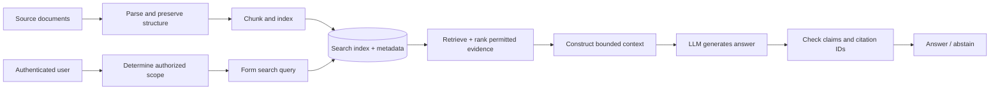
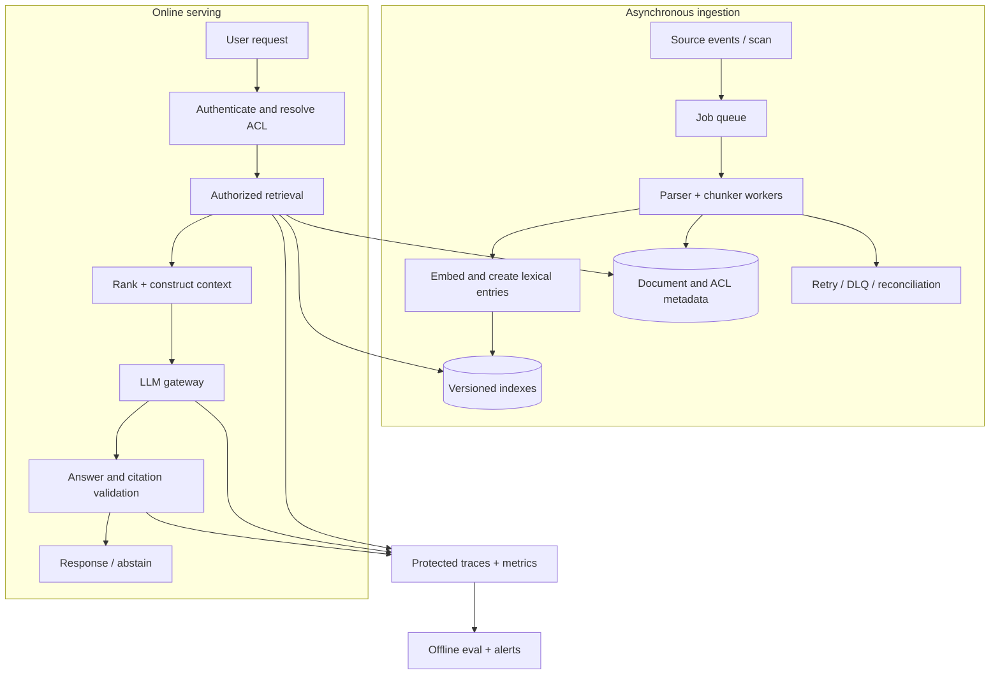

# RAG Engineering — Learn It, Design It, Defend It

**A clearer Senior/Principal AI Engineer interview master guide**  
**Edition:** v3.0 · **Reviewed:** 23 November 2026  
**Source:** Restructured and accuracy-reviewed from the supplied 123-question `rag.md` (v2.0, 21 November 2026)

> **Goal:** Understand a concept, recognize when it helps, explain the trade-off, and show how to verify that it works. This is a learning guide and interview reference—not a claim that one architecture is best for all workloads.

## How to use this guide

Read **Chapters 1–3** in order: they build the mental model. **Chapter 4** adds advanced choices only after the baseline is clear. **Chapters 5–7** cover the differences between a demo and production. **Chapter 8** is for system-design rehearsal. At the end, use the checklist, troubleshooting matrix, and **original Q1–Q123 coverage map** to revisit every topic without rereading duplicates.

Lessons use these cues where useful:

- **In plain English** — the concept with minimal terminology.
- **Example** — what the system actually does.
- **Production decision** — what an architect needs to validate or protect.

**Evidence key:** **Fact** = established mechanism or definition; **Research** = a paper's specific method; **Provider** = documented product behavior, version-sensitive; **Judgment** = engineering hypothesis to evaluate, not a universal rule. All numeric examples are illustrative unless a primary source explicitly establishes a product default or benchmark.

## Navigation

| Learning phase | Chapter | What you should be able to explain |
|---|---|---|
| **Understand** | [1 — Foundations](#chapter-1--understand-rag-before-choosing-technologies) | What RAG solves and when it is unnecessary |
| **Prepare** | [2 — Evidence and ingestion](#chapter-2--turn-documents-into-trustworthy-evidence) | Chunking, versions, update/delete lifecycle |
| **Retrieve** | [3 — Search and ranking](#chapter-3--find-the-right-evidence-retrieval-and-ranking) | Embeddings, hybrid, ANN, reranking, permissions |
| **Extend** | [4 — Advanced RAG](#chapter-4--advanced-retrieval-solve-a-measured-problem) | Agentic, graph, multi-hop, Self-RAG/CRAG |
| **Verify** | [5 — Evaluation](#chapter-5--evaluation-prove-that-the-system-works) | Metrics, test sets, judging and citations |
| **Operate** | [6 — Production](#chapter-6--production-design-reliable-ingestion-and-reliable-answers) | Reliability, tenancy, tracing, SLOs |
| **Secure** | [7 — Security](#chapter-7--security-privacy-and-regulated-data) | Trust boundaries, leakage, privacy |
| **Defend** | [8 — System design](#chapter-8--answer-seniorprincipal-system-design-questions) | Production case studies and troubleshooting |

**Reference:** [Fast revision](#fast-revision--ten-distinctions-interviewers-value) · [Practice sessions](#recommended-practice-sessions) · [Primary sources](#primary-source-reading-shelf) · [Original question coverage](#original-q1q123-coverage-index)

## Your RAG mental picture (read this first)

A user asks, **“How many annual leave days are new employees entitled to?”** The LLM may know general HR practices, but it does not know your company's *approved, effective* policy. RAG finds authorized policy evidence and lets the model answer *from that evidence*.



**Two separate workflows:**

1. **Ingestion (usually asynchronous):** source → parser/OCR → structure-aware chunks → embeddings/lexical index → versioned metadata.
2. **Serving (online):** authenticate and authorize → search → rank → assemble evidence → generate → validate → answer with citations.

**Three independent ways a RAG answer can fail:** (1) the *right evidence was never indexed*; (2) it was indexed but *not retrieved or passed to the model*; (3) it was provided but *the model generated a bad answer*. Measure these stages separately.

---

## Chapter 1 — Understand RAG before choosing technologies

### 1.1 What is RAG, and why use it?

**In plain English:** Retrieval-Augmented Generation supplies externally retrieved information to a model at answer time. The model does not need to have memorized that knowledge during training. Typical reasons: private knowledge, changing policies, domain-specific facts, and answers that need traceable evidence.

**Example:** The user asks about the current HR policy. The system finds the approved policy section, then asks the model to answer using it.

**Production decision:** RAG *reduces dependence on model memory* but cannot guarantee correctness or source freshness. The data may be missing, stale, misleading, or misread by the model. The original RAG paper is [Lewis et al. (2020)](https://arxiv.org/abs/2005.11401). **[Fact]**

### 1.2 What RAG is *not*

RAG is **not** synonymous with a vector database, embeddings, an agent, a knowledge graph, or a particular framework. Retrieval could use **BM25, vector similarity, SQL, a permitted API, or an exact lookup**. Some systems do not need a separate embedding index at all.

It is also **not** a guarantee against hallucinations. A fluent answer can still invent a missing clause, misread a table, cite the wrong version, or confidently repeat an inaccurate source. **[Fact]**

### 1.3 RAG versus fine-tuning versus long context

| Option | Main purpose | Good fit | Limitation |
|---|---|---|---|
| **RAG** | Provide knowledge at inference time | Current/private source-grounded answers | Retrieval/index quality and latency |
| **Fine-tuning** | Adapt model behavior or capabilities | Stable formatting, domain task behavior | Updating factual knowledge may need retraining; learned knowledge is not inherently source-traceable |
| **Long-context prompt** | Give the model a larger supplied context | Small bounded corpus or case-specific document set | Cost, attention quality, access scoping, context limit |

They can be combined. **Decision:** benchmark quality, latency, cost, and security on the *real* workload. RAG is not automatically cheaper than long context, and fine-tuning is not a substitute for frequently updated authoritative documents. **[Judgment]**

### 1.4 Parametric and external knowledge

**Parametric knowledge** lives in the model's learned weights; **external/non-parametric knowledge** lives in source systems, document stores, and indexes. A model might know what an API is, while retrieval supplies the *current signature of your internal API*.

**Production decision:** trust authoritative source records for current business rules. Do not infer document authority from model fluency or vector similarity. **[Fact]**

### 1.5 Search versus RAG versus an agent

A **search** system ranks/returns information. A **RAG** system uses retrieved information to produce an answer. An **agentic RAG** system may *decide what to search next*, based on results. These are capabilities rather than mutually exclusive product types.

**Example:** “What is the current leave policy?” → one retrieval. “Which services use this endpoint, and what permissions do they rely on?” → perhaps several dependent retrieval steps.

**Production decision:** choose a predictable single retrieval pipeline until the question actually requires adaptive multi-step search. **[Judgment]**

### 1.6 When you should avoid RAG

Choose an **authorized direct database/API lookup** for an exact record ID, balances, inventory, transaction status, or other integrity-sensitive fact. Choose deterministic business logic for policy decisions that must be enforced exactly. Use RAG for explanations over unstructured material, not as the sole arbiter of account or patient identity.

**Example:** “Get report ID X” → check permissions, query the database by X. “Explain terms in this report using our clinical glossary” → lookup the exact report, then retrieve supporting explanatory material. **[Judgment]**

**Quick interview drill:** Explain why “vector DB + LLM” is not a complete production RAG architecture. Mention permissions, source lifecycle, evaluation, and evidence validation.

---

## Chapter 2 — Turn documents into trustworthy evidence

### 2.1 The document ingestion pipeline

**In plain English:** Ingestion prepares material so it can be found later. Typical stages: source connector → validate/parse/OCR → clean with structure preserved → chunk → embed if using dense retrieval → update lexical/vector indexes → store source metadata and permissions.

**Example:** A new handbook PDF enters object storage. A worker extracts sections, creates chunks with `document_id`, `revision`, `page`, `heading`, `ACL`, and `effective_from`, then makes the complete revision queryable.

**Production decision:** Make ingestion **asynchronous**, **idempotent**, retryable, observable, and resumable; never let half-indexed revisions silently become authoritative. **[Judgment]**

### 2.2 What is chunking, and why does it matter?

Chunking breaks large documents into retrievable units. Without it, a small relevant policy may be buried in a 100-page document; with overly small chunks, the sentence “Employees receive 20 days” loses the heading “Annual Leave.”

**Example:** A handbook has *Introduction → Annual Leave → Sick Leave*. Index the policy sections, not random character slices across them.

**Production decision:** Preserve titles, headings, tables, lists, source span/page, and version. The right chunk size depends on query style and document structure. **[Fact/Judgment]**

### 2.3 Chunking strategies and overlap

| Strategy | Use when | Watch for |
|---|---|---|
| Fixed token size | Simple baseline | Splits headings or tables |
| Recursive / structure-aware | Markdown, policies, technical docs | Parser quality |
| Sentence/semantic grouping | Topic boundaries vary | Extra processing / unstable units |
| Parent-child / hierarchical | Search precise passages; answer with surrounding section | Duplicate parent content, relationship tracking |

**Overlap** repeats boundary text across adjacent chunks; it may protect cross-boundary context but increases storage, indexing cost, duplication, and answer tokens. Test several chunk settings—there is **no industry-wide optimal 512- or 1,024-token rule**. A hosted product's default is not a universal optimum. **[Judgment]**

### 2.4 Parent-child versus contextual retrieval

**Parent-child:** Index a small *child* passage; retrieve its bigger *parent* section for answer construction. It separates *search granularity* from *answer context*.

**Contextual Retrieval (Anthropic):** Add explanatory document-level context to a chunk *before indexing*. For example, attach “Employee Handbook → Annual Leave” to the otherwise ambiguous sentence “20 days annually.” Anthropic's measured improvements are from its studied datasets and setup, not guaranteed elsewhere. [Research](https://www.anthropic.com/research/contextual-retrieval).

**Decision:** Start with good structural parsing. Test parent retrieval or contextualization only when chunks lose meaning. **[Research/Judgment]**

### 2.5 Tables, PDFs, scans, and multimodal content

Text extraction alone can damage relationships: e.g., `sodium 138 mmol/L` without the correct test name or date. Preserve table rows, column headers, units, footnotes, and the original page/region. Use OCR/layout analysis for scans and image/vision processing when the visual content matters.

**Separate the tests:** extraction accuracy → retrieval quality → answer quality. A correct embedding match cannot repair a malformed table. Managed multimodal capabilities and supported file types depend on service/model configuration. [AWS documentation](https://docs.aws.amazon.com/bedrock/latest/userguide/kb-multimodal.html). **[Provider/Judgment]**

### 2.6 Metadata is more than a filter

Store **who owns the document**, **who may see it**, **which revision it represents**, **when it applies**, and **where each chunk came from**. Useful fields:

```json
{
  "document_id": "handbook",
  "source_revision": "v3",
  "chunk_id": "handbook:v3:annual-leave:02",
  "page": 12,
  "section": "Annual Leave",
  "tenant_id": "tenant-A",
  "acl_version": 18,
  "status": "approved",
  "effective_from": "2026-01-01",
  "indexed_at": "2026-01-03T09:00:00Z"
}
```

**Production decision:** Identifiers and permissions must be assigned/validated by trusted application logic, not invented by the LLM. For policy questions, the newest *upload* is not necessarily the currently *effective and approved* policy. **[Judgment]**

### 2.7 Updating documents without mixing versions

**Problem:** Document v2 changes its meaning, but v1 chunks remain searchable or only half of v2 is indexed.

**Approach:** Create revision-scoped records; ingest and validate v2; switch an active revision/alias after it is complete; then retire v1 and invalidate affected caches. Fence older ingestion workers so they cannot overwrite a newer revision. If separate stores are involved, state the actual consistency guarantee; there may be no atomic cross-store transaction.

**Production decision:** Make document/revision visibility explicit and reproducible in evaluations. **[Judgment]**

### 2.8 Deletion, revocation, and freshness

**Deletion:** Stop serving affected content promptly; remove or retire chunks, indexes, derived caches, and other copies according to retention policy; reconcile failures. **Permission revocation:** a previously authorized user must no longer be served the protected content, including from caches or citations. **Freshness:** monitor the lag from a source change to the new queryable revision.

Track separately `source_updated_at`, `effective_from/to`, `ingested_at`, and `indexed_at`. These are different clocks. **Do not confuse index freshness with business authority.** **[Judgment]**

### 2.9 Embedding upgrades and rollback

Changing an embedding model/version, input prefix, preprocessing, dimension, or metric may make old corpus vectors incompatible with new query vectors. Create a **new versioned index**, re-embed where needed, test against the previous system, canary the read path, and retain rollback capability.

Rollbacks may also require coordinated changes to lexical schema, chunking, reranker, prompt, and cached answers. Switching application code alone may not undo an incompatible index migration. **[Judgment]**

**Quick interview drill:** Your policy document changes at 09:00. How do you ensure that a 09:02 query cannot see a mixture of versions or continue using a revoked document?

---

## Chapter 3 — Find the right evidence: retrieval and ranking

### 3.1 Embeddings without the mystery

An embedding model turns a text or other input into a vector such as `[0.12, 0.83, ...]`. Similar meanings *can* be close under a compatible model and similarity measure. These numbers are learned representations, **not** probabilities or directly readable facts.

**Example:** “reset my password” and “recover my account” may be near each other in embedding space even when they share few words.

**Production decision:** Choose a model using evaluated domain, language, dimensionality, latency, data handling, and cost—not vector length or public rankings alone. Index documents and queries with compatible model/configuration. **[Fact/Judgment]**

### 3.2 What is a vector database?

A vector database or vector-search-capable engine stores embeddings and supports similarity queries; common options include dedicated systems and general databases/search engines with vector extensions. It may also support metadata filtering and ANN indexes. **It is a retrieval component, not a complete RAG system**: document parsing, source authority, permissions, generation, citation verification, evaluation, and operational ownership remain application responsibilities.

**Production decision:** Choose based on *filtered retrieval quality*, tenant isolation, update/delete semantics, capacity, operator skill, and total cost—not only advertised nearest-neighbor speed. **[Fact/Judgment]**

### 3.3 Cosine, dot product, and Euclidean distance

- **Cosine similarity:** compares vector directions: `cos(A,B) = (A·B) / (||A|| ||B||)`; undefined for a zero vector.
- **Dot product:** includes magnitude as well as direction unless vectors are normalized.
- **Euclidean distance (L2):** straight-line distance between vectors.

For **unit-normalized vectors**, `||A−B||² = 2(1−cos(A,B))`; this makes cosine and L2 rankings equivalent for the same unit vectors. Do not reuse similarity score cutoffs across metrics, models, or index configurations. **[Fact]**

### 3.4 Keyword, sparse, dense, and hybrid retrieval

**Lexical/keyword retrieval** rewards matching terms and is strong for exact IDs, API names, version numbers, error codes, and rare phrases. **BM25** uses term frequency, inverse document frequency, and length normalization. **Dense retrieval** searches learned embedding vectors for semantically related text. **Sparse retrieval** uses large mostly-zero representations; classical term-based and learned sparse approaches are distinct from dense embeddings.

**Hybrid** combines complementary retrieval paths. Example: a query contains both “password reset” and `AUTH-4032`—semantic search catches paraphrases; lexical search catches the exact code.

**Decision:** Compare lexical-only, dense-only, and hybrid using judged real queries rather than assuming hybrid always wins. **[Fact/Judgment]**

### 3.5 Reciprocal Rank Fusion (RRF)

BM25 scores and cosine similarity scores are on different scales; adding raw scores naïvely can be misleading. **RRF** combines *positions* in ranked lists:

`RRF(d) = Σ [1 / (c + rank_r(d))]` over lists where document `d` appears.

Here `c` is the smoothing constant, not the number of requested search results. A missing document contributes zero for that list. **Decision:** RRF is a useful fusion baseline, but ranks, weights, and truncation still need evaluation. [Azure hybrid ranking](https://learn.microsoft.com/en-us/azure/search/hybrid-search-ranking). **[Fact/Judgment]**

### 3.6 Exact versus approximate nearest neighbors (ANN)

**Exact KNN** evaluates the chosen distance over the complete eligible candidate set; it is a useful ground truth for index recall. **ANN** searches an index more cheaply but can miss some true nearest neighbors.

| Index | Idea | Typical trade-off |
|---|---|---|
| HNSW | Navigable layered graph | Strong latency/recall trade-off; memory and build overhead |
| IVFFlat | Cluster vectors; probe selected lists | Training/list/probe tuning; quality depends on data and settings |

**Production decision:** Benchmark ANN recall against an exact baseline, along with p95/p99 latency, build time, memory, and *filtered* query recall. [pgvector documentation](https://github.com/pgvector/pgvector). **[Provider/Judgment]**

### 3.7 The important pgvector filtering caveat

**Common misunderstanding:** A SQL `WHERE tenant_id = ...` predicate does not necessarily mean the ANN index searches only that tenant's vectors first. With pgvector's approximate indexes, the predicate can be applied *after candidates are scanned*, so small tenant subsets may return fewer than `LIMIT K` rows. Iterative scans, partitioning, partial indexes, or exact filtered search can change the trade-off. [pgvector documentation](https://github.com/pgvector/pgvector#filtering).

**Security distinction:** A correctly enforced database predicate may still protect confidentiality even when ANN recall suffers. But you must verify what can reach logs, rerankers, models, caches, and responses; application authorization must not be inferred from ANN behavior. **[Provider/Judgment]**

### 3.8 Top-K means *which* K?

A typical two-stage pipeline has different limits:

```text
User query → initial retrieval (candidate K=30)
           → reranker
           → context selection (final K=5)
           → LLM
```

These are **illustrative**, not recommended defaults. A larger candidate K may increase recall but can add latency and irrelevant material. Final context K is constrained by token budget and evidence sufficiency. **You cannot rerank a source that initial retrieval never returned.** **[Fact/Judgment]**

### 3.9 Reranking: a second look at relevance

A **bi-encoder** embeds query and document separately, enabling large-scale vector search. A **cross-encoder** often examines the query/document pair together for a more detailed relevance estimate; other rerankers use LLMs or learned scoring models.

**Example:** Search finds 30 plausible chunks. The reranker moves the *actual entitlement clause* ahead of generic “employee well-being” passages.

**Decision:** Evaluate improvement in final answer correctness and evidence coverage against reranking cost and latency; don't treat a reranker as mandatory. **[Fact/Judgment]**

### 3.10 Filtering for relevance versus filtering for permission

`documentType = policy` is often a relevance filter. `tenant_id = currentTenant` or group membership is a **security constraint**. The latter must be derived from a trusted authenticated principal and applied in the trusted data-access path.

**Pre-filter:** restrict eligible candidates before/as part of retrieval. **Post-filter:** retrieve candidates then remove disallowed results; it can hurt recall and is more error-prone for confidentiality if any downstream component sees unfiltered material. Implementations differ—Azure documents several filter modes. [Azure filtering](https://learn.microsoft.com/en-us/azure/search/vector-search-filters). **[Provider/Judgment]**

### 3.11 Query rewriting versus multi-query versus multi-hop

| Technique | What changes | Example |
|---|---|---|
| **Rewrite** | One original question becomes a better search query | “What about new hires?” → “Annual leave eligibility of new hires” |
| **Multi-query** | Search several reformulations/facets in parallel or in a batch | eligibility + carry-forward + entitlement |
| **Multi-hop** | Later search depends on what an earlier search found | find service calling A → inspect caller's auth rules |

Keep the original question and constraints. Query rewrite can silently drop dates, names, or identifiers. More queries mean more cost, latency, and possibly more noise. **[Fact/Judgment]**

### 3.12 Conversational RAG

A follow-up (“Does that apply to contractors?”) cannot be understood without the prior topic. Use a bounded amount of relevant conversation state to form a standalone retrieval query, *then search authoritative sources*. Conversation state is not the same as external knowledge.

**Production decision:** Avoid blindly sending entire chat histories; preserve user intent and authorization context. Rewriting does not grant permission to access other sources. **[Judgment]**

### 3.13 HyDE: search using a hypothetical answer

**Hypothetical Document Embeddings** asks a model to draft a plausible answer-like passage, embeds that passage, and uses it to search for **real** evidence. It can help when the wording of a question poorly matches relevant documents.

**Critical rule:** The invented passage is **a search probe, never evidence**. Do not cite it or assume it is true. **[Research/Judgment]**

### 3.14 Constructing the final context

Retrieved chunks are candidates; the **final context** is the evidence the LLM actually sees. Deduplicate overlaps, retain title/section/version/page, preserve table headers and units, and stop at a measured token budget. Order and truncation matter. Keep only authorized chunks.

**Example:** A search returns 20 chunks, including five repeats of the same clause. Use one authoritative excerpt plus supporting exceptions, rather than five duplicates.

**Production decision:** Evaluate *evidence sufficiency in the final prompt*, not just raw Top-K search scores. **[Judgment]**

### 3.15 Relevance is not answerability

A chunk can be strongly related to “annual leave” yet fail to contain the number for *new employees*. A high similarity score is **not** the probability that an answer is correct.

Distinguish: **topical relevance** → **sufficient authorized evidence** → **grounded answer** → **factual correctness**. This distinction determines whether the system should search again, ask for clarification, or abstain. **[Fact/Judgment]**

### 3.16 Multilingual and cross-language retrieval

A Vietnamese question about an English policy is not the same test as Vietnamese over Vietnamese documents. Evaluate same-language, cross-language, code-switched, transliterated, and domain-specific terms. Compare multilingual embeddings, lexical analyzers, optional translation, and hybrid ranking by language slice.

**Production decision:** Pay special attention to negation, dates, measurements, medication names, and exact identifiers after translation. A high score on English-only retrieval does not establish acceptable multilingual quality. **[Judgment]**

**Quick interview drill:** Why might hybrid retrieval improve Recall@K but lower answer quality? Discuss noise, conflicting evidence, context budget, and the final prompt.

---

## Chapter 4 — Advanced retrieval: solve a measured problem

### 4.1 Naive, advanced, and modular RAG

**Naive RAG:** retrieve passages, pass them to an LLM, return an answer. **Advanced RAG:** improve retrieval and context with filtering, hybrid search, reranking, and query processing. **Modular RAG:** compose or route reusable pieces to suit different queries. These labels describe design patterns rather than rigid standards.

**Decision:** Don't add five advanced techniques because a diagram looks impressive. First establish a measurable simple baseline. **[Judgment]**

### 4.2 Routing: exact, semantic, or structured retrieval?

A useful production router distinguishes query types. For an exact error code, try lexical search; for a paraphrased process question, semantic search; for a stable record ID, use an authorized API; for mixed questions, combine paths.

**Important:** An LLM can *suggest* a route but must not be the source of authorization. Always validate tool arguments and scope in trusted code. **[Judgment]**

### 4.3 Multi-hop and query decomposition

Some answers require evidence A *before* you know how to find evidence B. Example: “Which API sends this event, and what permission gate protects it?” First identify the sender; then inspect the sender's authorization path.

Use bounded search hops, a search budget, provenance for each hop, and an explicit stop condition. This can be a **deterministic workflow**; an agent is not required. **[Judgment]**

### 4.4 Agentic RAG

An agent can choose among knowledge sources, break down a question, inspect results, and decide whether more retrieval is useful. That flexibility comes with more model/tool calls, nondeterminism, budget management, latency, and new failure modes.

**Decision:** Expose mature, permission-aware search functions as tools. Keep tool-side validation, authorization, and query limits outside the model. Use agentic retrieval when fixed routing or a bounded multi-step workflow is insufficient. [Microsoft architecture guidance](https://learn.microsoft.com/en-us/azure/architecture/ai-ml/guide/rag/rag-agentic). **[Judgment]**

### 4.5 GraphRAG

**GraphRAG** uses structured relationships as part of evidence retrieval. A general knowledge graph can answer “A calls B, which depends on C.” **Microsoft GraphRAG** is a specific research/implementation approach that extracts entities/relationships and forms communities and summaries, especially to support *corpus-level* questions such as “What are the themes across all reports?”

**Trade-off:** extraction, graph correctness, updates, governance, and cost. GraphRAG complements rather than universally replaces chunk retrieval. [Microsoft GraphRAG documentation](https://microsoft.github.io/graphrag/) and [research](https://www.microsoft.com/en-us/research/publication/from-local-to-global-a-graph-rag-approach-to-query-focused-summarization/). **[Research]**

### 4.6 Multimodal RAG

Some evidence lives in image regions, charts, diagrams, or scanned pages. Multimodal RAG represents and retrieves one or more modalities and may pass them to a model capable of interpreting them.

**Example:** A report's chart visually communicates a trend absent from extracted text. Use a modality-capable retrieval/analysis path and retain page/region source references. Test extraction, cross-modal retrieval, and answer correctness separately. **[Judgment]**

### 4.7 Self-RAG: the *research method*, not a loose label

The **original Self-RAG paper** trains a model to use **reflection tokens** to decide when to retrieve and to critique evidence/generation. A regular workflow that says “check answer, retry search” is *self-corrective* in a generic sense, but is **not automatically the Self-RAG algorithm**. [Self-RAG paper](https://arxiv.org/abs/2310.11511). **[Research]**

### 4.8 CRAG: evaluate retrieval and correct it

In **Corrective RAG (CRAG)**, a retrieval evaluator detects weak results and triggers corrective retrieval actions. The original paper includes external web search; an internal-only “retry with another source” is **CRAG-inspired**, not necessarily an identical implementation. [CRAG paper](https://arxiv.org/abs/2401.15884). **[Research]**

**Remember the difference:** Self-RAG centers on reflection during the model's retrieve/generate process; CRAG centers on evaluating and correcting retrieval. Neither is a universal production requirement.

### 4.9 Conflicts: authority beats similarity

Suppose a draft policy uploaded today says 22 days, while an approved policy effective this year says 20. High vector similarity should not choose the winner. Use lifecycle metadata: approval, jurisdiction, effective dates, revision, authority, and relevant business scope. When conflict remains unresolved, show the conflicting evidence and abstain from a definitive answer. **[Judgment]**

### 4.10 When to introduce an advanced technique

| Measured failure | Candidate response | Counter-cost / risk |
|---|---|---|
| Exact identifiers missed | Lexical or hybrid search | Fusion and index complexity |
| Relevant chunk ranked too low | Reranking | Additional latency |
| Chunk loses meaning | Parent-child or contextualization | Larger context / ingestion cost |
| One query misses facets | Multi-query or decomposition | More searches and noise |
| Dependent evidence across sources | Multi-hop workflow | More state and failure points |
| Corpus-level entity/theme analysis | GraphRAG | Graph ingestion cost and correctness |
| Images, charts, complex tables | Multimodal parsing/retrieval | Extraction and verification effort |
| Search decisions change per step | Agentic retrieval | Nondeterminism, cost, tool safety |

**Quick interview drill:** For a standard internal policy assistant, which advanced RAG techniques would you *not* introduce in v1, and which measured failures would change your mind?

---

## Chapter 5 — Evaluation: prove that the system works

### 5.1 Why a working demo is not evidence of quality

A RAG system has at least **four observable dimensions**: **retrieval quality**, **generation quality**, **end-to-end task quality**, and **operational reliability**. It is possible to retrieve the correct passage but answer incorrectly; it is also possible to generate a convincing answer from a wrong or outdated passage.

**Decision:** Evaluate stages separately so improvements and regressions can be attributed to the right component. **[Judgment]**

### 5.2 Golden datasets: what should be in one example?

A good test case records: question, allowed principal/tenant, corpus snapshot, authoritative answer or claim rubric, relevant source/chunk IDs (when judged), expected citations, answerability, and query category. Include simple, multilingual, conflicting, stale, permission-sensitive, and unanswerable cases.

```json
{
  "question": "How many days does a new employee receive?",
  "tenant": "tenant-A",
  "corpus_revision": "2026-11-baseline",
  "expected_claims": ["New hire entitlement: 20 days, subject to eligibility"],
  "relevant_evidence_ids": ["handbook:v3:annual-leave:02"],
  "answerable": true
}
```

**Decision:** Domain review matters; synthetic questions are useful for coverage but are not ground truth simply because an LLM generated them. **[Judgment]**

### 5.3 Precision@K versus Recall@K (use actual counts)

Suppose **10** chunks are judged relevant to a question. The retriever returns **5**, of which **4** are relevant.

- **Precision@5 = 4/5 = 0.80** — what fraction of the top 5 is useful?
- **Recall@5 = 4/10 = 0.40** — what fraction of *all known relevant* chunks did we find?

**Caveats:** The denominator and relevance unit must be defined. In this guide, Precision@K uses K even if fewer results are returned; some libraries use other conventions. Recall with incomplete judgments is recall *against the judged set*. Zero-relevant cases require a separate documented rule or separate abstention evaluation. **[Fact]**

### 5.4 MRR versus NDCG

**MRR (Mean Reciprocal Rank)** rewards placing the **first relevant result** early. If a query's first relevant hit is at rank 4, reciprocal rank is `1/4`. Average over queries; a query with no relevant result in the evaluated cutoff contributes 0.

**NDCG@K** evaluates the *quality of an entire ranking*, allowing graded relevance. It discounts useful results that appear later:

`DCG@K = Σ (2^rel_i − 1) / log2(i+1)`; `NDCG = DCG / ideal_DCG`.

**Decision:** Use MRR when the first useful hit is central; NDCG when several results with different usefulness matter. **[Fact]**

### 5.5 Classical retrieval metrics versus framework context metrics

Classical Recall@K uses an annotated set of relevant retrieval items. **Context Recall** in an evaluation framework may instead ask whether retrieved text covers the **facts needed by a reference answer**. Likewise **Context Precision** may be rank-aware and judge-assisted—not identical to `relevant_count/K`.

**Example:** Three policy clauses are needed; retrieved evidence supports only two. Framework context recall may be low even if classical Recall@K (defined at a different unit) looks high.

**Decision:** Pin package, metric version, inputs, judge, and grading conventions. Do not put similarly named scores from different tools on one chart without confirming comparability. [Ragas metrics](https://docs.ragas.io/en/latest/concepts/metrics/available_metrics/); [Context Precision implementations](https://docs.ragas.io/en/latest/concepts/metrics/available_metrics/context_precision/). **[Provider]**

### 5.6 Faithfulness, correctness, relevancy: three different questions

| Dimension | Question | Failure example |
|---|---|---|
| **Faithfulness / groundedness** | Does the answer follow the provided evidence? | Context says 20 days; answer says 25 |
| **Correctness** | Is it actually correct against an authoritative reference? | Context is an outdated 15-day policy and answer repeats 15 |
| **Answer relevancy** | Does the answer address what the user asked? | Responds with generic wellness principles instead of entitlement |

Faithfulness can be high while correctness is low. Correctness depends on trustworthy references. Relevancy can be high for an incorrect answer. **[Fact]**

### 5.7 Provenance is not claim support

**Provenance:** which source/span was supplied? **Citation validity:** is the cited ID an actually retrieved, authorized record? **Claim support:** does that cited span substantiate the particular sentence? **Correctness:** is the statement true according to the authoritative source?

**Production pattern:** Give context chunks server-assigned opaque IDs; require answer citations to those IDs; validate that referenced IDs were actually supplied and authorized; assess semantic claim support separately for high-risk statements. A citation string alone is no evidence. **[Judgment]**

### 5.8 RAG Triad and its limits

The **RAG Triad** is a useful evaluation frame: **context relevance**, **groundedness/faithfulness**, and **answer relevancy**. It helps discover obvious weak points even when a full reference answer is unavailable.

**Limitation:** It does not prove real-world correctness, completeness, citation-to-claim support, or authorization. Do not confuse this triad with expected-answer-dependent metrics. [TruLens](https://www.trulens.org/getting_started/core_concepts/rag_triad/). **[Provider/Judgment]**

### 5.9 LLM-as-a-Judge

A judge model applies a specified rubric to a generated answer, often with its question, context, and reference answer. Useful for natural-language qualities that exact string matching misses.

**Risk:** judges make errors, can share generator biases, vary with prompt/model versions, and be influenced by order or wording. **Decision:** calibrate against human-reviewed samples, measure agreement, run pairwise or rubric-based tests where useful, and retain disagreement cases. **[Judgment]**

### 5.10 Ragas and DeepEval: tools, not ground truth

Both provide LLM-application evaluation capabilities, including RAG metrics. **Ragas** and **DeepEval** may implement similarly named metrics with different inputs or judgments; for example, Ragas uses *Response Relevancy* terminology while DeepEval often says *Answer Relevancy*.

**Decision:** Choose a repeatable evaluator and pin versions; prioritize the dataset, rubric, calibration, and regression process over the brand of framework. [Ragas](https://docs.ragas.io/en/latest/concepts/metrics/available_metrics/); [DeepEval](https://deepeval.com/guides/guides-rag-evaluation). **[Provider/Judgment]**

### 5.11 Offline versus online evaluation

**Offline:** run a controlled versioned corpus/permission snapshot and golden test set through candidate pipelines. Report retrieval metrics, answer quality, and latency/cost side-by-side. **Online:** examine real tasks, reviewed feedback, refusals, citation use, failures, and operational metrics without treating clicks or thumbs-up alone as objective correctness.

**Production decision:** Compare by query slice (exact identifier, multilingual, long document, permission-sensitive). A small average gain can hide a severe regression on a critical class. **[Judgment]**

### 5.12 Avoid evaluation leakage and overfitting

Split train/dev/test by **document family or underlying evidence**, not only by randomly chosen questions, because paraphrases may leak the answer into all splits. Do not repeatedly tune on the protected test set. Store source snapshot, prompt/model/index versions, judge configuration, and human annotation decisions.

**Decision:** Use paired tests and uncertainty estimates where metrics are noisy. A 0.01 score gain on a tiny evaluation set is not proof of improvement. **[Judgment]**

### 5.13 Evaluate abstention and citations explicitly

Test queries that are **answerable**, **unsupported**, **conflicting**, **stale**, and **forbidden** for the user. Track unsupported-answer rate on unanswerable cases, unnecessary-refusal rate on answerable ones, citation-ID validity, claim support, and correct source version.

**Decision:** A system that refuses every question may appear highly “faithful” but is not useful; a system that answers everything is unsafe when evidence is missing. Calibrate the decision. **[Judgment]**

### 5.14 Translate metrics into acceptance criteria

A release decision should specify: a representative test set, hard authorization checks, a baseline, acceptable changes to high-risk slices, latency/cost budgets, and a rollback trigger. There is no universal “95% RAG quality SLO.” Quality objectives are risk- and workload-dependent.

**Quick interview drill:** A system's Recall@10 rises from 0.80 to 0.91 but faithfulness falls. Is the upgrade good? What additional traces, labels, and query slices would you inspect?

---

## Chapter 6 — Production design: reliable ingestion and reliable answers

### 6.1 Reference architecture: the minimum useful separation



**Production decision:** Isolate ingestion throughput from query latency; maintain metadata/source authority independently of generated responses. The queue is not itself a source of truth for revision state. **[Judgment]**

### 6.2 Idempotency, retries, and recovery

Use a stable ingestion identity such as `(document_id, source_revision, transformation_version)`. Workers should safely retry individual stages and not create duplicate queryable chunks. Distinguish transient provider failures from permanently invalid documents. Use backoff, dead-letter handling, visibility into incomplete runs, and a periodic reconciliation process to detect missing or stuck work.

**Decision:** Record a durable ingest status, expected chunks, index revision, and attempt history. Protect against a slow older job publishing over a newer revision. **[Judgment]**

### 6.3 Batch versus incremental indexing

**Batch:** good for initial loads, periodic reprocessing, and simpler bulk operations, but can delay freshness or be expensive. **Incremental:** process only added/modified/deleted items, improving freshness and cost, but requiring change capture, deletion handling, versioning, and reconciliation.

A practical system may combine incremental updates with periodic reconciliation or full rebuilds. **[Judgment]**

### 6.4 Freshness is an end-to-end SLO

Measure source change → event ingestion → parse → embedding → index publication → query visibility. An index can be “healthy” while surfacing a stale approved policy. Separately monitor *source revision age*, *effective dates*, and *queryable revision*.

**Decision:** Define required freshness by business use case (minutes for active incident docs, longer for archived records); don't invent a universal threshold. **[Judgment]**

### 6.5 Multi-tenancy and document permissions

Tenant separation and user authorization are different dimensions. Within tenant A, not everyone can read every A document. Model document-level ACLs or entitlements and resolve them for the authenticated principal in a trusted component.

**Trade-off:** shared index with strong security filtering vs partitioned indexes vs separate stores. Consider tenant size, operational isolation, noisy neighbors, index recall with filters, and deletion/revocation behavior. **[Judgment]**

### 6.6 Revocation-aware caches

Cache keys or cache validity checks must account for principal/tenant scope, permission version, document/index revision, and answer behavior. Do not serve a formerly permitted cached answer after access is revoked. **Cache key separation is not itself a substitute for authorization**; sensitive cached content still needs rechecking/expiry/invalidation.

**Types:** embeddings of public repeated questions; eligible retrieval results; final generated answers when safe. Each type has different invalidation and leakage risks. **[Judgment]**

### 6.7 Insufficient evidence versus system failure

These outcomes should be distinguishable:

| Outcome | Safe response pattern |
|---|---|
| No authorized relevant source exists | Explain missing evidence; ask for clarification or abstain |
| Sources conflict | Show conflict and refrain from a definitive unsupported answer |
| Relevant source exists but retriever missed it | Investigate recall; possibly bounded alternate search |
| Search/index provider unavailable | Retry with budget; return a clear error or approved fallback |
| Authorization cannot be verified | **Fail closed** |

A silently substituted general-model answer is inappropriate for a product promising evidence-grounded results, especially in high-stakes contexts. **[Judgment]**

### 6.8 Latency optimization: measure components first

Break down p50/p95/p99 time for auth, query rewriting/embedding, lexical/vector search, reranking, context assembly, time-to-first-token, and generation duration. Optimize the actual bottleneck: smaller candidate sets, index tuning, parallel independent searches, caching, shorter context, model routing, and connection pooling.

**Decision:** Streaming can improve perceived responsiveness but **does not automatically lower total completion time**. Never reduce authorization or evidence checks merely to meet a latency goal. **[Judgment]**

### 6.9 Cost optimization: per *successful answer*

Track ingestion parsing/OCR, embedding and re-indexing, vector/lexical storage, reranking, LLM input/output tokens, and evaluation runs. Compare the cost of a *usable, correct answer*, not just the model's price per token.

**Trade-off:** aggressive context compression may save tokens but break claim support; reranking adds cost but may reduce wasted generation. Use measured experiments. **[Judgment]**

### 6.10 Scaling and capacity

Scale ingestion workers on queue backlog/throughput; scale serving on request load, latency, and downstream quotas. Control concurrency and apply backpressure. Index update rates, filtered ANN recall, model rate limits, and storage IO may dominate before API CPU does.

**Decision:** Exercise load with realistic tenant sizes, query distributions, ACLs, and document churn. Do not extrapolate from a single-user local demo. **[Judgment]**

### 6.11 Managed platform versus custom architecture

Managed retrieval services can reduce time spent running parsers, indexes, or infrastructure. Custom systems offer closer control over ranking, document lifecycle, provider independence, and authorization semantics but increase engineering burden.

**Decision:** Compare **needed features**, permission behavior, deployment/data constraints, observability, index portability, latency, cost, and vendor lock-in. Verify exact current provider options rather than treating a product category as a guarantee. **[Judgment]**

### 6.12 CI/CD is not just unit tests

Suggested test layers: parser and chunker unit tests; indexing/idempotency integration tests; tenant/ACL negative cases; retrieval regression on a frozen corpus; citation validation tests; generation/LLM-judge tests; fault injection and canary evaluation. Label nondeterministic tests as such and use sensible release gates.

**Decision:** Security invariants and deterministic correctness checks should fail a build even when an aggregate judge score improves. **[Judgment]**

### 6.13 What to monitor in production

- **Quality:** retrieval coverage, answerability, reviewed correctness, abstention, citation validity, drift by query slice.
- **Operations:** availability, error modes, p95/p99 latency by stage, cache hit/miss, token costs and provider throttling.
- **Data lifecycle:** failed ingestion, index lag, source/index mismatch, deleted-content visibility, permission propagation.

Maintain useful alerts and incident owners. There is no universal fixed quality objective; define service and quality objectives from real usage and risk. **[Judgment]**

### 6.14 Tracing versus logging

**Logs:** discrete events such as “embedding timeout,” “source revision published,” or “ACL denied.” **Traces:** the end-to-end path of one request across services, with duration and correlation IDs.

A privacy-aware trace can include principal/scope references, index and model versions, chunk IDs/ranks, context IDs, validation outcomes, durations, and token counts **without copying full sensitive prompts or records into observability storage**. Keep protected diagnostic sampling only where approved. **[Judgment]**

### 6.15 Minimum reproducible incident record

For an incorrect answer, preserve the query reference, authorized scope and policy decision, corpus/index revisions, search/reranking settings and candidates, final evidence IDs, model/prompt versions, answer, citation validation result, and stage timing. Version these inputs so you can replay the problem against the same snapshot.

**Decision:** If you cannot tell whether an incident came from parsing, recall, ACL, context construction, or generation, your observability is incomplete. **[Judgment]**

**Quick interview drill:** Design a 24/7 RAG service with occasional indexing delays, provider throttling, and permission revocations. Describe the allowed degraded modes, monitoring, and recovery sequence.

---

## Chapter 7 — Security, privacy, and regulated data

### 7.1 Start with trust boundaries

Source documents, web pages, OCR text, and search results are **untrusted data** even when they live in your index. The authenticated user, permissions service, trusted backend, model, vendor API, cache, and logging platform are distinct trust boundaries. A correct response must not read or disclose content outside the principal's authorized scope.

**Decision:** Enforce permissions in services/data stores; prompting the LLM “do not reveal secrets” is not access control. [OWASP RAG Security](https://cheatsheetseries.owasp.org/cheatsheets/RAG_Security_Cheat_Sheet.html). **[Judgment]**

### 7.2 Prompt injection through retrieved text

An indexed document may say “ignore earlier instructions.” That text is still **document content**, not an authorized instruction to the assistant. Direct injection arrives as a user input; indirect injection can arrive from retrieved documents or tool outputs.

**Defenses:** distinguish trusted control instructions from untrusted evidence, avoid empowering retrieved text to choose tools or privileges, validate outputs, minimize tool permissions, and test adversarial documents. **There is no single prompt that guarantees perfect prevention.** **[Fact/Judgment]**

### 7.3 Retrieval poisoning and source integrity

An attacker or accidental upstream change can make misleading documents appear legitimate. Validate source ownership/approval, ingest provenance, document signatures or trusted connectors where appropriate, approval status, and version history. Give weak/untrusted content less authority than approved sources.

**Decision:** Scan and validate at ingestion, but also treat retrieved content cautiously at query time. A perfectly ranked poisoned document is still bad evidence. **[Judgment]**

### 7.4 Cross-tenant and document-level disclosure

Test whether one tenant can retrieve another's content; whether users within the same tenant can read restricted documents; whether rerankers/models see unfiltered data; and whether answers, cached results, citation URLs, or diagnostic traces disclose protected information.

**Decision:** Tests should cover access *before* search, after revocation, and after index/caching changes. Failing closed on ACL service failures is a security property, not a prompt style. **[Judgment]**

### 7.5 Embeddings are not automatically anonymous

Vectors are numerical, but their links to source content, metadata, membership, and possible information leakage may still make them sensitive. Store them under appropriate access controls and retention rules. Likewise, removing direct IDs from health text does not necessarily eliminate re-identification risk from rare diagnoses, dates, or unusual combinations.

**Decision:** Classify embeddings, documents, traces, evaluation data, and derived outputs independently; assess actual re-identification risk rather than simply removing names. **[Judgment]**

### 7.6 Model, evaluator, and logging providers

Map every data transfer: what is sent to the embedding provider, generation provider, reranker, judge, tracing backend, and cloud storage; where each processor handles/stores data; retention and training-use terms; and contractual/security controls. Verify region-specific behavior and current provider settings.

**Regulated-data point:** a cloud region, encryption checkbox, or “HIPAA/PDPA” marketing statement alone does not establish compliance. A responsible legal/privacy assessment must consider the entire processing flow and applicable obligations. **[Judgment]**

### 7.7 Security evaluation suite

Build *negative* tests for cross-tenant documents, same-tenant ACLs, prompt-injection instructions in retrieved passages, poisoned/stale sources, permission revocation, cache leakage, deleted-document retrieval, unsafe citation targets, and logging exposure.

**Decision:** Treat a confidentiality failure as a blocking release issue, even if aggregate answer accuracy improved. **[Judgment]**

### 7.8 Key security rules to defend in an interview

1. **Trusted code authorizes retrieval**; the LLM cannot grant itself new access.
2. **Source provenance and approval** are distinct from semantic relevance.
3. **Unauthorized content must not reach models, rerankers, caches, or responses.**
4. **Revocation and deletion** must propagate to derived stores and caches according to explicit guarantees.
5. **Observability/evaluation** can become a second sensitive-data store.
6. **Fail closed** if required authorization cannot be verified.

Use the current [OWASP RAG Security Cheat Sheet](https://cheatsheetseries.owasp.org/cheatsheets/RAG_Security_Cheat_Sheet.html) and [OWASP LLM Top 10 2026](https://genai.owasp.org/resource/owasp-genai-llm-top-10-2026/) as versioned resources. **[Provider/Judgment]**

**Quick interview drill:** You discover that the vector-search predicate is correct but the reranker receives raw cross-tenant candidates. Which trust boundary has failed, and how would you test the fix?

---

## Chapter 8 — Answer Senior/Principal system-design questions

### 8.1 A repeatable design interview framework

Start with requirements before drawing a vector database:

1. **Users and task:** who asks what, what counts as a correct answer, what can the system refuse?
2. **Sources:** document types, versions, languages, trust, volume, update/delete rate.
3. **Permissions:** tenant, user roles, document ACL, regulated data and regional constraints.
4. **Baseline:** one ingestion pipeline, a simple permitted retriever, context construction, model, citations.
5. **Quality:** golden dataset, recall/answer correctness, abstention, critical query slices.
6. **Operations:** latency, cost, throughput, freshness, failure modes, tracing, rollback.
7. **Trade-offs:** which alternatives would you test and what evidence would change the decision?

A strong answer is not “use hybrid search”; it is “compare lexical, dense, and hybrid against representative judged queries, then justify the added complexity.”

### 8.2 Case study A — Enterprise knowledge assistant

**Goal:** Employees ask about approved internal policy and engineering docs. **Baseline:** structure-aware ingestion, approved/effective version metadata, BM25 + embeddings as competing baselines (hybrid if measured), trusted ACL-filtered retrieval, optional reranking, citation ID verification, abstention on missing evidence.

**Important edge cases:** a draft contradicts the approved policy; a user lacks permission to the attached annex; the old policy remains in cache; Vietnamese questions target English docs. Test each explicitly.

**Success measures:** reviewed correctness and source/version selection; leakage-negative test pass; latency and cost; reduction in incorrect/unsupported answers. **[Judgment]**

### 8.3 Case study B — Healthcare report explanations

**Goal:** Explain terminology in a report, with controlled supporting material. **Start with an authorized exact report lookup**, not a vector similarity lookup of patient records. Extract values and units with structure preserved. Retrieve approved explanatory knowledge only within scope. Keep clinical claims source-linked; do not infer or invent diagnoses. Include appropriate human review and high-stakes product safeguards.

**Important edge cases:** units/date associations, OCR error, obsolete guideline, source not approved in the region, sensitive tracing/evaluation data, revoked patient access. **[Judgment]**

### 8.4 Case study C — Source-code understanding

**Goal:** Answer “which services depend on auth and how?” Ingest repository code/docs with commit SHA, path, symbol, branch, ownership and access permissions. Index lexical identifiers as well as semantic descriptions; test code-aware chunking. For relationship questions, consider a static dependency graph or multi-hop inspection before building a GraphRAG pipeline.

**Important edge cases:** generated code, stale branches, renamed APIs, secrets in repositories, cross-repo permission differences, inferred vs proven call paths. Cite exact commit and path. **[Judgment]**

### 8.5 Case study D — Very large corpus

Separate source extraction from indexing; shard/partition based on business and tenant realities; make revisions queryable intentionally; test ANN recall under actual filters; manage backfills and model upgrades; set freshness and deletion objectives. Compare index cost and update rates against query quality and latency.

**Important:** Big corpus size by itself is not a reason to use agents or GraphRAG. Query *structure* and measured retrieval failures are more important. **[Judgment]**

### 8.6 Multi-model or multi-provider RAG

A provider gateway can centralize authentication, quotas, timeout budgets, usage tracing, model routing, and data transfer policy. Keep retriever/index versioning independent of generation model selection. Changing answer models may change format or grounding; changing embedding models may require re-indexing.

**Decision:** Test fallback behavior explicitly. An emergency fallback model may differ in safety, context length, source handling, output format, region, and price. **[Judgment]**

### 8.7 Troubleshooting: diagnose the stage, not the symptom

| Symptom | First places to look | Useful experiment |
|---|---|---|
| Irrelevant retrieval | Parsing, query intent, lexical/dense mix, chunking, filtering | Compare judged exact/lexical/dense/hybrid results |
| Fewer results than K | ACL limits, ANN/filter behavior, missing index, dedup | Compare exact filtered KNN with ANN |
| Good retrieval, wrong answer | Final context, source version, prompt, model, table parsing | Inspect actual sent evidence + claim support |
| Same query, different answer | Nondeterminism, corpus/index drift, cache, model version | Replay frozen snapshot and settings |
| No relevant results | Truly missing evidence vs retrieval failure vs ACL | Search authorized source directly with verified query |
| Deleted document still cited | Old index, async deletion, cache, citation store | Trace document ID through every derived layer |
| Offline great, online weak | Evaluation distribution, access scope, language, drift | Compare production failure slices to golden set |
| Latency spikes | Search, reranker, model TTFT, tokens, throttling | Compare per-stage p95/p99 traces |
| Conflicting sources | Authority, approval, effective dates, revision | Reproduce with authoritative source filter |
| High recall, low quality | Noise, context selection, buried fact, source errors | Inspect final evidence and reranker output |

### 8.8 A 90-second Principal-level answer pattern

> **“I would first define the source of truth, the permitted user scope, the expected answer types, and the quality/latency requirements. I would build a simple versioned ingestion pipeline and a measurable retrieval baseline rather than committing to an agentic or graph architecture immediately. Then I would compare lexical, dense, and hybrid retrieval with a judged dataset, add reranking only if it helps, construct a bounded context with traceable source IDs, and validate citation IDs and important claims. In production I would enforce authorization outside the model, handle document updates/deletions and revocations, and monitor quality, freshness, failures, cost, and latency. I would use regression tests and a canary/rollback plan for any model or index change.”**

Adapt the answer to the actual problem rather than reciting a fixed recipe.

---

## Fast revision — ten distinctions interviewers value

| Don't confuse | Correct distinction |
|---|---|
| RAG and vector search | RAG can retrieve via lexical, vector, SQL, APIs, or mixed paths |
| Similarity and truth | High vector score means similarity under a metric, not answer correctness |
| Precision and recall | Precision: useful portion returned; recall: relevant portion found |
| Recall@K and context recall | Judged-item recall vs coverage of expected answer evidence, depending on metric |
| Faithfulness and correctness | Evidence support vs real-world/reference correctness |
| Citation and evidence | An existing source ID does not prove a particular claim is supported |
| Top-K retrieval and final K | Candidate set is not final model context |
| Filtering and authorization | Search ranking/filter mode does not replace trusted permission checks |
| Self-RAG and CRAG | Reflection-token research method vs retrieval evaluation/correction method |
| Document freshness and authority | Most recently indexed is not necessarily approved/effective |

## Recommended practice sessions

**Session 1 — Explain clearly (30 minutes).** Draw the two RAG pipelines; compare search, embeddings, chunking, BM25, vector search, hybrid, and reranking.

**Session 2 — Diagnose (45 minutes).** Take three simulated failures: low Recall@K; good Recall@K but wrong answer; document revocation that still leaks from cache. Name the evidence you would inspect before changing code.

**Session 3 — Production design (60 minutes).** Design an enterprise knowledge assistant with 100K documents, multiple tenant ACLs, updates, multilingual queries, and measurable quality gates. Treat all volume and latency numbers as *interview assumptions*, not universal sizing rules.

**Session 4 — Evaluation defense (45 minutes).** Explain exactly how your golden dataset, judged relevant IDs, reference answers, citation tests, and human-calibrated judges work.

**Session 5 — Research literacy (30 minutes).** Distinguish GraphRAG, Self-RAG, CRAG, contextual retrieval, and agentic retrieval without claiming research results generalize automatically.

## Primary-source reading shelf

These are **direct references** for specific claims; a link does not mean its technique is universally optimal. Product versions and documentation change.

| Topic | Primary source |
|---|---|
| RAG origin | [Lewis et al., 2020](https://arxiv.org/abs/2005.11401) |
| RAG retrieval architecture | [Microsoft Architecture Center](https://learn.microsoft.com/en-us/azure/architecture/ai-ml/guide/rag/rag-information-retrieval) |
| Hybrid search and rank fusion | [Azure AI Search RRF](https://learn.microsoft.com/en-us/azure/search/hybrid-search-ranking) |
| Vector index, exact/ANN/filter caveats | [pgvector README](https://github.com/pgvector/pgvector) |
| Azure search filter modes | [Azure AI Search vector filters](https://learn.microsoft.com/en-us/azure/search/vector-search-filters) |
| Contextual Retrieval | [Anthropic research](https://www.anthropic.com/research/contextual-retrieval) |
| GraphRAG | [Microsoft GraphRAG](https://microsoft.github.io/graphrag/) |
| Self-RAG | [Original paper](https://arxiv.org/abs/2310.11511) |
| CRAG | [Original paper](https://arxiv.org/abs/2401.15884) |
| Agentic RAG engineering | [Microsoft guidance](https://learn.microsoft.com/en-us/azure/architecture/ai-ml/guide/rag/rag-agentic) |
| Ragas metric definitions | [Ragas docs](https://docs.ragas.io/en/latest/concepts/metrics/available_metrics/) |
| DeepEval metric definitions | [DeepEval docs](https://deepeval.com/guides/guides-rag-evaluation) |
| RAG Triad | [TruLens](https://www.trulens.org/getting_started/core_concepts/rag_triad/) |
| Multimodal managed KB | [Amazon Bedrock](https://docs.aws.amazon.com/bedrock/latest/userguide/kb-multimodal.html) |
| RAG security | [OWASP RAG Cheat Sheet](https://cheatsheetseries.owasp.org/cheatsheets/RAG_Security_Cheat_Sheet.html) |
| Current LLM security top risks | [OWASP 2026 release](https://genai.owasp.org/resource/owasp-genai-llm-top-10-2026/) |

## Revision discipline

Before using this as a *single source of truth* for a production decision: (1) verify version-sensitive provider claims in the product release you actually deploy; (2) measure on your corpus, users, and constraints; (3) treat legal/compliance claims as requiring a separate applicable assessment; and (4) preserve evidence and test configurations. This guide is comprehensive interview preparation, not a replacement for product documentation or an independent security review.

---

## Original Q1–Q123 coverage index

This is a **coverage map, not a new list of 123 lessons**. Many original questions intentionally converge on one lesson, so concepts are explained once. Section numbers refer to the revised lessons above.

| Original | Question topic | Revised section |
|---|---|---|
| Q1 | What is RAG? | 1.1 |
| Q2 | Why do we need RAG? | 1.1 |
| Q3 | How is RAG different from fine-tuning? | 1.3 |
| Q4 | What are the main components of a RAG system? | Mental picture |
| Q5 | Explain the difference between parametric and non-parametric knowledge. | 1.4 |
| Q6 | Does RAG eliminate hallucinations? | 1.2 |
| Q7 | What is the difference between RAG and a traditional search engine? | 1.5 |
| Q8 | What are the differences between RAG and long-context LLMs? | 1.3 |
| Q9 | What are embeddings? | 3.1 |
| Q10 | What is chunking, and why is it necessary? | 2.2 |
| Q11 | What are the different chunking strategies? | 2.3 |
| Q12 | What is chunk overlap? | 2.3 |
| Q13 | How do you choose an embedding model? | 3.1 |
| Q14 | What is the difference between vector search, keyword search and hybrid search? | 3.4 |
| Q15 | What is BM25? | 3.4 |
| Q16 | What is cosine similarity? | 3.3 |
| Q17 | What is a vector database? | 3.2 |
| Q18 | What is the difference between exact and approximate nearest-neighbor search? | 3.6 |
| Q19 | What is Top-K retrieval? | 3.8 |
| Q20 | What is reranking? | 3.9 |
| Q21 | What is metadata filtering? | 3.10 |
| Q22 | What is the difference between pre-filtering and post-filtering? | 3.10 |
| Q23 | What is Reciprocal Rank Fusion (RRF)? | 3.5 |
| Q24 | What is query rewriting? | 3.11 |
| Q25 | What is multi-query retrieval? | 3.11 |
| Q26 | What is HyDE (Hypothetical Document Embeddings)? | 3.13 |
| Q27 | What is Contextual Retrieval? | 2.4 |
| Q28 | What is Parent-Child Retrieval? | 2.4 |
| Q29 | What is semantic search versus lexical search? | 3.4 |
| Q30 | What is the difference between Naive RAG, Advanced RAG and Modular RAG? | 4.1 |
| Q31 | What is Agentic RAG? | 4.4 |
| Q32 | What is GraphRAG? | 4.5 |
| Q33 | What is Multimodal RAG? | 4.6 |
| Q34 | What is conversational RAG? | 3.12 |
| Q35 | What is Self-RAG? | 4.7 |
| Q36 | What is Corrective RAG (CRAG)? | 4.8 |
| Q37 | How do you handle conflicting documents in RAG? | 4.9 |
| Q38 | Why do we need RAG evaluation? | 5.1 |
| Q39 | What is a Golden Dataset? | 5.2 |
| Q40 | What is Recall@K? | 5.3 |
| Q41 | What is Precision@K? | 5.3 |
| Q42 | What is Mean Reciprocal Rank (MRR)? | 5.4 |
| Q43 | What is NDCG? | 5.4 |
| Q44 | What is Context Precision? | 5.5 |
| Q45 | What is Context Recall? | 5.5 |
| Q46 | What is Faithfulness? | 5.6 |
| Q47 | What is Answer Relevancy? | 5.6 |
| Q48 | What is Answer Correctness? | 5.6 |
| Q49 | What is the difference between Faithfulness and Correctness? | 5.6 |
| Q50 | What are Ragas and DeepEval? | 5.10 |
| Q51 | What is LLM-as-a-Judge? | 5.9 |
| Q52 | What is the RAG Triad? | 5.8 |
| Q53 | How do you perform offline evaluation? | 5.11 |
| Q54 | What is online evaluation? | 5.11 |
| Q55 | How do you prevent evaluation from becoming unreliable? | 5.12 |
| Q56 | How would you design a production RAG architecture? | 6.1 |
| Q57 | How would you design a document ingestion pipeline? | 2.1 |
| Q58 | How do you handle document updates? | 2.7 |
| Q59 | How do you handle document deletion? | 2.8 |
| Q60 | How do you handle ingestion failures? | 6.2 |
| Q61 | What is the difference between batch and incremental indexing? | 6.3 |
| Q62 | How do you handle embedding model upgrades? | 2.9 |
| Q63 | How do you ensure document freshness? | 6.4 |
| Q64 | How do you design multi-tenant RAG? | 6.5 |
| Q65 | How do you implement permission-aware retrieval? | 6.5 |
| Q66 | How do you implement caching in RAG? | 6.6 |
| Q67 | How do you optimize RAG latency? | 6.8 |
| Q68 | How do you optimize RAG cost? | 6.9 |
| Q69 | How do you handle insufficient retrieval results? | 6.7 |
| Q70 | How do you scale a RAG system? | 6.10 |
| Q71 | How do you choose between a managed RAG platform and a custom RAG implementation? | 6.11 |
| Q72 | How do you test RAG in CI/CD? | 6.12 |
| Q73 | What should you monitor in a production RAG system? | 6.13 |
| Q74 | What is the difference between tracing and logging in RAG? | 6.14 |
| Q75 | What is Prompt Injection in RAG? | 7.2 |
| Q76 | How do you prevent prompt injection through retrieved documents? | 7.2 |
| Q77 | What is RAG data poisoning? | 7.3 |
| Q78 | Are embeddings safe to store because they are not readable text? | 7.5 |
| Q79 | How do you prevent cross-tenant data leakage? | 7.4 |
| Q80 | What happens when a user's permission is revoked? | 2.8 |
| Q81 | How do you protect sensitive information in RAG? | 7.6 |
| Q82 | How do you evaluate RAG security? | 7.7 |
| Q83 | When should you NOT use RAG? | 1.6 |
| Q84 | How do you combine RAG with SQL and APIs? | 4.2 |
| Q85 | How do you design a RAG system for enterprise knowledge management? | 8.2 |
| Q86 | Design a RAG system for healthcare reports. | 8.3 |
| Q87 | How would you design a RAG system for source-code understanding? | 8.4 |
| Q88 | How would you design RAG for a large document corpus? | 8.5 |
| Q89 | How would you design a RAG platform supporting multiple LLM providers? | 8.6 |
| Q90 | How do you choose between RAG and an Agentic AI architecture? | 4.4 |
| Q91 | Your RAG system retrieves irrelevant documents. How do you troubleshoot it? | 8.7 |
| Q92 | Retrieval is good, but the generated answer is incorrect. What would you investigate? | 8.7 |
| Q93 | The system gives different answers to the same question. Why? | 8.7 |
| Q94 | Your RAG system returns no relevant documents. What should happen? | 6.7 |
| Q95 | Your vector database returns fewer results than requested. Why? | 3.7 |
| Q96 | A document is updated, but RAG still returns the old content. How do you investigate? | 8.7 |
| Q97 | Your RAG system performs well offline but poorly in production. Why? | 8.7 |
| Q98 | Your system has high retrieval recall but low answer quality. What does that indicate? | 8.7 |
| Q99 | How do you handle contradictory information across multiple knowledge sources? | 4.9 |
| Q100 | How would you investigate a sudden increase in RAG latency? | 6.8 |
| Q101 | How do you approach a RAG system design interview? | 8.1 |
| Q102 | What are the most common mistakes engineers make when implementing RAG? | 8.1 |
| Q103 | What are the most important architectural principles for production RAG? | 6.1 |
| Q104 | What is the difference between sparse and dense retrieval? | 3.4 |
| Q105 | What changes when the embedding space or similarity metric changes? | 2.9 |
| Q106 | How do you tune ANN indexing without guessing? | 3.6 |
| Q107 | What is multi-hop retrieval, and how is it different from multi-query retrieval? | 4.3 |
| Q108 | How do you produce reliable citations? | 5.7 |
| Q109 | What is the difference between provenance, faithfulness and factual correctness? | 5.7 |
| Q110 | How can updates avoid mixing document versions? | 2.7 |
| Q111 | How do you model event time, document time and index freshness? | 6.4 |
| Q112 | What belongs in the final context window? | 3.14 |
| Q113 | What do you do with a failed or unavailable retriever? | 6.7 |
| Q114 | How do you evaluate citation correctness and abstention? | 5.13 |
| Q115 | How do you prevent evaluation data leakage and overfitting? | 5.12 |
| Q116 | How should multilingual RAG be tested? | 3.16 |
| Q117 | What is the right way to handle tables, scanned PDFs and multimodal evidence? | 2.5 |
| Q118 | How would you structure an enterprise RAG quality SLO? | 5.14 |
| Q119 | How should you handle sensitive data sent to model and evaluation providers? | 7.6 |
| Q120 | What is the difference between retrieval quality and answerability? | 3.15 |
| Q121 | Why might an exact database lookup be better than vector retrieval? | 1.6 |
| Q122 | How do you design RAG rollback? | 2.9 |
| Q123 | What is the minimum production troubleshooting evidence package? | 6.15 |

### Editorial notes

- **Coverage:** all original Q1–Q123 map to a lesson, diagram, case study, or quick-revision section. Overlapping answers are intentionally not duplicated.
- **Some detail is condensed:** original provider-specific examples and lengthy operational bullets were condensed to make the teaching flow easier. Use the linked primary sources for provider-specific implementation details.
- **Prioritization:** Chapters 1–3 are foundations; Chapters 5–7 are most important for demonstrating senior production judgment; Chapter 4 is a toolbox for specific measured gaps.
