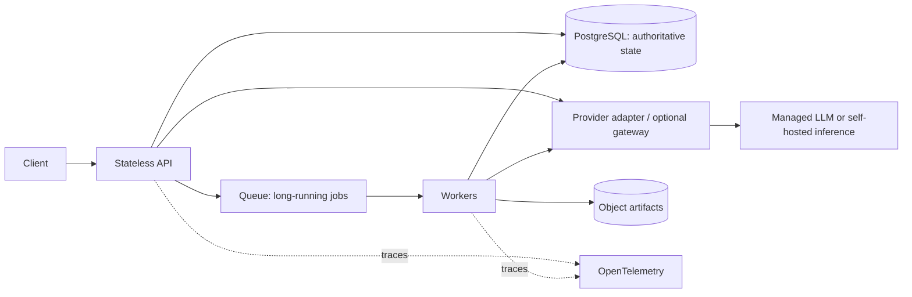
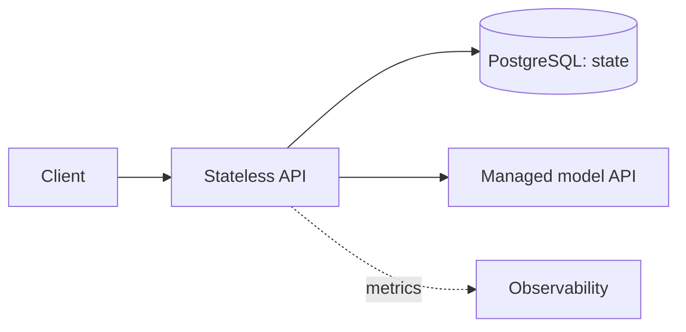
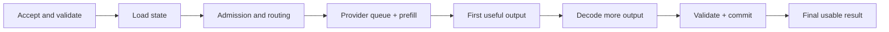
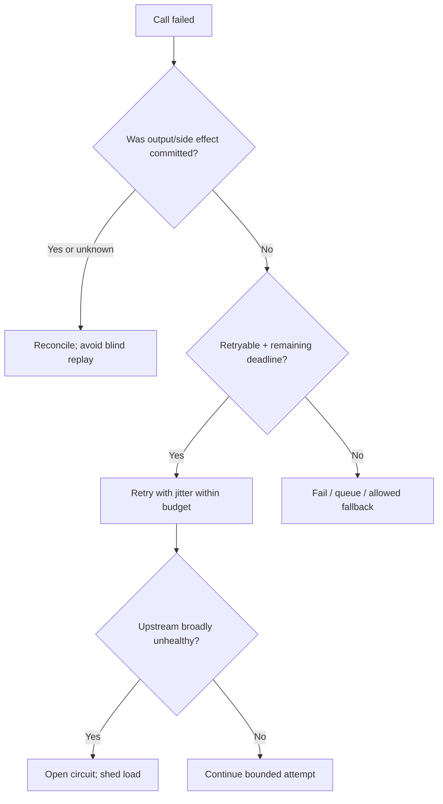
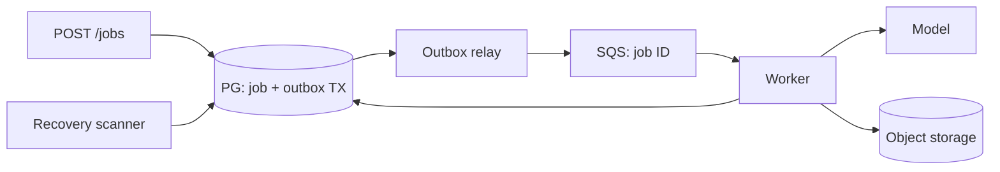
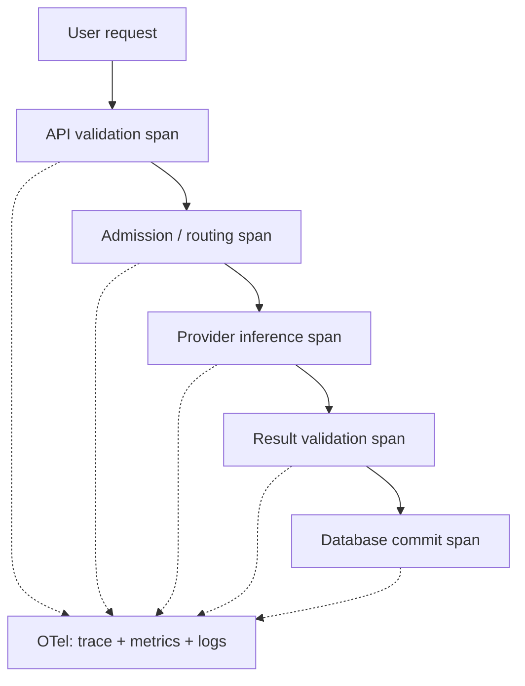

# Production AI System Design — Learn, Explain, Design

**Senior → Principal | Revised study and interview guide | 23 November 2026**

> **Purpose:** A topic-first, example-led replacement for the original 120-question guide. It **covers all 120 original question IDs** but consolidates repeated prompts into a smaller set of distinct learning cards and five complete interview scenarios.
>
> **Scope:** Production LLM application architecture. Excludes RAG, vector retrieval, model-training theory, deep AI evaluation, and security governance (covered in separate guides).

## Read this first: the whole subject in one minute

A production AI application is **a normal distributed system with an expensive, variable, probabilistic model dependency**. The engineering challenge is not just to get an answer; it is to make the end-to-end task **bounded, observable, durable when needed, and operationally predictable**.



**Four architectural questions to ask every time:**

1. **What is the user-visible contract?** Is it fast streaming, or an accepted background job?
2. **Who owns state and business correctness?** The application/database, not the model.
3. **What happens at every failure boundary?** Before inference, during a stream, after paid inference, before commit, after commit.
4. **How will we prove it works operationally?** Completion SLO, token usage, queue age, tracing, and incident recovery.

## How to use this version

- Read the short **mental model** for each module first; use its diagram to understand the flow.
- Each question card contains **Understand → Implement → Watch out**.
- Practice the **five design scenarios** after you finish the modules. You should be able to explain a design without memorizing Kubernetes product names.
- Treat example values and SQL as **illustrative**. Model capabilities, quotas, endpoints, prices, and instrumentation vary by provider, Region and version.


## Rapid glossary

| Term | Meaning in this guide |
|---|---|
| Prefill / decode | Prompt processing / incremental output generation |
| TTFT | Time to first generated token; first streamed chunk can differ |
| RPM / TPM | Requests per minute / tokens per minute quota dimensions |
| Admission control | Decision to accept, defer or reject work given real capacity |
| Backpressure | Pressure propagated upstream to prevent unlimited backlog |
| Idempotency | Same business command repeated without duplicate logical effects |
| Outbox | Event intention written in same transaction as business state |
| Lease / fencing | Recovery ownership timeout / stale-owner write prevention |
| Checkpoint | Proven, durably saved workflow progress |
| SLI / SLO | Measured reliability indicator / target for that indicator |
| RTO / RPO | Target recovery duration / tolerated data-loss window |

### Learning map

| Stage | Module | Main question |
|---|---|---|
| Foundation | 01. Architecture | Where does responsibility and state live? |
| Runtime | 02. Inference + streaming | What actually happens during one LLM request? |
| Scale | 03. Capacity + cost | What limits throughput and who pays? |
| Resilience | 04. Upstream reliability | What should be retried, rejected or failed over? |
| Correctness | 05. Durable workflows | How do jobs recover without corrupting state? |
| Operations | 06. Observability | How do you find failures and set service objectives? |
| Platform | 07. AWS + Kubernetes | Which provider/platform specifics affect the design? |
| Practice | 08. System design cases | Can you combine the concepts in an interview? |

---

# Module 01 — Architecture fundamentals

**Goal:** Start with where state lives, who owns correctness, and why some jobs cannot fit into one HTTP request.

### Mental model

Think in **three ownership layers**:

| Layer | Responsible for | Never assume it guarantees |
|---|---|---|
| Platform | Capacity, network, deployment, queues, telemetry | A correct model answer |
| Application | Business state, validation, idempotency, workflow semantics | Provider-side exactly-once execution |
| Model/provider | Inference and model-specific usage reporting | Transactional business effects |

**Start small:** `API → PostgreSQL → managed LLM`. Add Redis, a dedicated gateway, a queue, or more services **only when a requirement makes the simpler design insufficient**.



**Example:** A short chat reply can be synchronous; a 20-minute document analysis should be an accepted job with `jobId` and a status API.

## Core questions

### 01.01 — What makes production AI different from CRUD?

**Understand:** An LLM call is an expensive, variable-duration dependency that can return uncertain output. Your application—not the model—owns business correctness.

**Implement:** Keep business state and decisions in the application; explicitly budget output tokens and deadlines; separate model call metrics from endpoint metrics.

**Watch out:** Treating model requests like cheap deterministic database reads causes connection exhaustion, unexpected bills, and untracked partial responses. The model does not provide transactional semantics [S01][S27].

### 01.02 — Stateless services vs persistent conversations

**Understand:** Keep API replicas replaceable while saving conversation history and revisions in durable storage.

**Implement:** Store message/version records in PostgreSQL, short-lived hints in Redis, and artifacts in object storage.

**Watch out:** Extra datastore round trips; stale Redis copies and concurrent edits require version checks. Sticky sessions can simplify transient streaming state but complicate failover and load balancing.

### 01.03 — Interactive request or durable job?

**Understand:** Use synchronous execution for bounded interactive work; use an acknowledged job with durable identity when work can outlive the connection.

**Implement:** Return `202 Accepted` plus `jobId`, persist intent before queueing, offer GET status and optional notifications.

**Watch out:** Job lifecycle, polling, deduplication and retention add complexity; using a long HTTP timeout instead risks orphaned work.

### 01.04 — When do you need a model gateway?

**Understand:** Start with a provider adapter. Add a shared gateway when multiple teams need common routing, budgets, policy, and observability.

**Implement:** Expose an internal contract and pluggable provider adapters.

**Watch out:** An unnecessary hop can increase latency and create a single blast radius; a thin library is often enough for one service. Avoid making the gateway own business conversation state.

### 01.05 — Control plane vs data plane

**Understand:** The control plane defines policies; the data plane handles live requests. Cached policies keep requests alive when management is unavailable.

**Implement:** Store versioned configuration centrally and distribute cached snapshots to gateways.

**Watch out:** Configuration propagation delay; if the control plane fails, an explicitly bounded last-known-good snapshot can keep the data plane alive. Avoid an online control-plane lookup on every token.

### 01.06 — Managed inference vs self-hosted serving

**Understand:** Managed serving trades infrastructure control for simpler operations. Self-hosting adds GPU scheduling, runtime ownership, and utilization risk.

**Implement:** Compare model requirements, sustained utilization, data locality, latency, availability, compliance constraints and skills.

**Watch out:** Managed quotas and vendor behavior versus self-hosted cold starts, GPU OOM and idle-capacity cost [S17][S21].

### 01.07 — What belongs in PostgreSQL, Redis and object storage?

**Understand:** PostgreSQL holds business truth, Redis helps with fast ephemeral coordination, and object storage holds large immutable artifacts.

**Implement:** Put object keys and checksums in PostgreSQL rather than large payloads.

**Watch out:** Redis failover may lose volatile coordination; database hot rows can bottleneck; object-reference lifecycle must be reconciled [S09][S10][S23].

### 01.08 — Graceful degradation and failure domains

**Understand:** A degraded service should deliberately offer fewer capabilities rather than silently invent a successful answer. Isolate failures where they matter.

**Implement:** Codify fallback capabilities and communicate degradation in the API.

**Watch out:** A cheaper fallback may change language, format or task quality; never silently turn failure into a fabricated answer.

**Extra depth:** Independent concurrency budgets, pool isolation, limited fallbacks, per-dependency circuit breakers and clear traffic routing.

### 01.09 — How to start a Principal-level interview

**Understand:** Start with traffic, token sizes, latency, durability, geography, budget, and failure objectives. Draw infrastructure only after those constraints are clear.

**Implement:** Ask about sync versus async, tenant boundaries, model capability, traffic distribution, input/output token sizes, latency SLO, budget, data location, durability and operational staffing. Then draw failure domains and explain a small initial deployment.

**Watch out:** Overengineering model gateways and workflow engines without workload evidence obscures engineering judgment.  ---

---

# Module 02 — Inference and streaming

**Goal:** Understand the critical path: admission → model generation → validation → durable completion.

### Visualize the request timeline



- **TTFT / first useful content:** perceived startup delay. Some metrics report the first chunk, which may contain metadata rather than text.
- **End-to-end latency:** time from accepted request to **usable and committed** result (define your exact contract).
- **Streaming success:** only when the response reaches an explicit final state. If the user sees partial text but commit fails, report *incomplete*, not success.

**Example:** Chat displays text in 0.7 s but takes 25 s to finish. Improving handshake time might make little difference; investigate decode/output length and final persistence. Numbers are illustrative, not SLO advice.

## Core questions

### 02.01 — The end-to-end request lifecycle

**Understand:** Measure request acceptance, context fetch, provider waiting, first useful chunk, final validation, and database commit as separate stages.

**Implement:** Carry a request/trace ID and monotonic deadline through stages; classify time spent in queueing, network, prefill/generation, postprocessing.

**Watch out:** Persisting only at the end can lose streamed text after disconnect; persisting every token creates write amplification [S01][S13].

**Extra depth:** Record gateway queue wait, upstream request start, first meaningful content, last chunk, final commit.

### 02.02 — Prefill vs decode

**Understand:** Prefill processes the prompt; decode generates the reply. Large inputs and long outputs stress different stages.

**Implement:** Measure input tokens, output tokens, first-chunk timing, and generation duration separately.

**Watch out:** A simple “requests/sec” view hides radically different token shapes; architecture-specific implementation details vary by model/runtime [S17][S13].

### 02.03 — Streaming, TTFT and complete latency

**Understand:** Streaming improves perceived responsiveness, not necessarily total generation time. A first chunk is not the same as a completed usable answer.

**Implement:** Forward provider events, preserve ordering, terminate explicitly with finish/error/usage metadata where available.

**Watch out:** Streaming does not necessarily reduce generation time; proxies can buffer, clients can disconnect, and a partially streamed answer cannot be treated as committed success [S01].

**Extra depth:** Capture both at client and gateway, identifying network and app queues; label whether first event is actually user-visible content.

### 02.04 — Total deadline vs individual timeouts

**Understand:** One end-to-end time budget prevents retries and internal calls from quietly multiplying the user’s wait.

**Implement:** Propagate a single absolute deadline/remaining budget into queue admission, provider calls and postprocessing; reserve time for cleanup.

**Watch out:** A strict budget might reject work that could complete; ignoring it leaves zombie streams and overloaded pools.

### 02.05 — Static and continuous batching

**Understand:** Batching improves accelerator utilization but may delay requests. Continuous batching dynamically admits work during decoding in compatible serving engines.

**Implement:** For self-hosted models, enable an appropriate batching scheduler; for offline jobs, consider provider batch inference.

**Watch out:** Waiting to build batches raises latency and may cause head-of-line blocking; managed provider internals are not controlled by your app [S17][S20].

**Extra depth:** Use a serving engine supporting scheduled multi-request decoding and tune active token budgets.

### 02.06 — Parallel inference: faster, not cheaper

**Understand:** Run independent tasks concurrently only when the dependency graph allows it; limit parallel calls to avoid bursts in tokens and cost.

**Implement:** Establish fan-out budget and bounded concurrency; aggregate only when required results arrive.

**Watch out:** Parallelism raises instantaneous TPM use, peak connections, duplicate work on retries, and partial failure handling; parallel does not mean cheaper.

### 02.07 — Why output-token caps matter

**Understand:** An output cap limits generated length and helps bound latency and spend, but may truncate results; quota reservation rules vary.

**Implement:** Choose task-specific limits, stop conditions and truncation handling.

**Watch out:** Insufficient budget produces incomplete or malformed output. Vendor quotas sometimes reserve against `max_tokens`, not merely actual output; check endpoint-specific rules [S04][S27].

### 02.08 — Stream disconnect, persistence and replay

**Understand:** Once content has streamed, the client may disconnect before the response is committed. Track partial and final states separately.

**Implement:** Propagate an abort signal when the SDK/provider supports it; free local resources; decide whether the response remains a committed operation.

**Watch out:** Provider cancellation is best-effort and version-dependent; persisted conversations can diverge from what the client actually displayed. Support explicit replay/final-state reconciliation.

**Extra depth:** Persist message ID/status on acceptance; buffer or periodically checkpoint meaningful chunks; finalize in a transaction with status and usage; mark incomplete on interruption.

### 02.09 — SSE vs WebSockets

**Understand:** Use SSE for mostly one-way answer streaming; use WebSockets when the client needs ongoing bidirectional control or events.

**Implement:** Prefer SSE for simple incremental answer delivery; WebSocket for frequent bidirectional events, interrupt/control or shared sessions.

**Watch out:** Both need heartbeats/idle timeout strategy, reconnection and ordering; reverse proxies may buffer SSE, while WebSocket gateways add connection-state management.

### 02.10 — Troubleshooting slow completions and p95/p99

**Understand:** A good TTFT with bad final latency points to long output, generation stalls, fan-in, or persistence—not necessarily connection setup.

**Implement:** Attribute p95/p99 by stage and workload; cap concurrency and long-output tasks; split short/long queues.

**Watch out:** Optimizing median TTFT while ignoring completion failures can worsen overall success; quantiles from different stages cannot simply be added.

**Extra depth:** Compare output size, inter-chunk gaps, provider completion time and DB commit spans; segment by route.

---

# Module 03 — Capacity, economics and multi-tenancy

**Goal:** Tokens, inflight requests, tenant fairness and real cost matter more than request count alone.

### Three distinct bottlenecks

| Constraint | What it protects | What breaks if ignored |
|---|---|---|
| Request rate (RPM where applicable) | Arrivals per time window | Large request burst |
| Token rate (TPM or similar) | Token processing capacity | A few giant prompts throttle everyone |
| In-flight concurrency | Open requests, worker/GPU slots | Connection, memory, queue overload |

**Worked example (not a benchmark):** At a stable arrival rate of 2 requests/s with mean in-system time 15 s, Little’s Law gives **30 requests on average in the measured system boundary**. If you measure only active inference time, that yields active calls; if you include waiting, it yields active + waiting. p95 is **not** a substitute for the mean.

**Capacity equation:** roughly `token demand = arrivals × token count by workload class`; use distributions and burst percentiles, not only averages.

## Core questions

### 03.01 — Token economics and billing

**Understand:** Track billable input/output and applicable cache or reasoning categories. Estimates used for admission can differ from actual charges.

**Implement:** Track usage by tenant, task, model, endpoint and actual invoice rate; reconcile estimated to billed usage.

**Watch out:** Character-based estimates can undercount; provider-specific accounting and limits differ, so do not equate quota-token reservation with billable usage [S04][S22][S29].

### 03.02 — Choosing a model route

**Understand:** Route using requirements: capabilities, output format, regional constraints, measured performance, price and health—not an abstract best-model rank.

**Implement:** Rule-based default, with route version, per-route budgets and override paths; log decision reason.

**Watch out:** Misrouting harms task outcomes; opaque dynamic routing makes incidents difficult; avoid speculative “best model” assumptions.

### 03.03 — RPM, TPM, concurrency and Redis admission

**Understand:** A request-rate limit, a token budget and a simultaneous-work limit protect three distinct capacity boundaries.

**Implement:** Maintain distinct limiters and account for output-token reservations; validate vendor quota semantics.

**Watch out:** RPM-only limiting lets a few huge requests exhaust token capacity.

**Extra depth:** Define keys by tenant + model + period, reserve estimated tokens atomically, reconcile actual use.

### 03.04 — Rate limiting vs admission control / backpressure

**Understand:** Rate limiting answers “how much traffic?” Admission asks “can this request finish safely now?” Backpressure stops unsafe queue growth.

**Implement:** Apply bounded pending requests, concurrency limits and explicit 429/503 responses or durable async admission.

**Watch out:** Dropping/rejecting work reduces immediate availability but preserves system health; unbounded buffering risks OOM and missed deadlines.

**Extra depth:** Estimate work as input tokens + reserved output tokens, check in-flight budget, available slots, tenant entitlement, and deadline; reject or enqueue.

### 03.05 — Why replicas do not create LLM quota

**Understand:** Scaling API pods can improve connection capacity while making provider throttling worse if total token allowance remains fixed.

**Implement:** Use CPU or connection signals for API tiers, queue age/concurrency for workers, and token/KV-cache/GPU indicators for model servers.

**Watch out:** Scaling application pods does **not** create more vendor TPM quota or GPU memory [S11][S12][S17].

**Extra depth:** Cap gateway concurrency globally; scale consumers according to both backlog and downstream permits; configure cooldown/stabilization.

### 03.06 — Tenant fairness and isolation

**Understand:** Enforce tenant budgets at admission and fair work scheduling in the worker pool; one limit is not enough.

**Implement:** Separate interactive and batch pools, maintain tenant-level reservations and enforce tenant-specific queue depth/age.

**Watch out:** Strict fairness may waste idle capacity; borrowing unused capacity improves utilization but must be revocable. Watch starvation of small tasks behind large ones.

**Extra depth:** Per-tenant accounting keys, fair scheduling and, for high-variance workloads, separate execution pools.

### 03.07 — Head-of-line blocking

**Understand:** One huge task can delay many small ones. Separate latency-sensitive and bulk work when measured queue delay justifies it.

**Implement:** Use workload classes, deadline-aware admission, priority queues with starvation prevention, or size-based scheduling when estimates are reliable.

**Watch out:** Multiple queues fragment capacity and complicate fairness; priority-only scheduling can starve background work.

### 03.08 — Worker autoscaling beyond queue depth

**Understand:** Observe oldest-job age, job duration, inflight work and remaining downstream quota rather than blindly scaling on count.

**Implement:** Combine arrival rate, job-duration distribution, inflight count, queue age and downstream token budget.

**Watch out:** Scaling worker replicas beyond provider quota makes throttling worse; autoscaler delays and node provisioning remain constraints [S12][S24].

### 03.09 — Little’s Law for concurrency

**Understand:** In a stable system, average number of items in the system equals arrival rate times average time spent in the system; define the system boundary.

**Implement:** Segment by workload class, model and input/output token distribution; use stress tests for tail behavior.

**Watch out:** This identity does not predict saturated queues by itself; a non-steady workload or p95 latency cannot be substituted for the mean without qualification.

### 03.10 — Forecast tokens and explain capacity to leadership

**Understand:** Forecast distributions of inputs, outputs, peaks, retries and model mix; communicate a range with saturation triggers, not one guessed QPS.

**Implement:** Calculate expected input TPS and output TPS from observed conditional distributions; reserve headroom for retries and spillover.

**Watch out:** Average token sizes hide fat tails; output limits and model-version changes shift distributions [S03][S04][S26].

**Extra depth:** Use observed daily/peak arrival patterns, provider usage, input/output ratios, growth scenarios and cost rates; show saturation triggers and contingency.

### 03.11 — Hedged inference requests

**Understand:** Sending a backup request can cut rare outliers but may pay twice and add load during a provider outage. Use sparingly.

**Implement:** Restrict to eligible tasks/providers with cancellation and explicit extra-spend caps.

**Watch out:** Both calls may be billed, and hedging doubles peak load exactly when upstream capacity is scarce. Avoid during provider-wide throttling.

### 03.12 — Response cache: safe and unsafe cases

**Understand:** Reuse finished outputs only when input, authorization, versions and freshness make the result truly interchangeable.

**Implement:** Define cache key by tenant scope, model version, normalized input, parameter set and prompt version; set invalidation/TTL.

**Watch out:** Semantic equivalence is not guaranteed; an under-specified key returns wrong or cross-tenant data.

**Extra depth:** Use explicit cacheability policy and include versions of all significant inputs; cache immutable analytical artifacts when possible.

### 03.13 — Provider prompt caching vs response caching

**Understand:** Provider prompt caching can reuse a processed prefix while still generating a new answer; it is not the same as returning a cached response.

**Implement:** Keep eligible stable prefixes and inspect provider-specific cache usage/price/TTL rules.

**Watch out:** Cache hit depends on exact provider behavior and model; cached input token accounting varies. Do not infer a response cache from a prompt-cache hit [S14][S27].

### 03.14 — Single-flight request coalescing

**Understand:** Concurrent identical eligible requests can share one in-progress calculation—but only with a full, tenant-scoped key and failure recovery.

**Implement:** Key by fully scoped request fingerprint; elect one owner; others await a future or poll job ID.

**Watch out:** Owner failure can strand waiters; coalescing unlike requests through an incomplete key is a correctness bug. Avoid using a distributed lock without a recovery path.

### 03.15 — Usage ledger and reconciled billing

**Understand:** Record one ledger entry per attempt with usage, route, cost estimate and eventual billing reconciliation; Redis is not your invoice.

**Implement:** Ingest provider usage where exposed; reconcile against invoice/usage reports; separate estimates from settlement. Bedrock per-request metadata tagging is documented for `bedrock-runtime` (with invocation logging enabled), **not** `bedrock-mantle`.

**Watch out:** Failed/aborted calls may still incur charges; not every provider exposes identical usage events [S22][S29].  --- # Part III — Advanced: throughput, coordination and trade-offs (Q049–Q074)

**Extra depth:** Prefer provider-returned usage; record provisional estimates for interrupted streams; reconcile later and preserve attribution.

### 03.16 — Managed API cost vs self-hosting total cost

**Understand:** Compare cost per usable completed task, including GPU idle time, staffing, latency and failed attempts—not price per million tokens alone.

**Implement:** Include latency/service-class constraints, typical/peak demand and operational ownership; benchmark representative workloads.

**Watch out:** Ignoring idle GPUs makes self-hosting falsely cheap; assuming fixed provider rates ignores regional/model pricing and caching [S17][S29].

---

# Module 04 — Upstream reliability and routing

**Goal:** Retry only when the outcome is safe to replay, and always cap the damage of an unhealthy dependency.

### A safe provider-call decision tree



**Three rules:** (1) one layer owns retries; (2) never retry unboundedly; (3) a fallback model is an alternate *contracted implementation*, not a universal replacement.

## Core questions

### 04.01 — Throttling, retry boundaries and retry storms

**Understand:** Retries help transient errors, but layered automatic retries multiply load. Set one owner, jitter, a deadline and a total attempt budget.

**Implement:** Respect documented retry hints where present; use exponential backoff with jitter, remaining-deadline checks and a strict retry budget; queue async work.

**Watch out:** Retrying after tokens streamed can duplicate content or incur double cost; not all throttling has identical recovery time [S26][S30].

**Extra depth:** Classify failures by phase and persist step completion. Assign one retry-owning layer, enforce end-to-end attempt budget, exponential backoff with jitter, and circuit breaking.

### 04.02 — Circuit breaker

**Understand:** Open the breaker for a demonstrably unhealthy upstream so new requests do not all wait for the same failure.

**Implement:** Track provider/model/region failure rates with minimum sample volume; configure open/half-open/closed states and fallback.

**Watch out:** Too-sensitive breakers trip on expected user errors; per-pod breaker states can disagree; a global breaker may unnecessarily block healthy tenant traffic.

### 04.03 — Fallback model contracts

**Understand:** An alternative model is permitted only if the task’s capability, data-location, format and cost constraints are still satisfied.

**Implement:** Validate supported inputs, context size, output contract, available Region and expected cost *before* enabling fallback; record both attempts and the final model.

**Watch out:** Output schemas and tokenization may differ, and fallbacks can be slower/more costly; avoid fallback for jobs where model identity is part of the contract.

### 04.04 — Versioning model routes and canary releases

**Understand:** Treat model routing as deployable configuration. Pin the actual served model and test/roll back behavior changes like code.

**Implement:** Version route rules, pin a subset of tenant traffic, compare operational outcomes, and retain quick rollback.

**Watch out:** Request replay to compare models may incur spend and needs suitable handling; an unpinned dynamic policy defeats reproducibility.

**Extra depth:** Keep model catalog capability metadata, record route/model revisions, and retest application contracts before migration. Stable tenant/request bucketing, controlled weighted route, rollback threshold tied to operational outcomes, and full cost visibility.

---

# Module 05 — Durable execution and data integrity

**Goal:** A message queue wakes workers; a database records business truth. Leases, checkpoints and fencing keep retries from corrupting that truth.

### Make durability understandable

A reliable job has **two separate concerns**: a durable **record of what must happen**, and a notification that **wakes up a worker**.



**Why these components exist:**

1. **Outbox** closes the DB+queue dual-write gap (but may publish duplicates).
2. **Lease** allows another worker to take over after an owner disappears.
3. **Fencing** blocks the old owner from writing if it resumes.
4. **Checkpoint** avoids replaying successfully persisted steps.
5. **Recovery scanner** repairs expired leases or missing notifications.

**Guarantee boundary:** at-least-once job attempts + conditional durable commits can protect local final state. They cannot promise a paid model is invoked only once.

```sql
-- Example: one legitimate attempt may commit; stale attempts affect 0 rows.
UPDATE ai_jobs
SET status = 'completed', result_key = $1, updated_at = now()
WHERE id = $2 AND status = 'running' AND lease_epoch = $3;
```

For the above, the result object must exist before the conditional commit, and losing attempts need orphan-artifact cleanup. Keep DB transactions short; never call the model while holding row locks.

## Core questions

### 05.01 — Idempotent job acceptance and result writes

**Understand:** The same logical command must produce one accepted job or committed business effect—even when the HTTP call or queue message repeats.

**Implement:** Unique `(tenant_id, idempotency_key)` plus request-hash validation and stored result/job pointer.

**Watch out:** Cached responses need TTL/retention; LLM outputs themselves are not inherently identical across executions.

**Extra depth:** Upsert by `(tenant_id, external_operation_id)` in one transaction; make result writes conditional on expected state and attempt.

### 05.02 — At-least-once queue and scoped exactly-once claims

**Understand:** Expect duplicate delivery. Exactly-once execution claims never automatically extend to arbitrary external model or payment effects.

**Implement:** Workers acknowledge only after durable result/state commit; dedupe effects.

**Watch out:** Ordering, deduplication and exact delivery guarantees are queue-specific; SQS Standard is at-least-once and can deliver duplicates, including during visibility timeout [S07].

**Extra depth:** Combine durable checkpoints with idempotent/fenced business writes.

### 05.03 — Checkpointing paid inference

**Understand:** Checkpoint outputs and step state after durable persistence so a restart can resume from the last proven completion.

**Implement:** Store step status, version, input fingerprint, output pointer, and committed transition in a transactional state store.

**Watch out:** Overly fine checkpoints create storage overhead; checkpoints taken before output durability can lie.

### 05.04 — Transactional outbox and lost notifications

**Understand:** Write job intent and outbox event in one PostgreSQL transaction; publish later and tolerate duplicate notifications.

**Implement:** Publisher reads pending outbox rows, sends message, records delivery; consumers dedupe.

**Watch out:** Duplicate publishes remain possible; relay lag and poison events require monitoring. An outbox offers atomic *intent*, not distributed exactly-once [S08].

**Extra depth:** Transactional outbox relay retries unpublished events; scanner finds aged `queued` rows; idempotent consumers ignore duplicate notification.

### 05.05 — PostgreSQL job table vs SQS/Redis queue

**Understand:** The database owns job lifecycle and status; the queue carries wake-up notifications. Small systems can use database polling alone.

**Implement:** Represent jobs in PG, push job ID on the queue, and reconcile if notification is lost.

**Watch out:** A PG-only `SKIP LOCKED` queue simplifies a small deployment but can add database polling/load; Redis Streams offer consumer pending state but do not replace business transactions [S09][S10].

### 05.06 — Claiming PostgreSQL jobs safely

**Understand:** Claim ready work inside a short transaction with a conditional update; never hold a database lock during inference.

**Implement:** Use indexed ready state and claim with consistent ordering.

**Watch out:** PostgreSQL explicitly says `SKIP LOCKED` provides an inconsistent view, appropriate for queue-like consumers, not general-purpose reads [S09].

### 05.07 — Lease ownership vs fencing tokens

**Understand:** Leases let another worker recover work; fencing prevents an old worker from committing after its lease expires.

**Implement:** Store `lease_until`, `lease_owner`, `attempt_id`; renew while active; reject stale writes using a monotonically increasing fencing token/version.

**Watch out:** A paused worker may resume after lease expiry; a lease by itself does not stop it writing stale results. Use conditional commits.

**Extra depth:** Make the authoritative state store reject updates from old epochs; use Redis only for low-risk ephemeral coordination.

### 05.08 — Recovery scanner

**Understand:** Periodically find expired leases and accepted jobs that never received a queue notification; recover them in bounded batches.

**Implement:** Scan indexed nonterminal rows in batches, compare lease/version, requeue or fail according to policy.

**Watch out:** Excessively frequent full-table scans overload PG; scanner must be concurrency-safe and must not override currently valid ownership.

### 05.09 — Delayed retries and dead-letter queues

**Understand:** Retry transient failures on a schedule; put persistent poison jobs into a visible terminal process rather than retrying forever.

**Implement:** Retry with persisted `next_attempt_at`, attempt count, jitter, maximum elapsed lifetime and terminal failure state; route persistent failures for inspection.

**Watch out:** Large retries create a delayed traffic surge; infinite retries hide dead tasks and exceed cost budget.

**Extra depth:** Store job ID/error class/attempt references, alert on DLQ age/count, and provide a deliberate redrive procedure.

### 05.10 — Conversation ordering and revision conflicts

**Understand:** Two devices cannot silently create incompatible histories; enforce per-conversation revision semantics or serialize writes.

**Implement:** Use versioned append semantics and transactionally enforce expected sequence/revision.

**Watch out:** Global locks reduce concurrency; eventual read replicas may show stale history. Reject or merge conflicting writes explicitly [S34].

### 05.11 — PostgreSQL metadata and object storage consistency

**Understand:** An object upload and database commit are not atomic together. Verify the object before publishing the pointer and reconcile orphans.

**Implement:** Upload under temporary immutable key, verify checksum, then commit PG pointer/state; reconcile orphan keys and missing pointers.

**Watch out:** S3 has strong read-after-write consistency for object PUT/DELETE, but that does not make PG+S3 atomic [S23].

### 05.12 — State machines and workflow schema versions

**Understand:** Define legal states and transitions; record workflow version because jobs can survive application deployments.

**Implement:** Example `queued → running → completed | failed | cancelling`; transition with `WHERE state = expected AND version = expected`; record attempts separately.

**Watch out:** Too few states hide important ambiguity; too many states create maintenance burden. Completion must imply committed output durability.

**Extra depth:** Store `workflow_version`, input schema version, prompt/model route versions and migration strategy; keep compatible workers for outstanding jobs or translate state.

### 05.13 — Cancellation and graceful worker shutdown

**Understand:** Cancel means a durable stop request, not a promise that the model provider will immediately stop or reverse charges.

**Implement:** Persist cancellation intent; workers check before/after costly steps, propagate provider abort if supported, finalize as `cancelled` only when work is reconciled.

**Watch out:** Race with completion must be deterministic; an already committed business effect cannot be “uncalled.” Document possible charges for aborted inference.

### 05.14 — Compensation and unknown external outcomes

**Understand:** Compensation is a new action to offset a prior effect. If a timed-out external call might have succeeded, reconcile before repeating it.

**Implement:** Specify forward action, durable success marker, idempotent compensation and failure handling.

**Watch out:** Compensation can fail and may be only partially reversible; inference tokens already consumed cannot be refunded by a saga.

**Extra depth:** Use remote idempotency keys/status lookup when available; otherwise record `outcome_unknown` and reconcile.

### 05.15 — Parallel branches and joins

**Understand:** Each branch saves a stable attempt/result; the join starts only when required committed branches are complete.

**Implement:** Unique `(job_id, branch_id, generation)` rows; transactional increments or derive branch count from records.

**Watch out:** A naive in-memory counter loses updates; rescheduled branches can overwrite newer results unless fenced.

### 05.16 — When PostgreSQL is saturated

**Understand:** Look at claim indexes, locks, long transactions, bloat, connection count and competing workloads before adding replicas.

**Implement:** Inspect active queries, locks, index plans, connection usage and table bloat; shorten transactions, batch scans, partition old data or split operational responsibilities if justified.

**Watch out:** Adding connections can exacerbate saturation; holding a transaction through LLM inference is especially damaging [S09][S34].

### 05.17 — Provider completed, worker crashed before commit

**Understand:** Model output may be lost even though billed; track ambiguous attempts and persist artifacts before conditionally committing a result.

**Implement:** Save outputs under stable attempt IDs, commit with fencing, record ambiguous attempt accounting and retry only according to policy.

**Watch out:** Retried model calls can generate different outputs and double costs; checkpoints cannot recover data that was never durably saved.

---

# Module 06 — Observability and production operations

**Goal:** Measure what the user experiences, what the model consumed, and whether accepted jobs eventually became durable results.

### One request, three views



| View | Question answered | Example |
|---|---|---|
| Traces | Where did this call spend time? | Provider queue vs validation |
| Metrics | Is the whole service getting worse? | p95 final latency, queue oldest age |
| Logs | Which request/attempt failed and why? | error code, job ID, route version |

**Important:** Provider-side successful inference is not equivalent to a complete user task. Measure full application completion and partial-stream failures. GenAI OTel conventions are currently marked *Development*; verify SDK/spec version rather than hardcoding assumed field names [OTel GenAI](https://github.com/open-telemetry/semantic-conventions-genai/blob/main/docs/gen-ai/client-inference.md).

## Core questions

### 06.01 — OpenTelemetry traces and GenAI conventions

**Understand:** Trace ingress, admission, provider call, validation and storage; pin instrumentation versions because GenAI conventions are evolving.

**Implement:** Instrument spans for each stage and GenAI inference operations; add provider/model identifiers and usage when available.

**Watch out:** High-cardinality attributes and logging raw prompts can be expensive; GenAI semantic conventions are evolving and instrumentation versions differ [S13][S14].

**Extra depth:** Propagate trace context through HTTP and message metadata; relate a job ID to all attempts even when traces are separate. Pin instrumentation versions, document emitted fields and normalize at the collector if necessary.

### 06.02 — Interactive vs asynchronous SLIs and SLOs

**Understand:** Streaming chat and durable jobs need different success denominators and latency clocks; a quick first chunk is not job success.

**Implement:** Define numerator, denominator, population, exclusions, sampling window, and ownership first.

**Watch out:** Combining chat streams and background jobs in one latency SLO obscures failure; do not invent targets before observing workload and business needs [S18].

**Extra depth:** Define explicit event boundaries, valid-user-request denominator, dependency failures and cancellation policy; segment by task class.

### 06.03 — Structured logging and content exposure

**Understand:** Log IDs, model routes, attempts, errors, token counts and object references, not raw sensitive prompts by default.

**Implement:** Structured JSON with bounded fields; keep raw content collection off by default unless approved separately.

**Watch out:** Raw prompts/results create high-volume logs and can expose sensitive material; Bedrock invocation logging, when enabled, can capture inputs and outputs, so do not confuse it with ordinary metadata metrics [S15].

### 06.04 — Useful dashboards and high-cardinality metrics

**Understand:** Show user impact, inference behavior, backlog age and infrastructure, segmented by a bounded set of labels.

**Implement:** Histograms for latency, counters for outcomes, gauges for current capacity, dimensions with controlled cardinality.

**Watch out:** Tagging metrics by raw user/request ID creates cardinality explosions; do not use averages alone to track tail impact [S13][S16].

**Extra depth:** Each dashboard links to traces and recent deployments; filter by tenant class, model and region with controlled cardinality.

### 06.05 — Actionable alerts and error budgets

**Understand:** Alert on user impact or approaching capacity exhaustion; let agreed error-budget policy influence change risk.

**Implement:** Combine burn-rate SLO alarms with queue-age/capacity and upstream saturation alerts; attach route, tenant class, runbook and dashboard.

**Watch out:** Alerts on every provider 429 cause fatigue if backpressure is working; missing user-facing signals hides silently degraded output [S18].

**Extra depth:** Track budget consumption; slow risky changes or focus on reliability when burn is excessive; agree policy with product owners.

### 06.06 — Readiness vs real provider probing

**Understand:** Keep pod liveness/readiness separate from optional synthetic inference calls; provider outage should not take down every API pod.

**Implement:** Readiness confirms local ability to receive; asynchronous synthetic probes exercise allowed routes and report to monitoring.

**Watch out:** Synthetic calls incur cost and provider throttling; a green synthetic call does not prove business-task correctness [S31].

### 06.07 — Triage a sudden chat-latency regression

**Understand:** Start by separating region, route, time-to-first-content, final latency, token growth and provider throttling before scaling anything.

**Implement:** Compare TTFT, total duration, input/output tokens, upstream errors, in-flight requests and recent route releases; isolate the first worsening segment.

**Watch out:** Increasing replicas on a token-quota bottleneck magnifies the outage; reducing output budgets may harm task completion.

### 06.08 — Load testing and fault injection

**Understand:** Simulate realistic token sizes, burst patterns and disconnects, then crash workers or fail dependencies and assert invariants.

**Implement:** Use mock provider for API/DB isolation, then controlled real-provider tests within quota/budget; measure time series rather than one mean.

**Watch out:** Real-provider tests cost money and may alter upstream capacity; mocking misses true latency/throttle behavior.

**Extra depth:** Inject faults in a nonproduction or bounded canary environment with observable invariants.

### 06.09 — The incident runbook

**Understand:** A runbook connects symptom, dashboard, traffic scope, rollback, throttling mitigation, queue recovery and reconciliation to named owners.

**Implement:** Define who can change route weights, output limits, worker concurrency and queue processing; include post-incident accounting for incomplete results.

**Watch out:** An untested runbook can worsen outages; disabling retries or bulk traffic may be the safest mitigation even if some jobs are delayed.

---

# Module 07 — Platform, AWS Bedrock and disaster recovery

**Goal:** Treat cloud-provider behavior as an adapter-specific contract; keep platform availability and model quality separate.

### Cloud-specific facts that change design

| Decision | Safe rule |
|---|---|
| Bedrock `bedrock-runtime` | Per-model **combined** input/output TPM, with RPM for some models, plus possible other limits. |
| Bedrock `bedrock-mantle` | **Separate** input/output TPM and no endpoint RPM quota. Admission can initially reserve `input + max_tokens` against the input TPM budget before releasing unused reservation. |
| Cross-Region inference | Processing can take place in another eligible Region; geography profiles are not single-Region guarantees. |
| Provisioned Throughput | Reserved paid capacity; verify model eligibility, exact rates, commitment and actual sustained demand. |
| Step Functions Standard | Exactly-once **workflow execution** claim, not exactly-once execution of arbitrary third-party side effects. |

Source checks: [AWS runtime quotas](https://docs.aws.amazon.com/bedrock/latest/userguide/quotas-runtime.html), [AWS Mantle quotas](https://docs.aws.amazon.com/bedrock/latest/userguide/quotas-mantle.html), [cross-Region inference](https://docs.aws.amazon.com/bedrock/latest/userguide/cross-region-inference.html), [Step Functions types](https://docs.aws.amazon.com/step-functions/latest/dg/choosing-workflow-type.html).

**Deployment note:** These details are **provider documentation as checked 23 Nov 2026**, not universal settings. Always query the actual model/Region/account quota before selecting a rollout capacity.

## Core questions

### 07.01 — Self-hosted GPU operational risks

**Understand:** GPU inference adds model memory, KV-cache, batching, warm-up, OOM and accelerator scheduling constraints.

**Implement:** Monitor active sequences, waiting tokens, prefill/decode throughput, cache pressure and OOM/restarts; right-size GPU shape and model parallelism.

**Watch out:** Larger batch can raise throughput but also TTFT/tail latency; multi-GPU parallelism can increase communication overhead [S17].

**Extra depth:** Warm capacity, startup probes, capacity quotas, request-size admission and serving-level telemetry; test model-specific runtime configuration.

### 07.02 — Deploying code, prompts and workflow versions safely

**Understand:** A safe AI release versions application logic, prompt/config, model routes and long-running workflow state independently.

**Implement:** Compatibility checks, migration phases, canary traffic and explicit rollback runbooks; pin existing long jobs to compatible workflow versions.

**Watch out:** Dual-version compatibility increases work; unversioned long-running state can break after rollout [S32].

### 07.03 — Bedrock incident: throttling at peak traffic

**Understand:** Confirm which endpoint and quota dimension throttled before adding pods or changing retries.

**Implement:** Inspect provider response, CloudWatch metrics, in-flight token reservations, model/Region quotas; bound concurrency and queue batch jobs; assess eligible alternative routing or quota increase.

**Watch out:** Routing away can affect data-location requirements; runtime and Mantle quotas differ [S03][S04][S26].

### 07.04 — Bedrock control plane vs endpoint quota surfaces

**Understand:** Keep management/provisioning distinct from online inference and treat runtime vs Mantle quotas separately.

**Implement:** Provision and verify resources before shifting traffic; data plane uses known model/profile IDs.

**Watch out:** Changes to available models and endpoint support are region/feature-dependent; use current provider docs rather than assuming a universal API [S01][S02][S21].

**Extra depth:** Select supported API/model/Region, build adapter-specific usage interpretation and separate admission limiters per surface.

### 07.05 — Cross-Region inference and residency

**Understand:** An inference profile may process requests in other Regions; verify exact eligible destinations against data-location obligations.

**Implement:** Choose allowed profile, verify possible destination Regions and policy, then account for source/destination behavior in traces and operating procedures.

**Watch out:** A global profile is not “single-Region processing”; provisioned throughput is a separate mechanism and currently not supported with inference profiles per AWS docs [S05].

### 07.06 — When Provisioned Throughput pays off

**Understand:** Reserved model throughput can help measured sustained demand, but introduces commitment and idle-capacity economics.

**Implement:** Compare measured demand/cost, commitment terms, model/Region eligibility and service availability; plan idle-capacity economics.

**Watch out:** Purchasing capacity does not eliminate application bugs, network failures or bad model outputs; compatibility and availability vary [S21].

### 07.07 — Multi-AZ vs multi-Region, RTO and RPO

**Understand:** Multi-AZ handles local availability; multi-Region recovery needs state replication and explicitly tested recovery-time/data-loss objectives.

**Implement:** Use HA data services and redundant stateless replicas in a primary Region; add cross-Region data replication and tested promotion only when impact analysis warrants it.

**Watch out:** Multi-Region requires careful async state ownership and data divergence handling; a healthy alternate inference region cannot compensate for missing workflow state [S19].

**Extra depth:** Define goals per data class, select replication/backup strategy, and exercise restore with in-flight jobs and idempotency records.

---

# Module 08 — Five system-design interview cases

Each case takes several previously separate questions and turns them into **one design conversation**. Practice this progression: **requirements → minimal architecture → request path → failure injection → trade-off → metrics**.

## Case A — Streaming chat application

**Scenario:** Stateless chat API → PostgreSQL messages/revisions → inference adapter → SSE → final persisted response.

**Design conversation:** Two tabs send messages at once; a stream drops after 400 tokens. Decide revision conflicts, partial state and replay.

**Correctness test:** Do not treat emitted SSE chunks as committed data; the client should fetch authoritative message status.

**What a strong answer includes:**

1. Append user message with expected revision; call model with deadline; emit SSE event IDs; persist assistant completion/incompletion; attach per-request trace and usage.

2. One option is optimistic append with `expected_revision` and `409 Conflict`; another is serialized per-conversation processing via a queue.

3. Per-tenant admission, streaming TTFT and completion telemetry, partial-stream error accounting, route-specific circuit breaking and tested failover.

*Consolidates original design prompts: Q106, Q107, Q108.*

## Case B — Crash-resistant async inference jobs

**Scenario:** POST /jobs → PostgreSQL job+outbox transaction → SQS → leased worker → model → object storage → conditional PostgreSQL commit.

**Design conversation:** The worker pauses, its lease expires, another worker starts, then the first resumes. The old attempt must fail its conditional commit.

**Correctness test:** A fencing token prevents duplicate database results; it does not prevent duplicate model charges.

**What a strong answer includes:**

1. Accept idempotently, claim with version/fencing, commit each durable step, acknowledge only after final state transition, and requeue expired jobs.

2. `UPDATE jobs SET status='completed', result_key=... WHERE id=? AND lease_epoch=? AND status='running'`; accept exactly one affected row, and reject stale results.

3. Worker checks cancellation before every expensive step, aborts calls where supported, and commits `cancelled`/`failed`/`completed` conditionally; use termination grace periods and scanner recovery.

*Consolidates original design prompts: Q109, Q110, Q111.*

## Case C — Multi-tenant model gateway

**Scenario:** Clients → shared stateless gateway pool → tenant admission → versioned route → eligible model provider → usage ledger.

**Design conversation:** Tenant A floods requests and Provider 1 throttles; serve Tenant B fairly, respect each budget, and keep fallback within contract.

**Correctness test:** Quota reservations are provisional. Reconcile final charges and expire abandoned reservations.

**What a strong answer includes:**

1. Cache versioned routes locally; keep centralized billing asynchronously; apply bounded limits and request deadlines.

2. Atomically reserve tenant capacity, release unused reservation upon completion, append attempt-level usage, reconcile invoices.

3. Prevalidate fallback compatibility, limit attempts and only switch at safe retry points; expose actual served model in diagnostics.

*Consolidates original design prompts: Q112, Q113, Q114.*

## Case D — Async document analysis, no retrieval

**Scenario:** Object upload → durable analysis job → preprocessing → structured model extraction → schema validation → artifact publication.

**Design conversation:** A document has multiple sections and one fails validation. Decide whether publish is atomic, partial or failed.

**Correctness test:** Do not label partially validated structured data as complete.

**What a strong answer includes:**

1. Record immutable object version/checksum, store step status and attempts, checkpoint output, return status API.

2. Persist stage outputs and input fingerprints; use stable IDs when emitting parallel sub-jobs if genuinely independent.

3. Store status and per-stage error classifications; publish final results only after required validations; optionally retain partial artifacts with explicit completeness flags.

*Consolidates original design prompts: Q115, Q116, Q117.*

## Case E — Enterprise AI platform evolution

**Scenario:** Start with shared adapter and storage; evolve to gateway, durable workers, dedicated pools and control-plane policies when justified.

**Design conversation:** Several teams share models but have different data residency rules, SLOs and operational owners. Show a smallest credible rollout plan.

**Correctness test:** Principal-level answers compare the simplest design that meets requirements with the costs of adding each new component.

**What a strong answer includes:**

1. Define internal contracts, ownership, operating model and migration stages.

2. Define route SLO, application SLO, runbooks, escalation, model-change process and cost-center attribution.

3. Recommend a baseline (e.g., stateless TypeScript API + PostgreSQL + SQS/outbox + worker pool + managed inference + OTel), then state thresholds that would justify Step Functions, KEDA, dedicated gateway, multi-Region or GPU serving.

*Consolidates original design prompts: Q118, Q119, Q120.*

---

# Quick-reference cheat sheets

## Pattern selection (avoid building everything)

| Situation | Start with | Add only if proven necessary |
|---|---|---|
| One short synchronous chat | Stateless API + PostgreSQL + provider adapter | Gateway when shared policies justify it |
| Multi-minute analysis | Persistent job + worker + status API | Outbox/queue/checkpoint/scanner for stronger failure recovery |
| Several tenants/providers | Shared routing and quota policy | Dedicated gateways, pools and per-tenant fairness |
| High inference latency | Measure stage timings and output-token size | Batching, parallelism, dedicated pools or self-hosting after measurement |
| Expensive repeated requests | Explicitly scoped response cache or single-flight | Provider prompt caching where supported |
| Provider failures | Deadline, bounded retries, circuit breaker | Contract-tested fallback if permitted |
| DR requirement | Multi-AZ and backups | Multi-Region state replication after RTO/RPO analysis |

## Understand the failure boundary

| What failed? | Safe response | What you must not assume |
|---|---|---|
| HTTP client disconnected during streaming | Abort best-effort; expose final state and reconcile | Provider stopped or cannot bill |
| API saved job but did not publish message | Outbox relay/recovery scan, idempotent consumer | Queue notification automatically follows DB transaction |
| Worker lease expires during provider call | New worker can recover; old result rejected by epoch | Only one model call happened |
| External API timed out after request sent | Remote idempotency/status lookup; mark outcome unknown | Timeout means request did nothing |
| Provider returns 200 but app validation fails | Persist failed attempt and return correct job state | A successful model response is business success |
| More HPA pods but more 429s | Cap global concurrency and budget tokens | Replicas increase provider TPM |

## Observability starter pack

**Interactive:** accepted request rate, valid completed response rate, first useful content time, final usable completion latency, disconnect/partial rate, provider error/throttle rate, input/output usage and cost per successful task.

**Async:** acceptance-to-completion age, eligible terminal success, oldest queue/job age, expired leases, retry attempts, dead-letter count, completion/recovery latency and cost per completed job.

**Trace fields:** request ID, job ID, attempt ID, route version, model/provider/Region, error class, duration, token categories, output-artifact pointer. Keep personal or confidential prompt bodies out of routine telemetry.

## Core formulas (apply carefully)

- **Little’s Law:** `mean jobs in measured boundary = arrival rate × mean time in boundary`. Requires stable population and consistent time units.
- **Nominal inference cost:** `billable input tokens × input rate + billable output tokens × output rate + any additional token/service charges` (provider specific).
- **Cost per successful task:** `all allocated attempt + infrastructure costs / eligible successful tasks`, over the same cohort.
- **Queue growth:** if sustained arrival work rate ≥ sustained processing capacity, the backlog will not drain. A queue buys decoupling, not infinite throughput.
- **Error budget:** for a success-fraction SLO, `allowed failure fraction = 1 − SLO target`; denominator/cancellations/cohort must be defined.

## Interview answer template

1. **Requirements:** “Is this interactive or async? What is the maximum tolerated latency, job lifetime, geography, budget and data-loss window?”
2. **Smallest viable design:** “Start with API, PostgreSQL and managed inference; add queue/workers for durable long work.”
3. **Request/worker lifecycle:** Show exactly where state is committed and where tokens are consumed.
4. **Failure semantics:** Identify retries, unknown outcomes, stale ownership, partial streams and idempotency.
5. **Capacity:** Explain tokens, concurrent calls, queue age, tenant fairness and model quota independently.
6. **Operations:** Name SLI/SLO, trace, cost ledger, alerts and disaster recovery tests.
7. **Trade-off:** Say what complexity you *didn’t* add and why.

---

# Source review and accuracy corrections

This document is a **transformation and review of the user-supplied guide**. The original question IDs are preserved as coverage annotations—not as a second duplicated question bank. Official links below support version-sensitive claims; the rest of the advice is architectural reasoning, not a provider guarantee.

| Review item | Revision / clarification |
|---|---|
| Dense original text | Split into plain-language understanding, implementation, and failure warnings; added examples and diagrams. |
| Repeated request-lifecycle questions | Q002/Q023 merged into 02.01. |
| Repeated scaling questions | Q013/Q073 merged; Q014/Q049 merged. |
| Retry/fallback overlaps | Q029/Q030/Q057 merged; fallback rules consolidated with contract discussion. |
| Workflow correctness overlaps | Q015/Q034, Q041/Q065, Q038/Q094 consolidated; Q110 appears inside the durable-job case. |
| Metrics and operational overlaps | Q019/Q075/Q076; Q020/Q082; Q079/Q090 consolidated. |
| Confused exactly-once wording | Clearly scope Step Functions Standard guarantees to workflow execution and treat external side effects separately. |
| Bedrock quotas | Runtime combines input/output TPM and has model-specific RPM; Mantle has separate TPM dimensions, no enforced RPM, and unusual initial `input + max_tokens` input quota reservation. |
| Cross-Region routing | Profile routing geography is not a promise of processing in the caller’s Region. |
| Telemetry metric names | GenAI OTel conventions are under development; pin current emitted instrumentation names. |
| Precision and examples | No universal throughput target, price, job-duration threshold or SLO number is asserted. All example values are explicitly illustrative. |
| PostgreSQL version | Original citations use PostgreSQL 18, which remains supported and is valid for these SQL examples; PostgreSQL 19 was released on **19 Nov 2026** and is the newest major version, so do not label PostgreSQL 18 “latest.” |

## Official sources checked for accuracy (23 November 2026)

1. [AWS Bedrock runtime quotas](https://docs.aws.amazon.com/bedrock/latest/userguide/quotas-runtime.html)
2. [AWS Bedrock Mantle quotas](https://docs.aws.amazon.com/bedrock/latest/userguide/quotas-mantle.html)
3. [AWS Bedrock quota token counting](https://docs.aws.amazon.com/bedrock/latest/userguide/quotas-token-burndown.html)
4. [AWS Bedrock cross-Region inference](https://docs.aws.amazon.com/bedrock/latest/userguide/cross-region-inference.html)
5. [AWS Bedrock request metadata attribution](https://docs.aws.amazon.com/bedrock/latest/userguide/cost-mgmt-request-metadata.html)
6. [AWS Bedrock Provisioned Throughput](https://docs.aws.amazon.com/bedrock/latest/userguide/prov-throughput.html)
7. [AWS Step Functions execution types](https://docs.aws.amazon.com/step-functions/latest/dg/choosing-workflow-type.html)
8. [AWS SQS at-least-once delivery](https://docs.aws.amazon.com/AWSSimpleQueueService/latest/SQSDeveloperGuide/standard-queues-at-least-once-delivery.html)
9. [PostgreSQL 18 SELECT / SKIP LOCKED](https://www.postgresql.org/docs/18/sql-select.html)
10. [OpenTelemetry GenAI inference conventions](https://github.com/open-telemetry/semantic-conventions-genai/blob/main/docs/gen-ai/client-inference.md)
11. [KEDA SQS scaler](https://keda.sh/docs/2.21/scalers/aws-sqs/)
12. [PostgreSQL 19 release](https://www.postgresql.org/about/news/postgresql-19-released-3449/)

**Accuracy boundary:** This review checks material architectural claims and selected provider-specific statements, but does **not** certify every cloud service quota, every Region, every model version, or every linked document on an ongoing basis. For implementation decisions, verify current documentation and applied quotas in your account.

---

# Original-to-new coverage index

All original questions Q001–Q120 are accounted for exactly once in the learning cards or five cases. This is the **navigation map**, not a second question bank.

**Module 01 — Architecture fundamentals**
- `01.01` What makes production AI different from CRUD? — Q001
- `01.02` Stateless services vs persistent conversations — Q003
- `01.03` Interactive request or durable job? — Q004
- `01.04` When do you need a model gateway? — Q005
- `01.05` Control plane vs data plane — Q006
- `01.06` Managed inference vs self-hosted serving — Q007
- `01.07` What belongs in PostgreSQL, Redis and object storage? — Q016
- `01.08` Graceful degradation and failure domains — Q021, Q074
- `01.09` How to start a Principal-level interview — Q022

**Module 02 — Inference and streaming**
- `02.01` The end-to-end request lifecycle — Q002, Q023
- `02.02` Prefill vs decode — Q008
- `02.03` Streaming, TTFT and complete latency — Q009, Q010
- `02.04` Total deadline vs individual timeouts — Q012
- `02.05` Static and continuous batching — Q024, Q025
- `02.06` Parallel inference: faster, not cheaper — Q026
- `02.07` Why output-token caps matter — Q033
- `02.08` Stream disconnect, persistence and replay — Q035, Q037
- `02.09` SSE vs WebSockets — Q036
- `02.10` Troubleshooting slow completions and p95/p99 — Q055, Q092

**Module 03 — Capacity, economics and multi-tenancy**
- `03.01` Token economics and billing — Q011
- `03.02` Choosing a model route — Q027
- `03.03` RPM, TPM, concurrency and Redis admission — Q028, Q046
- `03.04` Rate limiting vs admission control / backpressure — Q014, Q049
- `03.05` Why replicas do not create LLM quota — Q013, Q073
- `03.06` Tenant fairness and isolation — Q050, Q059
- `03.07` Head-of-line blocking — Q051
- `03.08` Worker autoscaling beyond queue depth — Q052
- `03.09` Little’s Law for concurrency — Q053
- `03.10` Forecast tokens and explain capacity to leadership — Q054, Q103
- `03.11` Hedged inference requests — Q056
- `03.12` Response cache: safe and unsafe cases — Q060, Q062
- `03.13` Provider prompt caching vs response caching — Q061
- `03.14` Single-flight request coalescing — Q063
- `03.15` Usage ledger and reconciled billing — Q048, Q078
- `03.16` Managed API cost vs self-hosting total cost — Q104

**Module 04 — Upstream reliability and routing**
- `04.01` Throttling, retry boundaries and retry storms — Q029, Q030, Q057
- `04.02` Circuit breaker — Q031
- `04.03` Fallback model contracts — Q032
- `04.04` Versioning model routes and canary releases — Q058, Q086, Q087

**Module 05 — Durable execution and data integrity**
- `05.01` Idempotent job acceptance and result writes — Q015, Q034
- `05.02` At-least-once queue and scoped exactly-once claims — Q017, Q043
- `05.03` Checkpointing paid inference — Q018
- `05.04` Transactional outbox and lost notifications — Q038, Q094
- `05.05` PostgreSQL job table vs SQS/Redis queue — Q039
- `05.06` Claiming PostgreSQL jobs safely — Q040
- `05.07` Lease ownership vs fencing tokens — Q041, Q065
- `05.08` Recovery scanner — Q042
- `05.09` Delayed retries and dead-letter queues — Q044, Q045
- `05.10` Conversation ordering and revision conflicts — Q047
- `05.11` PostgreSQL metadata and object storage consistency — Q064
- `05.12` State machines and workflow schema versions — Q066, Q067
- `05.13` Cancellation and graceful worker shutdown — Q068
- `05.14` Compensation and unknown external outcomes — Q069, Q070
- `05.15` Parallel branches and joins — Q071
- `05.16` When PostgreSQL is saturated — Q093
- `05.17` Provider completed, worker crashed before commit — Q095

**Module 06 — Observability and production operations**
- `06.01` OpenTelemetry traces and GenAI conventions — Q019, Q075, Q076
- `06.02` Interactive vs asynchronous SLIs and SLOs — Q020, Q082
- `06.03` Structured logging and content exposure — Q077
- `06.04` Useful dashboards and high-cardinality metrics — Q079, Q090
- `06.05` Actionable alerts and error budgets — Q080, Q083
- `06.06` Readiness vs real provider probing — Q081
- `06.07` Triage a sudden chat-latency regression — Q084
- `06.08` Load testing and fault injection — Q088, Q089
- `06.09` The incident runbook — Q105

**Module 07 — Platform, AWS Bedrock and disaster recovery**
- `07.01` Self-hosted GPU operational risks — Q072, Q096
- `07.02` Deploying code, prompts and workflow versions safely — Q085
- `07.03` Bedrock incident: throttling at peak traffic — Q091
- `07.04` Bedrock control plane vs endpoint quota surfaces — Q097, Q098
- `07.05` Cross-Region inference and residency — Q099
- `07.06` When Provisioned Throughput pays off — Q100
- `07.07` Multi-AZ vs multi-Region, RTO and RPO — Q101, Q102
- `Case A` Streaming chat application — Q106, Q107, Q108
- `Case B` Crash-resistant async inference jobs — Q109, Q110, Q111
- `Case C` Multi-tenant model gateway — Q112, Q113, Q114
- `Case D` Async document analysis, no retrieval — Q115, Q116, Q117
- `Case E` Enterprise AI platform evolution — Q118, Q119, Q120

## Original guide source-link definitions

[S01]: https://docs.aws.amazon.com/bedrock/latest/userguide/conversation-inference.html
[S02]: https://docs.aws.amazon.com/bedrock/latest/userguide/endpoints.html
[S03]: https://docs.aws.amazon.com/bedrock/latest/userguide/quotas-runtime.html
[S04]: https://docs.aws.amazon.com/bedrock/latest/userguide/quotas-mantle.html
[S05]: https://docs.aws.amazon.com/bedrock/latest/userguide/cross-region-inference.html
[S15]: https://docs.aws.amazon.com/bedrock/latest/userguide/model-invocation-logging.html
[S16]: https://docs.aws.amazon.com/bedrock/latest/userguide/monitoring-runtime-metrics.html
[S20]: https://docs.aws.amazon.com/bedrock/latest/userguide/batch-inference.html
[S21]: https://docs.aws.amazon.com/bedrock/latest/userguide/prov-throughput.html
[S22]: https://docs.aws.amazon.com/bedrock/latest/userguide/cost-mgmt-request-metadata.html
[S25]: https://docs.aws.amazon.com/bedrock/latest/userguide/service-tiers-inference.html
[S26]: https://docs.aws.amazon.com/bedrock/latest/userguide/scaling-throughput-best-practices.html
[S27]: https://docs.aws.amazon.com/bedrock/latest/userguide/quotas-token-burndown.html
[S29]: https://aws.amazon.com/bedrock/pricing/

[S06]: https://docs.aws.amazon.com/step-functions/latest/dg/choosing-workflow-type.html
[S07]: https://docs.aws.amazon.com/AWSSimpleQueueService/latest/SQSDeveloperGuide/sqs-visibility-timeout.html
[S08]: https://docs.aws.amazon.com/prescriptive-guidance/latest/cloud-design-patterns/transactional-outbox.html
[S09]: https://www.postgresql.org/docs/18/sql-select.html
[S10]: https://redis.io/docs/latest/develop/data-types/streams/
[S23]: https://docs.aws.amazon.com/AmazonS3/latest/userguide/Welcome.html
[S28]: https://docs.aws.amazon.com/lambda/latest/dg/with-sqs.html
[S34]: https://www.postgresql.org/docs/18/transaction-iso.html

[S11]: https://kubernetes.io/docs/concepts/workloads/autoscaling/horizontal-pod-autoscale/
[S12]: https://keda.sh/docs/2.21/scalers/aws-sqs/
[S13]: https://github.com/open-telemetry/semantic-conventions-genai/blob/main/docs/gen-ai/client-inference.md
[S14]: https://github.com/open-telemetry/semantic-conventions-genai/blob/main/docs/gen-ai/gen-ai-token-metrics.md
[S17]: https://docs.vllm.ai/en/stable/cli/serve/
[S18]: https://sre.google/workbook/error-budget-policy/
[S19]: https://docs.aws.amazon.com/whitepapers/latest/disaster-recovery-workloads-on-aws/
[S24]: https://docs.aws.amazon.com/eks/latest/userguide/autoscaling.html
[S30]: https://docs.aws.amazon.com/sdkref/latest/guide/feature-retry-behavior.html
[S31]: https://kubernetes.io/docs/concepts/workloads/pods/probes/
[S32]: https://kubernetes.io/docs/concepts/workloads/controllers/deployment/

